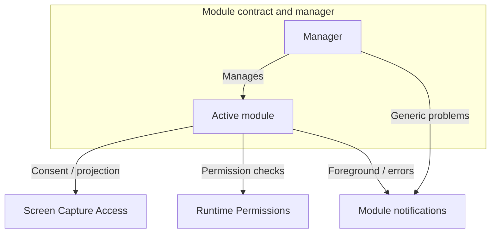

# Core

Core defines how a host app opens streaming modules, coordinates access to screen capture and runtime permissions, and presents streaming notifications.

Core has four components:

- [Streaming Module Contract and Manager](docs/module-contract-and-manager.md) defines streaming modules and manages their lifecycle.
- [Screen Capture Access](docs/screen-capture.md) coordinates screen-sharing consent and access to Android screen capture.
- [Runtime Permissions](docs/runtime-permissions.md) defines permission checks and Activity-owned permission requests.
- [Streaming Module Notifications](docs/notifications.md) defines foreground content and error delivery.

## Streaming Module Contract and Manager

`StreamingModule` is the abstract contract implemented by each streaming module. The host app registers module definitions with `StreamingModuleManager`, the application-process singleton that selects modules, routes commands, and coordinates shutdown.

A **module instance** is one opening of a registered module. The manager admits one instance to new work at a time. The module supplies a `StreamingModule.Controller` to own that instance's streaming behavior, UI, resources, and cleanup.

Opening a module and starting capture are separate operations. Opening prepares the module for use. An accepted Start request begins a **capture attempt** within that instance.

## Screen Capture Access

`ScreenCaptureAccess` coordinates consent requests and access to Android screen capture across the application process. An Activity-root consent host presents the app's explanation and Android's screen-sharing dialog. The module owns the capture attempt and starts capture after consent and media preparation succeed.

## Runtime Permissions

`RuntimePermission` defines checks for ordinary Android permissions. The host app supplies `RuntimePermissions` at the Activity root to own explanations, Android permission dialogs, and permission UI state. The module evaluates current permission and decides its next action after a request.

## Streaming Module Notifications

`StreamingModuleNotifications` is the contract for foreground content, error delivery, and notification settings destinations. The host app supplies a notification provider that implements it. The instance's Android Service owns foreground presentation, the manager owns generic instance warnings and failures, and the Controller owns detailed operation errors and recovery.

## How the components connect

A typical flow:

1. The host app selects a registered module, and the manager opens an instance.
2. A Start request reaches the Controller. The module checks its prerequisites and obtains screen-capture access when needed.
3. The module prepares its media work and streams.
4. A successful Stop ends capture. Exit or replacement closes the module instance and starts its cleanup.

The component guides describe architecture and lifecycle. KDoc defines the callable contracts.
