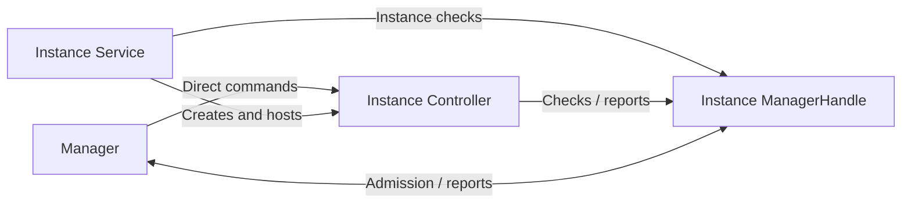
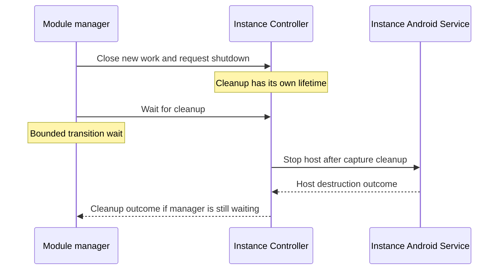

# Streaming Module Contract and Manager

[Core](../README.md)

`StreamingModule` defines a streaming module, and `StreamingModuleManager` selects and manages registered modules as an application-process singleton. The host app registers a definition for each available module.

A **module instance** is one opening of a registered definition. To open it, the manager reserves its identity and asks Android to start the module's declared Android Service. The module supplies a Controller that owns the instance's work and resources. The manager allows at most one instance to accept new work at a time.

Capture Start and a normal successful Stop operate inside the same instance. Restarting the module, or opening it again after closing it, creates a new instance with a new identity.

## Participants and relationships

- **Manager.** `StreamingModuleManager` governs opening, replacement, command routing, health observation, and shutdown requests for the application process.

- **Module definition.** The module implementation supplies a `StreamingModule` definition, and the app registers it in the manager's process-wide catalog. This description, also called a **descriptor**, identifies the module and names its Android Service class. The descriptor is reused across openings; each opening has its own instance.

- **Host Android Service.** `StreamingModuleService` is the abstract Android Service for streaming modules. Each module supplies a concrete subclass and declares it in its definition. The manager asks Android to start that class. The Service enters foreground and calls the module's Controller factory.

- **Controller.** The module supplies a concrete `StreamingModule.Controller`, created by its Android Service. The Controller executes commands and owns streaming, module UI, resources, and cleanup for one opening. The manager installs and starts it, sends commands directly to it, and requests its shutdown.

- **ManagerHandle.** `StreamingModule.Controller.ManagerHandle` connects one module instance's Android Service and Controller to `StreamingModuleManager`. The manager creates it when reserving the instance, before the Android Service receives the start request or the Controller exists. Both clients use its instance information and admission checks. Progress and failure reports reach the manager through the same handle, which stays bound to that instance through cleanup.

## How they collaborate

1. **Module opening.** The app selects a registered module. The manager resolves the choice, creates the instance identity and its manager handle, and asks Android to start the declared Android Service.
2. **Host preparation.** For an admitted opening, `StreamingModuleService` enters **waiting foreground**, its phase before capture, then invokes the module's Controller factory. The manager installs and starts the returned Controller while the instance still accepts work.
3. **Capture admission.** The Controller decides whether it can accept Start. An accepted Start begins a **capture attempt** within that instance, with the module coordinating any required [runtime permissions](runtime-permissions.md) and [screen-sharing consent](screen-capture.md).
4. **Capture preparation.** After consent, the module changes the same Android Service to `mediaProjection` foreground, with `microphone` when required. This happens before obtaining Android's screen-capture handle (`MediaProjection`). The module then prepares its media work and starts capture.
5. **Capture stop or module closure.** A normal successful Stop cleans up the attempt and can return the host to waiting foreground for another Start. Replacement, restart, and Exit close new module work and request Controller shutdown.

Waiting and capture are two foreground phases supported by the same Android Service and Controller.

## Identities and lifetimes

`StreamingModule` declares three identity types:

| Identity | Meaning |
| --- | --- |
| `StreamingModule.Id` | The registered module, reused across openings. |
| `StreamingModule.InstanceId` | One opening of that module. Restarting or reopening creates a new instance identity. |
| `StreamingModule.CaptureAttemptId` | One accepted capture Start within that instance. |

The Controller and manager handle belong to one module instance through its cleanup. The handle continues to describe that instance after admission closes and a replacement opens. Callbacks and cleanup retain their originating instance throughout replacement.

The manager routes Start; each Controller decides readiness and owns capture admission. The application's current module implementations serialize **one logical capture attempt at a time**, including preparation and consent when needed, capture, and declared attempt cleanup.

### Closing a module instance

Closing stops new work and asks the Controller to clean up the instance. Capture or cleanup failure can also close the whole instance. Cleanup has its own lifetime: it can begin before ordinary module work starts, or when that work has stopped progressing.

The Controller coordinates capture cleanup, then stops this instance's Android Service and waits for its destruction. The host's destruction notification belongs to that same Controller. Unexpected host loss also closes the instance, and its Controller retains cleanup ownership.

Replacement and Exit give the previous instance a bounded shutdown wait. The manager's wait ends independently of Controller cleanup. The manager can move on while old cleanup continues alongside a replacement instance.

The single-instance policy controls new work. Older physical resources may still be releasing when a replacement opens. Cleanup completion follows the release guarantees provided by the module's resource owners.

## Manager commands

Manager commands request changes to the module or capture lifecycle. The manager and Controller evaluate admission and readiness during processing. They can drop stale or busy requests. Any resulting effects appear in module behavior and manager state.

### Selection and restart

Selection chooses a registered module. The manager resolves an implicit choice from an available remembered module or the highest-priority registered module. Choosing a different module closes the current instance and opens a new one.

Selecting the same module leaves its existing instance in place, including after failure. Restart explicitly replaces that instance with a new opening of the same module. The restart remains bound to the instance it targeted.

During an opening or another lifecycle transition, the manager drops additional selection and restart requests. A later request can open a module once the transition ends.

### Capture Start, Stop, and recovery

**Start** asks the current Controller to begin capture within its module instance. The Controller decides whether the module is ready and owns the capture attempt that follows acceptance.

**Stop** targets one capture attempt. A normal successful Stop ends that attempt and leaves the module available. The attempt identity keeps a delayed Stop scoped to its original capture work.

**Recovery** asks the module to handle one of its operation errors within the same instance. The module defines whether recovery is available and which error it applies to.

### Exit

Exit closes new module work, cancels an opening, and returns while shutdown proceeds. It may apply to the application's module work or target one current instance. An instance-specific Exit remains scoped to that instance.

`Exiting` remains visible after the bounded shutdown wait ends, and a later selection can open a module again. The host app owns removal of its tasks. Task removal and media cleanup each have their own completion; `Exiting` records closure to new module work.

## Observable process and instance health

`StreamingModuleManager.State` is one observable snapshot of the manager lifecycle and the current instance's control health. `Running` and `Unresponsive` pair an instance identity with status reported by that instance.

Health describes whether Controller work is progressing. A Controller can be healthy while capture is idle. Capture and network readiness are separate from this control health.

| State | Meaning |
| --- | --- |
| `NoModule` | Idle state awaiting module selection. |
| `Switching` | Module selection, replacement, or startup is in progress. |
| `Running` | The current Controller is reporting fresh progress. |
| `Unresponsive` | Progress is stale; the retained capture summary is the last accepted report. |
| `Failed` | The instance is closed to new work. Its failure remains visible until the manager starts another lifecycle transition. |
| `Exiting` | Exit has closed new work. The bounded shutdown wait may be pending or finished. |

A change between `Running` and `Unresponsive` keeps the same module instance. Command admission follows the instance and transition state. Terminal failure closes new work and starts cleanup.

Replacement publishes `Switching`, and Exit publishes `Exiting`, while the previous instance may still be cleaning up. Reports remain bound to their originating instance. Observers receive the latest snapshot and can skip intermediate transitions.

The Controller reports a `StreamingModule.Status` capture summary. It describes capture activity, consumer presence, the current capture attempt, and any operation error. Capture activity and consumer presence evolve independently, and an operation error can leave the instance usable.

## Module UI and notifications

The Controller owns its module-specific UI. The manager presents the admitted current instance's installed UI, with host fallback content otherwise. The Controller retains ownership of module work and cleanup across rendering changes.

The [Streaming Module Notifications](notifications.md) contract connects a host-supplied notification provider to the instance's Android Service, manager, and Controller. Those owners select foreground, generic problem, and detailed error presentations for their respective lifetimes.
