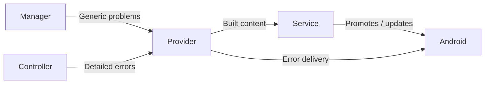

# Streaming Module Notifications

[Core](../README.md) · [Streaming Module Contract and Manager](module-contract-and-manager.md)

`StreamingModuleNotifications` defines foreground notification content, error delivery, and notification settings destinations. The host app supplies a **notification provider** that implements this contract for the application process. Each notification's lifecycle stays with the Android Service, manager, or Controller that selected its content and actions.

## Participants and relationships

- **Notification provider.** It returns foreground content to the requesting Android Service, delivers or clears owner-selected error presentations, and supplies channel settings destinations.

- **Instance Android Service.** `StreamingModuleService` owns foreground presentation for its module instance. It asks the provider to build content, then manages foreground promotion and notification updates through the instance's Service lifetime.

- **Manager.** `StreamingModuleManager` owns a generic problem presentation for the current instance. It follows control health and the instance's reported operation error through the application process.

- **Controller.** The module's `StreamingModule.Controller` selects any detailed operation errors it presents and owns their lifetime and offered recovery through resolution or instance shutdown.

- **Android.** Android manages notification visibility and user settings. Its delivery conditions apply to the presentation chosen by each owner.

The [module guide](module-contract-and-manager.md#participants-and-relationships) describes how the Service and Controller are created and bound to one instance.

## Foreground presentation

A registered module declares a foreground notification slot for its Android Service component. The manager validates the slot and supplies it through the instance's manager handle. The Service uses that same slot across waiting and capture phases.

The foreground lifecycle follows the instance and its capture attempts:

1. **Waiting.** The admitted Service enters waiting foreground before the Controller factory runs. Its presentation offers Exit for that instance.
2. **Capture preparation.** After consent, the same Service enters capture foreground before projection acquisition. Exit remains available while the module prepares capture.
3. **Confirmed capture.** Once the module confirms capture, the Service presents Stop for that capture attempt. Updating the content retains the existing foreground type mask.
4. **Stopping capture.** The Service can restore Exit content while capture cleanup continues. Waiting foreground restoration follows declared cleanup for a surviving admitted instance.
5. **Module shutdown.** Shutdown closes foreground updates. After declared capture cleanup settles, the Controller stops its Service and awaits destruction. Android removes the foreground state and notification when the Service stops.

The provider builds foreground content even while notification delivery is blocked; the Service performs foreground promotion and updates. The requesting owner handles presentation failures as part of its startup or capture work. [Screen Capture Access](screen-capture.md) describes consent, foreground preparation, and projection ownership.

## Error presentation

The manager and Controller each own their error presentation and its notification slot. Generic manager problems and detailed module errors can appear together.

The manager presents a generic warning when the current instance reports an operation error or becomes unresponsive. Terminal failure selects failure presentation. The manager clears its warning once control is responsive and the reported operation error is resolved. Transitions and Exit also clear its presentation.

The Controller selects detailed operation errors for presentation and can offer in-place recovery for its current error episode. It clears its presentation as the error resolves or the instance shuts down. Recovery stays within the same instance; the [manager guide](module-contract-and-manager.md#capture-start-stop-and-recovery) describes its lifecycle role.

The provider treats error delivery as best effort and attempts cancellation whenever the owner clears its presentation. Each owner determines subsequent updates according to its own state.

## Notification actions

Exit, Stop, and recovery buttons carry owner-supplied commands through `StreamingModuleActionReceiver` to the manager. Each button retains its original target:

| Button | Target and behavior |
| --- | --- |
| Exit | The module instance that supplied the foreground presentation. |
| Stop | The capture attempt confirmed by that instance. |
| Recovery | The instance and module-owned error episode that offered recovery. |

The manager checks current identity, admission, and lifecycle state. For Stop and recovery, the Controller validates its capture attempt or error episode before handling the routed command. Actions remain bound to their original targets through replacement and later capture attempts.

## Delivery and permissions

The current host provider creates the Streaming channel for foreground presentation and the Error channel for manager and module problems. It builds localized presentation and makes notification content taps open the app. It attempts error posting when the Error channel is available.

The provider checks the applicable notification grant, app-wide enablement, and the selected channel's availability. These checks read current delivery settings. Android controls visibility, the Service owns foreground admission, and the module and its resource owners report capture and cleanup outcomes.

[Runtime Permissions](runtime-permissions.md) owns notification permission checks and Activity-root request UI. Its notification check includes app-wide availability; the notification provider adds channel-aware checks. The provider supplies a resolvable channel settings destination when one is available, and module UI owns navigation to it.
