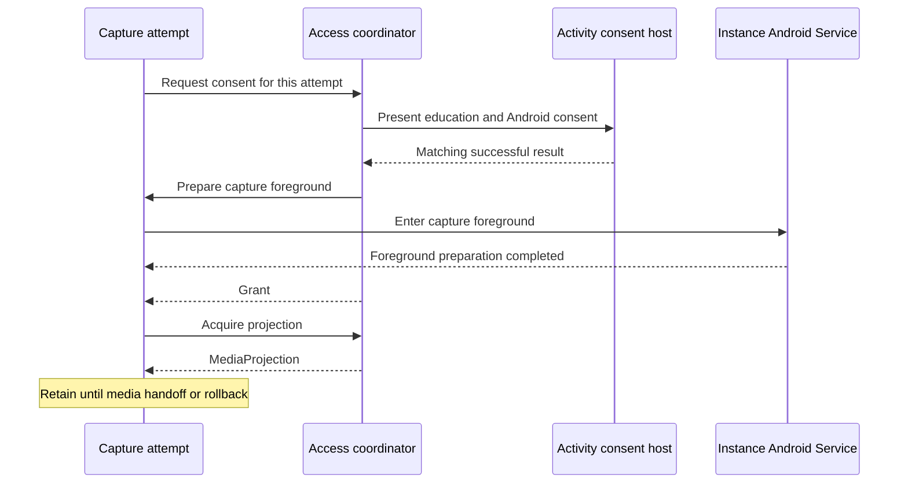

# Screen Capture Access

[Core](../README.md) · [Streaming Module Contract and Manager](module-contract-and-manager.md)

Screen Capture Access coordinates screen-sharing consent and access to Android screen capture. A **capture attempt** is one accepted Start within a module instance. The module obtains a `MediaProjection`, Android's handle for the approved screen or app area, to set up capture and owns the resulting media work.

The access coordinator manages consent requests and projection acquisition across the application process. The [Streaming Module Contract and Manager](module-contract-and-manager.md) governs which module instance may accept new work. Capture attempts connect these responsibilities and carry their own lifetime.

## Participants and relationships

- **Access coordinator.** `ScreenCaptureAccess` is the application-process access coordinator. Module instances obtain consent and a projection through it. It correlates pending consent with the right attempt and coordinates projection acquisition.

- **Activity consent host.** The app places `ScreenCaptureConsentHost` at the Activity root, outside individual module screens. It presents capture education and Android's consent UI, reports host eligibility, and returns results to the coordinator.

- **Capture attempt.** The module's Controller admits an attempt identified by `StreamingModule.CaptureAttemptId` and owns its lifetime. The attempt requests access, prepares foreground, and retains any returned projection until a media owner accepts it. Until handoff, failed startup leaves projection rollback with the attempt.

- **Instance Android Service.** This is the exact host for the attempt's module instance. It enters capture foreground before projection acquisition. Its connection to the manager remains bound to that instance through delayed consent results and replacement. [Streaming Module Notifications](notifications.md#foreground-presentation) describes its foreground presentation.

- **Media owner.** The module chooses the owner that accepts the projection and performs capture. Acceptance transfers ownership. Before that handoff, stopping an attempt-owned projection after unsuccessful startup is **raw projection rollback**. After handoff, the media owner owns operation, revocation handling, and cleanup.

The [module participants](module-contract-and-manager.md#participants-and-relationships) define the Controller, Android Service, and `ManagerHandle`. Projection ownership passes to the attempt when Screen Capture Access returns it; frame capture belongs to the module's media owner.

## How they collaborate

A **grant** carries consent delivered to the attempt after foreground preparation. The successful fresh-consent path is:

Consent is followed by foreground preparation on the module instance's Android Service. That preparation completes before grant delivery, and projection acquisition has its own admission. The attempt owns the projection returned for media startup. Capture starts only after the module has obtained the projection and prepared its own media work.

Consent requests can end during host admission, access admission, capture education, Android consent, or foreground preparation. The request result describes its outcome, with technical failure and cancellation reported separately.

## Host and request ownership

Fresh consent is presented by a selected, resumed Activity host. Android submission determines how host changes affect the request:

- **Before submission.** The request belongs to the selected host. A change in host selection ends the unsubmitted request and its presentation.

- **After submission.** The original request retains its single Android submission and result association across Activity pause, host changes, and recreation. A matching successful result can continue foreground preparation while the Activity is paused.

Consent remains bound to the capture attempt's lifetime after result delivery. Cancellation settles the coordinator's request; Android owns its system dialog's lifetime. Result delivery requires a matching live request.

Foreground promotion and grant delivery are separate steps. Cancellation after promotion can leave foreground rollback with the attempt before grant delivery. The attempt retains that cleanup responsibility independently of the Activity host.

Capture education records acceptance of the app explanation, and persisted acceptance controls later education displays. Android's dialog handles screen-sharing approval, and the module reports capture startup. Pending requests and grants belong to the current process; a new process starts fresh. Ordinary permission UI has its separate [Runtime Permissions](runtime-permissions.md) lifetime.

## Projection creation and handoff

A returned projection remains attempt-owned until the module's media owner accepts it. The module owns capture startup, and failure or cancellation before handoff leaves rollback with the attempt. After handoff, the media owner retains responsibility for the projection and its resources through operation and cleanup.

The coordinator admits one pending consent request or projection acquisition at a time. A delivered grant leaves projection acquisition subject to admission. Once acquisition begins, it remains coordinated until handoff or rollback has settled. The manager's [module admission and cleanup model](module-contract-and-manager.md#identities-and-lifetimes) remains separate.

The media owner manages the projection's active lifetime. Media startup, shutdown, and physical release follow the guarantees declared by their owners.

## Legacy reuse and cleanup

Older supported Android versions allow the coordinator to retain a consent result in process memory for a later attempt. Modern Android sessions always use fresh consent. Reuse still requires foreground preparation and a new projection acquisition. The next admitted request consumes the saved consent, so failed startup can require a new prompt.

The module qualifies a completed attempt for reuse after successful startup, a normal requested stop, and confirmed cleanup under the media owner's contract. Failure, revocation, or uncertain cleanup leaves that attempt ineligible for reuse. Consent reuse follows the media owner's release guarantees, and process restart requires fresh consent and projection acquisition.

## Consent observations

The app supplies `ConsentRequestObserver` to observe whether an attempt took saved consent or submitted a fresh Android consent request. Submission observations can also identify acceptance of capture education. These observations record consent-source decisions.

Consent results, foreground preparation, and media startup determine subsequent progress. A later cancellation or failure can settle the request or attempt before those stages. The coordinator isolates observer failures; the module remains responsible for the attempt's outcome, and the Activity host remains responsible for presenting the request.
