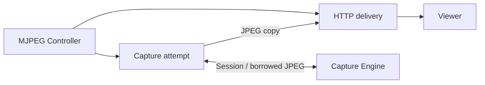
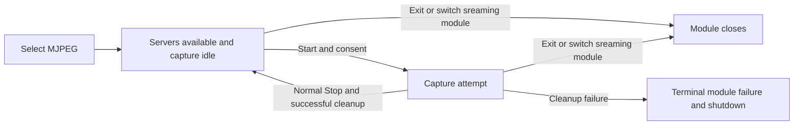

# MJPEG architecture

[Overview](../README.md) · [Usage](usage.md) · Architecture · [HTTP server](http-server.md)

MJPEG mode makes the Android screen or an approved app window available as JPEG images using the HTTP protocol. Selecting the mode prepares viewing; **Start stream** begins a separate capture attempt. A normal **Stop stream** ends capture while the selected HTTP server continues to serve the configured inactive image. Viewers connect independently and share the selected image.

This guide follows the path from [opening the mode](#opening-the-mode) through [capture](#starting-capture), [delivery](#delivering-images), and [closing](#stopping-and-closing). It then explains [settings and readiness](#settings-and-readiness) and the boundaries between observations at the app and viewer.

## The pieces

The app uses [Core module](../../core/README.md) to select and manage streaming modes, coordinate screen-sharing access and permissions, and present notifications. MJPEG mode supplies the behavior specific to capturing and serving images:

- **Module manager and Android Service.** Core's [manager](../../core/docs/module-contract-and-manager.md) opens a module instance for the selected mode. Its Android Service hosts that instance and maintains foreground presentation while it is available.
- **MJPEG Controller.** The Controller coordinates the instance's screen, settings, addresses, capture attempts, HTTP delivery and shutdown.
- **Capture attempt and Capture Engine.** An accepted Start creates an attempt. It obtains screen-sharing access and prepares capture; [Capture Engine](../../screen-capture-engine/README.md) turns the approved content into JPEG images.
- **HTTP delivery.** The server listens on selected device addresses, controls viewing access, holds the shared image and serves it to clients.
- **Viewer.** A browser or another HTTP client receives images. The packaged browser page also receives viewing state, including capture notices and display settings.

## Opening the mode

One opening of MJPEG mode creates a **module instance**. Its Service creates and hosts the Controller, and HTTP delivery belongs to the instance. The Controller discovers device addresses and prepares listeners for the selected, permitted addresses. This work can take time or fail before a usable server is available. A listener reported as **Listening** is open on the streaming device; a viewer also needs a route through the network to that address.

The Service stays in the foreground while the selected mode is waiting or capturing. Its notification offers Exit while waiting and Stop stream for the current capture when available. Android notification settings affect visibility. [Core notifications](../../core/docs/notifications.md#foreground-presentation) describes foreground presentation, and [Usage](usage.md#permissions-and-readiness) explains the permission actions and listener status shown in the app.

## Starting capture

Start is available when the current settings, selected addresses, permission and matching listener are ready and the previous capture has cleaned up. The Controller checks these conditions again when it receives the request. An older listening address can remain visible while a changed configuration is still being prepared.

For an accepted Start, the attempt uses [Core screen-capture access](../../core/docs/screen-capture.md) to obtain consent and the Android projection for the approved screen or app window. The instance Service prepares its capture foreground role. If consent is declined, access is busy or startup fails, that attempt ends; another explicit Start can be made when the sreaming module is ready again.

The attempt holds the projection until Capture Engine accepts it. A failed handoff leaves cleanup with the attempt; after a successful session creation, the Engine owns the projection and image production. Startup establishes readiness to produce images, so the first JPEG can arrive later. Capture can also pause and recover when image settings or capture conditions change. The [Engine usage guide](../../screen-capture-engine/docs/usage.md) describes its public capture contract.

## Delivering images

Capture Engine lends each JPEG for the duration of its callback. The sreaming module copies the bytes on the callback thread before returning, giving HTTP delivery an image it can retain and share. Each response keeps its chosen image valid while writing it. A stopped attempt can no longer publish delayed images.

HTTP delivery selects one shared image for viewers. During capture this can be the latest produced frame; when capture output is unavailable, **Inactive stream image** selects the logo or a retained frame. The retained frame may therefore expose the last captured screen after Stop. [Usage](usage.md#automation) explains that setting.

MJPEG readers advance to the latest selected image, skipping intermediate publications when they cannot keep up. Unchanged images can be repeated while capture is quiet. This avoids an unbounded queue of frames per slow reader, although memory and network use still depend on image sizes and active clients. [HTTP server](http-server.md#consume-images) describes the media responses and unavailable-image behavior.

The packaged page receives state separately from image data. A capture notice, an available image and the image actually rendered by the browser describe different observations. The [HTTP guide](http-server.md#websocket-state) defines the state protocol; [Usage](usage.md#browser-controls) explains browser recovery.

## Stopping and closing

**Stop stream** targets the current capture attempt. After a normal Stop, capture cleanup runs and the Service returns to its waiting foreground presentation. The instance's HTTP server and viewing credentials remain available, including access to the selected inactive image. A later Start creates a new capture attempt; a delayed Stop for an earlier attempt does not stop the new one.

Exit, switching modes and **Restart module** close the instance to new work and start cleanup of capture, HTTP delivery, address discovery and the Service. Restart opens a replacement that waits for another Start. A capture failure can leave the instance available after successful cleanup; capture cleanup failure terminates the instance and requests shutdown.

A shutdown request and a completed resource release are separate events. The manager waits within its transition limits, while the resource owners continue cleanup. A replacement can start while an older instance is still cleaning up. Capture cleanup waits for the Engine stop and frame-consumer completion, and the Engine's public stop contract defines its completion; some internal resources may finish releasing later. See [Core's Exit contract](../../core/docs/module-contract-and-manager.md#exit) and the [Engine lifecycle contract](../../screen-capture-engine/docs/usage.md#run-a-capture-session) for these completion boundaries.

## Settings and readiness

Saving a setting records the desired value. The Controller accepts changes according to the live or idle policy, and capture or HTTP delivery applies the accepted configuration. These are separate stages: a successful save establishes persistence, while the relevant owner makes application observable. Image settings can update during capture, and a frame already being processed can still use earlier parameters. Stream setup settings wait until capture cleanup succeeds. [Usage](usage.md#change-configuration) lists the apply timing for each setting.

Address filters can change listeners during capture. Permission checks govern which selected addresses can be prepared; an ordinary listener failure can leave other listeners and capture usable, and **Retry** targets the failed listener. Local listening alone does not establish remote reachability: routing, network isolation and viewer conditions also matter. [Core runtime permissions](../../core/docs/runtime-permissions.md) owns the shared permission flow, while [Usage](usage.md#permissions-and-readiness) covers the mode's actions.

Viewing credentials belong to HTTP delivery, separately from capture attempts and the app's local PIN display. Normal capture Start and Stop preserve them. Closing or restarting the mode, or changing applied access protection or the enabled PIN, replaces them. The [HTTP guide](http-server.md#viewing-credentials) defines their scope and use.

## Reading status

The manager's instance health describes the progress of the mode as a whole. A running instance can still be waiting for capture or a listener, and an unresponsive instance can recover when progress resumes. Capture, listener, permission and settings observations can reflect adjacent moments as each owner reports independently. The [Core health contract](../../core/docs/module-contract-and-manager.md#observable-process-and-instance-health) explains manager status; [Usage](usage.md#observe-state-and-failures) covers recovery in the app.

Statistics report image production and completed JPEG payload writes at the server. They do not establish that a peer received, decoded or displayed an image. Media and browser state also travel independently. Use the viewer to check the end-to-end result, and see [Usage statistics](usage.md#read-statistics) for the measurements and their limits.
