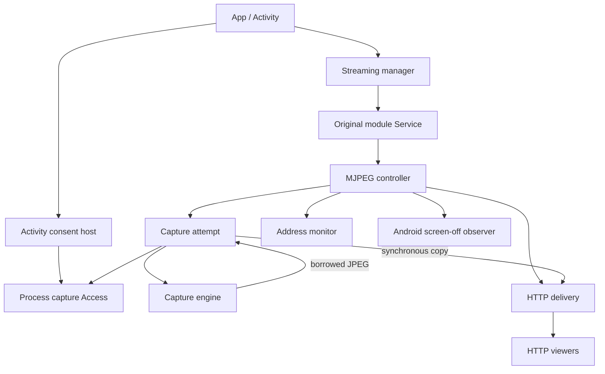
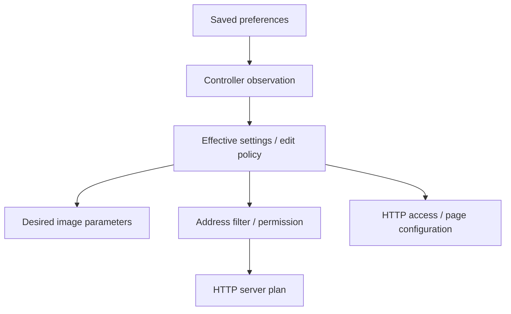

[Usage](usage.md) · Architecture · [Internals](../internal/README.md)

# MJPEG architecture

MJPEG connects one Android capture attempt to multiple HTTP viewers. Shared streaming infrastructure owns launch admission and Android coordination; the native controller owns its module's working state and cleanup. HTTP can remain open while capture is idle or stopped. This separation lets Stop end screen production without treating every browser response or address listener as a new capture session.

Read [Usage](usage.md) for controls, configuration and host integration, the [HTTP viewing API](http-viewing-api.md) for client-facing routes/state, and the [internal pages](../internal/README.md) for exact algorithms and outcomes. This page explains how the components fit together; the internal pages extend these technical foundations with exact implementation contracts.

## Components and boundaries

The arrows show interaction. Settings, manager and `ScreenCaptureAccess` live at process scope; the consent host belongs to the Activity. Each controller owns its address monitor, screen-off observer and HTTP delivery and retains the latest capture attempt for cleanup. Its original Android Service retains the controller reference and performs platform foreground calls, without a separate media worker.

| Component | Responsibility |
| --- | --- |
| `:app` | Application DI, Activity/bootstrap/Exit, projection consent hosting, shared ordinary-permission UI, module recovery UI and notification presentation. |
| `:streaming-core` | Registered module manager, instance/attempt API, Service base, notification interface/actions, selection/education settings, capture Access and the typed ordinary-permission port. |
| `:common` | Shared UI, analytics, preference storage and helpers. |
| `:mjpeg` | Descriptor/Service/controller, saved mode settings, address discovery, capture session and engine adapter, HTTP delivery and current screen. |
| `:screen-capture-engine` | Projection-backed image production, transformations, JPEG encoding and bounded borrowed-frame delivery. |

MJPEG, RTSP and PlayStore-only WebRTC integrate directly with the same manager, Service base and Controller contract. Each module owns its media, protocol, settings and per-instance workers; the shared Activity hosts projection consent and ordinary permission UI. RTSP/WebRTC retain their existing media internals and best-effort teardown. MJPEG's capture and cleanup contracts are described here; [Streaming host](../internal/01-lifecycle/streaming-host.md#activity-lifetime-and-module-boundaries) explains the shared boundaries.

## Lifetimes and identities

An immutable module descriptor identifies a selectable mode without opening resources. The manager reserves a launch before dispatching the descriptor's Service. Only an accepted delivery invokes the Service factory and installs an inert controller; ordinary work starts after installation.

| Identity | Lifetime and purpose |
| --- | --- |
| Module `Id` | Stable catalog selection, `MJPEG` for native MJPEG. |
| `InstanceId` | One module launch; replacement/restart gets a new UUID. |
| `CaptureAttemptId` | One accepted Start in that instance; retained through attempt cleanup. |
| Discovery address ID | One observed IP plus IPv6 scope, retained across filters/metadata until confirmed disappearance. |
| HTTP server UUID | One planned address/port incarnation; physical retries preserve it. |
| Physical listener identity | One bind attempt/CIO engine; request admission addresses this exact listener. |
| Capture generation identity | One production epoch selected by the capture attempt; suspension/recovery can replace it within the same attempt. |
| Credential generation | One runtime viewing-authorization epoch; independent of capture. |

These identities solve different races. Exact attempt Stop cannot end replacement capture. A stale server Retry cannot reset a replacement server. Late JPEG copies cannot restore an image after their capture generation is revoked. Old WebSocket state cannot authorize a later credential generation. [Coordination](../internal/01-lifecycle/coordination.md) and [HTTP delivery](../internal/03-delivery/http-delivery.md) describe where each comparison occurs.

## Control and observation

The manager handles process transitions on Main, Android's main thread. Its Runtime binds admission and reports to the original launch. The native controller serializes commands, settings, address changes and capture observations in one event loop on the background Default dispatcher. Each owner checks whether new work is still allowed when admitting it; shutdown closes admission independently of that loop and begins cleanup even if the loop is blocked.

The app derives generic recovery UI from manager state and routes Restart directly with that state's instance ID. Operation diagnostics travel in `Status.errorMessage`; heartbeat loss and terminal failure remain manager states. Error-notification delivery is process-owned and independent of rendered UI. [Usage](usage.md#observe-state-and-failures) describes the resulting cards and recovery controls.

The capture attempt runs in controller scope and continues entered cleanup in `NonCancellable`. HTTP has its own runtime on the IO dispatcher and control monitor; discovery has independent scan/close work. These owners can begin cleanup independently, although one stuck obligation can leave total cleanup pending. Exact scheduling and admission rules are in [Coordination](../internal/01-lifecycle/coordination.md).

StateFlows provide latest snapshots, not a guaranteed history of every transition. Manager state and current instance ID are not an atomic pair. Capture state, HTTP Info, permission and saved settings also come from separate observations. Each owner reads the facts it needs at its own admission boundary rather than assuming a global snapshot.

### Readiness across boundaries

A host or viewer crosses several independently observed boundaries. Use the fact owned by that boundary rather than deriving all readiness from one phase:

| Observed fact | What it establishes | What it does not establish |
| --- | --- | --- |
| Manager Running | The admitted module reports live control work. | Capture, a matching listener or an image is ready. |
| Start command returned | The caller finished issuing Start; a stale or unadmitted target can be ignored. | Routing/admission, consent, engine startup or a first JPEG. |
| Capture `isStreaming` | Engine startup succeeded and the attempt has not accepted Stop/failure/cleanup. It can remain true while Suspended. | A selected image, current viewer or successful network write. |
| HTTP Listening / browser `hasImage` | Respectively, a listener started / a selected image exists. | External reachability, a new capture frame or repaint. |
| Completed JPEG payload counter | The output path completed that payload's bytes. | Peer receipt, decode or display. |
| Capture Stop returned | The caller finished issuing exact-attempt Stop; a stale or unadmitted target can be ignored. | Routing/admission, JPEG callback completion or capture cleanup. |
| Exit wait ended | The bounded wait ended; cancelling its caller ends only that wait. | Every media, foreground, graphics or socket obligation completed successfully. |

These distinctions explain the [usage and recovery path](usage.md#troubleshoot-viewing-and-capture). A custom viewer follows the separate [HTTP viewing API](http-viewing-api.md); it does not route Android capture commands through WebSocket.

### Saved, accepted and applied values

Saved values become effective only after controller observation and edit-policy checks. Backend, HTTP port and access settings other than PIN visibility stay fixed through consent, capture and cleanup; live fields can change. The live PIN-visibility preference affects only the native screen and does not update HTTP configuration. Successful cleanup allows deferred setup values to apply. Copy URL uses applied HTTP credentials, and engine convergence follows its own frame-metadata contract. [Settings](../internal/02-configuration/settings.md) and [Coordination](../internal/01-lifecycle/coordination.md#effective-settings-and-saves) describe these boundaries.

## Capture and image delivery

The capture attempt obtains consent, promotes its original Service to foreground, then creates the projection. Successful engine construction transfers projection ownership to the engine. [MjpegCaptureSession](../src/main/kotlin/io/screenstream/mjpeg/MjpegCaptureSession.kt) owns one immutable snapshot of capture/cleanup outcomes and the capture generation. Its concrete transitions commit the effective status and generation together; HTTP applies that pair without deciding or returning generation identity. State wakeups and borrowed JPEG callbacks sample fresh engine state under one session gate. The callback captures the committed generation there, then forwards it with byte count and synchronous copier outside the gate; recovery admission does not wait for the controller queue. The engine owns geometry, metrics, configuration/output metadata, timing and encoding; [Module lifecycle](../internal/01-lifecycle/module-lifecycle.md) describes startup and cleanup.

The copier is borrowed authority: it is usable only on the frame callback's thread before the callback returns. HTTP can decline an offer or copy it once into owned storage outside its monitors, then checks generation identity before publishing. The selected immutable byte prefix can be leased by multiple responses. Old frames remain valid for existing writers until their leases end; selection changes do not overwrite them.

Each media response pins its initial JPEG before sending headers. A single JPEG response sends that pin; MJPEG advances to the newest selected frame and skips intermediate publications. If there is no newer publication, MJPEG can repeat the current JPEG after one second without another capture/encode. This bounds ordinary frame queuing, not total byte memory: JPEG sizes, active response leases and copies outside the module still matter. [JPEG delivery](../internal/03-delivery/jpeg-delivery.md) owns the pool, lease and write rules.

Capture phase and selected image availability are separate. One latest real frame is retained until replacement or HTTP disposal. Whenever no real frame belongs to the current capture generation, the common fallback selects none, logo, or that retained frame (logo if absent). This applies before the first frame, during consent, suspension, Stop and failure; fallback edits do not replace a current real frame. An existing MJPEG reader can wait for image availability; a new request without a pin receives 503. A capture failure remains Failed through successful cleanup until a new accepted attempt.

## HTTP and networks

Discovery publishes an immutable inventory of supported scoped IPs and their interface alternatives, retaining candidates whose absence a scan cannot confirm. The controller starts discovery on first settings acceptance, selects one matching interface per scoped IP using its effective filter, and passes permitted addresses to HTTP. Filter changes select synchronously from its processed inventory. Start also selects from the freshest inventory and requires matching permitted addresses in both fresh and retained selections plus a Listening server at the applied port. The monitor uses one admission gate for callback metadata and observer handles and owns their independent cleanup; its native source only reads interface evidence. See [Network addresses](../internal/02-configuration/network-addresses.md) and [Start readiness](../internal/01-lifecycle/coordination.md#discovery-plan-and-start-readiness).

Each scoped IP/port has a socket owner serializing bind and cleanup. A bind failure affects that server, while uncertain listener cleanup stops delivery to prevent a successor from assuming the socket is free. Retry targets the exact failed server UUID. [HTTP delivery](../internal/03-delivery/http-delivery.md) defines retry, cleanup and transport limits.

Listeners share access, routes and selected JPEG. Credential rotation prevents old readers from acquiring another frame and revokes old WebSockets; an acquired JPEG lease may still finish. Sampled endpoint history rows are separate from physical response jobs. Counters include completed payload writes from active and finished responses, without proving network receipt or display. See [HTTP accounting](../internal/03-delivery/http-delivery.md#client-history-and-statistics).

The browser is an independent viewer. Separate connection, media, access, viewport, presentation and picture-in-picture owners coordinate through the page; they do not issue capture commands. The desktop preview has its own virtual-device, HTTP/WebSocket, build/watch and panel owners and does not run Android capture or Ktor/CIO. The [HTTP viewing API](http-viewing-api.md) owns the client protocol; [Web client](../internal/03-delivery/web-client.md) extends it with transport and browser behavior; the existing [build guide](../tools/web-client/README.md) owns authored/generated assets and preview operation.

## Shutdown and completion evidence

There are three completion boundaries:

1. **Capture Stop** requests cancellation of the exact attempt; the module remains open.
2. **Capture session cleanup** settles available media, consumer, foreground and projection-guard obligations. Successful engine stop confirms logical shutdown and projection-stop return, not every internal engine resource release.
3. **Module cleanup** joins admitted controller work, HTTP and monitor close, capture cleanup, final foreground removal and original Service destruction.

Manager deadlines bound waiting and allow UI progress while cleanup is unconfirmed; owners continue their cleanup independently. A deadline does not prove physical resource release or successful cleanup. Failed manager outcomes are retained; Unresponsive can recover with a fresh report. See [Streaming host](../internal/01-lifecycle/streaming-host.md#reports-clocks-and-deadlines) and [Module lifecycle](../internal/01-lifecycle/module-lifecycle.md#controller-shutdown-and-complete-module-cleanup).

Device/OEM lifecycle, browser compatibility, memory/FD behavior and rendering require qualification in the relevant environment. The [testing guide](../internal/04-testing/testing.md) defines verification scope and evidence requirements; results belong with the change or release being verified.
