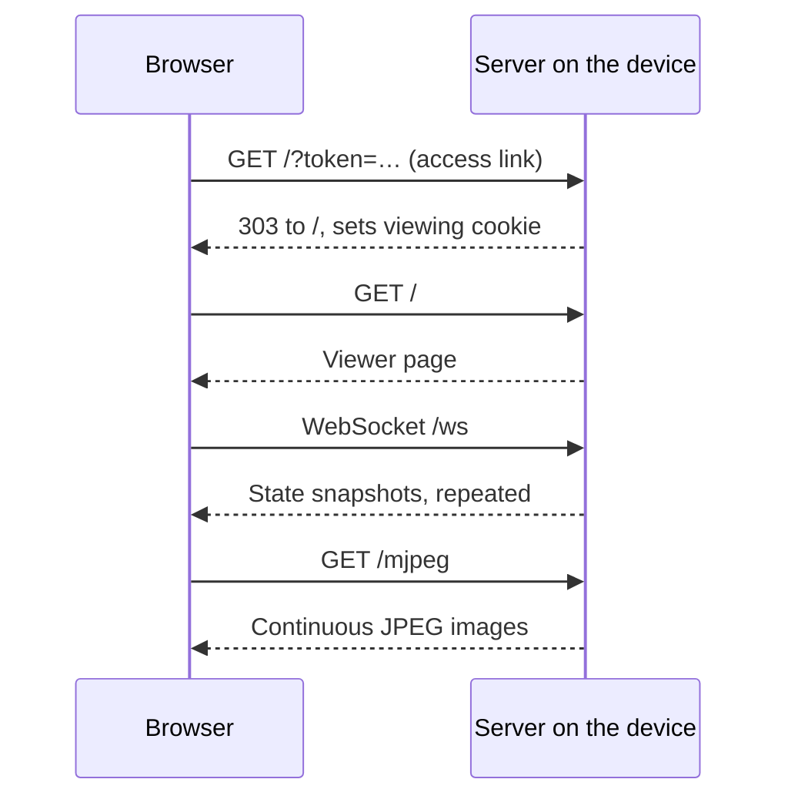

# MJPEG HTTP server and browser viewer

[Overview](../README.md) · [Usage](usage.md) · [Architecture](architecture.md) · HTTP server

While MJPEG mode is open, the app runs a small web server on the Android device. Browsers and other HTTP clients connect to it directly over the network to watch the screen. The server provides four things:

- a built-in **viewer page** that a browser opens from the shared link
- **image routes** that return the screen as a single JPEG picture or as a continuous MJPEG stream
- **PIN verification** for protected streams
- a read-only **state connection** that tells the viewer page about access, capture notices and appearance settings

The server and screen sharing have separate lifetimes. The server starts when the mode opens, so viewers can load the page and authorize before you press **Start stream**. Starting capture supplies live screen images. Stopping it leaves the server running, and it keeps serving the configured inactive image (the app logo or the last captured frame) until you start again or leave the mode. All viewers see the same image, and each one connects independently.

Viewers connect straight to one of the device's addresses over plain, unencrypted HTTP. No relay or cloud service carries the stream. Any client with a network route to a listed address can connect. Usually that means the same Wi-Fi, but the app can also offer VPN, routed or non-private addresses (see [Connection](usage.md#connection)). [Usage](usage.md) explains how to share, protect and watch a stream. This guide explains how the server behaves and describes the HTTP contract that a custom viewer or image client must follow.

## Contents

- [Key terms](#key-terms)
- [How a browser views a stream](#how-a-browser-views-a-stream)
- [Server principles](#server-principles)
- [Reference](#reference)
  - [Links the app shares](#links-the-app-shares)
  - [Routes](#routes)
  - [Host and Origin checks](#host-and-origin-checks)
  - [Access and credentials](#access-and-credentials)
  - [PIN verification](#pin-verification)
  - [Images](#images)
  - [External media clients and CORS](#external-media-clients-and-cors)
  - [State connection](#state-connection)
  - [The built-in viewer page](#the-built-in-viewer-page)
  - [Errors at a glance](#errors-at-a-glance)
- [Security considerations](#security-considerations)

## Key terms

| Term | Meaning |
| --- | --- |
| **Listener** | The server socket on one device address. The app shows one link for each listening address, and all of them use the same port (8080 by default). |
| **Selected image** | The single JPEG that the server currently offers to every viewer. |
| **Image kind** | The source of the selected image: `live` (the current capture), `retained` (an earlier captured frame, used when no current frame exists and **Inactive stream image** is set to Last frame), `logo` (the app logo) or `none`. |
| **Request authority** | The host and port that a request is addressed to, sent in the HTTP `Host` header. |
| **Origin** | The scheme, host and port of the page that makes a browser request, for example `http://192.168.1.23:8080`. |
| **Token** | The secret `token` query value carried by access links on a protected stream. |
| **Viewing cookie** | The `screenstream_access` cookie a browser receives after it opens a valid access link or enters the correct PIN. |
| **Snapshot** | One JSON message on the state connection. Each snapshot describes the complete current viewing state. |

## How a browser views a stream

The viewer page loads, opens the state connection, and requests images once the state says an image is available. In the diagram, each arrow is one request or response between the browser and the device.



Without protection, the access-link step is skipped and the link is just the address, such as `http://192.168.1.23:8080/`. With protection, a viewer who opens the plain address is asked for the PIN. The page sends the PIN to `/pin`, receives the viewing cookie, and then reconnects to `/ws`.

## Server principles

- **One image for everyone.** The server holds a single selected image and gives it to every image request. A stream reader always moves on to the newest image. When a reader can't keep up, it skips intermediate images instead of building up a backlog.
- **State and images travel separately.** Snapshots and images arrive on different connections and in no fixed order. A notice such as "stopped" doesn't show which picture a viewer is currently displaying.
- **Access is checked on every request.** The viewer page itself is public. Images and state require open access or a valid credential. When credentials change, the server ends existing image streams and state connections.
- **Direct addressing only.** Requests must address a listener by its numeric IP address and port, over plain HTTP/1.1. DNS names, reverse proxies, port forwarding with a different authority and `https://` don't work.
- **Viewers can only watch.** No HTTP route starts, stops or configures capture. Those controls exist only in the app on the device.

## Reference

### Links the app shares

The app builds links from each listed address and the shared port. It also offers direct MJPEG and JPEG variants of each link.

| Link | Plain address | Access link (protected stream) |
| --- | --- | --- |
| Viewer page | `http://192.168.1.23:8080/` | `http://192.168.1.23:8080/?token=<token>` |
| MJPEG stream | `http://192.168.1.23:8080/mjpeg` | `http://192.168.1.23:8080/mjpeg?token=<token>` |
| Single JPEG | `http://192.168.1.23:8080/jpeg` | `http://192.168.1.23:8080/jpeg?token=<token>` |

On an open stream, every link is the plain address. On a protected stream, an address offers a ready **access link** once it is listening with the current protection in effect. Copy, share and QR then carry the token. Until then, and for addresses that can't be written portably in a link, such as deprecated IPv6 site-local addresses (`fec0::/10`), those actions use the plain address, and viewers are asked for the PIN.

IPv6 addresses appear in brackets, as in `http://[2001:db8::23]:8080/`. Treat the token as an opaque value and copy it exactly as given.

### Routes

| Request | Purpose | Success |
| --- | --- | --- |
| `GET /` | Viewer page, which is public. It's gzip-compressed when the browser accepts it. | `200`, `text/html` |
| `GET /?token=<token>` | Exchanges an access link for a viewing cookie. | `303 See Other` to `/` |
| `GET /favicon.ico` | Browser icon, which is public. | `200`, `image/x-icon` |
| `POST /pin` | Verifies a PIN. | `204 No Content` |
| `GET /jpeg` | Returns one JPEG image. | `200`, `image/jpeg` |
| `GET /mjpeg` | Returns a continuous MJPEG stream. | `200`, `multipart/x-mixed-replace` |
| `OPTIONS /jpeg`, `OPTIONS /mjpeg` | CORS preflight. | `204 No Content` |
| `GET /ws` with a WebSocket upgrade | Read-only state snapshots. | `101 Switching Protocols` |

Requests to other paths return `404`. A known path called with an unsupported method returns `405` with an `Allow` header:

| Path | `Allow` |
| --- | --- |
| `/`, `/favicon.ico`, `/ws` | `GET` |
| `/pin` | `POST` |
| `/jpeg`, `/mjpeg` | `GET, OPTIONS` |

`HEAD` falls under this rule and isn't supported. Image routes ignore `Range` and always send complete images, never `206` partial content. The server reads only the `token` query parameter and ignores all others.

Every response carries these headers:

| Header | Value |
| --- | --- |
| `Cache-Control` | `no-store` |
| `X-Content-Type-Options` | `nosniff` |
| `Referrer-Policy` | `no-referrer` when the request URL contains `token`, otherwise `same-origin` |
| `Server` | `ScreenStream` |
| `Date` | The response time |

### Host and Origin checks

The server checks the request authority before it routes a request, so these rules apply to every path.

- Send exactly one `Host` header containing the listener's numeric IP address and port, as in `192.168.1.23:8080` or `[2001:db8::23]:8080`. The port is always required because the app never uses port 80.
- A listener on a loopback address also accepts `localhost` with the port.
- A missing, repeated or malformed `Host` returns `400`. Malformed values include those with userinfo, a path, a query or a non-numeric port.
- A well-formed `Host` that names something else returns `403`. Examples are a DNS name, another address, another port, or the authority used by a proxy or port forward.
- `Forwarded` and `X-Forwarded-*` headers are ignored.

Two routes also check the browser origin:

| Route | Required origin evidence |
| --- | --- |
| `POST /pin` | An `Origin` header that equals the server's own origin. If `Origin` is absent, a `Referer` from the same origin is accepted, path included. Anything else returns `403`. |
| `/ws` | An `Origin` header that equals the server's own origin. `Referer` isn't accepted. A missing or different origin closes the connection with code `1008` after the upgrade. |

The server's own origin is `http://` plus the host and port from the `Host` header. Host spellings are compared as text, so use the same spelling in `Host` and `Origin`. This matters for IPv6, where two different spellings can name the same address. Native clients that call `/pin` or `/ws` must add a matching `Origin` header themselves. Image routes follow the separate [cross-origin rules](#external-media-clients-and-cors).

### Access and credentials

A stream is either **open**, with no PIN, or **protected**, with PIN protection on in the app. On an open stream, every image and state request is allowed, and `POST /pin` returns `204` without setting a cookie.

A protected stream accepts three kinds of credential:

| Credential | How a client sends it | Accepted by |
| --- | --- | --- |
| Token | `token` query parameter | `/jpeg` and `/mjpeg`. `/` exchanges it for the viewing cookie. |
| Viewing cookie | `Cookie: screenstream_access=<value>` | `/ws`, and `/jpeg` and `/mjpeg` for same-origin or non-browser requests |
| PIN | `pin` field in `POST /pin` | `/pin` only. A correct PIN returns the viewing cookie. |

`/ws` doesn't accept the token. A client must first exchange the token or verify the PIN to get the cookie.

#### Exchanging an access link

Any `GET /` request that contains `token` receives a `303` redirect to `/`, even when the token is empty or wrong. A valid token also sets the viewing cookie. An invalid token sets nothing and leaves any cookie the browser already has in place. The cookie header is:

```text
Set-Cookie: screenstream_access=<value>; Path=/; HttpOnly; SameSite=Lax
```

The cookie belongs to the browser session and to one host. It has no expiry, `Domain` or `Secure` attribute. A browser therefore needs a separate authorization for each device address it uses. Repeating a valid exchange or a correct PIN returns the same cookie, so other tabs stay authorized.

#### When credentials change

The token and the cookie change together. They stay valid until one of these events:

| Event on the device | Credentials | Open image streams and state connections |
| --- | --- | --- |
| Start or Stop capture | Unchanged | Continue |
| Change appearance, inactive image or PIN-attempt settings | Unchanged | Continue |
| Change the PIN, or turn protection on | Replaced | Image streams end after the image being sent. State connections end. |
| Turn protection off | Removed, so access is open | Same as above. Reconnecting clients need no credentials. |
| Close and reopen the mode, or restart it | Newly generated, even with the same PIN | The old server shuts down with all its connections. |

A PIN block applies only to PIN entry. A cookie or token that is already valid keeps working during a block.

### PIN verification

To verify a PIN, send one form field named `pin` that holds exactly six ASCII digits, including any leading zeros:

```http
POST /pin HTTP/1.1
Host: 192.168.1.23:8080
Origin: http://192.168.1.23:8080
Content-Type: application/x-www-form-urlencoded

pin=048213
```

Other form fields are allowed. Keep the encoded body within 256 bytes. On a protected stream, a body with another content type, a missing or repeated `pin`, a malformed value or too many bytes counts as a wrong PIN. If the request body can't be read, the connection fails without a defined status.

| Status | Meaning |
| --- | --- |
| `204` | The PIN is correct and the response sets the viewing cookie. On an open stream, any submission returns `204` without a cookie. |
| `403` | The PIN is wrong, or the `Origin`/`Referer` check failed. |
| `429` with `Retry-After` | PIN entry from this device must wait. `Retry-After` gives the remaining wait in whole seconds, rounded up. |

When **Limit PIN attempts** is on (the default), the fifth wrong entry from one IP address returns `429` and starts a block. The block lasts for the duration set in the app, 3 minutes by default, and covers that IP address on every listening address. During the block, even the correct PIN returns `429`, and further requests don't extend the deadline. A correct PIN outside a block clears the wrong-entry count.

Blocks follow the IP address of the direct connection, so devices that reach the server through one shared address share a block. The server keeps wrong-entry records for at most 1,024 IP addresses at a time. While all 1,024 records are live, a device without a record receives `429` before its PIN is checked, even when the PIN is correct. Its `Retry-After` gives the time until the earliest record expires. A slot can free up sooner, for example when a device that has a record enters the correct PIN.

### Images

#### Single JPEG

`GET /jpeg` returns the selected image as one `image/jpeg` response with a `Content-Length`. Back-to-back requests can return the same image when nothing new has been captured.

#### MJPEG stream

`GET /mjpeg` returns `Content-Type: multipart/x-mixed-replace; boundary=screenstream-jpeg` and keeps the response open. Every part is a complete JPEG with its own length. Lines end with CR LF:

```text
--screenstream-jpeg
Content-Type: image/jpeg
Content-Length: 48213

<48213 bytes of JPEG data>
--screenstream-jpeg
Content-Type: image/jpeg
Content-Length: 47980

<47980 bytes of JPEG data>
--screenstream-jpeg
…
```

Read the boundary from the response `Content-Type`, and read each payload using its `Content-Length`, across as many network reads as needed. The server never sends a closing boundary (`--screenstream-jpeg--`). The stream simply ends.

#### What clients receive

- **Latest image.** Each new part carries the image that is selected at that moment. A reader that falls behind skips to the newest image.
- **Repeats.** While the selected image doesn't change, for example when the stream is stopped or the screen is still, the stream sends the same image again about once a second.
- **Across Stop and Start.** An open stream survives a capture Stop and the next Start. Its content switches between `live`, `retained` and `logo` images as the selection changes. Image clients receive the logo as an ordinary JPEG.
- **When a stream ends.** A stream ends when the client disconnects, when credentials change (after the image being sent), when its address stops being served, or when the mode closes. A response can also end partway through an image, including a `/jpeg` response that ends before its announced `Content-Length`. Start a new request to get a complete image.

#### Availability

The server checks access before it checks image availability. If a request lacks the required credentials, it receives `403` even when no image is available. If an authorized request arrives while the server can't serve an image, for example while the mode is closing, it receives `503` with `Retry-After: 1`. [Inactive stream image](usage.md#automation) chooses between the logo and the last frame when no live image exists.

### External media clients and CORS

Cross-Origin Resource Sharing (CORS) decides whether a script on another website may read a response. The image routes use one fixed policy:

| Header | `GET /jpeg`, `GET /mjpeg` | `OPTIONS /jpeg`, `OPTIONS /mjpeg` |
| --- | --- | --- |
| `Access-Control-Allow-Origin` | `*` | `*` |
| `Access-Control-Expose-Headers` | `Content-Length, Content-Range, Retry-After` | — |
| `Access-Control-Allow-Methods` | — | `GET, OPTIONS` |
| `Access-Control-Allow-Headers` | — | `Content-Type, Range` |
| `Allow` | — | `GET, OPTIONS` |

`GET` responses carry these headers on `403` and `503` as well, so a script can read the status and `Retry-After`. `OPTIONS` always returns the same `204` and headers, whatever the preflight asks for. The server doesn't send `Access-Control-Allow-Credentials`.

On a protected stream, the server ignores the viewing cookie on any image request that looks cross-origin. A request counts as cross-origin when any of these is true:

- an `Origin` header (including `null`) differs from the server's origin
- `Sec-Fetch-Site` is something other than `same-origin` or `none`
- `Referer` comes from another origin
- any of those headers is repeated

Requests without these headers, such as those from native clients or a link typed into the address bar, can use the cookie. External web pages should rely on the token in the copied link instead.

Display a stream on your own page:

```html
" alt="Shared screen">
```

Read one image from a script:

```javascript
const response = await fetch(copiedJpegLink);
if (!response.ok) {
  // 403: access denied; 503: retry after the Retry-After seconds
  throw new Error(`JPEG request failed: ${response.status}`);
}
const jpeg = await response.blob();
```

Don't set `credentials: "include"`. The wildcard CORS policy doesn't allow credentialed requests, so the browser would block the response.

Save one image from a command line:

```sh
curl -o screen.jpg "http://192.168.1.23:8080/jpeg?token=<token>"
```

Browsers apply their own network rules on top of these headers:

- **HTTPS pages.** A page served over HTTPS generally can't use these plain-HTTP links because of mixed-content blocking.
- **Public sites and private addresses.** Chrome can require a Local Network Access permission before a public website contacts a private or loopback address. After that permission is granted, some local requests are exempt from mixed-content blocking.

Chrome's [Local Network Access guide](https://developer.chrome.com/docs/modern-web-guidance/guides/security/local-network-access) describes the current rules. Test in the browsers and networks you target.

### State connection

The viewer page learns about access, capture and appearance through a WebSocket at `ws://<address>:<port>/ws`. A custom viewer can use the same connection.

**Connecting.** The request needs a matching `Origin` header. On a protected stream it also needs the viewing cookie. The connection is read-only: sending a text or binary message closes it with code `1008`. The server sends WebSocket pings, which browsers and common WebSocket libraries answer automatically. A client that stops answering pings is disconnected.

**Denied access.** If a request lacks the required credentials, the server sends one message and then closes normally with code `1000`:

```json
{ "access": "pin_required" }
```

```json
{ "access": "blocked", "retryAfterMs": 154000 }
```

`blocked` means that PIN entry from this device must wait for `retryAfterMs` milliseconds. That covers a PIN block and a wait for room in the attempt history.

**Authorized snapshots.** Once a client is admitted, the server sends a snapshot immediately, then another after each change. While nothing changes, it repeats the current snapshot about every two seconds, so a silent connection points to a problem. Every snapshot is complete. Intermediate changes can be skipped, so apply the latest snapshot as the whole state.

```json
{
  "access": "open",
  "notice": null,
  "hasImage": true,
  "imageKind": "live",
  "display": {
    "background": "#101418",
    "title": "Android device",
    "titleEnabled": true,
    "titleLayout": { "position": "top", "presentation": "overlay", "autoHide": true },
    "controlsLayout": { "position": "bottom", "presentation": "overlay", "autoHide": true }
  }
}
```

| Field | Values |
| --- | --- |
| `access` | `open` when no PIN is required, `authorized` when the cookie was accepted |
| `notice` | `null`, `permission_required`, `stopped`, `paused` or `failed` (see below) |
| `hasImage` | `true` unless `imageKind` is `none` |
| `imageKind` | `live`, `retained`, `logo` or `none` (see [Key terms](#key-terms)) |
| `display.background` | Page background as `#RRGGBB` |
| `display.title`, `display.titleEnabled` | Stream name text and whether it's shown |
| `display.titleLayout`, `display.controlsLayout` | `position` (`top` or `bottom`), `presentation` (`overlay` or `bar`), `autoHide` (Boolean) |

| `notice` | Meaning |
| --- | --- |
| `null` | Capture is starting or running. |
| `permission_required` | The device is waiting for someone to confirm Android's screen-sharing prompt. |
| `stopped` | Capture isn't running. It hasn't started since the mode opened, is stopping, or has stopped. |
| `paused` | Capture is paused on the device, for example because the image settings leave nothing to capture. |
| `failed` | The last capture attempt failed. The notice stays until the next Start or until the mode closes. A failed cleanup closes the mode by itself. |

The notice and the image kind are independent. A `stopped` notice can come with a `logo` or `retained` image.

**When the connection ends.** The server ends the connection when credentials change, when its address stops being served, or when the mode closes. Reconnect and read the first message to find out whether the client must authorize again. The schema has no version number, and the viewer page is always served by the same app version as the server. Custom clients should tolerate fields they don't recognize.

### The built-in viewer page

The viewer page is one self-contained HTML document with its styles, script and logo built in. It loads nothing from other sites, uses the browser's language when a translation exists, and needs JavaScript. It follows the protocol above:

- **Authorization.** It opens `/ws`. If the answer is `pin_required`, it shows a PIN form and posts to `/pin`. If the answer is `blocked`, it shows a countdown. After a `204` it reconnects.
- **Images.** It requests images only for `live` and `retained` image kinds. For `logo` it shows its built-in logo without a request. MJPEG is the default. It can switch to polling `/jpeg` one image at a time. Image requests rely on the viewing cookie and add a throwaway query parameter.
- **Appearance.** It applies each snapshot's `display` settings and shows the capture notice. It keeps the method choice and image sizing within the page.
- **Recovery.** It reconnects automatically after the state connection drops or goes silent, and it retries images that fail to load.

[Watching in the browser](usage.md#watching-in-the-browser) covers the controls viewers see.

### Errors at a glance

| Response | Typical cause | What a client should do |
| --- | --- | --- |
| `400` | Missing, repeated or malformed `Host` | Use the address exactly as the app shows it. |
| `403` on any path | `Host` doesn't name this listener (DNS name, proxy, other port) | Connect directly to the listed numeric address and port. |
| `403` on `/jpeg` or `/mjpeg` | Missing or outdated token or cookie | Get a fresh link, or authorize with the PIN. |
| `403` on `/pin` | Wrong PIN, or `Origin`/`Referer` check failed | Check the PIN and the `Origin` header. |
| `404` | Unknown path | Use a route from [Routes](#routes). |
| `405` | Unsupported method, including `HEAD` | Use a method from the `Allow` header. |
| `429` on `/pin` | PIN entry blocked or waiting for capacity | Wait for `Retry-After` seconds. |
| `503` on `/jpeg` or `/mjpeg` | No image can be served right now | Retry after `Retry-After` (1 second). |
| WebSocket close `1000` after a denial message | Authorization needed or PIN entry blocked | Authorize, or wait for `retryAfterMs`. |
| WebSocket close `1008` | Missing or mismatched `Origin`, or the client sent a message | Send the matching `Origin` and never send data. |

## Security considerations

- **Unencrypted traffic.** Plain HTTP exposes the screen images, the PIN, the token and the viewing cookie to anyone who can observe the network path between viewer and device. Use the server on networks you trust.
- **Access links are keys.** An access link is a bearer credential: anyone who has it can watch until the credentials change. Links can persist in chat history, clipboards and client logs. The app marks copied links as sensitive, and the server's `no-store` and referrer headers limit browser caching and leaking. To revoke access, change the PIN.
- **Open streams.** With no PIN, anyone who can reach the address can watch. Because of the wildcard CORS policy, a website that a viewer visits could also read open-stream images through that viewer's browser, if the browser permits the request to the device's address. Turn on PIN protection on shared networks.
- **Other websites.** A page on another site can show or read protected images only with the token from a link, because the server ignores the viewing cookie on cross-origin image requests. The state connection never accepts the token. It requires a matching `Origin` and, on a protected stream, the viewing cookie, so pages on other sites can't open it.
