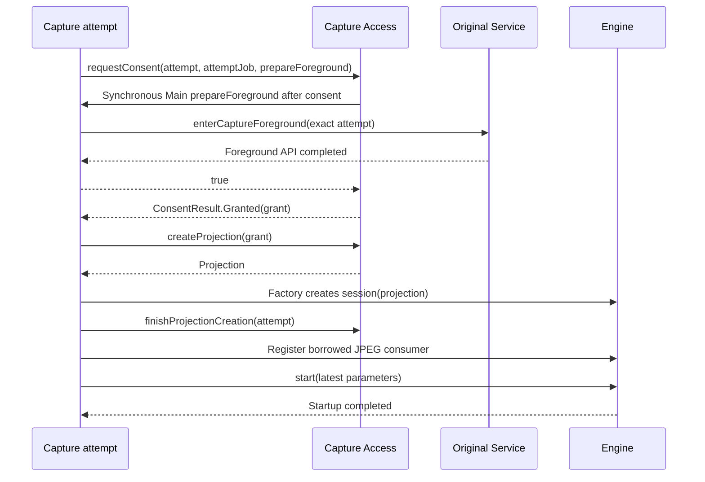
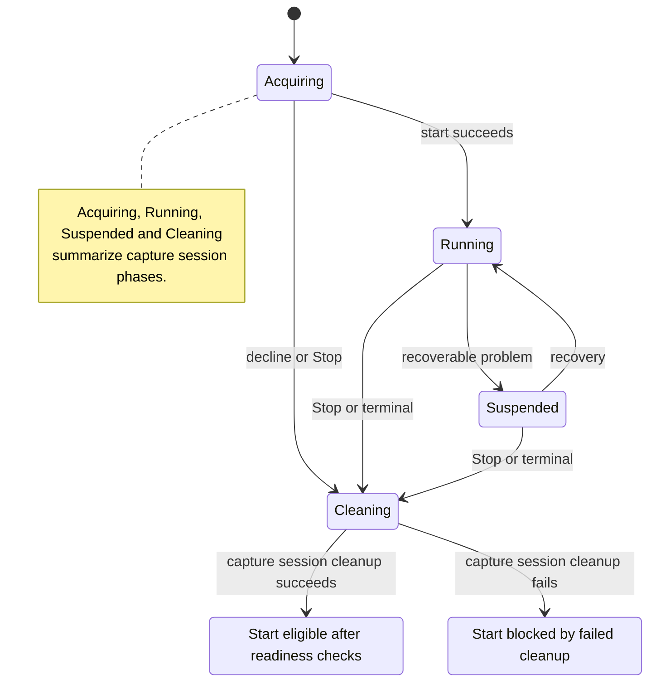

[Internals](../README.md) · [Streaming host](streaming-host.md) · [Coordination](coordination.md)

# Native module and capture lifecycle

[MjpegCaptureSession](../../src/main/kotlin/io/screenstream/mjpeg/MjpegCaptureSession.kt) adapts one engine run to native MJPEG. It owns consent, foreground lifetime, projection before engine handoff, the engine session, borrowed-frame registration and their cleanup. [MjpegStreamingModuleController](../../src/main/kotlin/io/screenstream/mjpeg/MjpegStreamingModuleController.kt) owns admission of that attempt and cleanup of the whole module. HTTP image/response lifetimes are separate; [JPEG delivery](../03-delivery/jpeg-delivery.md) owns their rules.

The internal [engine adapter](../../src/main/kotlin/io/screenstream/mjpeg/MjpegCaptureEngineAdapter.kt) supplies `MjpegEngineFactory` and `MjpegEngineSession`; their default implementation forwards engine operations and statistics. The session exposes phase, problem and stop reason, borrowed `MjpegBorrowedJpeg` callbacks and the exact consumer registration. Successful factory return transfers projection ownership; a thrown construction step leaves it with the capture attempt. Registration `unregister` awaits exact consumer completion separately from media stop. These types are internal boundaries, not a public integration API.

## Startup and projection ownership

Construction takes `initialImageSettings`, fixing the JPEG backend and initializing desired dynamic parameters for the attempt. Under the capture-admission gate, the controller creates a fresh initial generation and constructs the inert session and attempt record before calling HTTP `registerCapture(attempt, initialCaptureGeneration)`. Registration sets HTTP Starting and retains the previous real image. The controller then calls `start()` and retains the attempt record before leaving that same gate, so shutdown cannot miss the owner. `start()`, called once before `requestStop` or updates, launches capture in controller scope; return is not consent, startup or first-JPEG confirmation. On entry, the capture body explicitly synchronizes its fresh WaitingForPermission status/generation under the state gate, unless Stop already won.

The sequence shows successful startup. `ConsentResult.NotGranted` sets the first Stop cause to User and proceeds to cleanup; it does not repeat consent. Failures are tagged by acquisition stage. Consent is bound to the explicitly supplied attempt Job, which must remain active through projection admission. The mandatory foreground callback runs immediately on Main after matching consent, before grant delivery, without waiting for host resume. [Streaming host](streaming-host.md#consent-and-projection-handoff) owns Access correlation and version rules.

The capture session stores a returned raw projection immediately. Failed engine construction leaves it session-owned. After successful construction the engine owns it, the raw variable is cleared and the creation guard is released. Late platform return after Stop still enters rollback/handoff; cancellation cannot make a returned resource ownerless.

The consumer samples current engine state under the session state gate, synchronizes HTTP phase/generation, and captures the exact generation identity before forwarding byte count and a synchronous copier outside that gate. The copier is valid only in that callback on its original thread, writes at offset zero and must not be retained. HTTP can decline the offer or copy into its owned storage, checking the captured generation before copying and again before publication. Incomplete/throwing copy is an Output.frame failure, retains the first capture failure, requests Error Stop and cancels capture. Consumer registration can receive a callback before engine `start` returns; there is no separate first-frame startup barrier.

## Desired parameters and engine observations

The latest dynamic image settings remain in a StateFlow through consent/startup. Initial engine parameters come from its latest value. While the engine is Active, Reconfiguring or Suspended, changed desired values are submitted to the same session; a closed engine admission can reject them with IllegalStateException without inventing a new attempt. Equal parameters are not resubmitted. Backend policy stays fixed, while crop-disabled and unselected size values remain saved but are not sent as active parameters. [Settings](../02-configuration/settings.md) owns model validation/conversion choices.

The capture session owns one immutable `State`; status, streaming and suspension are derived from its lifecycle facts. First Stop cause, capture failure, cleanup failure and cleanup outcome remain independently observable. Concrete Stop, failure, engine-sampling and cleanup operations commit through one gate. The commit derives the generation from the effective status after sticky Stop/failure precedence: Active retains or creates a generation; permission/startup/reconfiguration preserve it; Suspended and terminal statuses revoke it. It publishes the snapshot, releases the screen lock on terminal paths before HTTP work, and pushes status/generation only when either changes. HTTP applies that pair without returning or choosing a generation. Initial capture-body synchronization is explicit because the initial snapshot already reports WaitingForPermission while registration set HTTP Starting. The controller separately processes snapshots for UI, module reports and cleanup admission; its queue cannot overwrite production authority.

An independent engine-state collection wakes a fresh `currentState` sample inside the same gate used by frame admission and cancels the running scope on terminal state. The emitted payload is not reapplied later: a delayed observation cannot revoke a generation opened by a newer callback sample. Parameter submission combines desired settings with the session's canonical `State`, including fresh frame-callback samples; it accepts running status before startup return without backpressuring terminal observation. A state-observation failure is retained as capture failure. Engine statistics are collected independently for logging; their observation failure is logged without defining a capture failure. Engine geometry, configuration convergence, old-frame allowance and recovery behavior remain the [engine contract](../../../screen-capture-engine/docs/usage.md).

If the engine is already Active while controller/state observation lags behind recovery, the frame callback can open the generation before offering that JPEG. This does not promise lossless callbacks or observation of every engine transition. A callback sampled in Suspended or terminal state is rejected; Reconfiguring preserves an existing generation but does not reopen a revoked one. Null `captureGeneration` means publication is revoked: Active → Reconfiguring keeps its generation, while Suspended → Reconfiguring stays null until Active. A callback observed in Active can still contain older settings/content under the engine contract.

## State and failure precedence

The capture session publishes latest `status`, `isStreaming`, optional suspension problem, first capture failure, first cleanup failure and nullable `cleanupSucceeded`. StateFlow may skip intermediate values; retained outcomes remain available.

| Condition, in precedence order | Capture session status |
| --- | --- |
| Retained capture/cleanup failure, false cleanup or engine Failed | Failed |
| Cleanup outcome available with no failure | Stopped |
| First Stop accepted with cleanup pending | Stopping |
| No engine yet | WaitingForPermission |
| Engine NotStarted/Starting | Starting |
| Engine Active/Reconfiguring/Suspended | Matching status |
| Engine Stopped with cleanup pending | Stopping |

`isStreaming` is true only after successful engine start, before any Stop/failure/cleanup outcome and without engine terminal state. It remains true through Reconfiguring/Suspended after startup. Active before `start` return alone is not confirmation of `isStreaming`. A retained failure outranks successful cleanup, leaving Failed until a new controller-admitted attempt replaces it.

Suspended maps engine InvalidRequest, CaptureUnavailable or ResourceExhausted to its stable problem category. The reason is published only while status is Suspended. InternalFailure/UnsupportedColorSpace are not expected suspension reasons. The native UI displays the mapped reason and offers Stop; it has no capture Retry action.

The diagram separates simplified capture session phases from controller cleanup outcomes. Running includes Active/Reconfiguring. The controller retains its latest admitted attempt record and derives availability from its processed cleanup outcome. Successful cleanup permits a replacement attempt after readiness checks even if the last session still reports Failed; failed cleanup blocks Start. The completed record remains the module's capture-cleanup owner until a replacement is admitted or the module shuts down.

## Failure stages and recovery boundaries

`State.Failure(stage, cause)` is an internal diagnostic, not an HTTP wire value or an instruction to retry that stage. The first `captureFailure` and first `cleanupFailure` are retained independently; simultaneous failures do not define a deterministic order between independent cleanup operations. Use the stage with [startup ownership](#startup-and-projection-ownership), [cleanup obligations](#capture-cleanup-and-its-evidence) and the original cause, rather than treating every Failed state as the same operation.

| Retained capture stage | Boundary that failed |
| --- | --- |
| `Startup.consent` | `requestConsent` threw before the foreground callback. A matching launcher failure uses `ConsentLaunchException`; cancellation is handled separately. `NotGranted` is normal User Stop, without a capture failure. |
| `Startup.foreground` | The mandatory consent callback threw while entering the original Service's capture foreground lifetime. A false callback result is instead normal `NotGranted(ForegroundRejected)`. Projection creation has not begun. |
| `Startup.projection` | Creating the projection through Access. Returned raw resources still follow rollback ownership. |
| `Engine.creation` | Constructing the engine session; failed construction leaves the raw projection with the attempt. |
| `Startup.projectionHandoff` | Releasing the projection-creation guard after successful engine construction; the engine already owns the projection. |
| `Engine.registration` | Registering the borrowed-frame consumer after engine ownership transfer. |
| `Engine.start` | Initial start or another uncaught failure escaping the structured `runEngineSession` lifetime. It is not limited to an exception from the `start` call. |
| `Engine.state` | Observing engine Failed during running, cancellation handling or cleanup; its problem is included in the diagnostic cause. |
| `Engine.stateObservation` | The engine-state observation path failed. Real StateFlows do not naturally throw collection failures; this remains a defensive boundary. |
| `Output.frame` | Reading borrowed frame size, synchronous output/copy or complete-copy validation failed. The callback requests Error Stop. |

| Retained cleanup stage | Obligation that failed |
| --- | --- |
| `Cleanup.consumer` | Exact borrowed-frame registration unregister/completion. Ordinary engine Stop does not naturally make unregister fail. |
| `Cleanup.media` | Engine stop after handoff, or raw projection stop before handoff. |
| `Cleanup.foreground` | Foreground removal when that operation is eligible under the media outcome. |
| `Cleanup.projectionCreation` | Exact projection-creation guard release, attempted independently of prior resource errors. |
| `Cleanup.consentReuse` | Saving an otherwise eligible consent grant after successful available resource cleanup. |
| `Cleanup.capture` | Unexpected outer cleanup failure, or capture completion without a recorded cleanup outcome. Cancellation before body entry is instead successful no-resource cleanup. |

`Engine.statsObservation` only logs a statistics-collector failure. `Engine.imageUpdate` logs rejection of a parameter update after engine admission closes; neither is a retained capture/cleanup failure stage. A cancellation or normal engine Stopped can end capture without inventing a failure, and the first accepted User/System/Error/Shutdown Stop cause remains unchanged.

Successful cleanup can coexist with a retained capture failure: the attempt stays Failed, while the controller derives idle availability and can admit a new Start after its readiness checks. A failed cleanup keeps Start blocked until module shutdown. Pending cleanup remains pending, even if the manager's bounded wait ends. There is no per-stage retry or native capture Retry action; a server Retry belongs to HTTP and cannot repair capture ownership. Recoverable capture errors do not automatically become terminal manager failures. See [controller coordination](coordination.md#activity-and-command-admission) and [host failure classification](streaming-host.md#reports-clocks-and-deadlines).

## Stop and suspension

`requestStop(reason)` preserves the first User/System/Error/Shutdown cause and requests cancellation immediately. It does not wait for callback completion or cleanup. Parameter updates after Stop are ignored. `awaitCleanup` only waits for the retained outcome; it neither starts nor stops capture, and cancellation of a waiter does not cancel the owner.

Ordinary Stop leaves HTTP/module open and applies the image fallback. Suspension keeps the same engine session/foreground lifetime but closes the current HTTP capture generation and applies that same fallback without erasing the latest real frame. There is no MJPEG recovery timer, suspension deadline or continuous retry. Changed parameters/capture conditions may recover the session; equal parameters are not a retry. System projection Stop and the controller's [empty-address timeout](coordination.md#network-loss-deadline) still apply during suspension.

The live [keep-awake preference](coordination.md#keep-screen-awake) requests a dim-allowed screen lock only during confirmed capture. Stop and terminal capture paths release it before media teardown. This optional best-effort resource reports errors only in logs, independently of the media cleanup outcome. The controller's live screen-off Stop preference applies independently during consent, startup, running and suspension.

## Capture cleanup and its evidence

Entered resource cleanup runs with [NonCancellable](https://kotlinlang.org/api/kotlinx.coroutines/kotlinx-coroutines-core/kotlinx.coroutines/-non-cancellable/). Cancelling the controller/attempt triggers this cleanup rather than abandoning it. If cancellation wins before capture body entry, completion records successful cleanup without acquired resources; abnormal completion without an outcome records cleanup failure.

| Obligation | Completion rule |
| --- | --- |
| JPEG consumer | Unregister runs independently and is awaited, including admitted exact callback/copy completion. |
| Media | Stop engine session after handoff, otherwise stop raw projection when present. |
| Foreground | After engine handoff, attempt removal only if engine stop returned successfully. Before handoff, attempt removal even if raw projection rollback failed. |
| Projection guard | Attempt exact `finishProjectionCreation`, independently of earlier media/foreground errors. |
| Consent reuse | Only after successful cleanup and eligible normal completion, as below. |

Each operation retains the first cleanup failure without hiding the first capture failure. Failure in one obligation does not skip consumer/guard work. Final nullable cleanup outcome is published once work settles; a suspended/hung operation keeps it pending. `cleanupSucceeded=true` can accompany capture failure.

Successful engine stop confirms logical stop and projection-stop return, **not complete internal engine physical cleanup**. Consumer unregister supplies the separate exact callback-completion boundary. Successful capture session cleanup means these available operations completed without error; it cannot strengthen engine/Android guarantees. Pending/failed engine stop does not authorize normal foreground removal after handoff.

Consent reuse requires successful startup, successful capture session cleanup, no capture failure, first Stop cause User or Shutdown and engine `Stopped(Requested)`. The Access coordinator then permits only the latest admitted consumed Grant to save once on SDK 24–33. Failed startup, failure/system revocation and failed cleanup do not save. The attempt Job need not remain active to save after cleanup.

## Controller shutdown and complete module cleanup

`requestModuleShutdown` is the sole terminal ingress. Its once-only signal closes foreground admission, stops the retained capture owner and then closes HTTP admission, before cancelling ordinary controller work, closing the event queue and starting the independent cleanup receipt. Capture Stop runs outside the capture-admission gate and releases its screen lock before unrelated HTTP closure. Nested `finally` blocks preserve later closure obligations when an earlier action fails. Capture admission and shutdown share a gate so cleanup cannot miss a newly created session.

Cleanup starts three branches independently:

- HTTP `stop`, including its owned runtime/listeners/requests.
- Address-monitor `close`, including scans and observer retirement.
- Platform branch: latest admitted capture `awaitCleanup`, final foreground removal, original Service `stopSelf`, then `awaitDestroyed`.

The controller joins admitted ordinary jobs, including entered preference saves, and awaits all branches. False reflects any failed available obligation. A hanging capture cleanup does not prevent HTTP/monitor cleanup starting but can prevent the platform branch and total receipt settling. A cancelled `awaitCleanup` caller abandons only its wait.

The latest admitted attempt record retains its session after successful or failed cleanup, so completion cannot remove the last owner's cleanup obligation. Capture cleanup failure blocks new Start; successful cleanup permits derived idle availability and deferred setup application. Manager deadlines and Service destruction callbacks do not substitute for these outcomes. [Streaming host](streaming-host.md#reports-clocks-and-deadlines) owns bounded waiting; actual device/graphics/socket release remains separate evidence.
