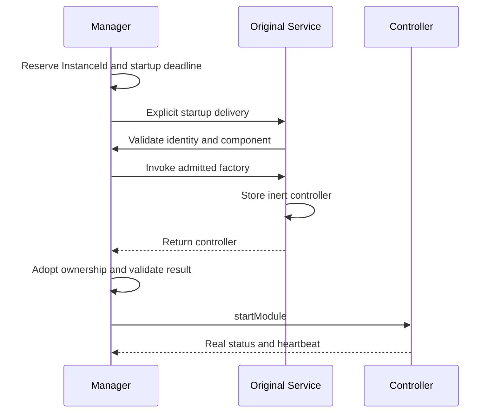

[Internals](../README.md) · [Module lifecycle](module-lifecycle.md) · [Coordination](coordination.md)

# Streaming host and Android coordination

MJPEG uses shared infrastructure to reserve a module launch, admit its original Service/controller, coordinate consent and route exact capture Stop. The controller owns ordinary work and independent cleanup. This page owns those host boundaries; [Usage](../../docs/usage.md) owns caller behavior and [Architecture](../../docs/architecture.md) supplies the common model.

Sources: [StreamingModuleManager](../../../streaming-core/src/main/kotlin/io/screenstream/streaming/StreamingModuleManager.kt), [manager implementation](../../../streaming-core/src/main/kotlin/io/screenstream/streaming/manager/StreamingModuleManagerImpl.kt), [module/controller API](../../../streaming-core/src/main/kotlin/io/screenstream/streaming/module/StreamingModule.kt), [Service base](../../../streaming-core/src/main/kotlin/io/screenstream/streaming/module/StreamingModuleService.kt), [native Service](../../src/main/kotlin/io/screenstream/mjpeg/MjpegStreamingModuleService.kt) and [capture Access](../../../streaming-core/src/main/kotlin/io/screenstream/streaming/capture/ScreenCaptureAccessImpl.kt).

## Service-first launch and ownership

The registered catalog remains unchanged for the manager's lifetime and is priority-sorted with unique IDs; construction/registration does not launch a module. MJPEG metadata uses ID `MJPEG`, priority 40 and `MjpegStreamingModuleService`. Saved valid selection still takes precedence over the default first entry. Each launch has an `InstanceId` and a Runtime: the manager-provided handle for checking that launch's admission and reporting its status/failure. The manager routes commands to the original launch, and old reports cannot affect a replacement.

On Main, `onServiceStart` checks the action, reserved identity, component, pending admission and absence of an existing controller before invoking the factory. Rejected/repeated/stale deliveries create no second controller.

The Service stores the factory result before returning. The manager adopts it before checking its identity or calling `startModule`, retaining the cleanup obligation even for a late/invalid result. The manager releases its short gate before invoking the factory, module commands or Compose content.

The Service returns `START_NOT_STICKY`. With no controller it calls `stopSelfResult(startId)`; a rejected delivery to an occupied Service does not stop another launch's controller. The Service owns the original reference and destruction callback. The controller owns HTTP, discovery, capture and admitted operations; settings singletons outlive launches. Installed controllers retain reference identity so observation does not merge different launches by value equality.

## Selection and process state

One queued Main transition handles selection/restart/Exit. The first selection waits for the internal [StreamingSettingsStore](../../../streaming-core/src/main/kotlin/io/screenstream/streaming/settings/StreamingSettingsStore.kt) initialization and rechecks its exact operation afterward. Exit or a superseding transition prevents a stale read from launching. Saved available ID wins, otherwise the first catalog entry is used. A null saved choice gets the fallback persisted; an unknown saved ID is not automatically overwritten. Later null selection uses the prepared choice. Explicit changed choices are persisted sequentially.

| Manager state | Exact meaning |
| --- | --- |
| NoModule | Before initial selection. |
| Switching | Settings preparation, replacement or first real status is pending. |
| Running | Accepted control report; capture, server readiness and consumers remain separate. |
| Unresponsive | Heartbeat stale, retaining last accepted status without automatic admission revocation/Stop. |
| Failed | First terminal launch/module failure, retained through cleanup. |
| Exiting | Exit pending or completed; selection can reopen after the operation finishes. |

The canonical `state` includes an instance ID only for Running/Unresponsive/Failed; after cleanup it may identify an outcome rather than a live controller. Read one `state` value for coherent phase/identity. `InstanceContent` additionally requires the exact installed controller and open admission. Switching/Exiting hide prior content. The selector is disabled during Switching. Failed shows the app's red error panel with Restart. Unresponsive adds a host-owned warning with Restart between the selector and retained module content. Running and Unresponsive use the error panel when admitted module content is unavailable.

Same current module ID is a no-op even after failure. Restart replaces the exact current launch outside a transition, creates a new launch UUID and preserves saved selection. Concurrent selections/restarts are rejected without queueing. Neither operation automatically starts capture.

## Reports, clocks and deadlines

LaunchRecord retains bounded slots for latest Running, first failure and Finished. The first failure closes admission and requests Shutdown. Later success cannot erase it or affect a replacement. Before the first accepted real status, dispatch/factory/timeout failures use the generic manager failure presentation; afterward a module-provided message resource may be retained. Recoverable capture failures belong to the module, not automatically to manager failure.

| Rule | Clock and boundary |
| --- | --- |
| First real status | Three seconds elapsed realtime from dispatch reservation, not from `startService` return. |
| Heartbeat freshness | More than three seconds uptime since the accepted heartbeat becomes Unresponsive. |
| Native heartbeat | Actual control-loop uptime, approximately every second subject to scheduling. |
| Launch shutdown wait | One retained absolute elapsed-realtime deadline, assigned when the manager first requests bounded shutdown waiting. |

The native loop's first report does not wait for settings or network readiness. Smaller heartbeat timestamps cannot move the accepted timestamp backward. Fresh status can recover Unresponsive; terminal Failed remains terminal. Deep sleep does not consume uptime; Main scheduling delay can cause a reversible stale-heartbeat observation. A timer wakes control work but is not itself proof of processed work.

The manager assigns a shutdown deadline three seconds from its bounded-wait request and preserves it thereafter. Failure ingress can close admission and begin cleanup before Main processes the failure and assigns that deadline. Cleanup start and deadline assignment are separate events.

Switch/restart waits separately for old shutdown and new startup, potentially six seconds of scheduled waiting. Exit supersedes opening, retains any existing shutdown deadline and never extends it. Public selection, restart and Exit calls request process-owned transitions without awaiting those deadlines. A deadline ends manager waiting only; controller cleanup continues independently, including when Main or Android calls delay progress.

On Finished, the manager releases controller references regardless of success. A false result reports failed/unconfirmed cleanup and a warning without creating another terminal cause or prohibiting future launches. Unexpected Finished while admission is open is a launch/module failure. Late outcomes cannot reclassify a replacement; an occupied Service can still reject replacement startup after the manager's wait ends.

## Original Service and foreground obligations

The [Service base](../../../streaming-core/src/main/kotlin/io/screenstream/streaming/module/StreamingModuleService.kt) has no media scope. Accepted startup enters waiting foreground with `specialUse` before creating the inert controller. Concrete Services supply the controller factory; the base owns `enterCaptureForeground`, `updateCaptureNotification` and `leaveCaptureForeground`. Each module owns its capture attempt and serializes foreground changes on Main. Entry checks the exact attempt's instance and current Runtime, records the foreground attempt, then promotes using that original Service's validated fixed notification slot and required service types.

Promotion returns true for Android API completion and false for admission rejection without an Android call. Platform exceptions close foreground admission, report failure and request shutdown of the original controller. These outcomes do not prove notification visibility or physical resource release. The module records its exact attempt's foreground obligation before calling Android, so rollback still has an owner after cancellation or an exception.

`updateCaptureNotification` changes the exact attempt's presentation without re-entering foreground or revalidating a projection grant. Confirmed capture shows an exact-attempt Stop; waiting or stopping shows Exit. After its declared media cleanup, the attempt calls `leaveCaptureForeground` to return the same Service to waiting `specialUse`. Terminal cleanup closes foreground admission and uses `stopAndAwaitDestruction`; Android removes foreground state when stopping the Service.

MJPEG reserves foreground notification 400 and promotes with mediaProjection after consent. RTSP and WebRTC retain foreground slots 300 and 200 and own detail-error slots 310 and 210. MJPEG operation warnings and manager failures use manager error slot 1000. MJPEG reports a non-null `Status.errorMessage` for its retained actual failure or delayed Stop; RTSP/WebRTC keep operational diagnostics in their own UI/detail slots and leave that status field null. Unresponsive and terminal Failed remain manager problems. Each continuous manager warning episode gets one delivery attempt; a terminal failure replaces it. Android notification settings still apply. Resolution or switch/restart/Exit cancels the manager notice. See [ModuleErrorNotificationCoordinator](../../../streaming-core/src/main/kotlin/io/screenstream/streaming/manager/ModuleErrorNotificationCoordinator.kt).

`onDestroy` closes admission, detaches the original controller, calls superclass destruction and then notifies that controller in `finally`, completing the destruction receipt afterward. Timeout closes foreground admission and attempts `stopSelf` before reporting failure/Shutdown to the original Runtime/controller. Neither path finds or stops a replacement. Module cleanup settles its declared capture teardown, stops the original Service and awaits actual destruction. RTSP/WebRTC teardown remains best effort; completion does not certify physical media release. MJPEG keeps its stronger available cleanup boundaries.

## Consent and projection handoff

[ScreenCaptureAccess](../../../streaming-core/src/main/kotlin/io/screenstream/streaming/capture/ScreenCaptureAccess.kt) owns pending consent correlation and a process guard around projection creation. It does not own foreground, returned projection or engine resources. Those belong to the [capture attempt](module-lifecycle.md#startup-and-projection-ownership).

`requestConsent(attempt, attemptJob, prepareForeground)` runs under the explicitly supplied installed attempt Job. It returns `ConsentResult.Granted(grant)` or `NotGranted(reason)`, with reasons Busy, HostUnavailable, EducationDeclined, Declined and ForegroundRejected. The opaque Grant retains the attempt Job, so a short requesting child may complete while the attempt remains active. It owns no Android resource or future creation reservation. Cancellation remains cancellation; technical failures throw. Only a matching Android launcher failure is wrapped in the top-level `ConsentLaunchException`; foreground and projection failures retain their own paths.

All modules supply the mandatory synchronous Main `prepareForeground` callback. A matching successful result immediately invokes it outside the Access lock, without waiting for the Activity to resume or adding a delivery timeout. The callback rechecks the exact attempt, module admission and relevant permissions, then returns after the foreground API completes; false returns ForegroundRejected. SDK 24–33 cached consent uses the same callback. The original attempt installs its rollback owner before requesting, since cancellation after promotion can prevent grant delivery. A new UI launch still requires the current resumed host.

After foreground preparation and grant delivery, worker-thread `createProjection` checks the active attempt Job, exact Grant, one-use consumption and absence of pending/overlapping creation. It consumes the Grant even on platform failure and retains the creation guard. The capture session must store the returned projection before suspension or fallible work: a late return after Stop still needs handoff or raw rollback. Successful engine creation transfers projection ownership; failed construction leaves it with the capture session.

A successful foreground callback privately timestamps its grant. On SDK 24–33, acquisition can retry once after 100 ms for SecurityException only when it began within 1500 ms of successful promotion. `createProjection(grant, retryAfterRecentForegroundStart = true)` explicitly enables it for RTSP/WebRTC; MJPEG passes false, also the default. The same consumed grant and in-flight creation guard cover both calls; cancellation is checked before retry.

`finishProjectionCreation(attempt)` releases only that attempt's non-in-flight guard after handoff or completed raw rollback. Calling it during the synchronous platform call does not clear the guard; cleanup must call again afterward. Guard completion does not prove engine capture completion.

On SDK 24–33, Access can consume one process-cached consent result Intent; it stores no projection/VirtualDisplay and does not persist consent. A busy/inactive request does not consume the cache. An admitted attempt does, so failed startup requires fresh consent next time. [AOSP 33](https://raw.githubusercontent.com/aosp-mirror/platform_frameworks_base/android-13.0.0_r1/services/core/java/com/android/server/media/projection/MediaProjectionManagerService.java) provides platform context; OEM/revoked-grant behavior requires separate validation. Only the latest admitted consumed attempt may save once, after the capture session's successful startup/normal requested Stop/cleanup conditions. On SDK 34+, each new session uses fresh consent; cloning an Intent does not create new authority. Follow [Android projection](https://developer.android.com/media/grow/media-projection) and [FGS requirements](https://developer.android.com/develop/background-work/services/fgs/service-types#media-projection).

## Consent host, cancellation and exact Stop

[ScreenCaptureConsentHost](../../../streaming-core/src/main/kotlin/io/screenstream/streaming/compose/ScreenCaptureConsentHost.kt) stays outside tab selection. Access retains request key/host token rather than Activity, launcher or UI scope. Education Continue requires the exact request and records the shared education flag; Cancel ends it before submission without a start-attempt analytics event. Submission requires the current resumed host and is marked before launcher invocation, preventing recreation from launching twice.

An unsubmitted request loses admission when its host pauses/changes. A submitted one survives recreation/pause; only its keyed result can resolve it. Correlation is removed before invoking the foreground callback or resuming the waiter, so duplicate and late results cannot resolve it again. A result before submission is a technical failure. Cancellation removes only the caller's pending wait and ignores its late result; it cannot dismiss Android's system dialog or remove resources returned from an already admitted platform call. Process death restores neither request nor Grant.

Access receives one constructor-wired `ConsentRequestObserver` for committed saved-consent takes and fresh system submissions. The app routes those facts to the matching pending per-attempt analytics tracker; observers do not control consent or foreground work. Native MJPEG analytics remains a deferred placeholder and emits no session metrics.

[StreamingModuleActionReceiver](../../../streaming-core/src/main/kotlin/io/screenstream/streaming/manager/StreamingModuleActionReceiver.kt) creates immutable explicit broadcast actions and is non-exported. Stop action/data encode module/instance/attempt; Exit targets the original instance; Recover adds an exact current-error token. Extras do not establish identity. No action starts an Activity or Service. Manager checks the admitted launch and queues recovery on Main; the controller checks the live attempt or error episode at handling time rather than trusting delayed Status. In-place module recovery differs from manager Restart. PendingIntent identity is independent of notification removal; see [Android PendingIntent](https://developer.android.com/reference/android/app/PendingIntent).

## Ordinary runtime permissions

Ordinary permission UI is separate from `ScreenCaptureAccess` and projection consent. The core [RuntimePermissions.kt](../../../streaming-core/src/main/kotlin/io/screenstream/streaming/permission/RuntimePermissions.kt) defines one `RuntimePermission` enum, four-state `PermissionState` and `RuntimePermissions` interface; [LocalRuntimePermissions](../../../streaming-core/src/main/kotlin/io/screenstream/streaming/compose/LocalRuntimePermissions.kt) supplies the Compose provider. The enum includes Notifications, LocalNetwork, RecordAudio, Microphone and DeviceAudio; the last three share the `RECORD_AUDIO` name and grant/state. `isRequired(Context)` guards Notifications at runtime 33+ and LocalNetwork at runtime/target 37+. Enum members `isGranted(Context)` and `shouldShowRationale(Activity)` own the platform availability/rationale reads. Notifications require both the applicable runtime grant and `NotificationManager.areNotificationsEnabled()` on the supported API 24+ range. `suggestsSettings(Activity, Collection<String>)` routes disabled notifications to Settings when no runtime request is applicable or the runtime grant is already present; otherwise it combines the caller's observed-rationale history with the current rationale signal. `openSettings(Activity)` selects and opens the Android settings destination. The [app root](../../../app/src/main/java/info/dvkr/screenstream/ui/RuntimePermissionHost.kt) delegates these operations while retaining ownership of saved rationale history, permission UI/state and launch-failure handling; no separate permission ViewModel is needed.

The public [host contract](../../docs/usage.md#integrate-the-android-host) defines `state`, fresh `isGranted` and UI-thread `tryRequest`. The call is synchronous admission: already granted or one accepted explanation returns true while resumed; a busy slot or nonresumed Activity rejects an ungranted request. A missing notification grant does not gate other permissions. There is no queue, coalesced result or caller waiter. Once accepted, the explanation belongs to the app rather than the originating action and survives that screen's exit. Other requests cannot replace the pending slot merely because they use the same Android permission.

`RuntimePermissionHost` saves one pending enum entry and its phase (Explanation/SystemDialog/Settings) as root UI state. The pending entry's `rememberSaveable` initializer offers Notifications only in a genuinely fresh, non-restored root when notification access is unavailable, including app-wide disablement. Restoring a pending entry or a saved null preserves that UI state rather than creating another offer. Rationale evidence has its own saveable list, keyed by Android permission name; a fresh list loads the current published `permissionsWithObservedRationale` set from initialized [AppSettings](../../../app/src/main/java/info/dvkr/screenstream/settings/AppSettings.kt), while restored root state preserves its list. This durable set defaults to empty and covers every ordinary permission, including the shared name of the audio aliases. Pending requests and phases are not persisted in AppSettings. Rationale evidence is neither authorization nor a user-decision/permanent-denial classification. Already observed evidence remains valid when Android later reports false rationale, until the root observes the applicable runtime grant and removes that permission name. Without such evidence, public APIs cannot reliably distinguish a fresh request from an existing permanent denial; the state may remain Requestable. The app's Settings → Device notification settings action remains an independent recovery path.

The flow maps start empty: the first `state(permission)` call reads that permission and creates one stable read-only StateFlow, keyed by Android permission name so audio aliases receive the same instance. Updates touch only an already-created flow; there is no eager entry per enum value or global OS monitor. Each computation prefers fresh Granted, then pending-name Requesting, history/rationale-based SettingsSuggested, then Requestable. The published value remains a last-known UI hint between computations, including Granted. A fresh grant can be visible while the pending physical slot is still occupied. SettingsSuggested is not proof of permanent denial. `tryRequest` checks resumed lifecycle before the fresh grant, and accepts an already granted permission before testing slot ownership. True is never a capture/readiness receipt.

The launcher stays registered across every root state. `LifecycleEventEffect(ON_RESUME)` finishes the current Settings visit, or an explanation whose permission is now granted; it creates no new offer and does not bulk-refresh unrelated permission flows. A launched system request stays pending for its callback across recreation. The explanation chooses native text/icon from the enum entry. Notifications choose Continue with an applicable Android request or Open settings using the notification-availability routing and observed-rationale heuristic above; they do not always direct the user to Settings. Every explanation is optional: Not now, Back and outside dismissal clear the app request. Leaving the originating screen does not. Finishing or dismissing a request, background return and Settings return do not reinstall a notification explanation in that root.

Before a system/Settings launch the root checks current pending entry, phase, resumed lifecycle and fresh availability. Immediately before a native request it records rationale evidence only if the runtime permission is required, its current grant is denied and Android's rationale signal is true. A callback is handled only for a pending SystemDialog; a false entry for that Android permission triggers the same fresh evidence check. Map membership, a false entry or an empty result alone does not establish a user decision: cancellation can also produce a nonempty false result. A grant callback likewise does not prove a new user choice. For every permission, valid evidence adds its Android permission name to the root list and requests an ordered process-owned save to `AppSettings.permissionsWithObservedRationale`. When the root checks and observes the applicable runtime grant, it removes that name from both the list and saved set, even if app-wide notification delivery remains disabled. These checks run for an already granted request, before confirmation, after a grant callback and on return from the current Settings visit or a granted explanation; they are not a global grant monitor. Save cancellation propagates and ordinary save failures log; durable publication can lag the root list. Explanation dismissal, Settings navigation and launch failure are not themselves evidence, although valid rationale may already have been observed before a failed native launch. Completion clears the slot and updates only the completed permission's existing flow. Technical launch failures are logged and clear the slot through the same path. There is no returned grant outcome: modules use state as a UI hint and recheck the OS while applying their own current business conditions. Saved phase/history neither creates capture authority nor guarantees that Android will restore a physical dialog after process death.

## Activity lifetime and module boundaries

[SingleActivity](../../../app/src/main/java/info/dvkr/screenstream/SingleActivity.kt) requests selection in `onCreate` for a fresh Activity or when the process manager is `NoModule`/`Exiting`. If the manager remains Exiting, that Activity removes its task and returns. [BaseApp](../../../app/src/main/java/info/dvkr/screenstream/BaseApp.kt) independently observes Exiting on queued Main and calls `finishAndRemoveTask()` for the app's tasks. It does not wait for the manager's bounded cleanup wait or force process termination; controller cleanup continues independently. Home/rotation and Recents removal are not capture Stop commands, and a later opening can select after completed Exit. Waiting modules keep their original Service in `specialUse` foreground. Device lifecycle behavior still requires runtime qualification.

All three modules integrate directly with the manager/base Service/Controller contracts. RTSP and PlayStore-only WebRTC retain their protocol/media workers and module-owned permission relevance, Retry and recovery. Shared consent and ordinary permission UI belong to the Activity root; module settings, exact attempts and media resources belong to their original module owners. No adapter lease, second Service startup or Parcelable command transport remains. These shared boundaries do not make RTSP/WebRTC best-effort media teardown equivalent to MJPEG's cleanup contract.
