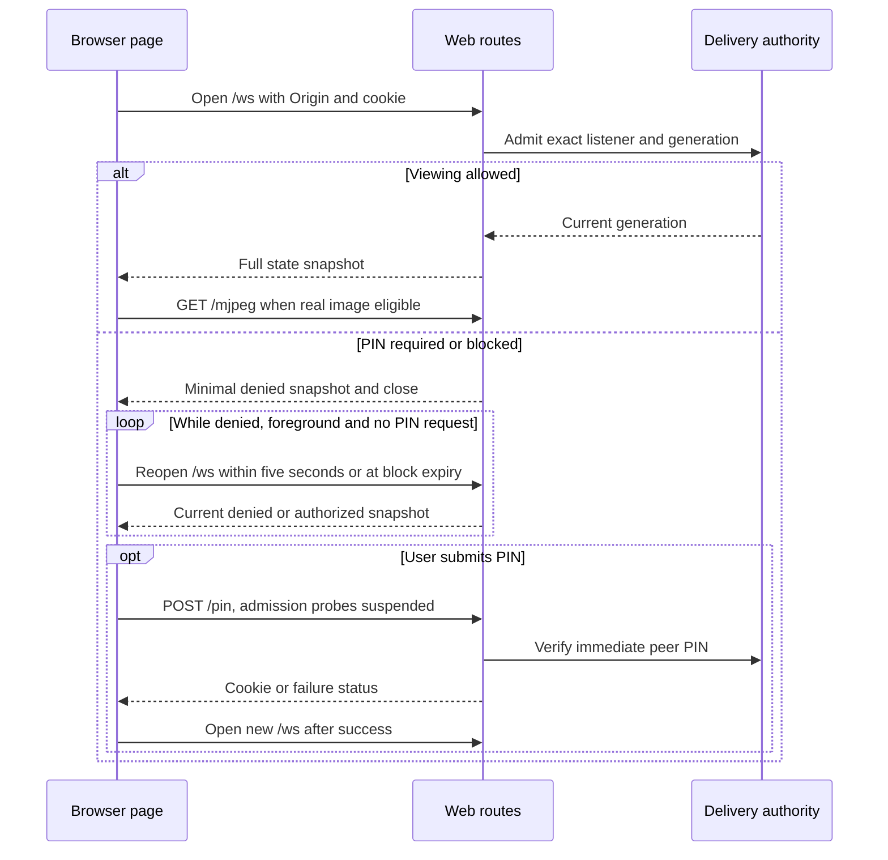

# Web client

One packaged HTML page provides viewing, PIN entry and recovery for independent browsers. It requests state and JPEGs from the Android device and does not control capture. [HTTP delivery](http-delivery.md) owns runtime authority and credentials; [JPEG delivery](jpeg-delivery.md) owns payload lifetimes and writer behavior. The public [HTTP viewing API](../../docs/http-viewing-api.md) defines routes, credentials, response headers and state schema. This page extends that foundation with authority parsing, PIN-body handling, transport settlement and browser resource lifetimes.

## Contents

- [Routes and response headers](#routes-and-response-headers)
- [Request authority, origin and credentials](#request-authority-origin-and-credentials)
- [PIN body parser](#pin-body-parser)
- [WebSocket snapshots and transport](#websocket-snapshots-and-transport)
- [Browser owners and recovery](#browser-owners-and-recovery)
- [Presentation and browser-local choices](#presentation-and-browser-local-choices)
- [Fullscreen and picture in picture](#fullscreen-and-picture-in-picture)
- [Source, build workflow and verification limits](#source-build-workflow-and-verification-limits)

## Routes and response headers

The public [route and response-header table](../../docs/http-viewing-api.md#routes-and-response-headers) owns the client-visible contract. The common `ApplicationCallPipeline.Plugins` interceptor adds those headers and validates trusted authority plus the exact listener before normal routing. The lazy HTML cache includes CSS/JavaScript and serves the packaged bytes unchanged, so there is no separate asset-route family or settings-dependent HTML transformation. The browser uses a neutral system-theme background during initial connection, PIN entry, blocking and no-image states. An authorized snapshot supplies the shared RGB; the browser applies it to the viewing canvas and bars when an image is displayed. Access denial restores the neutral class and clears the inline viewing background. Title, layout, image facts and credentials remain outside the initial HTML. [JPEG delivery](jpeg-delivery.md#writing-jpeg-and-mjpeg) owns framing and response-write settlement.

## Request authority, origin and credentials

The public [authority and credential contract](../../docs/http-viewing-api.md#request-authority-origin-and-credentials) defines accepted Host/Origin and cookie behavior. The adapter checks direct CIO authority against the exact listener, comparing numeric host bytes after stripping the listener's scope suffix. It does not trust forwarded authority or resolve arbitrary aliases.

Authority parsing rejects user information, fragment, path and query. The port defaults to 80 when omitted. Hosts are lowercased and IPv6 brackets removed. Literal parsing restricts IPv4 to four numeric octets in 0–255 and IPv6 to permitted numeric characters before `InetAddress` parsing; it does not resolve arbitrary hostnames. The route check compares numeric authority bytes, but origin equality subsequently compares parsed host text plus effective port. Do not assume all textual spellings of an equivalent IPv6 address are interchangeable for Origin.

PIN and WebSocket Origin checks use the parsed origin equality above. Origin must use `http`, have no user information or fragment and, when supplied as Origin rather than Referer, no path or query. The browser-origin basis is [RFC 6455](https://www.rfc-editor.org/rfc/rfc6455.html#section-10.2). Browser enforcement of cookie attributes remains platform behavior; [HTTP access](http-delivery.md#access-generations-and-pin-blocks) owns credential generation, rotation cutoff and immediate-peer blocking.

PIN verification and WebSocket block-state admission use CIO's direct `remoteAddress` as the peer key, matching media accounting. They do not obtain peer identity through the reverse-resolving `remoteHost` property.

## PIN body parser

`POST /pin` requires `application/x-www-form-urlencoded` after removing content-type parameters. It reads at most 257 bytes, using the extra byte to detect a body over the 256-byte limit, within five seconds. Parsing requires exactly one `pin` field; other fields do not replace it. The access validator requires six ASCII digits.

Wrong content type, oversize body, malformed form encoding (including malformed percent escapes), or missing/duplicate PIN yields null and enters ordinary PIN verification. With protection enabled, this yields `403`, or `429` when the peer is blocked or reaches the wrong-PIN threshold. An already active block is checked before verification; even a correct PIN cannot bypass it. Body-read timeout, read failures, cancellation and unexpected parser failures propagate through the transport rather than receiving a dedicated status mapping here. An Origin rejection occurs before PIN parsing/verification.

Blocked responses round remaining milliseconds upward to seconds for `Retry-After`. Open access returns successful authorization without issuing a protected cookie. If the listener became unavailable before verification, the handler returns no result and the route responds `403`.

## WebSocket snapshots and transport

The public [WebSocket schema](../../docs/http-viewing-api.md#websocket-state) owns authorized and denied snapshots. The adapter collects `StateFlow`; internal credential generation fences delivery but is omitted from JSON. Notices map `WaitingForPermission` → `permission_required`, `Stopping`/`Stopped` → `stopped`, `Suspended` → `paused`, `Failed` → `failed`; `Active`, `Starting` and `Reconfiguring` use null. `imageKind` distinguishes none, logo, current-source live frame and retained real frame; `hasImage` is derived for compatibility. The first accepted frame publishes a kind transition even when availability remains true; ordinary live publications do not emit per-frame state. Notice and image availability are independent, so a stopped notice can accompany a retained image. The browser maps fixed notice codes through one of 25 locale catalogs selected from browser language preferences, with English fallback. [Locale selection](../../tools/web-client/src/strings.js) owns legacy aliases and Chinese script/region matching. Capture notice differs from state-connection recovery status.

The current browser validator rejects malformed JSON, missing authorized fields, unknown image-kind/notice values, inconsistent hasImage, invalid layouts and wrong types. Denied access codes are handled before authorized-field validation; the page normalizes block timing. Extra fields are not a version negotiation mechanism.

One serialized state writer sends the current authorized snapshot immediately, on changes and after two seconds without a change. Every send rechecks the credential generation and listener admission. Repeated snapshots use the same schema and do not assert image freshness. Ktor settings use 15-second protocol ping and timeout, maximum inbound frame size 4096 bytes, incoming wrapper capacity 4 with close-on-overflow, and outgoing capacity 8 with suspension. Outgoing JSON snapshots have a separate 256 KiB limit. Wrapper bounds do not establish a limit on all Ktor/transport memory.

State send plus flush has a five-second budget; voluntary close plus default-session join has another five-second budget. The state-serving helper uses the server-session receiver's call for admission and request-job identity. Text/binary commands violate the read-only contract and close with policy violation. An incoming close/error ends a collector awaiting the next state. In `finally`, the adapter cancels the request/raw transport and detached default-session jobs, then joins the default-session job in `NonCancellable`; it does not join its own request job. [HTTP cleanup](http-delivery.md#terminal-cleanup) waits physical call completion.

## Browser owners and recovery

| Owner | Current browser resources |
| --- | --- |
| Connection | One WebSocket, first-state/retry/admission timer, liveness timer and one PIN XHR |
| Media | One displayed `img`, at most one replacement candidate, attempt generation and timers |
| Access panel | PIN form/messages, quiet block countdown and access-panel layout |
| Picture in picture | Canvas/video, attempt resources and serialized native operations |
| Viewport | Shared visible/safe rectangle, layout-height canvas and browser viewport events |
| Presentation | Shared appearance, local sizing, player layout, inactivity and fullscreen |
| Page | Applies snapshots; coordinates owners, status text and page lifecycle |

State connection and media recover independently. Losing only WebSocket keeps an already working media image/connection. The first authorized state after a new socket forces a media replacement when a live/retained image is eligible, including when its fields equal the preceding snapshot. Ordinary `true → true` availability updates leave healthy or exhausted media attempts alone; `false → true` starts media.

The state connection retries with waits of 0, 1, 2, 4 and 5 seconds, then continues with five-second waits until restored or paused. Its first valid state has a ten-second deadline; a visible page reconnects after five seconds without another valid state. Only a valid response resets the backoff. The compact Reconnecting message remains visible without a retry button because attempts continue automatically. A valid recovered snapshot clears the connection warning and forces media replacement without waiting for new image pixels. Media retains its 0, 1, 2, 4 and 8-second retry series, ten-second first-image timeout and manual action after exhaustion. A promoted image resets its budget. A browser without WebSocket support displays unsupported state.

PIN-required and blocked snapshots close their short-lived socket. While the page is foreground, admission is rechecked through `/ws` after at most five seconds, or sooner at the reported block expiry, with a 100 ms minimum delay. Hidden denied pages do not open probes; returning to the page rechecks admission. These probes do not submit a PIN or poll `POST /pin`. A newly authorized snapshot leaves the access panel without requiring another PIN submission. Repeated denial preserves the current PIN draft, field error and focus; repeated block snapshots refresh the countdown from the server's remaining duration without clearing the draft or repeating the block announcement.

A replacement candidate is hidden until `load` arrives with positive natural dimensions. JPEG additionally requires `complete` and awaits `decode()` when supported; MJPEG does not await `decode()`. Natural dimensions alone can be available before an image is fully loaded. Callbacks from old socket objects or candidate generations are ignored; displayed-image callbacks use element identity so a new candidate does not disable observation of the previous image. Promotion removes the previous displayed image and begins 500 ms size observation. [HTML image processing](https://html.spec.whatwg.org/multipage/images.html#updating-the-image-data) defines initial multipart availability; `load` is not a portable event for each later frame.

A failed or timed-out candidate is discarded and retries the selected method while the previous usable image remains displayed. An error on the displayed element, or an observed loss of its previously positive natural dimensions, clears that unavailable element and recovers media; an existing replacement attempt or scheduled request keeps its own deadline and retry budget. This detects image unavailability, not its network cause. The ten-second deadline only bounds waiting for an initial image. An `img` error does not expose the HTTP status or distinguish malformed bytes from transport failure; even an HTTP error response can contain a valid image. `complete` can also be true for a broken image. Clean multipart completion or a paused stream can leave an image available without a new event, and a browser can clear its data after an interruption without another error event. These signals and a live WebSocket do not establish frame freshness or repaint progress.

MJPEG is the default. More requests an explicit method through `media.selectMethod`; selecting the current method does nothing, while the recovery action selects the other method. The choice survives reconnect in page memory. Live JPEG starts its next request after a candidate is successfully promoted; retained JPEG waits 500 ms. Both remain single-flight, so a slow load delays the next request rather than accumulating requests. It uses the same first-image timeout and finite recovery budget. Generated request-sequence query values distinguish attempts; they are not server session credentials.

Authorization denial, image kind none/logo and page pause always clear displayed/candidate images and PiP. Pending permission keeps selected retained media eligible, using the same server image selection as direct clients. Capture pause/failure independently applies the common image fallback. Keeping a displayed element during replacement does not copy its pixels or guarantee preservation of a last MJPEG frame. A static JPEG can be normal, and the browser has no freshness watchdog proving new capture production.

PIN entry uses a masked password field with a numeric keyboard hint. Input filtering keeps ASCII digits; paste is filtered before applying the six-digit limit and preserves the unselected field suffix. Wrong and incomplete PIN errors appear in red between the field and Connect, with aria-invalid and a field description. Editing clears the field error; sending and network status plus the blocked announcement retain a separate node outside the hidden entry area. JavaScript validates six digits locally before submission, permits one XHR, uses a ten-second browser timeout and posts a URL-encoded field. An explicit submission closes any admission-probe socket and suspends probes while that XHR is pending, so an older probe cannot overwrite its result. `204` clears the PIN field and retries state connection; `403` shows wrong PIN; `429` uses Retry-After for the countdown, with a one-second fallback. The visible countdown updates once per second outside the live status; the status announces the block and restores the entry message on expiry. PIN-panel Retry appears for a PIN network failure, not ordinary PIN entry, wrong PIN or blocking. Countdown expiry re-enables entry without claiming the server accepted anything.

Page `pagehide`/`freeze` pauses connection, aborts pending PIN XHR, releases media/PiP, clears timers and resets active pointer interaction; `pageshow`/`resume` reconnects. Aborting a pending PIN request clears the panel's sending state and re-enables Connect rather than leaving a disabled form. Pausing does not erase a current PIN draft, field error or absolute block deadline; resume derives the remaining countdown from that deadline. Returning from visibility hidden for more than 30 seconds replaces a stale state connection, whose first snapshot replaces media. A shorter return retries if the socket is not open or its last valid snapshot is at least five seconds old, otherwise resumes missing media and exposes controls. The liveness deadline does not fail a hidden page; visibility return revalidates it. Background/event-loop throttling can delay all these timers.

## Presentation and browser-local choices

[Settings](../02-configuration/settings.md#shared-web-appearance) owns shared appearance defaults. Viewer choices live only in page memory; new page load resets them. Screen JPEGs and retained real frames use the same sizing logic; the page's own decorative logo remains in the centered DOM state:

| Local mode | Behavior |
| --- | --- |
| Fit, default | Preserve aspect ratio and fit the complete JPEG with background around it |
| Original size | Natural image size in CSS pixels with scrolling |
| Fit to width | Proportional width and vertical scrolling when tall |

Oversized images start at the scroll origin so all edges remain reachable. The title is text, not injected HTML; a long caption is ellipsized while full text remains available in its title attribute. The document title falls back to ScreenStream for an empty shared title.

The page selects one current message and its actions: access owns its form; unsupported WebSocket is terminal; connection recovery precedes eligible media recovery, current capture notice and ordinary image waiting. Lower-priority transient feedback is discarded when another message owns the surface. Old capture text and the More Notice field are cleared from presentation during state-connection loss; the protocol snapshot remains available to media and access owners. A healthy retained image uses its current capture notice on the same surface rather than a separate badge; no waiting text is added when that notice is null.

When no real image is displayed, the page uses one centered DOM flow containing the selected logo, message and actions. A connected authorized state shows the DOM logo only for selected image kind logo; live/retained image loading and none do not add a logo. Initial connection and connection loss retain generic logo/status presentation. Logo-to-message and message-to-actions gaps are both 16px; content can grow and scroll between occupied title/control blocks. Pending permission shows the same selected retained image or logo as direct media; the permission notice remains independent of that image. With a usable image, the same message/action block moves to a translucent dark overlay above visible occupied bottom blocks, without resizing or moving the image. Text-only messages use content-sized compact surfaces; errors with actions keep their button layout. The surface scrolls within the remaining HUD-free area; a very short area gives that scrollable surface priority over the HUD. More temporarily replaces the status surface. Only text is a live region; disappearing recovery controls restore focus to a viewing control or the viewport. Browser and direct clients request the identical media endpoints and bytes. State and image delivery are independent: a JPEG or MJPEG update can briefly show the server logo before the matching snapshot clears it. There is no atomic state/image pairing.

Controls order is the three sizing buttons, fullscreen, PiP, More; optional actions use feature detection. Icons use basic inline 24px SVGs within 48px targets; Original size displays 1:1, and Fit to width uses horizontal outward arrows. All controls have localized names and tooltips. Sizing buttons expose the selected mode with `aria-pressed`; translucent background fills distinguish selected, hover and keyboard-focus states without HUD outlines or underlines. Caption and controls independently follow top/bottom and overlay/bar. At each edge, bars form the outer group outside the image viewport and reserve only their own measured heights. Overlays form the inner group inside the viewport and never reserve image space, including mixed bar/overlay layouts. Within each group, controls are outermost and the caption sits nearer the image. Bars follow the canvas background and remain visible regardless of their saved auto-hide value. With an image displayed, bar text and icons use black or white according to the stronger contrast against its configured background, with matching translucent interaction fills. Visible overlays pack together without gaps left by hidden overlays. Menu retains its full-stack height calculations, opening toward the center past both blocks with scrolling and available-height limits; status follows the visibly occupied bottom blocks. Safe-area CSS and `visualViewport` are used when available. Narrow layouts can wrap controls onto additional rows while keeping the three sizing buttons together, retaining 48px targets and keyboard-focus styling.

One four-second inactivity timer hides only overlays whose auto-hide value is true. Hide/show motion uses two coordinated 110ms phases: panels fade and slide out before the message moves into their empty space; on reveal, the message moves clear before panels fade and slide in. Hidden overlays no longer hold the message away from the edge; their fading positions retain the full overlay stack while visible overlays compact. Only bar heights reserve image space throughout, so overlay auto-hide never resizes the image. The current message does not auto-hide. Reduced-motion preference disables these transitions. Touch/mouse activity and keyboard interaction reveal them; active interaction, a hovered control, keyboard focus in controls/menu and an open menu prevent hiding at expiry. Controls use a named group with ordinary Tab navigation and native button activation. More reveals a nonmodal named region with one Connection heading, separate MJPEG and JPEG rows, concise descriptions and external legal links; it has no permanent Retry or Close action. The method buttons expose selection with `aria-pressed` and a check mark. Status, Image, conditional Notice and Dimensions appear below the choices without another heading or redundant Method row; there is no full-title field or disclosure. More toggle and Escape/BrowserBack close it and restore focus; an outside click or tap closes it without moving focus away from the clicked target. Initial focus goes to the selected method, or the menu region when method selection is disabled. Pointer/touch input suppresses the image viewport's focus outline; HUD and method buttons show background focus styling for keyboard input. Equal appearance snapshots do not reset inactivity/layout. Changed display and the first snapshot of a new socket do; access, notice and availability still apply on every accepted snapshot.

The shared viewport owner fills the canvas from layout-height measurements because percentage heights can remain at the [small initial containing block](https://www.w3.org/TR/css-display-3/#initial-containing-block) after browser bars retract. At normal zoom it intersects the shell, CSS safe edges and the [visual viewport's size and offsets](https://drafts.csswg.org/cssom-view/#the-visualviewport-interface), converting those offsets into shell coordinates. Visual viewport resize and scroll events cover keyboard shrinking and panning; window resize, orientation, scroll, fullscreen and page restoration provide ordinary and legacy updates. Without VisualViewport, `innerHeight` still limits the visible rectangle even when the document's layout height is larger. A child iframe sees its own frame viewport; it cannot infer outer browser occlusion. Pinch zoom magnifies the existing layout instead of shrinking and moving the player to follow the visual viewport.

PIN entry, logos, image viewport, reserved bars, controls, the current message/actions and More use that shared rectangle. Safe edges intersect the shell boundaries, so a keyboard edge already above the bottom safe area does not reserve that inset twice. Safe-area measurements use an invisible positioned rectangle, avoiding the dynamic bottom-padding pattern discouraged by [Chrome's edge-to-edge guidance](https://developer.chrome.com/docs/css-ui/edge-to-edge). A very short window lets a scrollable panel cover the HUD while keeping it inside the available rectangle. Native input focus and panel scrolling remain available. This uses viewport measurements rather than assuming that browser bars, safe-area insets and keyboards report the same dimensions; current [Firefox for Android uses visual-only keyboard resizing](https://www.firefox.com/en-US/firefox/android/132.0/releasenotes/) too. Overlaid or floating keyboards that do not change reported viewport geometry, and legacy visual-only panning without VisualViewport, still require device qualification.

Overlay controls, caption and current message/actions use `rgba(24, 27, 31, .8)` surfaces with an opaque fallback and optional background blur. Blur never weakens the dark backing. More and tooltips retain their dense opaque `#24272b` surfaces for readability. PIN/access and no-image states retain the app's system light/dark palette with matching native-control color-scheme metadata; legacy browsers retain the light fallback. The configured RGB viewing-page background and black/white separate-bar contrast remain independent of these surfaces. No CSS variables, icon fonts, masks or blur polyfills are required.

## Fullscreen and picture in picture

Fullscreen uses available standard/prefixed native request/exit APIs. Modern APIs report rejected promises; legacy void APIs use standard/prefixed error events. Synchronous exceptions use the same current-attempt reporter. Each current attempt reports failure at most once while ordinary viewing remains available; superseded promise callbacks are ignored and page pause invalidates the reporter. Fullscreen changes update the button state; the viewport owner performs the geometry refresh. The [Fullscreen standard](https://fullscreen.spec.whatwg.org/) defines native asynchronous behavior; feature detection is not a compatibility result.

When detected APIs permit PiP, the page paints the current JPEG to canvas every 100 ms, uses `canvas.captureStream(10)`, attaches it to video and requests native PiP. Each attempt owns its canvas, context, stream/tracks, timers and resulting PiP window. Cleanup releases only that attempt's resources, detaches video and stops tracks; stale callbacks cannot release a successor.

Preparation, metadata, play and native enter share a ten-second application timer. `NotAllowedError` retains a ready stream and asks for another user press, with a 30-second ready timer; another such rejection renews it.

The browser serializes native enter/exit operations. A late successful enter from an already released attempt requests exit before another operation. Native promises cannot be canceled: an unresolved operation can block later operations even after application resources are released.

Exit, image clearing and page pause release the attempt. Timers depend on browser scheduling, and API presence does not prove user-activation, secure-context, policy or device support. The [W3C PiP working draft](https://www.w3.org/TR/picture-in-picture/) describes those platform APIs; native behavior and resource costs require qualification on the target browser.

## Source, build workflow and verification limits

Authored JavaScript owners are [connection.js](../../tools/web-client/src/connection.js), [media.js](../../tools/web-client/src/media.js), [access.js](../../tools/web-client/src/access.js), [picture-in-picture.js](../../tools/web-client/src/picture-in-picture.js), [viewport.js](../../tools/web-client/src/viewport.js), [presentation.js](../../tools/web-client/src/presentation.js) and [page.js](../../tools/web-client/src/page.js). Shared strings/helpers live in [strings.js](../../tools/web-client/src/strings.js); appearance and markup live in [style.css](../../tools/web-client/src/style.css) and the [HTML template](../../tools/web-client/src/index.html). [WebRoutes](../../src/main/kotlin/io/screenstream/mjpeg/http/web/WebRoutes.kt) and [WebState](../../src/main/kotlin/io/screenstream/mjpeg/http/web/WebState.kt) own transport/wire generation.

Follow the [web-client build guide](../../tools/web-client/README.md) for pinned runtime versions, commands, browser syntax targets and generated assets. [build.cjs](../../tools/web-client/build.cjs) exports `buildHtml`, `inputPaths` and `output`; `inputPaths` includes all authored modules, CSS, the template and embedded JPEG logo. [viewer-build.cjs](../../tools/web-client/preview/viewer-build.cjs) fingerprints and watches those inputs, falls back to one-second polling if native watching fails and retains the last successful in-memory output after a build error. Source rebuilds require an explicit viewer reload; changes to `build.cjs`, including its module list, require restarting the preview server. Syntax/drift checks do not verify browser APIs or MJPEG/fullscreen/PiP compatibility.

The desktop [preview server](../../tools/web-client/preview/server.cjs) owns HTTP/WebSocket transport, [device.cjs](../../tools/web-client/preview/device.cjs) owns scenario snapshots and credentials, and [panel.js](../../tools/web-client/preview/panel.js) owns the controls. It serves the same built viewer at `/viewer`. Its canonical presets and 20-second PIN block are visual fixtures: Last frame selects a frozen sample rather than reproducing native selection history. Its HTTP/WebSocket checks do not execute viewer JavaScript or establish Android/Ktor transport behavior.

Qualify iPhone/iPad Safari, Android Chrome, desktop and TV viewing separately; generated syntax targets do not establish compatibility for these environments. The browser offers manual JPEG/MJPEG switching and retains ordinary viewing when fullscreen/PiP fails. [HTTP limits](http-delivery.md#cio-transport-and-limits) remain independent of browser state. [Testing](../04-testing/testing.md) describes verification scope and evidence requirements.

Navigation: [Internal guide](../README.md) · [Usage](../../docs/usage.md) · [Architecture](../../docs/architecture.md).
