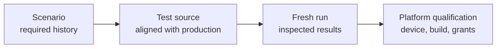

# Testing MJPEG

[Internals](../README.md) · [Scenario index](02-verification-contracts.md)

This guide explains how to verify MJPEG mode after a change. It covers which environment can establish which kind of behavior, how to run the module's local tests, and what counts as evidence. It is written for maintainers. Other documents define the behavior itself. [Usage](../../docs/usage.md), [Architecture](../../docs/architecture.md) and [HTTP server](../../docs/server.md) state what users and clients observe. The guides in the [internals index](../README.md) explain how the module implements that behavior. The [scenario index](02-verification-contracts.md) lists the histories that verification must cover.

## From required behavior to evidence

A scenario describes required behavior. It becomes verified behavior only through a chain of separate steps, and each step can fall behind the others:



- A **scenario** in the catalogue states what must hold. It doesn't claim that anything has been tested.
- **Test source** that names a scenario ID shows intent. It counts only when its fixtures and assertions match current production and the owning contract.
- A **fresh run** with inspected results is execution evidence for the environment it ran in, and only for that environment.
- **Platform qualification** on a recorded Android build and device is needed wherever behavior depends on the real platform. Examples are foreground admission, projection, local-network enforcement, connections from another device, wakefulness and visible notifications.

Keep run reports with the change or release that produced them. A report lists commands, environments, results and the scenario IDs it covered. This guide and the scenario pages describe what to verify; they are not a coverage dashboard.

## Current state of the test sources

The Kotlin sources under `mjpeg/src/test/kotlin` are drafts. Many were written against earlier production APIs, and the MJPEG unit-test task doesn't currently compile. For example, some sources still use an inactive-image setting value that production no longer has, and the browser-state contract test doesn't expect the current `imageKind` field. Successful app assembly and web-client checks are separate evidence: they neither compile nor run this suite.

Until the drafts are aligned:

- Don't report a scenario as covered just because a test method mentions its ID.
- Treat existing assertions as hints to check against current source and the owning guide, not as the specification.
- When production and a draft test disagree, the contract in the owning guide decides, unless the change deliberately alters that contract.

Test methods mark the scenarios they target with a comment such as `// Cases: MJPEG-CAP-13`. Keep that convention so that the catalogue and the tests can be cross-checked. The module has no `src/androidTest` suite and no instrumentation runner. Device evidence therefore comes from recorded manual qualification, such as the [packaged-app lifetime](scenarios/09-integration.md#mjpeg-cfg-04).

## What the local suite covers

The local suite is meant to exercise MJPEG's own logic and its adapter boundaries:

- settings persistence and edit policy
- controller admission and reconciliation
- the capture adapter
- address discovery
- HTTP delivery
- viewing access
- JPEG storage and wire output
- the web protocol

Several neighbors need their own verification, even when an MJPEG test supplies their inputs:

| Neighbor | Where its verification belongs |
| --- | --- |
| Core's manager, Service base class, consent coordination, permission host and notifications | Core, against its [public contracts](../../../core/README.md) |
| Capture Engine sessions, frames and statistics | The [Capture Engine](../../../screen-capture-engine/README.md) |
| Viewer page build, desktop preview and browser smoke | The [web client tools guide](../../tools/web-client/README.md) |
| Compose screens, clipboard, QR codes, and the app's permission and consent UI | Android UI checks in the app |
| Ktor server internals | Ktor. MJPEG tests only its own use of the CIO engine. |

A fixture that stands in for a neighbor shows how MJPEG responds to that input. It doesn't show how the neighbor behaves. The [integration scenarios](scenarios/09-integration.md) cover the points where the real pieces meet.

## Choosing an environment

Use the lowest environment that faithfully exercises the boundary under test. Test size and environment are separate choices: a small test can still need Robolectric, and a long history can run on the plain host JVM.

| Level | Environment | What it can establish |
| --- | --- | --- |
| L0 | Host JVM, no Android execution | Value policies, access decisions at explicit times, JPEG storage and readers, and saved-settings and wire fixtures parsed independently |
| L1 | Robolectric, plus Ktor's test engine or a CIO server on loopback | Simulated Android adapters, preferences and assets, in-process routes, and real host-socket histories |
| L2 | Recorded Android build on a device | Foreground and projection admission, native discovery, local-network enforcement and incoming traffic on that platform |

L0 and L1 sources live in `src/test/kotlin`. L2 sources would live in `src/androidTest/kotlin`.

- **Ktor's test engine** handles calls in process without binding sockets ([Ktor testing](https://ktor.io/docs/server-testing.html)). Listener, bind and transport histories therefore need a configured CIO server.
- **Robolectric** reproduces much of Android but not all of it ([Robolectric limitations](https://robolectric.org/best-practices/)).
- **Host success** never establishes device or OEM behavior, browser rendering, or reachability from another device. Android's [testing strategy guide](https://developer.android.com/training/testing/fundamentals/strategies) describes the same trade-off between fidelity and cost.

Some production seams determine what each level can reach:

- **Capture through the controller.** The controller creates each capture session itself, using the production engine factory. Controller-level tests therefore reach capture only through the injected `ScreenCaptureAccess`, for example with refused, failed or held consent. Histories that need particular engine phases belong at the session level, where `MjpegCaptureSession` accepts an engine factory.
- **The Service.** The controller takes the concrete `MjpegStreamingModuleService`, so its tests also run Core's Service base class. Treat what the Service itself does as Core behavior (see [MJPEG-CAP-13](scenarios/03-capture.md#mjpeg-cap-13)).
- **Interface owners.** `HttpDelivery` and `NetworkAddressMonitor` are interfaces. Controller tests can use either fakes or the real implementations.

## Android versions

The [root build](../../../build.gradle.kts) defines the SDK levels:

- The minimum SDK is API 24, the same as the Capture Engine's.
- The compile SDK and the target SDK are both 37.
- The MJPEG library takes its minimum and compile SDK from the root build and declares no target of its own. Android enforces the packaged app's target SDK.

Compile and target SDK are build baselines, not an upper limit on the Android versions MJPEG runs on.

Behavior that doesn't depend on the platform, such as saved data, wire output and ownership histories, can use one representative SDK. Platform transitions need explicit qualification on the versions where behavior changes. Record which versions actually ran, rather than implying that every release was covered.

| Boundary | What changes across versions |
| --- | --- |
| [Discovery callbacks](scenarios/04-network.md#mjpeg-net-09) | Getter fallback before API 26, callback metadata from API 26, request capabilities from API 30, public tethering events from API 36 |
| [Local-network permission](scenarios/04-network.md#mjpeg-lan-01) | Enforcement for apps targeting API 37 on Android 17, an implicit grant for lower targets, and the separate Android 16 opt-in restriction |
| [Capture foreground](scenarios/03-capture.md#mjpeg-cap-13) | Foreground service types take effect from API 29, and Android applies stricter type rules from API 34. Core's Service base class performs the promotion on each level. |
| [Consent and first Start](scenarios/03-capture.md#mjpeg-cap-12) | Core can reuse consent on older versions; modern versions always ask. Newer versions may let the user share a single app. From API 34, the Engine takes capture dimensions from projection callbacks. |
| [Real app lifetime](scenarios/09-integration.md#mjpeg-cfg-04) | Real permissions, projection, Service and incoming connections on a recorded build |

Local-network enforcement needs particular care. On Android 17, apps that target API 37 need `ACCESS_LOCAL_NETWORK`, and the restriction also covers accepting incoming TCP connections, which is exactly what MJPEG's listeners do. Android 16 applies the restriction only when it is enabled for the app, for example through the `RESTRICT_LOCAL_NETWORK` compatibility flag. Android's [local network permission guide](https://developer.android.com/privacy-and-security/local-network-permission) describes both versions.

To qualify enforcement, record the target SDK and the grant state, and connect from a client on another device. A bind on the phone, or a request from a browser on the phone itself, shows nothing about enforcement. Where projection behavior depends on the Android build or QPR, record those details too.

## Running local tests

The [module build](../../build.gradle.kts) defines the test dependencies, resources and JVM settings:

- Production code compiles with JDK toolchain 17.
- Unit tests run on a JDK 21 launcher with `--add-opens=java.base/jdk.internal.access=ALL-UNNAMED`.
- Android resources are included in unit tests.

Once the test sources compile, run this from the repository root:

```shell
./gradlew :mjpeg:testDebugUnitTest
```

To select one class, add `--tests 'fully.qualified.TestClass'`. Then inspect `mjpeg/build/reports/tests/testDebugUnitTest/` and `mjpeg/build/test-results/testDebugUnitTest/`. A successful build without fresh test results isn't execution evidence. That includes a task that was up to date or skipped. CIO histories that bind IPv4 and IPv6 addresses independently need both loopback families configured on the host.

## Evidence rules

1. **Use independent expectations.**
   - Compare results against values you computed yourself, and use recognizable byte fixtures.
   - Parse saved JSON and multipart output without the production serializer or writer.
   - Check that secrets are redacted and that authorization actually works.
   - A freshly generated credential can equal an old one by coincidence, so never assert that random values differ.
2. **Wait for stable checkpoints.**
   - A `StateFlow` keeps only its latest value, so a collector can miss transitions.
   - A race history needs explicit entry and completion barriers, plus a statement of which outcomes are allowed. Delays and incidental call counts are not barriers.
3. **Control the clocks that production reads.**
   - The controller reads `SystemClock.uptimeMillis()` for its heartbeat. It reads `SystemClock.elapsedRealtime()` for address-loss deadlines, the stop-delay warning, the slow-viewer cooldown, frame-rate calculation and statistics history.
   - Coroutine test time advances none of these clocks.
   - Production also uses fixed dispatchers (`Default`, `IO` and `Main.immediate`) that a test dispatcher doesn't replace, and socket work runs on real threads.
4. **Keep lifecycle facts apart.**
   - Saving a setting, the controller observing it, and its owner applying it are three separate facts.
   - Stop acceptance, publication cutoff, cancellation, exact consumer completion and physical cleanup are also separate.
   - A retained image or a statistics row is neither an active capture nor an active request.
5. **Account with real output.**
   - Nonzero byte counters need real written payloads.
   - Partial payloads, multipart framing and flush failures each need their own injected failures.
   - Counters show what was written, not what a peer received or displayed.
   - A shutdown request doesn't prove that transport has settled.
6. **Label supplied inputs.**
   - An engine or native input that a fixture supplies shows how MJPEG responds to that input. It doesn't show Android projection revocation, native discovery, real dependency-graph resolution or upstream behavior.
   - Some inputs are ones a conforming neighbor never produces, such as a short frame copy, a throwing engine `StateFlow` or an undocumented engine problem. Label such checks as defensive.
7. **Treat statistics as approximate.** Verify their documented baselines and lifetimes. Don't turn them into exact render timing or a new memory or performance guarantee.

[Coroutine test scheduling](https://kotlinlang.org/api/kotlinx.coroutines/kotlinx-coroutines-test/) explains which work virtual time controls.
