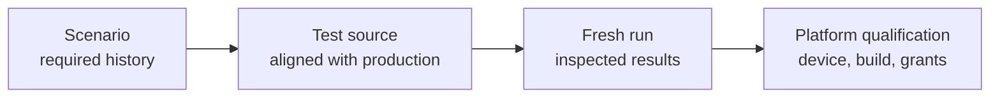

# Testing MJPEG

[Internals](../README.md) · [Scenario index](02-verification-contracts.md)

This guide explains how to verify MJPEG mode after a change. It covers which environment can establish which kind of behavior, how to run the module's local tests, and what counts as evidence. It is written for maintainers. Other documents define the behavior itself. [Usage](../../docs/usage.md), [Architecture](../../docs/architecture.md) and [HTTP server](../../docs/server.md) state what users and clients observe. The guides in the [internals index](../README.md) explain how the module implements that behavior. The [scenario index](02-verification-contracts.md) lists the histories that verification must cover.

## From required behavior to evidence

A scenario describes required behavior. It becomes verified behavior only through a chain of separate steps, and each step can fall behind the others:



- A **scenario** in the catalogue states what must hold. It doesn't claim that anything has been tested.
- **Test source** that names a scenario ID shows intent. It counts only when its fixtures and assertions match current production and the owning contract.
- A **fresh run** with inspected results is execution evidence for the environment it ran in, and only for that environment.
- **Platform qualification** on a recorded Android build and device is needed wherever behavior depends on the real platform. Examples are foreground admission, projection, local-network enforcement, connections from another device, wakefulness and visible notifications.

Keep run reports with the change or release that produced them. A report lists commands, environments, results and the scenario IDs it covered. This guide and the scenario pages describe what to verify; they are not a coverage dashboard.

## Current state of the test sources

The Kotlin sources under `mjpeg/src/test/kotlin` target current production behavior. Alignment with production is a property of the source, not a result: only a fresh run with inspected results, recorded with its change, is execution evidence. Not every scenario has an automated history, and platform-only parts stay deferred. Successful app assembly and web-client checks are separate evidence: they neither compile nor run this suite.

When you read or change these tests:

- Don't report a scenario as covered just because a test method mentions its ID.
- Treat assertions as claims to check against current source and the owning guide, not as the specification.
- When production and a test disagree, the contract in the owning guide decides, unless the change deliberately alters that contract.
- Prefer existing boundaries, Kotlin `internal` access from the module's own tests and observable outputs. Don't use reflection on private members or widen production APIs for a test. A production change made for testability is a design change of its own: explain it separately and get explicit approval before making it.

Test methods mark the scenarios they target with a comment such as `// Cases: MJPEG-CAP-13`. Keep that convention so that the catalogue and the tests can be cross-checked. The module has no `src/androidTest` suite and no instrumentation runner. Device evidence therefore comes from recorded manual qualification, such as the [packaged-app lifetime](scenarios/09-integration.md#mjpeg-cfg-04).

## What the local suite covers

The local suite is meant to exercise MJPEG's own logic and its adapter boundaries:

- settings persistence and edit policy
- controller admission and reconciliation
- the capture adapter
- address discovery
- HTTP delivery
- viewing access
- JPEG storage and wire output
- the web protocol

Local verification aims to establish all of MJPEG's documented behavior and interface contracts, with two exclusions: analytics observations and Compose UI. Histories that only the real platform can establish stay **deferred** until platform qualification records them; report them as deferred, not covered. Instrumented tests, device or emulator runs and browser runs aren't part of local verification.

Several neighbors need their own verification, even when an MJPEG test supplies their inputs:

| Neighbor | Where its verification belongs |
| --- | --- |
| Core's manager, Service base class, consent coordination, permission host and notifications | Core's [testing guide](../../../core/internal/testing/01-testing.md), against its [public contracts](../../../core/README.md) |
| Capture Engine sessions, frames and statistics | The [Capture Engine](../../../screen-capture-engine/README.md) |
| Viewer page build, desktop preview with its Node fixture checks, and manual browser smoke | The [web client tools guide](../../tools/web-client/README.md) |
| Compose screens, clipboard, QR codes, and the app's permission and consent UI | Android UI checks in the app |
| Ktor server internals | Ktor. MJPEG tests only its own use of the CIO engine. |

The existing Node fixture checks exercise the page builder and the preview harness, not the viewer's JavaScript in a browser. Automated viewer JavaScript tests would be new work and are a separate discussion.

A fixture that stands in for a neighbor shows how MJPEG responds to that input. It doesn't show how the neighbor behaves. The [integration scenarios](scenarios/09-integration.md) cover the points where the real pieces meet.

## Choosing an environment

Use the lowest environment that faithfully exercises the boundary under test. Test size and environment are separate choices: a small test can still need Robolectric, and a long history can run on the plain host JVM.

| Level | Environment | What it can establish |
| --- | --- | --- |
| L0 | Host JVM, no Android execution | Value policies, access decisions at explicit times, JPEG storage and readers, and saved-settings and wire fixtures parsed independently |
| L1 | Robolectric, plus Ktor's test engine or a CIO server on loopback | Simulated Android adapters, preferences and assets, in-process routes, and real host-socket histories |
| L2 | Recorded Android build on a device | Foreground and projection admission, native discovery, local-network enforcement and incoming traffic on that platform |

L0 and L1 sources live in `src/test/kotlin`. L2 sources would live in `src/androidTest/kotlin`.

- **Ktor's test engine** handles calls in process without binding sockets ([Ktor testing](https://ktor.io/docs/server-testing.html)). Listener, bind and transport histories therefore need a configured CIO server. Report test-engine results as in-process route evidence, separately from results over real CIO sockets.
- **Robolectric** reproduces much of Android but not all of it ([Robolectric best practices](https://robolectric.org/best-practices/)).
- **Host success** never establishes device or OEM behavior, browser rendering, or reachability from another device. Android's [testing strategy guide](https://developer.android.com/training/testing/fundamentals/strategies) describes the same trade-off between fidelity and cost.

Some production seams determine what each level can reach:

- **Capture through the controller.** The controller creates each capture session itself and forwards its `MjpegEngineFactory`, which defaults to the production factory. Controller tests can therefore control engine sessions as well as consent through the injected `ScreenCaptureAccess`. Histories about one attempt's engine phases still belong at the session level, where `MjpegCaptureSession` accepts the same factory.
- **Published screen state.** The controller exposes the state it publishes to its screen as a read-only internal `state`, so controller tests can assert it without rendering Compose. Its getter carries `@VisibleForTesting(otherwise = NONE)`.
- **Frame-rate calculation.** `calculateMjpegCurrentFps` is the production function, declared in the [capture session source](../../src/main/kotlin/io/screenstream/mjpeg/MjpegCaptureSession.kt) and annotated `@VisibleForTesting(otherwise = PRIVATE)`. Its tests check literal numeric values. Session and controller histories can supply only the Engine's own initial statistics, a lawful zero snapshot, because other Engine statistics values can't be constructed outside the Engine. Those histories show how zero is handled. They don't show a non-null or non-zero rate computed from real Engine emissions.
- **The Service.** The controller takes the concrete `MjpegStreamingModuleService`, so its tests also run Core's Service base class. Treat what the Service itself does as Core behavior (see [MJPEG-CAP-13](scenarios/03-capture.md#mjpeg-cap-13)).
- **Interface owners.** `HttpDelivery` and `NetworkAddressMonitor` are interfaces. Controller tests can use either fakes or the real implementations.
- **Listener lifecycle.** `KtorHttpDelivery` creates each bind attempt's `HttpListener` through a constructor factory that defaults to `CioHttpListener`. Delivery tests can supply an ordinary controlled listener that holds or fails start, termination and cleanup without binding a socket. Such a listener shows how delivery's ownership responds to those outcomes. Bind, transport and socket-release histories still need the default listener on real CIO sockets.
- **Discovery's observation dispatcher.** `AndroidNetworkAddressMonitor` accepts an `observationDispatcher`, `Dispatchers.Default` by default, for its owned observation scope only. Its native scans and close work still switch to `Dispatchers.IO`, and it has no injectable clock. Rule 3 under [Evidence rules](#evidence-rules) explains how cadence tests use it.

## Android versions

The [root build](../../../build.gradle.kts) defines the minimum, compile and target SDK levels; read the current values there. The [module build](../../build.gradle.kts) takes its minimum SDK, compile SDK and build tools from the root build and declares no target of its own. Android enforces the packaged app's target SDK, which the [app build](../../../app/build.gradle.kts) sets.

Compile and target SDK are build baselines, not an upper limit on the Android versions MJPEG runs on.

Behavior that doesn't depend on the platform, such as saved data, wire output and ownership histories, can use one representative SDK. Platform transitions need explicit qualification on the versions where behavior changes. Record which versions actually ran, rather than implying that every release was covered.

| Boundary | What changes across versions |
| --- | --- |
| [Discovery callbacks](scenarios/04-network.md#mjpeg-net-09) | Getter fallback before API 26, callback metadata from API 26, request capabilities from API 30, public tethering events from API 36 |
| [Local-network permission](scenarios/04-network.md#mjpeg-lan-01) | Enforcement for apps targeting API 37 on Android 17, an implicit grant for lower targets, and the separate Android 16 opt-in restriction |
| [Capture foreground](scenarios/03-capture.md#mjpeg-cap-13) | Foreground service types take effect from API 29, and Android applies stricter type rules from API 34. Core's Service base class performs the promotion on each level. |
| [Consent and first Start](scenarios/03-capture.md#mjpeg-cap-12) | Core can reuse consent on older versions; modern versions always ask. Newer versions may let the user share a single app. From API 34, the Engine takes capture dimensions from projection callbacks. |
| [Real app lifetime](scenarios/09-integration.md#mjpeg-cfg-04) | Real permissions, projection, Service and incoming connections on a recorded build |

Local-network enforcement needs particular care. On Android 17, apps that target API 37 need `ACCESS_LOCAL_NETWORK`, and the restriction also covers accepting incoming TCP connections, which is exactly what MJPEG's listeners do. Android 16 applies the restriction only when it is enabled for the app, for example through the `RESTRICT_LOCAL_NETWORK` compatibility flag. Android's [local network permission guide](https://developer.android.com/privacy-and-security/local-network-permission) describes both versions.

To qualify enforcement, record the target SDK and the grant state, and connect from a client on another device. A bind on the phone, or a request from a browser on the phone itself, shows nothing about enforcement. Where projection behavior depends on the Android build or QPR, record those details too.

## Running local tests

The [module build](../../build.gradle.kts) owns the test dependencies, the inclusion of Android resources, the JVM toolchain for production code, and the separate Java launcher and JVM arguments for unit tests. Read the current values there. The unit-test launcher affects only the host test run, not the bytecode MJPEG ships or the runtime on a device.

Run this from the repository root:

```shell
./gradlew :mjpeg:testDebugUnitTest
```

To select one class, add `--tests 'fully.qualified.TestClass'`. Then inspect `mjpeg/build/reports/tests/testDebugUnitTest/` and `mjpeg/build/test-results/testDebugUnitTest/`. A successful build without fresh test results isn't execution evidence. That includes a task that was up to date or skipped. CIO histories that bind IPv4 and IPv6 addresses independently need both loopback families configured on the host.

In Android Studio, run a test class or method from its gutter icon, or run the `mjpeg` module's `testDebugUnitTest` task from the Gradle tool window. A saved run configuration keeps the module and class names it was created with. If one names a module or class that no longer exists, delete it and create a new one from the current test source.

Gradle and Android Studio both run the suite with the module build as it is. The suite needs no custom test runner, init script, separate Gradle home or cache, and no JVM flags beyond those the module build declares.

## Doubles, shadows and fault adapters

Use the narrowest supported control for the boundary under test:

- **MJPEG's own collaborators.** Use the constructor seams under [Choosing an environment](#choosing-an-environment) and ordinary fakes of internal interfaces, such as a controlled `HttpListener`. Don't replace an MJPEG class's constructor or methods with a Robolectric shadow.
- **Android framework.** Prefer Robolectric's supported shadow APIs. For screen state, [`ShadowPowerManager.turnScreenOn(boolean)`](https://robolectric.org/javadoc/latest/org/robolectric/shadows/ShadowPowerManager.html) changes interactivity. In the [linked shadow source](https://github.com/robolectric/robolectric/blob/robolectric-4.17/shadows/framework/src/main/java/org/robolectric/shadows/ShadowPowerManager.java), it also sends the screen-on or screen-off broadcast when the state actually changes. That is an observation of the implementation, not documented API ([Harness fidelity traps](#harness-fidelity-traps)). Under the `PAUSED` looper, receivers get that broadcast only when the test runs the main looper, so a history can check behavior both before and after delivery. A custom shadow of a framework class still fits where Robolectric offers no supported control for the platform behavior or failure that a history needs.
- **Writer output and write faults.** To observe or fail a writer's output in process, intercept Ktor's public `ApplicationSendPipeline.After` phase and write the response's own `WriteChannelContent` to a controlled channel. Scope the interceptor to the exact response under test, and don't replace transport classes. The result is evidence about the writer, not about CIO transport ([Harness fidelity traps](#harness-fidelity-traps)).

## Harness fidelity traps

Ktor's test engine is a model of the server, not CIO. Check these points before you treat a test-engine result as evidence for the history it names.

These traps, the Robolectric screen-broadcast observation under [Doubles, shadows and fault adapters](#doubles-shadows-and-fault-adapters) and the WebSocket queue observations in [Web client](../02-delivery/03-web-client.md#limits-and-settlement) describe library implementation, not documented API. Their source links are pinned to the inspected release, so recheck them when the [version catalog](../../../gradle/libs.versions.toml) changes that library.

- **Repeated request headers.** In the linked source, the test client merges repeated values of a request header into one comma-joined field before the call reaches the server. `Cookie` values are joined with `; `, and only date headers stay separate ([test client engine](https://github.com/ktorio/ktor/blob/3.6.1/ktor-server/ktor-server-test-host/common/src/io/ktor/server/testing/client/TestHttpClientEngine.kt), [`mergeHeaders`](https://github.com/ktorio/ktor/blob/3.6.1/ktor-client/ktor-client-core/common/src/io/ktor/client/engine/Utils.kt)). Before you claim repeated-field coverage, assert the values the server actually saw with `getAll`. When a history needs genuinely separate field lines, send them from a raw socket to a CIO listener, as the [duplicate-header test](../../src/test/kotlin/io/screenstream/mjpeg/http/web/WebRoutesDuplicateHeaderCioTest.kt) does.
- **Response and upgrade lifetimes.** The test engine runs response producers and WebSocket upgrades under Jobs whose lifetimes differ from CIO's. Observations at the public send boundary, such as a controlled writer, or of the routing call's Job from `RoutingCallStarted`, are model evidence for MJPEG's own ownership. Physical settlement, meaning call completion and socket closure, needs real CIO.
- **One scheduler domain.** In the linked source, `testApplication` runs its block inside `runTest` on a real dispatcher, so the context it provides already carries a hidden `TestCoroutineScheduler` ([`runTestWithRealTime`](https://github.com/ktorio/ktor/blob/3.6.1/ktor-test-dispatcher/common/src/TestCommon.kt)). When a test drives a writer coroutine with a manual clock, give that coroutine a `StandardTestDispatcher` and the `TestCoroutineScheduler` it uses, in one context. Don't create such a dispatcher inside `testApplication`, where it would sit beside Ktor's hidden scheduler. Prefer `runTestApplication` called from a context without a test scheduler, which makes that ownership explicit, as `driveControlledWriter` in the [response protocol test](../../src/test/kotlin/io/screenstream/mjpeg/http/media/JpegResponseProtocolTest.kt) does. Keep the jobs structured and cancel and join them in bounded cleanup. Don't replace a missing checkpoint with a sleep or a longer timeout.

## Evidence rules

1. **Use independent expectations.**
   - Compare results against values you computed yourself, and use recognizable byte fixtures.
   - Parse saved JSON and multipart output without the production serializer or writer.
   - Check that secrets are redacted and that authorization actually works.
   - A freshly generated credential can equal an old one by coincidence, so never assert that random values differ.
2. **Wait for stable checkpoints.**
   - A `StateFlow` keeps only its latest value, so a collector can miss transitions.
   - A race history needs explicit entry and completion barriers, plus a statement of which outcomes are allowed. Delays and incidental call counts are not barriers.
   - A model that places a change at each wait point, such as a reader model, is evidence for that model only. It shows the same interposition in the real writer only where a writer history interposes at that exact point.
3. **Control the clocks that production reads.**
   - The controller reads `SystemClock.uptimeMillis()` for its heartbeat. It reads `SystemClock.elapsedRealtime()` for address-loss deadlines, the stop-delay warning, the slow-viewer cooldown and statistics history. The capture session reads the same clock for frame-rate receipts, and HTTP delivery for PIN blocks, bind retries and request history.
   - Coroutine test time advances none of these clocks.
   - Apart from discovery's observation scope, production uses fixed dispatchers (`Default`, `IO` and `Main.immediate`) that a test dispatcher doesn't replace, and socket work runs on real threads.
   - Discovery's refresh deadlines read `System.nanoTime()`. Network cadence tests explicitly instrument the `networkaddress` package under Robolectric's `PAUSED` looper mode, so those reads follow Robolectric's clock, and they pass a `StandardTestDispatcher` on the same `TestCoroutineScheduler` they advance. Advance Robolectric's clock and the scheduler together.
   - Native reads still run on real IO threads, so each supplied read needs its own entry and completion receipts. Check a read's unique inventory witness only after `runCurrent()` returns: the monitor publishes the inventory before it arms the next deadline, so publication alone doesn't show the deadline is set.
   - Bound host-side waits with the host JVM's uptime, which is independent of Robolectric. Inside the instrumented package, `System.nanoTime()` may follow the shadowed clock.
   - Don't call `advanceUntilIdle()` while recurring timers are scheduled. Advance to explicit times and run current work instead.
4. **Keep lifecycle facts apart.**
   - Saving a setting, the controller observing it, and its owner applying it are three separate facts.
   - Stop acceptance, publication cutoff, cancellation, exact consumer completion and physical cleanup are also separate.
   - A retained image or a statistics row is neither an active capture nor an active request.
5. **Account with real output.**
   - Nonzero byte counters need real written payloads.
   - Partial payloads, multipart framing and flush failures each need their own injected failures.
   - Counters show what was written, not what a peer received or displayed.
   - A shutdown request doesn't prove that transport has settled.
6. **Label supplied inputs.**
   - An engine or native input that a fixture supplies shows how MJPEG responds to that input. It doesn't show Android projection revocation, native discovery, real dependency-graph resolution or upstream behavior.
   - Some inputs are ones a conforming neighbor never produces, such as a short frame copy, an engine `StateFlow` whose collection fails, or an undocumented engine problem. Label such checks as defensive.
   - Derive a failing `StateFlow` from a real one with `onSubscription`. Don't implement the interface yourself: kotlinx.coroutines doesn't support inheriting [`StateFlow`](https://kotlinlang.org/api/kotlinx.coroutines/kotlinx-coroutines-core/kotlinx.coroutines.flow/-state-flow/) outside the library.
7. **Treat statistics as approximate.** Verify their documented baselines and lifetimes. Don't turn them into exact render timing or a new memory or performance guarantee.

[Coroutine test scheduling](https://kotlinlang.org/api/kotlinx.coroutines/kotlinx-coroutines-test/) explains which work virtual time controls.
