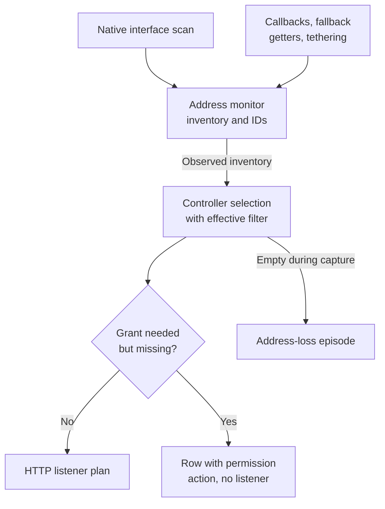

# Address discovery and local-network permission scenarios

[Scenario index](../02-verification-contracts.md) · [Testing](../01-testing.md)

This page lists the test histories for three jobs: how MJPEG finds the device's addresses, how it chooses which ones to offer, and how it holds back listeners that need Android's local-network permission. Use it when you change discovery, address classification, selection with the **Network filter**, or the permission gate.

The scenarios build on these owners:

| Behavior | Owner |
| --- | --- |
| Network filter choices, address types and advice on reaching viewers | [Usage: Connection](../../../docs/usage.md#connection) and [Make sure viewers can reach you](../../../docs/usage.md#make-sure-viewers-can-reach-you) |
| One listener per permitted address, and when Start is available | [Architecture: Addresses, listeners and readiness](../../../docs/architecture.md#addresses-listeners-and-readiness) |
| Evidence, classification, address identity, refresh and close | [Network addresses](../../01-module/05-network-addresses.md) |
| Selection with the effective filter, grant checks, Start readiness and address-loss Stop | [Coordination](../../01-module/03-coordination.md) |
| Grant checks and the permission request UI | Core [Runtime Permissions](../../../../core/docs/runtime-permissions.md) |
| Platform enforcement of local-network traffic | Android's [local network permission guide](https://developer.android.com/privacy-and-security/local-network-permission) |

Some neighboring histories belong to other pages. The controller scenarios cover Start readiness ([mjpeg-ctl-02](02-controller.md#mjpeg-ctl-02)), plans kept during Loading ([mjpeg-ctl-08](02-controller.md#mjpeg-ctl-08)), and the address-loss episode and its deadline ([mjpeg-ctl-09](02-controller.md#mjpeg-ctl-09), [mjpeg-ctl-10](02-controller.md#mjpeg-ctl-10)). Server incarnations belong to [mjpeg-srv-03](05-http-runtime.md#mjpeg-srv-03).

## Components and terms

- [`NetworkAddress.kt`](../../../src/main/kotlin/io/screenstream/mjpeg/networkaddress/NetworkAddress.kt) defines the filter, the address categories, the scoped IP key and the inventory's selection.
- [`AndroidNetworkAddressSource`](../../../src/main/kotlin/io/screenstream/mjpeg/networkaddress/AndroidNetworkAddressSource.kt) runs one native interface scan. The scan goes through the injectable [`NativeInterfaceAccess`](../../../src/main/kotlin/io/screenstream/mjpeg/networkaddress/NativeInterfaceAccess.kt). It reports the addresses found, the interfaces read successfully, the interfaces that failed, and whether enumeration completed.
- [`AndroidNetworkAddressMonitor`](../../../src/main/kotlin/io/screenstream/mjpeg/networkaddress/AndroidNetworkAddressMonitor.kt) does the ongoing observation work:
  - observes network callbacks, fallback getters and tethering events
  - numbers each platform change
  - runs scans one at a time
  - keeps address IDs and publishes the inventory
  - retires its observers on close
- `MjpegStreamingModuleController` does three things with the inventory:
  - selects addresses with the effective filter
  - removes addresses that lack a required grant
  - hands the rest to HTTP delivery as its listener plan

The scenarios use these terms:

- **Candidate:** one IP address on one interface, together with the interface type.
- **Scoped IP:** the IP bytes plus, for IPv6, the scope ID and scope interface name.
- **Alternatives:** all candidates that share one scoped IP. They share one **address ID** in each monitor instance.
- **Inventory:** the immutable map from scoped IP to its ordered alternatives. The monitor publishes it in its `Observed` state.
- **Platform snapshot:** the callback, fallback and tethering metadata at one moment. Its **revision** increases with every platform change.
- **Confirmed absence:** current evidence that a missing candidate is really gone ([mjpeg-net-06](#mjpeg-net-06)).
- **Grant-dependent address:** a non-loopback address on a Wi-Fi, Ethernet or Other interface. MJPEG plans a listener for it only while the local-network grant is present.

## Test layers and evidence

[Testing](../01-testing.md) defines the layers, the current verification status and the evidence rules. For discovery they work as follows:

- **L0** checks the filter, categories and selection on hand-built inventories.
- **L1** runs the source and monitor with a fake `NativeInterfaceAccess` and controlled `ConnectivityManager` and `TetheringManager` inputs. It also runs the controller's plan with a controlled grant.
  - Native scans and close work run on real IO threads, so hold and release each scan with entry and completion barriers. Scan deadlines read `System.nanoTime()` on the monitor's injectable observation dispatcher; cadence tests coordinate that dispatcher's scheduler with Robolectric's clock, as [evidence rule 3](../01-testing.md#evidence-rules) explains.
  - The address-loss clock is `SystemClock.elapsedRealtime()`.
- **L2** is needed for real native discovery, permission enforcement and incoming reachability.
- **Supplied inputs:** callbacks supplied by a test show how MJPEG reconciles them. They don't show that Android would deliver them. An offered address never proves that a viewer can reach it.

## Classification and selection

### Owned filter criteria

**Setup.** Build a filter from mutable sets and an inventory from mutable maps and lists.

**Steps.** Mutate the original collections after construction, apply representative filters, and try to modify the returned selection. Build a filter with an empty group. Publish an inventory equal to the current one.

**Expected.**

- Filter criteria, inventories and selections don't change when the caller's collections change, and they can't be modified.
- A filter with an empty group selects nothing. Saved settings reject empty groups separately ([mjpeg-set-01](01-settings.md#mjpeg-set-01)).
- An equal inventory produces no new state. Observers may see conflated states, so assert on stable checkpoints.

### Supported address categories

**Setup.** Supply addresses on both sides of each category boundary, including scoped IPv6 variants.

**Expected.** Compare the exact addresses selected and their categories:

1. **IPv4 Private** is exactly `10.0.0.0/8`, `172.16.0.0/12` and `192.168.0.0/16`. Neighbors such as `11.0.0.1`, `172.15.255.255`, `172.32.0.1` and `192.169.0.1`, and CGNAT `100.64.0.0/10`, are NonPrivate.
2. **IPv6 Private** is `fc00::/7`: both `fc` and `fd` prefixes, scoped or not. Addresses just outside it are NonPrivate when otherwise supported. Examples are `fbff::1` and deprecated site-local `fec0::1`.
3. **Loopback** has its own category in both families: `127.0.0.0/8` and `::1`.
4. **IPv4 link-local** `169.254.0.0/16` is LinkLocal.
5. **Never offered:** unspecified addresses (`0.0.0.0`, `::`), multicast, and IPv6 link-local `fe80::/10`, including scoped forms. They never enter the inventory under any filter.

The monitor drops the excluded addresses when it accepts candidates, so check exclusion through the monitor (L1). Category boundaries can be checked on a hand-built inventory (L0). NonPrivate says nothing about internet reachability.

### Interface type evidence

**Setup.** Supply conflicting platform transports, several networks naming one interface, tethering metadata, recognizable interface names and unknown names.

**Expected.** Types follow this precedence:

1. **One capabilities report.** VPN beats Wi-Fi, which beats Ethernet, which beats cellular (Mobile). Anything else is Other.
2. **Several networks for one interface.** A VPN report always wins. Otherwise the earlier specific type stays, and a specific type replaces Other.
3. **Tethering events (API 36+).** They fill only interfaces that have no type or are Other. Wi-Fi tethering maps to Wifi, and every other tethering type maps to Other.
4. **Name inference.** It applies to interfaces that are still Other and to interfaces without platform metadata:
   - `tun`, `tap` and `ppp` are Vpn
   - `wlan`, `wifi`, `p2p`, and `ap` followed by digits are Wifi
   - `eth` is Ethernet
   - `rmnet`, `ccmni` and `pdp` are Mobile
   - all other names stay Other
5. **Platform updates.** An update reclassifies retained candidates. If an update has no type for an interface, a retained candidate keeps its previous type.

**Evidence boundary.** Write the expected groups as an independent table. Don't reuse the production classifier to compute them.

### Filtering before duplicate choice

**Setup.** Report the same scoped IP on several interfaces. The fresh scan's candidate uses an interface type the filter excludes, and a retained candidate uses a type it matches. Add the same IPv6 bytes with two different scopes, and an unscoped IPv6 candidate next to its scoped form on the same interface.

**Expected.**

- Selection filters alternatives first, then keeps one per scoped IP. Fresh candidates come before retained ones, and the first matching alternative wins. An excluded fresh candidate can't hide a matching retained one.
- Different IPv6 scopes stay separate entries with separate IDs.
- An unscoped IPv6 candidate gives way to the scoped form of the same bytes on the same interface.
- Switching the chosen alternative keeps the address ID.
- The selection order is deterministic: interface name, address bytes, scope, then interface type.

## Identity and evidence

### Identity versus confirmed absence

**Setup.** Observe an address and record its ID.

**Steps.** Change its interface metadata. Edit the filter to exclude it and to include it again. Make its interface unreadable. Then confirm its absence with current evidence, and bring the same IP back. Separately, change its IPv6 scope and change the HTTP port.

**Expected.**

- The ID survives metadata changes, filter exclusion and unreadable interfaces.
- The ID is retired only after the absence of every alternative is confirmed. When the IP returns, it gets a new, higher ID.
- A different scope is a different address.
- The port isn't part of address identity. HTTP adds it separately.

### Listener continuity under metadata changes

**Setup.** A selected scoped IP has a Listening server.

**Steps.**

1. Change the interface type, or switch the chosen alternative, without losing that scoped IP. Keep the conditions for planning it unchanged: the effective filter still selects the address, the grant rule still permits it, and the port stays the same.
2. Separately, make a metadata change that moves the address out of the plan while its scoped IP stays in the inventory. Either move it to a type the filter excludes, with no other matching alternative, or move it to a grant-dependent type while the grant is missing. Then make it eligible again.

**Expected.**

- In the first history, the address ID stays the same, and so do the server incarnation and its listener ([mjpeg-srv-03](05-http-runtime.md#mjpeg-srv-03)).
- In the second history, discovery keeps the address ID, but the plan drops the address. Its listener is retired and its requests are cut off. That is a legitimate filter or permission cutoff, not lost continuity. When the address becomes eligible again, it returns as a new server incarnation with the same address ID.
- Different IPv6 scopes still map to different sockets.

### Completeness and absence authority

**Setup.** Vary enumeration completeness, successful and failed reads of individual interfaces, and whether platform metadata is ready.

**Expected.**

- A missing candidate is removed only when two conditions hold:
  - the scan's platform revision is still current
  - the scan either read that interface successfully, or completed enumeration without that interface failing
- After complete enumeration, the source retries failed interfaces by name. After incomplete enumeration, it retries every interface name the platform knows. A successful retry counts as a successful read.
- Candidates on interfaces that a scan neither read successfully nor ruled out keep their last evidence. Incomplete enumeration and failed reads therefore can't retire them.
- An incomplete scan can still retire candidates on interfaces it read successfully by name. If those reads cover every interface that held candidates and find them empty, the inventory validly becomes empty. Don't expect an incomplete scan to keep the inventory nonempty unconditionally.
- A scan is complete only when three things hold: enumeration completed, no interface failed, and platform metadata is ready. Readiness changes only the refresh schedule, never absence authority.
- After an incomplete result, the monitor retries after 250 ms, 1 s and 3 s, then every 30 s. After a complete result, it refreshes every 30 s. Check the schedule with scan-entry evidence, not wall-clock sleeps.

### Native absence versus callback fallback

**Setup.** Callback metadata lists addresses for an interface. Run each case separately:

- the native read of that interface fails
- the native read succeeds with no addresses
- the native read finds the interface down
- enumeration completes without that interface

**Expected.**

- Callback addresses fill in only when the native read is unknown, meaning enumeration was incomplete or that interface's read failed.
- A successful native read wins over the callback, including a read of an empty or down interface.
- Complete enumeration that omits an interface confirms its absence, even while callbacks still list addresses for it.
- Enumeration and read failures leave earlier candidates uncertain until later evidence settles them.

### Stale scan and latest filter

**Setup.** Hold a native scan in progress.

**Steps.** While the scan is held, change callback metadata and have the controller change its filter. Release the scan. Repeat with a result that is current but incomplete.

**Expected.**

- The stale result may add candidates. It retains the earlier ones and triggers an immediate rescan, but it can't confirm any absence.
- Discovery publishes the inventory, and the controller selects from it with its latest effective filter. Filters never reach the monitor.
- Uncertain observations keep their candidates. A later successful scan converges on the current addresses.

## Platform observation and lifetime

### Platform callback transitions

**Setup.** Run on the API levels below, supplying callback, getter and tethering inputs.

**Expected.**

- **All levels.** The network request adds `NOT_RESTRICTED` and requires neither `INTERNET` nor `VALIDATED`, so LAN, peer-to-peer and VPN networks participate.
- **API 24–25.** The network callback is registered, but the getter fallback still runs on every scan. For each network, callback data takes precedence over getter data. Metadata counts as ready only after a complete getter read.
- **API 26–29.** The request removes the `TRUSTED` and `NOT_VPN` capabilities. Successful callback registration clears the getter evidence and stops getter reads.
- **API 30–35.** The request clears all default capabilities.
- **API 36 and 37.** A tethering event callback is also registered. Metadata isn't ready until the first tethering event arrives.
- **Getter reads.** A getter read is discarded if any callback changed platform state during it. An incomplete getter read merges with the earlier getter evidence instead of replacing it.
- **Registration failure.** A failed callback or tethering registration is logged. Native scans and getter fallback stay available, and the next scan retries the registration.

**Late registration.** Hold a network or tethering registration until after close begins. Verify that the late registration is unregistered exactly once.

**Evidence boundary.**

- Qualify tethering fixtures by the public API they model. A Wi-Fi-only fixture establishes only the Wi-Fi mapping. The mapping of other tethering types to Other needs its own faithful input.
- Injected stock callbacks show how MJPEG reconciles them. They don't show that a real `NetworkRequest` would match.

### Discovery independent of subscribers

**Setup.** Construct a monitor without collecting its state.

**Steps.** Call `start()` repeatedly, collect later, and run the controller through its first accepted settings and several filter edits.

**Expected.**

- The controller starts discovery once, at its first accepted settings. Repeated `start()` calls are harmless.
- Discovery continues whether or not anyone collects.
- Filter edits select from the published inventory. They are not monitor inputs and don't restart discovery.

**Evidence boundary.** Prove that only one scan is active with scan entry and completion evidence. Don't count emissions, because equal states are conflated.

### Close and late registration

**Setup and steps.** Close the monitor in three situations:

- before `start()`
- while a native scan is held
- while observer registration is held

Then deliver late callbacks and call `start()` again. Cancel one close waiter while another keeps waiting.

**Expected.**

- Close admits no new work. Late callbacks change nothing, later `start()` calls are ignored, and a registration that completes after close is retired.
- Closing before start ends in `Closed` without ever publishing `Loading`.
- Successful close waits for the active scan and for every observer to be unregistered.
- Cancelling one waiter neither abandons that cleanup nor reopens discovery.

### Failure and cleanup aggregation

**Setup.** Make discovery fail while several observers are registered.

**Steps.**

1. Make several unregister calls throw.
2. Separately, make one unregister call hang, then release it.

**Expected.**

- The failure becomes observable immediately as `Failed`.
- The cleanup worker calls the unregister handles one after another, in registration order.
  - A handle that throws is recorded, and the next handle is still called.
  - A handle that hangs holds back the handles after it, and close completion, until it returns. The handles don't progress independently.
- Close completion also waits for observation to finish, including any native scan.
- Close throws the discovery failure as the primary cause. The first cleanup failure is attached to it as suppressed, and later cleanup failures are attached to that first one.
- When only cleanup fails, close throws the first cleanup failure with the later ones attached, and the state stays `Failed`.

**Evidence boundary.** Preserve the existing first-cause and suppression behavior without demanding a new deduplication rule. The controller treats a failed or closed monitor during an open instance as a module failure ([mjpeg-ctl-11](02-controller.md#mjpeg-ctl-11)).

## Local-network permission

The controller reads the grant through Core's `RuntimePermission.LocalNetwork` check. It refreshes the result on each heartbeat and filters the listener plan and Start readiness with it. The app's permission host owns request UI and its hints ([Runtime Permissions](../../../../core/docs/runtime-permissions.md#current-authorization-versus-ui-state)).

### Runtime and target gates

**Setup.** Deny the grant. Select at least one grant-dependent address.

**Steps.** Vary the runtime below 37 and at 37, and the target SDK below 37 and at 37. Focus L1 on runtime 24, runtime 36, and runtime 37 with targets 36 and 37.

**Expected.**

- MJPEG holds back grant-dependent listeners exactly when Core reports the grant missing.
- The combination that must report it missing is Android's enforcement rule: runtime API 37 or later with target SDK 37 or later. Every other combination must leave all selected rows plannable.
- Record Core's answer for each combination. Core's public guide says only that availability depends on device and app configuration.

**Evidence boundary.** Platform enforcement is a separate L2 qualification, and so is Android 16's opt-in local-network restriction. Android's guide ties that opt-in compatibility setting to `NEARBY_WIFI_DEVICES` rather than `ACCESS_LOCAL_NETWORK`. Record the declared permissions of the artifact under test rather than assuming them.

### Address permission policy

**Setup.** Deny the grant on a combination where it applies. Select loopback addresses and non-loopback Wi-Fi, Ethernet, Other, Mobile and VPN addresses.

**Expected.**

| Selected address | Without the grant |
| --- | --- |
| Wi-Fi, Ethernet or Other, not loopback | The row stays visible with the permission action and no listener |
| Mobile or VPN | A listener is planned |
| Loopback, on any interface type | A listener is planned |

- Rows held back for the grant can't make Start available.
- Only the row's permission action calls the request. Changing the filter never opens permission UI.
- Planning Mobile and VPN listeners is MJPEG's admission policy. Android's own handling of those interfaces is recorded in [mjpeg-lan-05](#mjpeg-lan-05).

### Fresh grant and revocation

**Setup.** A grant-dependent address is Listening.

**Steps.** Revoke the grant outside the controller and let a heartbeat recheck run. Then grant it again and let another heartbeat run. Alongside this, change only the permission host's UI state without changing the grant.

**Expected.**

- On revocation, the grant-dependent listeners leave the plan, and requests on them are cut off.
- Discovery evidence stays intact: the rows keep their address IDs and remain selected.
- On a new grant, those rows return to the plan as new server incarnations, keeping their address IDs.
- UI state from the permission host alone neither adds nor removes listeners. Only a fresh grant check does.

### Denial is not network loss

**Setup.** Start capture while the grant is present and every matching address is grant-dependent.

**Steps.**

1. Revoke the grant, keep the matching selection nonempty, and wait past the address-loss timeout.
2. Separately, publish an `Observed` inventory whose selection is empty.

**Expected.**

- Revocation removes the listeners but starts no address-loss episode, and capture continues past the timeout.
- The empty selection does start an episode, and Stop follows at its deadline as in [mjpeg-ctl-09](02-controller.md#mjpeg-ctl-09).
- Use the real loss clock, `SystemClock.elapsedRealtime()`, for the boundary.

### Real incoming enforcement

**Setup.** Use a qualified artifact that targets SDK 37, on an API 37 device, with a viewer on an external LAN device. Record the grant state, and test loopback separately.

**Steps.** View the stream, revoke the grant, grant it again, and watch the plan recover.

**Expected.** Report the actual outcomes: which connections were reachable, which were refused, and when the plan recovered. Don't require one particular exception class or immediate closure of the physical socket.
