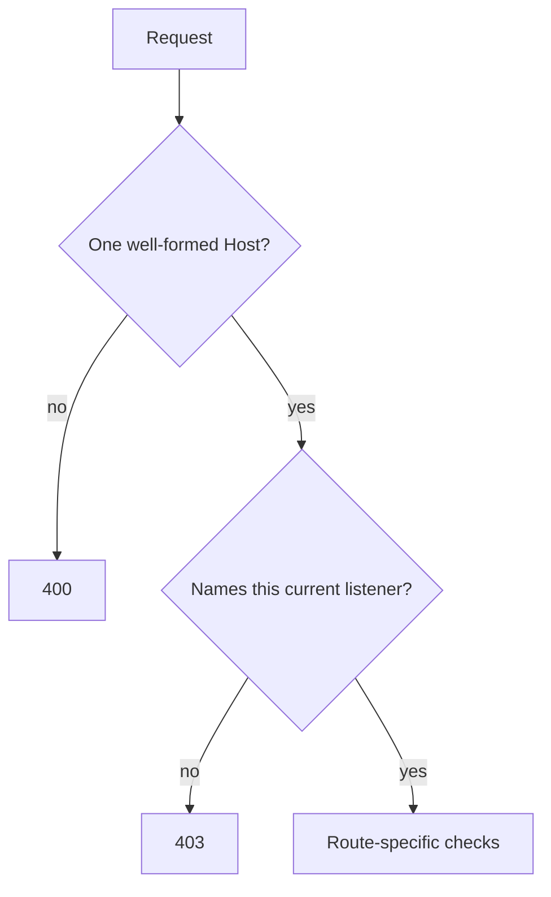

# Web protocol scenarios: request authority, routes and the state connection

[Scenario index](../02-verification-contracts.md) · [Testing MJPEG](../01-testing.md)

This page describes the histories a test needs in order to show that the HTTP surface keeps its public contract. It covers request authority, the viewer page and token exchange, PIN submission, media authorization and CORS, and the read-only WebSocket state connection.

The public [HTTP server guide](../../../docs/server.md#reference) owns the wire contract: routes, statuses, headers, credentials and the snapshot schema. This page refers to that contract and doesn't repeat its tables. [Web client](../../02-delivery/03-web-client.md) explains the Android route adapter. [HTTP delivery](../../02-delivery/01-http-delivery.md) owns admission, credentials and cutoff.

Neighboring pages own related histories:

- [Access scenarios](06-access.md) cover attempt budgets, rotation and blocks.
- [Media scenarios](07-media.md) cover image bytes.
- [HTTP runtime scenarios](05-http-runtime.md) cover listener lifetime.
- The [web tools guide](../../../tools/web-client/README.md) covers the page's own behavior in a browser.

These are requirements, not a record of passing tests. [Testing MJPEG](../01-testing.md) explains the current verification status and the evidence rules.

## The pieces under test

| Piece | Lifetime | Responsibility |
| --- | --- | --- |
| `WebRoutes` | One HTTP delivery, installed on each listener | Common headers and authority checks before routing, the routes themselves, the PIN body parser and the WebSocket adapter |
| Delivery request handler | One HTTP delivery | Whether a listener is current, token exchange, PIN verification, media admission, WebSocket admission and whether a socket is still current |
| `WebState` | One immutable value per change | The facts a snapshot encodes, plus an internal credential generation that never reaches the wire |

Several terms recur below.

- **Request authority** is the `Host` header.
- A **current listener** is the exact listener that the current plan holds. It counts as current from the moment its incarnation installs it, including while it is still starting, until its address leaves the plan or delivery stops.
- The **credential generation** changes whenever credentials are replaced. Each admitted WebSocket remembers the generation it was admitted under.

Every request passes the same checks before routing:

### Evidence layers

[Testing MJPEG](../01-testing.md#choosing-an-environment) defines levels L0 to L2 and their limits.

`WebState` encoding is plain Kotlin. Check it at L0 with an independent JSON parser. Routes, request bodies and WebSocket behavior need L1. Use Ktor's test engine for routing and body channels, and configured CIO for upgrades, transport limits and timeouts.

An L1 response proves what the server sent, not what a browser allows. CORS enforcement, mixed-content blocking and Local Network Access are browser policy. Android networking needs L2.

## Authority before routing

### Pipeline headers and listener authority

**History.** Request `/`, `/favicon.ico`, `/pin`, `/jpeg`, `/mjpeg`, `/ws` and an unknown path on three kinds of listener: a current one, one whose address has left the plan, and one after terminal stop. Send each request with no `token` parameter, an empty `token=` and a token value.

**Expected.**

- Every response, including `400`, `403` and `404`, carries the public common headers.
- `Referrer-Policy` is `no-referrer` whenever the query contains `token`, even when it's empty, and `same-origin` otherwise.
- A missing, repeated or malformed `Host` returns `400` before any other check.
- A well-formed `Host` that doesn't name this listener, or a listener that is no longer current, returns `403`.
- A retired listener admits no new request on any route.

### Direct Host forms

**History.** Send numeric IPv4 and bracketed IPv6 hosts in several spellings of the listener's address (compressed, expanded, different case). Add hosts with the port omitted and with the port given, and `localhost` on a loopback and on a non-loopback listener. Include a DNS name, another address, another port, userinfo, a path or query, a non-numeric port, non-ASCII text, an IPv6 zone identifier and repeated `Host` headers.

**Expected.**

- Syntax errors return `400`, and well-formed but unsupported authorities return `403`, following the [public rules](../../../docs/server.md#host-and-origin-checks).
- The listener match compares address bytes and port, so other spellings of the listener's own address pass.
- `Origin` is later compared with the `Host` spelling as text, case-insensitively, so equivalent bytes don't make every spelling interchangeable.
- An omitted port means port 80, which is never a saved port, so the request returns `403`.
- `localhost` works only on a loopback listener.
- The listener's IPv6 scope is ignored in the comparison. A `Host` that carries a zone identifier is rejected, because the listener's scope is not a portable authority.

### Unknown routes and forwarded data

**History.** Vary paths and methods, and add `Forwarded` and `X-Forwarded-*` headers that name trusted or untrusted hosts and peers. Use both trusted and untrusted direct `Host` values.

**Expected.** Authority checks come first. Routing then follows the public `404` and `405` rules, with `Allow` on `405`. Forwarded values never make an untrusted `Host` acceptable and never change the `Origin` comparison. They never replace the immediate peer IP used for PIN attempts and client rows. No route starts, stops or configures capture.

## Viewer page and PIN

### Packaged page and token redirect

**History.** Request `/` without `token` after changing page settings. Then request it with a current, a wrong and an empty token, on open and protected streams, with and without an existing valid cookie. Repeat a valid exchange.

**Expected.**

- Without `token`, the response is `200` with the packaged HTML. It is the same whatever the settings or credentials, because neither is injected into the page.
- With `token`, the response is always `303` to `/`. It sets the viewing cookie, with the [public attributes](../../../docs/server.md#exchanging-an-access-link), only for a current token on a protected stream.
- A repeated valid exchange returns the same cookie and rotates nothing.
- An invalid exchange sends no `Set-Cookie`, so an existing valid cookie stays in place.
- An open stream redirects without a cookie.

The redirect removes the token from the page URL, and the page script never reads the query string. Browser-side checks of that belong to the [web tools guide](../../../tools/web-client/README.md).

### PIN Origin and Referer

**History.** Submit `POST /pin` with `Origin` in these forms: matching, another host or port, another scheme, `null`, and with a path. Then send it with `Origin` absent and a same-origin `Referer` that has a path, with a foreign `Referer`, with both headers giving conflicting answers, with neither header, and with malformed values.

**Expected.**

- When `Origin` is present, it alone decides. It must equal `http://` plus the request's host and port, with no path or query, and `Referer` is then ignored.
- Without `Origin`, a same-origin `Referer` is accepted, path included.
- Everything else returns `403` before the body is read. A request rejected for its authority or origin never reaches PIN verification and never spends an attempt.

### Bounded PIN forms

**History.** On a protected stream, submit:

- a valid PIN and a wrong PIN
- a body with the `pin` field missing, a body with it repeated, and a body with extra fields
- malformed percent-encoding and non-ASCII digits
- `application/x-www-form-urlencoded` with a charset parameter, another content type, and no content type
- bodies of exactly 256 and 257 bytes
- a 257th byte that arrives while the client keeps the connection open

**Expected.** The parser accepts only a form-encoded body (parameters allowed), at most 256 bytes long, with exactly one `pin` field. Verification then requires six ASCII digits. Any other input yields no PIN, which verification treats as a wrong entry: `403`, and an attempt spent while limiting is on. The parser stops as soon as the 257th byte arrives, without waiting for the rest of the body. Invalid forms are parsed results and never authorize. Failures while reading the body are a separate case, covered by mjpeg-web-06.

### Body failure before verification

**History.** Stall the body past its five-second read limit, or fail the body channel, before parsing. Then submit a known sequence of wrong PINs to measure the remaining budget.

**Expected.** The failed request ends without PIN verification, and the wrong-PIN budget is unchanged. Don't require a stable HTTP status for a read failure or timeout, because none is defined. The read limit runs in real time inside the call, so use faithful channel and timing inputs rather than coroutine virtual time.

### PIN response and retry duration

**History.** Submit a correct PIN, a wrong PIN and a PIN during a block. Use remaining block times with a fractional second, such as 1,200 ms, and with whole seconds. Include an open stream, and a listener that retires between the authority check and verification.

**Expected.**

- A correct PIN returns `204` with the viewing cookie, and a wrong one returns `403`.
- During a block, the response is `429` with `Retry-After` in whole seconds, rounded up: 1,200 ms gives `2`, and 2,000 ms gives `2`.
- An open stream returns `204` without a cookie.
- A retired listener returns `403` without verifying the PIN or spending an attempt.

The capacity wait for unknown peers belongs to [access scenario mjpeg-acc-10](06-access.md#mjpeg-acc-10).

## Media routes

### Media authorization before availability

**History.** For `/jpeg` and `/mjpeg`, vary the credential: none, wrong token, current token, current cookie. Vary availability: a selected image, and no image (a defensive fixture without a logo). Vary the listener and runtime state: current listener, a listener retiring after the authority check, and closing delivery. Vary capture: never started, stopped and failed.

**Expected.**

- Credentials are checked first, so a request without valid credentials gets `403` even when no image is available.
- An authorized request that can't be served gets `503` with `Retry-After: 1`. That covers closing delivery, a listener that is no longer current, or no selected image.
- Both statuses carry the media CORS headers.
- Logo and retained images stay viewable while capture is inactive. Neither a running capture nor a page load is required.
- If an authorized request reaches admission after its listener retired, admission rejects it as unavailable (`503`), not with the earlier `403`. Record that as the current race outcome. Assert the `503` on the wire only while the handler can still write its response. Retiring the listener also cancels its engine and calls, so a request whose transport was already cancelled may end without any status.

### Cross-origin media credentials

**History.** For each media route, combine open and protected access with these headers and credentials:

- `Origin`: same, foreign, `null`, absent, repeated, malformed
- `Sec-Fetch-Site`: `same-origin`, `none`, `same-site`, `cross-site`, repeated
- `Referer`: same, foreign, malformed, repeated
- credentials: current token, wrong token, current cookie, token and cookie together

**Expected.**

- Any cross-origin signal on the [public list](../../../docs/server.md#external-media-clients-and-cors), including a malformed or repeated header, makes the server ignore the viewing cookie.
- On a protected stream, a cross-origin request with only the cookie gets `403`, and one with the current token succeeds. A cookie never broadens what the token allows.
- Requests with no cross-origin signal, such as native clients, can use the cookie.
- Open streams serve every combination.
- The CORS headers are fixed and never include `Access-Control-Allow-Credentials`.

### OPTIONS and preflight fields

**History.** Send `OPTIONS` to each media path with absent and arbitrary `Origin`, `Access-Control-Request-Method` and `Access-Control-Request-Headers`, with and without credentials. Also send `OPTIONS` to `/`, `/pin`, `/ws` and an unknown path. Repeat with a malformed `Host` and on a retired listener.

**Expected.** Media paths always return `204` with the fixed advertised `GET, OPTIONS` policy. They don't check credentials and don't reflect request fields. `/`, `/pin` and `/ws` grant no CORS: they return `405` with their `Allow` value, and unknown paths return `404`. Authority rejection (`400` or `403`) still comes first.

### Methods, range and compression

**History.** Send unsupported methods to known paths, including `HEAD`, `PUT`, `POST` to a media path and `GET` to `/pin`. Request unknown paths, and send `Range` on authorized `/jpeg` and `/mjpeg` requests. Offer gzip on `/` (`200`), on `/?token=` (`303`), on `/favicon.ico`, on both media paths, on `/ws` and on error responses.

**Expected.**

- Unsupported methods return `405` with the public `Allow` value, and `HEAD` is not supported. Unknown paths return `404`.
- `Range` is ignored: the response is the complete `200` image with no `206` and no `Content-Range`.
- Only the `200` HTML from `/` is gzip-compressed. Credentials, media, WebSocket and error responses aren't.
- `/favicon.ico` is public and returns `200` `image/x-icon` without credentials on protected streams too.

## State connection

### WebSocket Origin and cookie

**History.** Upgrade `/ws` with a matching, missing or foreign `Origin`, with only a same-origin `Referer`, and with a token only in the URL. Add a current, wrong or absent cookie on open and protected streams, and from a blocked peer.

**Expected.**

- A missing or mismatched `Origin` is closed with code `1008` right after the upgrade, before admission. `Referer` isn't accepted for `/ws`.
- With a matching `Origin`, an open stream, or a protected stream with the current cookie, receives snapshots.
- Anything else receives exactly one message, `{"access":"pin_required"}` or `{"access":"blocked","retryAfterMs":…}`, followed by a normal `1000` close. Denial messages carry no other fields.
- A URL token never authorizes the upgrade.
- If the listener retires, or the call ends, between the authority check and admission, application admission returns a viewing-access denial on the already upgraded connection rather than answering `403`. Record that as the current race outcome. While the handler can still send, the client receives the denial message and the `1000` close; on an open stream that message reads `pin_required`. Once the call or transport has been cancelled, the connection may end without any message. Its settlement is then checked as in [mjpeg-web-12](#mjpeg-web-12).

### Independent browser-state schema

**History.** Encode every capture status (Stopped, Starting, WaitingForPermission, Active, Reconfiguring, Suspended, Failed, Stopping) against every image kind (none, logo, live, retained), on open and protected streams. Use empty titles, Unicode titles and titles that need JSON escaping, with both layout choices. Parse the result with an independent JSON parser.

**Expected.**

- Keys, types and values match the [public schema](../../../docs/server.md#state-connection).
- The notice mapping is:
  - Stopped and Stopping → `stopped`
  - Starting, Active and Reconfiguring → `null`
  - WaitingForPermission → `permission_required`
  - Suspended → `paused`
  - Failed → `failed`
- `hasImage` is false only for `none`.
- `display` reproduces the page settings.
- Credentials, the credential generation, error details and other internal identifiers never appear.

### Latest state and generation cutoff

**History.** Change display settings, image kind and capture notice while a snapshot send is held. Rotate credentials, or retire the listener, between a change and the next send.

**Expected.**

- Each send cycle reads one immutable state value, then encodes and sends it. Every snapshot sent is therefore complete and consistent with the value read in its cycle.
- A change that lands after that read waits for a later cycle, and intermediate states may be skipped. The read, the encoding and the send are not atomic, so a test must not require the sent snapshot to match the state at the moment it is encoded or leaves the device.
- Before each send, the socket checks its listener and credential generation. After rotation or retirement, it ends without sending any snapshot of the successor state. A snapshot of the previous state that already passed its check may still go out.
- While nothing changes, the same snapshot repeats about every two seconds with the same schema. A repeat implies neither a fresh image nor delivery to the peer.

### Read-only data and transport termination

**History.** After admission, have the client send a text message and, separately, a binary message. Separately again, exchange ping and pong, send a close frame and disconnect abruptly, all while the state stays unchanged.

**Expected.** Text or binary data closes the connection with `1008`. Ping and pong are handled by the transport and close nothing. A close frame or disconnect ends the waiting state writer promptly, without waiting for the next keepalive. On exit, the handler cancels the request and the detached default-session jobs and joins the latter. Observe that settlement directly through call completion and socket closure, not through cancellation or silence.

### Frame, queue and send limits

**History.** Build snapshots whose encoded UTF-8 text is just below, exactly at and just above 256 KiB (262,144 bytes), using multibyte characters and JSON escapes. Count encoded bytes, not title characters. The stream-name editor limits names to 64 characters, but the settings model doesn't, so build the oversized title at model level.

**Expected.** Snapshots up to the cap are sent. A larger one is not sent: the connection closes with code `1011` (`InternalError`) and the reason `Page settings exceed snapshot limit`.

**History.** Separately:

- hold a send and its flush past their five-second budget
- hold a voluntary close and the join of the default session past their five-second budget
- overflow the incoming queue, which holds four frames and closes on overflow
- send an incoming frame larger than 4,096 bytes
- stop reading as a peer until the eight-frame outgoing queue fills and the send budget expires
- let the 15-second ping timeout elapse

**Expected.** Each case ends the connection at its documented cutoff, and the handler's detached session settles. These capacities bound only their own queues and frames. Total transport memory and physical cleanup time need separate evidence.
