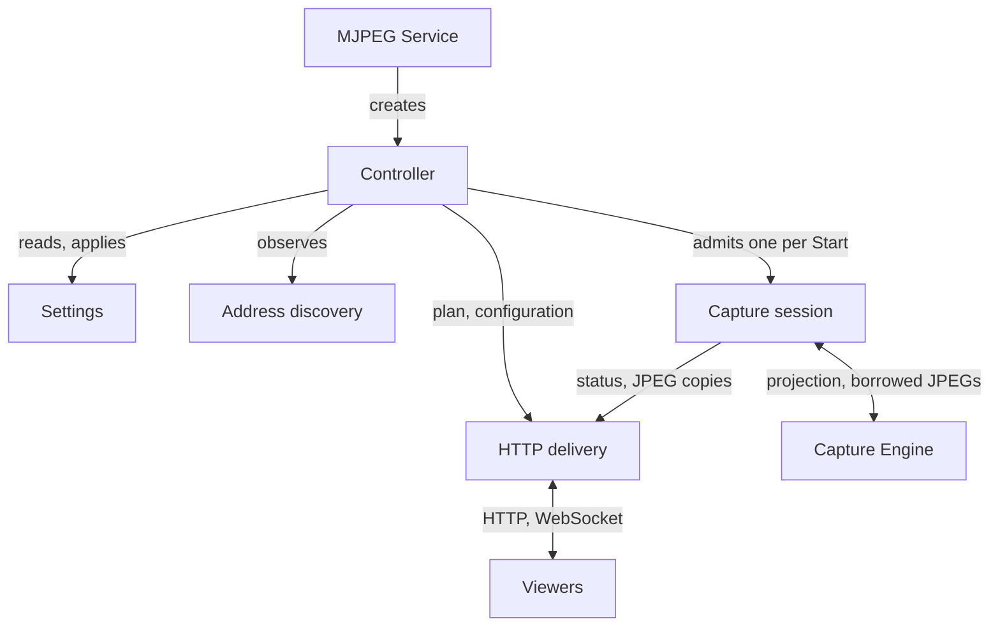

# MJPEG internals

[Overview](../README.md) · [Usage](../docs/usage.md) · [Architecture](../docs/architecture.md) · [HTTP server](../docs/server.md)

These guides are for developers who maintain and evolve MJPEG mode. They pick up where the public documentation stops. The overview and the three public guides describe what users, viewers and HTTP clients can rely on. The internal guides explain how the implementation keeps those promises: which component owns each resource, the order in which work happens, which races matter and what a failure leaves behind.

Read the public [Architecture](../docs/architecture.md) guide first. It introduces the vocabulary used here:

- **module instance**: one opening of the mode
- **capture attempt**: one accepted Start
- **listener**: the server socket on one device address
- **ready link**: the link the app shares for an address once that address can be shared
- **token**: the access key that protected links carry
- **viewing cookie**: what a browser receives after a valid link or PIN

This page maps the module's components and who owns each contract, then sets out a reading path through the internal guides.

## Components and responsibilities

MJPEG plugs into [Core](../../core/README.md) and drives the [Capture Engine](../../screen-capture-engine/README.md) through their public contracts. Within the module, a few owners divide the work. In the diagram, "creates" and "admits" arrows show ownership; the other arrows show control and data flow.

The Controller makes every coordination decision but never handles image bytes. The capture session copies each JPEG it borrows from the Engine straight into storage owned by HTTP delivery.

| Component | Responsibility | Lifetime | Source entry point |
| --- | --- | --- | --- |
| Module descriptor | Registers the mode with Core: ID `MJPEG`, its Service class and its notification slot. Creates no resources. | App process | [MjpegStreamingModule](../src/main/kotlin/io/screenstream/mjpeg/MjpegStreamingModule.kt), [Koin module](../src/main/kotlin/io/screenstream/mjpeg/MjpegKoinModule.kt) |
| Service | Core `StreamingModuleService` subclass. Keeps the instance in the foreground and creates its Controller. | One instance | [MjpegStreamingModuleService](../src/main/kotlin/io/screenstream/mjpeg/MjpegStreamingModuleService.kt) |
| Controller | Handles commands, saved settings, discovery and capture observations in one event loop. Admits Start and Stop, decides readiness, runs automation, publishes screen state and manager reports, and begins terminal shutdown. | One instance | [MjpegStreamingModuleController](../src/main/kotlin/io/screenstream/mjpeg/MjpegStreamingModuleController.kt) |
| Mode screen | Renders the Controller's published state and sends commands back. Settings screens save directly to preferences. | One instance | [MjpegUiController](../src/main/kotlin/io/screenstream/mjpeg/ui/MjpegUiController.kt) |
| Settings | Saved preferences, validation and defaults | Across openings | [MjpegSettings](../src/main/kotlin/io/screenstream/mjpeg/settings/MjpegSettings.kt) |
| Address discovery | Reports supported device addresses with interface evidence. The Controller applies the Network filter to that evidence. | One instance | [NetworkAddressMonitor](../src/main/kotlin/io/screenstream/mjpeg/networkaddress/NetworkAddressMonitor.kt) |
| Capture session | One attempt: consent, projection handoff, the Engine session, frame copying, publication authority and cleanup | One accepted Start, through its cleanup | [MjpegCaptureSession](../src/main/kotlin/io/screenstream/mjpeg/MjpegCaptureSession.kt), [Engine adapter](../src/main/kotlin/io/screenstream/mjpeg/MjpegCaptureEngineAdapter.kt) |
| Screen-off observer | Reports screen-off to the attempt that registered for it | One instance | [AndroidScreenOffObserver](../src/main/kotlin/io/screenstream/mjpeg/screenoff/AndroidScreenOffObserver.kt) |
| HTTP delivery | Listeners, viewing credentials and PIN blocks, request admission and accounting, image selection and storage, and browser state | One instance | [HttpDelivery](../src/main/kotlin/io/screenstream/mjpeg/http/HttpDelivery.kt), [KtorHttpDelivery](../src/main/kotlin/io/screenstream/mjpeg/http/KtorHttpDelivery.kt) |
| Viewer page | A self-contained HTML document built from the web-client sources and packaged as an Android asset | Served by every listener | [Web client tools](../tools/web-client/README.md) |

Inside HTTP delivery, smaller owners hold access state, request history, the image store and the route adapter. [HTTP delivery](02-delivery/01-http-delivery.md#components-and-lifetimes) lists them.

Locks nest in one order across the module: capture-session state gate, then HTTP control monitor, then JPEG store monitor. JPEG copies, network writes, binds and joins run outside all of them. [Capture lifecycle](01-module/02-module-lifecycle.md#canonical-capture-state), [HTTP delivery](02-delivery/01-http-delivery.md#locks-and-where-work-runs) and [JPEG delivery](02-delivery/02-jpeg-delivery.md#locks-and-threads) explain each side.

## Lifetimes and identities

Much MJPEG work finishes after the situation that started it has changed. A consent result can arrive after Stop. A frame callback can run after its capture paused. A bind can complete after its address disappeared. A WebSocket can be about to send after the credentials rotated. Each kind of work therefore carries the identity of the owner that started it, and that owner checks the identity before a late result takes effect.

| Identity | What it names | Changes when | Prevents |
| --- | --- | --- | --- |
| Module instance (`InstanceId`, `ManagerHandle`) | One opening of the mode | Reopen, **Restart mode**, another mode | An old Controller or Service reporting to, or cleaning up, a replacement |
| Capture attempt (`CaptureAttemptId`) | One accepted Start | Every accepted Start | A delayed Stop, such as from the notification or screen-off, ending a newer attempt |
| Capture generation | A period in which one attempt may publish JPEGs | Pause, recovery or Stop, possibly several times within one attempt | Late frame copies reaching viewers after publication was revoked |
| Server incarnation (planned server UUID) | One planned listener for one selected address on one port | A plan that adds an address, re-adds one after it was removed, or changes the port. Bind retries, **Retry** and metadata updates for the same address and port keep it. | A **Retry** or a late bind result reaching a listener that a plan change has retired |
| Credential generation | One token and cookie pair | Changing the PIN while protected, or turning protection on or off. Every instance starts its own. | Admitted state connections and media continuing under revoked credentials |

### Requests, completion and release

Keep four boundaries apart for every operation: a request, its acceptance, its logical completion and the physical release of its resources.

- **Start.** A tap sends a request, and the event loop decides it at handling time. Capture is confirmed when the Engine's `start()` returns, but frame callbacks can begin earlier, so publication authority exists from admission. The first JPEG can arrive after confirmation.
- **Stop.** An accepted Stop revokes publication at once. Its cleanup outcome records the steps that the Engine and Core contracts confirm. Physical release beyond those contracts stays unproven. [Stop and capture cleanup](01-module/02-module-lifecycle.md#stop-and-capture-cleanup) owns the order.

Capture Stop and instance closure are different operations. Stop ends one exact attempt and keeps listeners, credentials, viewers and statistics history; its successful cleanup makes the controller idle and applies deferred setup. Closure retires the whole instance, including capture, HTTP delivery, discovery and the Service, and a replacement starts with fresh credentials. Exit, **Restart mode**, another mode, a terminal component failure, failed capture cleanup and Service destruction all close the instance.

Closure has one terminal entry point. It closes admission before cancelling work, so cleanup can't miss an owner admitted at the same moment. Core's manager waits for the cleanup result only for a [bounded time](../../core/docs/module-contract-and-manager.md#closing-a-module-instance), so a replacement can open while the old instance is still releasing resources. Don't describe old cleanup as finished just because the manager has moved on. [Controller shutdown](01-module/02-module-lifecycle.md#controller-shutdown-and-complete-module-cleanup) owns the order, and [Cleanup obligations](01-module/01-module-integration.md#cleanup-obligations) lists what the result covers.

## Rules that span several guides

- **One place decides.** Only the Controller's event loop changes its facts: accepted settings, address selection, processed capture state and warnings. Start and Stop are decided when the loop handles them, not when the screen offered them. [Coordination](01-module/03-coordination.md) owns this rule.
- **Setup waits for successful cleanup.** The JPEG encoder, the HTTP port and the access settings (except hiding the PIN) can be saved at any time. They take effect only while no attempt is pending cleanup. [Settings](01-module/04-settings.md) owns persistence and the effective-settings projection.
- **The PIN is prepared once per opening.** With protection on and **New PIN on open**, the Controller generates a PIN once, before HTTP delivery first applies the access settings. With protection off, opening the mode leaves the PIN alone.
- **Ready links reflect applied state.** A row's ready link is built from applied facts: a permitted, listening, portable address, applied access settings and, with protection on, HTTP's applied token. Saved but unapplied access never reaches a link. [Coordination](01-module/03-coordination.md#statistics-and-native-state-projection) owns the rule.
- **Each credential has its own channel.** The server accepts the token in media URLs and in the `/` exchange, which turns it into the cookie; the page script never reads it. `/ws` always requires a matching `Origin` and, on a protected stream, the cookie; it ignores the token. Cross-origin media requests must carry the token because their cookie is ignored. The [HTTP server guide](../docs/server.md#access-and-credentials) owns the wire rules, and [HTTP delivery](02-delivery/01-http-delivery.md) and [Web client](02-delivery/03-web-client.md) own enforcement.
- **Discovery doesn't prove reachability.** A listed address may be a VPN, routed or non-private address, and nothing restricts viewers to a local network. [Network addresses](01-module/05-network-addresses.md) owns classification and its limits.

## Contract owners

Public pages own observable behavior, including technical contracts such as the wire tables in the HTTP guide and the user settings catalogue with defaults in Usage. Internal pages own the obligations behind that behavior: admission gates, ordering, cancellation, retries and cleanup receipts. They link to the public owners rather than restating them. Shared dependencies keep their own contracts, and MJPEG relies only on the public Core and Engine documentation.

| Question | Public owner | Internal extension |
| --- | --- | --- |
| What does MJPEG offer, and what are its limits? | [Overview](../README.md) | This page |
| How do controls, settings, permissions and recovery behave for users? | [Overview](../README.md) · [Usage](../docs/usage.md) | [Coordination](01-module/03-coordination.md), [Settings](01-module/04-settings.md), [Network addresses](01-module/05-network-addresses.md) |
| Which component owns work, images and lifetimes? | [Architecture](../docs/architecture.md) | [Module integration](01-module/01-module-integration.md), [Capture lifecycle](01-module/02-module-lifecycle.md), [JPEG delivery](02-delivery/02-jpeg-delivery.md) |
| What must an HTTP client send, and what does it receive? | [HTTP server](../docs/server.md) | [HTTP delivery](02-delivery/01-http-delivery.md), [Web client](02-delivery/03-web-client.md) |
| How are instances, the Service, the manager and health defined? | [Streaming Module Contract and Manager](../../core/docs/module-contract-and-manager.md) | [Module integration](01-module/01-module-integration.md) |
| How do consent, projection handoff and legacy consent reuse work? | [Screen Capture Access](../../core/docs/screen-capture.md) | [Module integration](01-module/01-module-integration.md), [Capture lifecycle](01-module/02-module-lifecycle.md) |
| How is the local-network permission checked and requested? | [Runtime Permissions](../../core/docs/runtime-permissions.md) | [Coordination](01-module/03-coordination.md), [Network addresses](01-module/05-network-addresses.md) |
| How are the foreground notification and errors presented? | [Streaming Module Notifications](../../core/docs/notifications.md) | [Module integration](01-module/01-module-integration.md) |
| What do Engine sessions, borrowed frames, parameters and stop guarantee? | [Capture Engine usage](../../screen-capture-engine/docs/usage.md) | [Capture lifecycle](01-module/02-module-lifecycle.md), [JPEG delivery](02-delivery/02-jpeg-delivery.md) |
| How is the viewer page built and previewed? | [Web client tools](../tools/web-client/README.md) | [Web client](02-delivery/03-web-client.md) |

## Reading path

The guides are grouped in the order a newcomer usually needs them. Each entry says what the guide covers, so you can also jump straight to the guide for the part you're changing.

### 1. Module: one instance, its captures, settings and addresses

- [Module integration](01-module/01-module-integration.md) covers how Core installs one instance. It describes the descriptor, Service and Controller factory, the manifest declarations and foreground types, permission use, and the reports MJPEG sends the manager. Read it when you change registration, DI or the Android declarations.
- [Capture lifecycle](01-module/02-module-lifecycle.md) follows one attempt from admission through consent, projection handoff and Engine start, then through publication generations, Stop and cleanup, and finally complete module cleanup. Read it when you change capture startup, state precedence or resource release.
- [Coordination](01-module/03-coordination.md) covers the Controller's event loop. It explains command admission and Start readiness, effective settings, the address plan and local-network permission, and the address-loss deadline. It also covers screen-off and keep-awake, slow-viewer warnings, statistics, and the state published to the screen and the manager.
- [Settings](01-module/04-settings.md) covers the saved model and defaults, validation, PIN generation and edits, the edit policy and effective settings, and storage recovery.
- [Network addresses](01-module/05-network-addresses.md) covers discovery sources and evidence freshness, classification and filtering, address identity, refresh and close, and platform and permission limits.

### 2. Delivery: how images and state reach viewers

- [HTTP delivery](02-delivery/01-http-delivery.md) covers the listener plan and scoped sockets, credential generations and PIN blocks, request admission and cutoff, client history and statistics, terminal cleanup and transport limits.
- [JPEG delivery](02-delivery/02-jpeg-delivery.md) covers frame copying and publication authority, image selection, reader leases and pooling, JPEG and multipart writing, and slow-reader observations.
- [Web client](02-delivery/03-web-client.md) covers the route adapter, authority and origin checks, the PIN body parser, WebSocket transport, and the browser page's owners and recovery. The [web client tools](../tools/web-client/README.md) guide owns the sources, the generated asset and the desktop preview.

### 3. Testing: required behavior and evidence

- [Testing](03-testing/01-testing.md) covers verification layers, supported Android versions, how to run checks and the rules for honest evidence. It also records the current status: the Kotlin test sources are drafts that need alignment with current production APIs before they can provide evidence.
- [Verification scenarios](03-testing/02-verification-contracts.md) is the index of required histories. It maps each area to its scenario page and existing source entry points.

Scenario IDs and their anchors identify required behavior across implementations. Keep every ID, and keep its distinct failure, race and boundary-value histories, when you reorganize prose or tests.

## Keep a change reviewable

1. When observable behavior changes, update its public owner first, then the internal extension. Exact wire tables stay in the HTTP guide, user settings and defaults stay in Usage, and shared host guarantees stay with Core or the Engine.
2. Explain the ownership, ordering and failure consequences that a later maintainer must preserve. Link to source entry points where they help, but don't keep a parallel inventory of classes or declarations.
3. Update the relevant scenario page. Keep required behavior, compatible test source, fresh execution and platform qualification as separate claims. Store execution reports with the change or release, not in these references.
4. Check relative links and anchors. Keep diagrams small, and say what their arrows mean.
