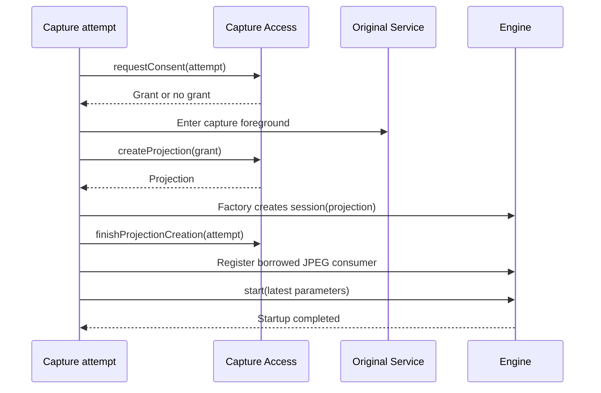
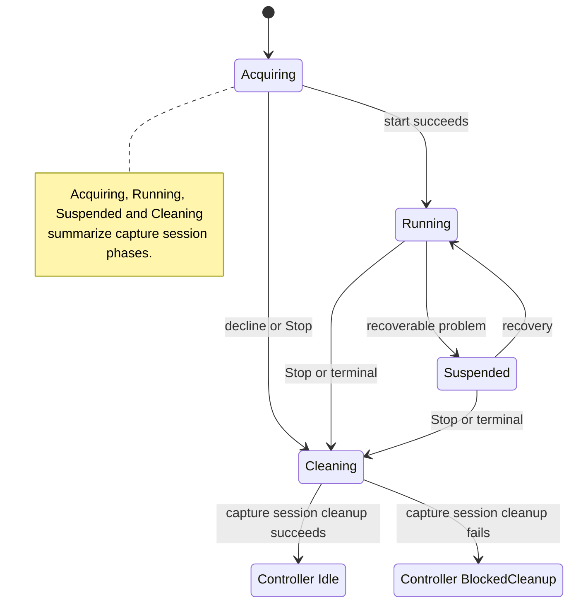

[Internals](../README.md) · [Streaming host](streaming-host.md) · [Coordination](coordination.md)

# Native module and capture lifecycle

[MjpegCaptureSession](../../src/main/kotlin/io/screenstream/mjpeg/MjpegCaptureSession.kt) adapts one engine run to native MJPEG. It owns consent, foreground lifetime, projection before engine handoff, the engine session, borrowed-frame registration and their cleanup. [MjpegStreamingModuleController](../../src/main/kotlin/io/screenstream/mjpeg/MjpegStreamingModuleController.kt) owns admission of that attempt and cleanup of the whole module. HTTP image/response lifetimes are separate; [JPEG delivery](../03-delivery/jpeg-delivery.md) owns their rules.

The internal [engine adapter](../../src/main/kotlin/io/screenstream/mjpeg/MjpegCaptureEngineAdapter.kt) supplies `MjpegEngineFactory` and `MjpegEngineSession`; their default implementation forwards engine operations and statistics. The session exposes phase, problem and stop reason, borrowed `MjpegBorrowedJpeg` callbacks and the exact consumer registration. Successful factory return transfers projection ownership; a thrown construction step leaves it with the capture attempt. Registration `unregister` awaits exact consumer completion separately from media stop. These types are internal boundaries, not a public integration API.

## Startup and projection ownership

The capture session is inert until `runCapture(initialImageSettings)`, called once before Stop or updates. It fixes the JPEG backend for the attempt, prepares desired dynamic parameters and launches in controller scope. Return is not consent, startup or first-JPEG confirmation. Before constructing it, the controller calls HTTP `registerCapture` for the new exact attempt.

The sequence shows successful startup. No grant sets the first Stop cause to User and proceeds to cleanup; it does not repeat consent. Failures are tagged by acquisition stage. Consent is obtained in the lifetime coroutine so its requesting Job remains valid for projection admission. [Streaming host](streaming-host.md#consent-and-projection-handoff) owns Access correlation and version rules.

The capture session stores a returned raw projection immediately. Failed engine construction leaves it session-owned. After successful construction the engine owns it, the raw variable is cleared and the creation guard is released. Late platform return after Stop still enters rollback/handoff; cancellation cannot make a returned resource ownerless.

The consumer forwards byte count and a synchronous copier. The copier is valid only in that callback on its original thread, writes at offset zero and must not be retained. HTTP can decline the offer or copy into its owned storage. Incomplete/throwing copy is an Output.frame failure, retains the first capture failure, requests Error Stop and cancels capture. Consumer registration can receive a callback before engine `start` returns; there is no separate first-frame startup barrier.

## Desired parameters and engine observations

The latest dynamic image settings remain in a StateFlow through consent/startup. Initial engine parameters come from its latest value. While the engine is Active, Reconfiguring or Suspended, changed desired values are submitted to the same session; a closed engine admission can reject them with IllegalStateException without inventing a new attempt. Equal parameters are not resubmitted. Backend policy stays fixed, while crop-disabled and unselected size values remain saved but are not sent as active parameters. [Settings](../02-configuration/settings.md) owns model validation/conversion choices.

The capture session observes engine state and maps terminal Stopped/Failed to cancellation of its capture coroutine. A state-observation failure is retained as capture failure. Engine statistics are logged; their observation failure is logged without defining a capture failure. Engine geometry, configuration convergence, old-frame allowance and recovery behavior remain the [engine contract](../../../screen-capture-engine/docs/usage.md).

## State and failure precedence

The capture session publishes latest `status`, `isStreaming`, optional suspension problem, first capture failure, first cleanup failure and nullable `cleanupSucceeded`. StateFlow may skip intermediate values; retained outcomes remain available.

| Condition, in precedence order | Capture session status |
| --- | --- |
| Retained capture/cleanup failure, false cleanup or engine Failed | Failed |
| Cleanup outcome available with no failure | Stopped |
| First Stop accepted with cleanup pending | Stopping |
| No engine yet | WaitingForPermission |
| Engine NotStarted/Starting | Starting |
| Engine Active/Reconfiguring/Suspended | Matching status |
| Engine Stopped with cleanup pending | Stopping |

`isStreaming` is true only after successful engine start, before any Stop/failure/cleanup outcome and without engine terminal state. It remains true through Reconfiguring/Suspended after startup. Active before `start` return alone is not confirmation of `isStreaming`. A retained failure outranks successful cleanup, leaving Failed until a new controller-admitted attempt replaces it.

Suspended maps engine InvalidRequest, CaptureUnavailable or ResourceExhausted to its stable problem category. The reason is published only while status is Suspended. InternalFailure/UnsupportedColorSpace are not expected suspension reasons. The current native UI receives the reason but does not display it or offer capture Retry.

The diagram separates simplified capture session phases from controller cleanup outcomes. Running includes Active/Reconfiguring. Successful cleanup permits a replacement attempt in controller Idle even if the last attempt still reports Failed; failed cleanup retains that exact attempt in BlockedCleanup.

## Stop and suspension

`stop(reason)` preserves the first User/System/Error/Shutdown cause and requests cancellation immediately. It does not wait for callback completion or cleanup. Parameter updates after Stop are ignored. `awaitCleanup` only waits for the retained outcome; it neither starts nor stops capture, and cancellation of a waiter does not cancel the owner.

Ordinary Stop leaves HTTP/module open and applies stopped-image policy. Suspension keeps the same engine session/foreground lifetime but closes the current HTTP production source and clears image selection. There is no MJPEG recovery timer, suspension deadline or continuous retry. Changed parameters/capture conditions may recover the session; equal parameters are not a retry. System projection Stop and the controller's [empty-address timeout](coordination.md#network-loss-deadline) still apply during suspension.

Saved keep-screen-awake and additional screen-off Stop preferences have no connected runtime handling.

### Recorded wakefulness design (unimplemented)

The earlier architecture recorded a plan for one controller-owned `SCREEN_DIM_WAKE_LOCK` during capture, including Suspended and while another app is foreground; idle HTTP would not require it. This remains unimplemented and has no device validation. The recorded decision accepts the [API's deprecated status](https://developer.android.com/reference/android/os/PowerManager#SCREEN_DIM_WAKE_LOCK) while it remains available.

The plan uses [`acquire(timeout)`](https://developer.android.com/reference/android/os/PowerManager.WakeLock#acquire(long)) without reference counting, renewed only by processed controller heartbeats so a stalled controller cannot renew it. Stop, disabling `keepScreenAwake` and module Shutdown would end renewal and attempt release independently of other cleanup; Service destruction alone is insufficient.

## Capture cleanup and its evidence

Entered resource cleanup runs with [NonCancellable](https://kotlinlang.org/api/kotlinx.coroutines/kotlinx-coroutines-core/kotlinx.coroutines/-non-cancellable/). Cancelling the controller/attempt triggers this cleanup rather than abandoning it. If cancellation wins before capture body entry, completion records successful cleanup without acquired resources; abnormal completion without an outcome records cleanup failure.

| Obligation | Completion rule |
| --- | --- |
| JPEG consumer | Unregister runs independently and is awaited, including admitted exact callback/copy completion. |
| Media | Stop engine session after handoff, otherwise stop raw projection when present. |
| Foreground | After engine handoff, attempt removal only if engine stop returned successfully. Before handoff, attempt removal even if raw projection rollback failed. |
| Projection guard | Attempt exact `finishProjectionCreation`, independently of earlier media/foreground errors. |
| Consent reuse | Only after successful cleanup and eligible normal completion, as below. |

Each operation retains the first cleanup failure without hiding the first capture failure. Failure in one obligation does not skip consumer/guard work. Final nullable cleanup outcome is published once work settles; a suspended/hung operation keeps it pending. `cleanupSucceeded=true` can accompany capture failure.

Successful engine stop confirms logical stop and projection-stop return, **not complete internal engine physical cleanup**. Consumer unregister supplies the separate exact callback-completion boundary. Successful capture session cleanup means these available operations completed without error; it cannot strengthen engine/Android guarantees. Pending/failed engine stop does not authorize normal foreground removal after handoff.

Consent reuse requires successful startup, successful capture session cleanup, no capture failure, first Stop cause User or Shutdown and engine `Stopped(Requested)`. The Access coordinator then permits only the latest admitted consumed Grant to save once on SDK 24–33. Failed startup, failure/system revocation and failed cleanup do not save. The cancelled requesting Job need not remain active to save after cleanup.

## Controller shutdown and complete module cleanup

`requestModuleShutdown` is the sole terminal ingress. Its once-only signal first closes foreground admission, HTTP admission and the retained capture owner, then cancels ordinary controller work, closes the event queue, clears UI and starts the independent cleanup receipt. Nested `finally` blocks preserve later closure obligations when an earlier action fails. Capture admission and shutdown share a gate so cleanup cannot miss a newly created session.

Cleanup starts three branches independently:

- HTTP `stop`, including its owned runtime/listeners/requests.
- Address-monitor `close`, including scans and observer retirement.
- Platform branch: latest admitted capture `awaitCleanup`, final foreground removal, original Service `stopSelf`, then `awaitDestroyed`.

The controller joins admitted ordinary jobs, including entered preference saves, and awaits all branches. False reflects any failed available obligation. A hanging capture cleanup does not prevent HTTP/monitor cleanup starting but can prevent the platform branch and total receipt settling. A cancelled `awaitCleanup` caller abandons only its wait.

The retained capture owner survives controller activity changes, so successful/failed attempt completion cannot remove the last owner's cleanup obligation. Capture cleanup failure blocks new Start; successful cleanup returns to Idle and allows deferred setup application. Manager deadlines and Service destruction callbacks do not substitute for these outcomes. [Streaming host](streaming-host.md#reports-clocks-and-deadlines) owns bounded waiting; actual device/graphics/socket release remains separate evidence.
