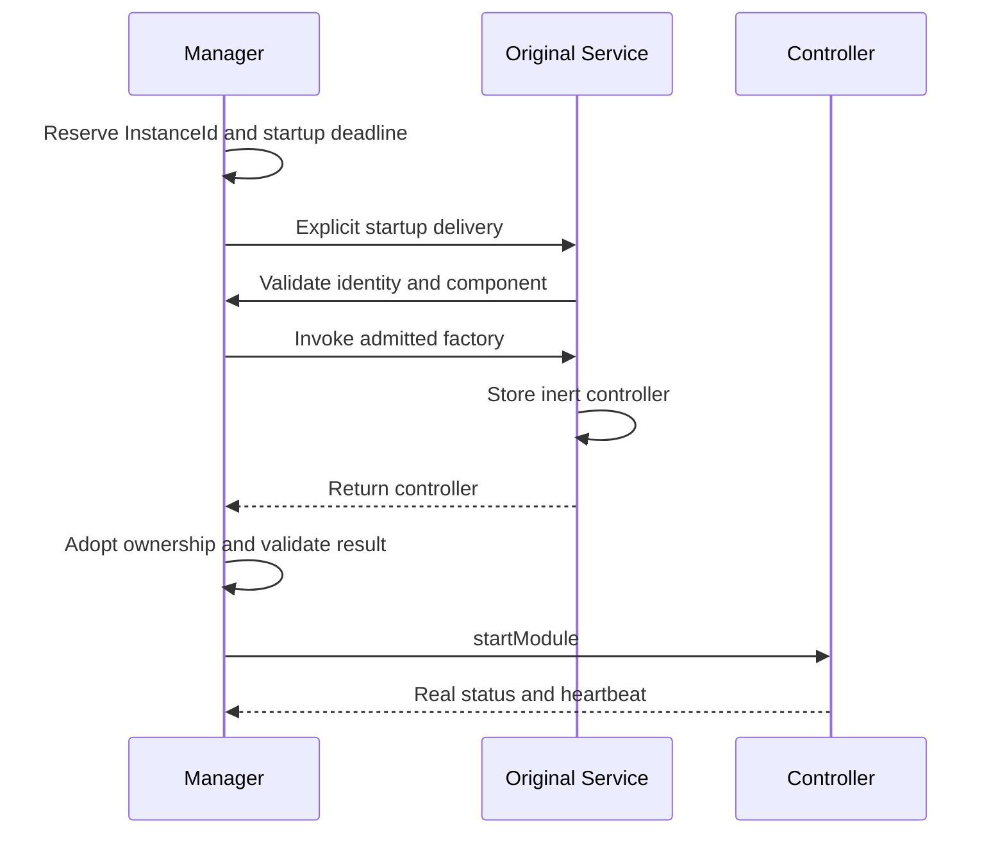

[Internals](../README.md) · [Module lifecycle](module-lifecycle.md) · [Coordination](coordination.md)

# Streaming host and Android coordination

MJPEG uses shared infrastructure to reserve a module launch, admit its original Service/controller, coordinate consent and route exact capture Stop. The controller owns ordinary work and independent cleanup. This page owns those host boundaries; [Usage](../../docs/usage.md) owns caller behavior and [Architecture](../../docs/architecture.md) supplies the common model.

Sources: [StreamingModuleManager](../../../streaming-core/src/main/kotlin/io/screenstream/streaming/StreamingModuleManager.kt), [manager implementation](../../../streaming-core/src/main/kotlin/io/screenstream/streaming/manager/StreamingModuleManagerImpl.kt), [module/controller API](../../../streaming-core/src/main/kotlin/io/screenstream/streaming/module/StreamingModule.kt), [Service base](../../../streaming-core/src/main/kotlin/io/screenstream/streaming/module/StreamingModuleService.kt), [native Service](../../src/main/kotlin/io/screenstream/mjpeg/MjpegStreamingModuleService.kt) and [capture Access](../../../streaming-core/src/main/kotlin/io/screenstream/streaming/capture/ScreenCaptureAccessImpl.kt).

## Service-first launch and ownership

The catalog is fixed and priority-sorted with unique IDs; construction/registration does not launch a module. Native metadata uses ID `MJPEG`, priority 25 and `MjpegStreamingModuleService`. Each launch has an `InstanceId` and a Runtime: the manager-provided handle for checking that launch's admission and reporting its status/failure. The manager routes commands to the original launch, and old reports cannot affect a replacement.

On Main, `onServiceStart` checks the action, reserved identity, component, pending admission and absence of an existing controller before invoking the factory. Rejected/repeated/stale deliveries create no second controller.

The Service stores the factory result before returning. The manager adopts it before checking its identity or calling `startModule`, retaining the cleanup obligation even for a late/invalid result. The manager releases its short gate before invoking the factory, module commands or Compose content.

The Service returns `START_NOT_STICKY`. With no controller it calls `stopSelfResult(startId)`; a rejected delivery to an occupied Service does not stop another launch's controller. The Service owns the original reference and destruction callback. The controller owns HTTP, discovery, capture and admitted operations; settings singletons outlive launches. Installed controllers retain reference identity so observation does not merge different launches by value equality.

## Selection and process state

One Main transition handles selection/restart/Exit. The first selection waits for [StreamingSettings](../../../streaming-core/src/main/kotlin/io/screenstream/streaming/settings/StreamingSettings.kt) initialization and rechecks its exact operation afterward. Exit or a superseding transition prevents a stale read from launching. Saved available ID wins, otherwise the first catalog entry is used. A null saved choice gets the fallback persisted; an unknown saved ID is not automatically overwritten. Later null selection uses the prepared choice. Explicit changed choices are persisted sequentially.

| Manager state | Exact meaning |
| --- | --- |
| NoModule | Before initial selection. |
| Switching | Settings preparation, replacement or first real status is pending. |
| Running | Accepted control report; capture, server readiness and consumers remain separate. |
| Unresponsive | Heartbeat stale, retaining last accepted status without automatic admission revocation/Stop. |
| Failed | First terminal launch/module failure, retained through cleanup. |
| Exiting | Exit pending or completed; selection can reopen after the operation finishes. |

Current instance ID is published only for Running/Unresponsive/Failed; after cleanup it may identify an outcome rather than a live controller. Read one `state` value for coherent phase/identity. `InstanceContent` additionally requires the exact installed controller and open admission. Switching/Exiting hide prior content. The current selector is disabled during Switching; shell Failed/Unresponsive and explicit Restart presentation remain unfinished.

Same current module ID is a no-op even in Failed/Unresponsive. Restart requires the exact current failed/unresponsive instance outside a transition, creates a new launch UUID and preserves saved selection. Concurrent selections/restarts are rejected without queueing. Neither operation automatically starts capture.

## Reports, clocks and deadlines

LaunchRecord retains bounded slots for latest Running, first failure and Finished. The first failure closes admission and requests Shutdown. Later success cannot erase it or affect a replacement. Before the first accepted real status, dispatch/factory/timeout failures classify as LaunchFailed; afterward they classify as ModuleFailed. Recoverable native capture failures belong to MJPEG, not automatically to manager failure.

| Rule | Clock and boundary |
| --- | --- |
| First real status | Three seconds elapsed realtime from dispatch reservation, not from `startService` return. |
| Heartbeat freshness | More than three seconds uptime since the accepted heartbeat becomes Unresponsive. |
| Native heartbeat | Actual control-loop uptime, approximately every second subject to scheduling. |
| Launch shutdown wait | One retained absolute elapsed-realtime deadline, assigned when the manager first requests bounded shutdown waiting. |

The native loop's first report does not wait for settings or network readiness. Smaller heartbeat timestamps cannot move the accepted timestamp backward. Fresh status can recover Unresponsive; terminal Failed remains terminal. Deep sleep does not consume uptime; Main scheduling delay can cause a reversible stale-heartbeat observation. A timer wakes control work but is not itself proof of processed work.

The manager assigns a shutdown deadline three seconds from its bounded-wait request and preserves it thereafter. Failure ingress can close admission and begin cleanup before Main processes the failure and assigns that deadline. Cleanup start and deadline assignment are separate events.

Switch/restart waits separately for old shutdown and new startup, potentially six seconds of scheduled waiting. Exit supersedes opening, joins any existing shutdown deadline and never extends it. Absolute deadlines do not guarantee wall-clock API return when Main or Android calls are blocked. Deadline/abandoned waiter ends waiting only; controller cleanup continues independently.

On Finished, the manager releases controller references regardless of success. A false result reports failed/unconfirmed cleanup and a warning without creating another terminal cause or prohibiting future launches. Unexpected Finished while admission is open is a launch/module failure. Late outcomes cannot reclassify a replacement; an occupied Service can still reject replacement startup after the manager's wait ends.

## Original Service and foreground obligations

The [Service base](../../../streaming-core/src/main/kotlin/io/screenstream/streaming/module/StreamingModuleService.kt) has no media scope. `promoteForeground` and `removeForeground` are synchronous; the capture worker serializes them. Promotion also checks current Runtime, Service destruction, closed admission, positive type/notification ID and outstanding removal/failure state.

Removal obligation is recorded **before** Android promotion, including when promotion throws. A second promotion is rejected until successful removal. Closing foreground admission prevents new promotion while preserving required removal. Already admitted Android calls can finish after destruction.

Promotion reports ApiCompleted, Rejected or Failed. Removal reports NotRequired, ApiCompleted, Unconfirmed or Failed. These describe API outcomes, not notification visibility or physical resource release. No obligation gives NotRequired even after destruction. Destruction with required removal gives Unconfirmed; Unconfirmed/Failed permanently close promotion, report failure and shut down the original controller without retry.

Native capture creates notification 400 on Main after consent, rechecks cancellation, then promotes with the mediaProjection type. Capture/cleanup failures can show notification 410. Manager errors use a separate desired-notification owner and app ID 500: one attempt for first terminal failure, one per continuous Unresponsive episode. Fresh heartbeat clears the stale episode; switch/restart/Exit clears the previous notice. Delivery failure is logged without retry, and nested synchronous delivery cannot let old cancellation delete a new desired notice. See [StreamingModuleErrorNotification](../../../streaming-core/src/main/kotlin/io/screenstream/streaming/manager/StreamingModuleErrorNotification.kt).

`onDestroy` closes admission, detaches the original controller, calls superclass destruction and then notifies that controller in `finally`, completing the destruction receipt afterward. Timeout closes foreground admission and attempts `stopSelf` before reporting failure/Shutdown to the original Runtime/controller. Neither path finds or stops a replacement. Native module cleanup waits capture obligations, performs final removal, calls original `stopSelf` and awaits destruction, even when removal fails.

## Consent and projection handoff

[ScreenCaptureAccess](../../../streaming-core/src/main/kotlin/io/screenstream/streaming/capture/ScreenCaptureAccess.kt) owns pending consent correlation and a process guard around projection creation. It does not own foreground, returned projection or engine resources. Those belong to the [capture attempt](module-lifecycle.md#startup-and-projection-ownership).

`requestConsent(attempt)` runs in the attempt's lifetime coroutine. Null means decline, busy acquisition or lack of a resumed host when a new dialog is needed; technical failures throw. The opaque Grant holds the requesting Job but owns no Android resource or future creation reservation. A short child coroutine is unsuitable because that Job must stay active through creation admission.

After foreground promotion, Access `createProjection` checks the active requesting Job, exact Grant, one-use consumption and absence of pending/overlapping creation. It consumes the Grant even on platform failure and retains the creation guard. The capture session must store the returned projection before suspension or fallible work: a late return after Stop still needs handoff or raw rollback. Successful engine creation transfers projection ownership; failed construction leaves it with the capture session.

`finishProjectionCreation(attempt)` releases only that attempt's non-in-flight guard after handoff or completed raw rollback. Calling it during the synchronous platform call does not clear the guard; cleanup must call again afterward. Guard completion does not prove engine capture completion.

On SDK 24–33, Access can consume one process-cached consent result Intent; it stores no projection/VirtualDisplay and does not persist consent. A busy/inactive request does not consume the cache. An admitted attempt does, so failed startup requires fresh consent next time. [AOSP 33](https://raw.githubusercontent.com/aosp-mirror/platform_frameworks_base/android-13.0.0_r1/services/core/java/com/android/server/media/projection/MediaProjectionManagerService.java) is the historical platform basis, not proof of OEM/revoked-grant behavior. Only the latest admitted consumed attempt may save once, after the capture session's successful startup/normal requested Stop/cleanup conditions. On SDK 34+, each new session uses fresh consent; cloning an Intent does not create new authority. Follow [Android projection](https://developer.android.com/media/grow/media-projection) and [FGS requirements](https://developer.android.com/develop/background-work/services/fgs/service-types#media-projection).

## Consent host, cancellation and exact Stop

[ScreenCaptureConsentHost](../../../streaming-core/src/main/kotlin/io/screenstream/streaming/capture/ScreenCaptureConsentHost.kt) stays outside tab selection. Access retains request key/host token rather than Activity, launcher or UI scope. Education Continue requires the exact request and records the shared education flag; Cancel ends it before submission. Submission requires the current resumed host and is marked before launcher invocation, preventing recreation from launching twice.

An unsubmitted request loses admission when its host pauses/changes. A submitted one survives recreation/pause; only its keyed result can resolve it. Correlation is removed before resuming the waiter, including synchronous result replay. A result before submission is a technical failure. Cancellation removes only the caller's pending wait and ignores its late result; it cannot dismiss Android's system dialog or remove resources returned from an already admitted platform call. Process death restores neither request nor Grant.

[ForegroundNotification](../../../streaming-core/src/main/kotlin/io/screenstream/streaming/foreground/ForegroundNotification.kt) makes an immutable explicit broadcast Stop to the non-exported [CaptureStopReceiver](../../../streaming-core/src/main/kotlin/io/screenstream/streaming/manager/CaptureStopReceiver.kt). Action and data URI encode module/instance/attempt; extras do not establish identity. The receiver routes on Main without starting an Activity or Service. Manager checks the admitted launch; controller checks the live exact attempt at handling time rather than trusting delayed Status. Invalid/stale/repeated Stop is harmless. PendingIntent identity is independent of notification removal; see [Android PendingIntent](https://developer.android.com/reference/android/app/PendingIntent).

## Activity lifetime and legacy boundary

[SingleActivityViewModel](../../../app/src/main/java/info/dvkr/screenstream/app/SingleActivityViewModel.kt) dispatches bootstrap once and shares Exit completion across rotation. After bounded manager waiting, [SingleActivity](../../../app/src/main/java/info/dvkr/screenstream/SingleActivity.kt) calls `finishAndRemoveTask`; it does not force process termination. Home/rotation do not repeat selection, Recents removal is not capture Stop, and reopening can select after completed Exit. Idle module Service is not held foreground, so Android can destroy it in the background. Device lifecycle behavior still requires acceptance evidence.

[LegacyStreamingModuleAdapter](../../../streaming-legacy/src/main/kotlin/io/screenstream/streaming/legacy/LegacyStreamingModuleAdapter.kt) holds a per-backend lease through startup/stop/observers and original Service destruction. Busy lease rejects a new controller without stopping another backend. Legacy Stop acknowledgment has bounded waiting and does not prove media cleanup; synthetic attempt and neutral pulse do not supply native health/fencing. Backend UI/settings/consent remain legacy-owned. These adapter limitations do not change the native MJPEG contracts.
