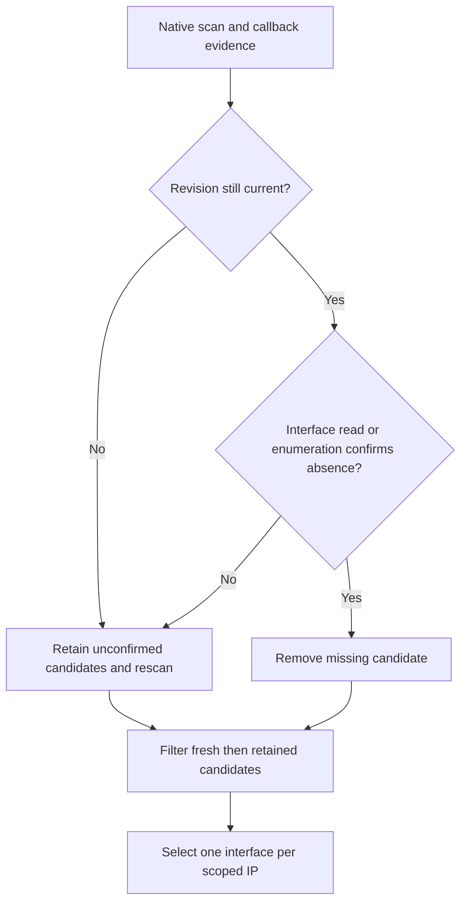

# Network addresses

`AndroidNetworkAddressMonitor` discovers usable local address candidates and publishes a filtered selection. The controller owns permission gating, the HTTP plan and network-loss Stop; discovery does not bind sockets or test reachability. [Settings](settings.md#network) owns saved filter defaults, and [HTTP delivery](../03-delivery/http-delivery.md#planned-servers-and-scoped-sockets) owns the separate server incarnation.

## Contents

- [Source and observation owners](#source-and-observation-owners)
- [Evidence, freshness and retention](#evidence-freshness-and-retention)
- [Classification and filtering](#classification-and-filtering)
- [Address identity and ordering](#address-identity-and-ordering)
- [Refresh and close](#refresh-and-close)
- [Permissions and platform limits](#permissions-and-platform-limits)
- [Implementation and verification](#implementation-and-verification)

## Source and observation owners

| Owner | Responsibility |
| --- | --- |
| `NativeInterfaceAccess` | Native interface enumeration, name lookup and handle getters; the default system reader preserves native failures |
| `AndroidNetworkAddressSource` | Callback metadata/revisions and unregister bookkeeping under `platformLock`; native interface reads on IO outside that lock |
| Monitor `Observation` | One serialized native scan, latest filter, retained candidates, identities and refresh deadlines |
| Monitor lifecycle gate | Admission of updates/close, durable close completion and final failure |
| Controller | Current permission evidence, allowed HTTP addresses and network-loss episode |

The monitor starts lazily on the first `updateFilter`; close can start its worker even before any filter. Filter updates and source snapshots use conflated channels, so slow consumers receive latest values rather than a queue of every intermediate event. The state progresses from `NotStarted` to `Loading(filter)` and then `Observed(filter, addresses)`. An observed empty list is a valid selection. `Failed` is final failure evidence; successful close publishes `Closed`.

The source combines `ConnectivityManager` callback payloads with internal [NativeInterfaceAccess](../../src/main/kotlin/io/screenstream/mjpeg/networkaddress/NativeInterfaceAccess.kt). Both monitor and source default to `SystemNativeInterfaceAccess`, which delegates enumeration, name lookup and handle getters to `NetworkInterface` when read, preserving native exceptions for the source's evidence classification.

The source observes nonrestricted networks without requiring `INTERNET` or `VALIDATED` capability, preserving LAN/P2P candidates. API 24–25 use a getter fallback; it also remains available on newer APIs while callback registration has failed. Registered callbacks are authoritative from API 26 onward. The fallback is revision-fenced and never overwrites newer callback information or restores a lost network. API 36+ tethering callbacks add public interface-type evidence.

## Evidence, freshness and retention

Each scan records the platform snapshot revision, which identifies the source's current platform metadata, along with found addresses, successfully read interfaces, failed interfaces and whether enumeration completed. A successful read of a down interface records an empty address list. Enumeration and individual reads can fail independently; retry lookups use known callback/tether interface names when needed.

Callback addresses supplement unknown native reads after incomplete enumeration or interface-read failure. They do not override a successful native read that shows absence. Callback metadata may still be incomplete while Android emits its updates; `Snapshot.ready` describes observer/type information, not successful reads of all addresses.

At scan completion, the monitor rereads the source snapshot. It removes a missing candidate only if the metadata revision still matches and the scan confirms absence for that interface: a successful read, or completed enumeration with the interface absent from the failed set. Unrelated incomplete metadata does not invalidate a successful current read. If the snapshot revision changed during the scan, its results can add candidates but cannot remove older ones; the monitor immediately requests another scan.

Fresh candidates are sorted and placed before retained candidates. A candidate replaced by matching fresh interface/IP evidence is not retained twice. Temporary unreadability keeps its identity and avoids treating uncertainty as a listener teardown request. Source type updates can reclassify retained candidates while address reads catch up.

## Classification and filtering

A candidate must match one selected member of each group: families **and** interface types **and** categories. Members within one group use **or**. A low-level empty group selects nothing; saved [network settings](settings.md#network) reject empty groups.

Unspecified addresses, multicast and IPv6 link-local are always excluded. Virtual interfaces are not excluded solely because they are virtual. A network with only IPv6 link-local addresses provides no supported selection.

| Category | Meaning |
| --- | --- |
| `Private` | IPv4 RFC 1918: `10/8`, `172.16/12`, `192.168/16`; IPv6 ULA: `fc00::/7` |
| `NonPrivate` | Other supported unicast, including CGNAT `100.64/10` and deprecated `fec0::/10`; no Internet reachability promise |
| `Loopback` | IPv4 `127/8`, IPv6 `::1`; local-device viewing |
| `LinkLocal` | IPv4 `169.254/16`; IPv6 link-local remains excluded |

Public framework transport evidence takes precedence over name inference. VPN wins when multiple transports are reported, followed by Wi-Fi, Ethernet, cellular and Other. Tethering evidence supplements unknown types; Wi-Fi tethering maps to `Wifi`, while other tethering types are `Other` unless further evidence/name inference applies. USB tethering is not assumed to be cellular.

Fallback name inference recognizes `tun`/`tap`/`ppp` as VPN; `wlan`/`wifi`/`p2p`/`ap` plus digits as Wi-Fi; `eth` as Ethernet; and `rmnet`/`ccmni`/`pdp` as mobile. Unrecognized names remain `Other`.

Filtering happens before duplicate interface selection. An excluded fresh candidate cannot hide another matching interface for the same IP. One matching candidate is selected per IP identity, preferring matching fresh evidence to matching retained evidence.

## Address identity and ordering

`NetworkAddress.id` is monotonic within one monitor instance and identifies IP bytes plus IPv6 scope ID and scoped-interface name. Filter changes, interface metadata changes and HTTP port changes preserve it. Once all evidence for the address is confirmed gone, a later return gets a new ID. A different IPv6 scope is a distinct identity.

When one interface supplies both scoped and unscoped aliases for the same IPv6 bytes, the scoped candidate suppresses its unscoped alias. Selection is sorted deterministically by interface name, address-byte length, unsigned byte representation, scope ID, scope-interface name and interface-type ordinal. Returned lists/filter sets are immutable copies.

`NetworkAddress` contains the chosen IP, interface name and type; the HTTP port is separate. Its equality includes metadata and scope as well as ID, so a metadata edit can publish an updated address while [HTTP](../03-delivery/http-delivery.md#planned-servers-and-scoped-sockets) retains its incarnation.

## Refresh and close

The observation coroutine permits at most one native scan on IO. A first filter requests a scan; later filters immediately reselect known evidence. New system revisions request another read and can reset retry scheduling. Incomplete reads retry after 250 ms, 1 second and 3 seconds, then every 30 seconds. Complete reads refresh every 30 seconds. These coroutine timers do not guarantee detection latency while the device sleeps; discovery uses no wake lock or alarm.

`close()` first fences updates and begins source close, then awaits a shared completion independent of that waiter. Source close marks `isClosing`, takes unregister handles and ignores late callback mutations. All unregister actions run, collecting failures. Registration that finishes after close is rejected and unregistered before its scan completes.

The cleanup worker unregisters observers, joins observation including an active native scan and late registrations, then closes the source change channel. An observation failure publishes `Failed` and starts unregistering immediately, before waiting for a stuck scan. Its cause remains primary; cleanup failures are attached as suppressed causes. Canceling one close waiter does not abandon cleanup or establish success. A native scan that never returns can keep close pending; the code does not manufacture completion from elapsed time.

## Permissions and platform limits

The manifest declares `ACCESS_NETWORK_STATE` for observation, `INTERNET` for HTTP and `ACCESS_LOCAL_NETWORK`. The project uses min API 24 and target/compile API 37. Android's [local-network permission](https://developer.android.com/privacy-and-security/local-network-permission) applies to target-37 apps on Android 17, including incoming TCP acceptance. [Coordination](../01-lifecycle/coordination.md#lan-permission-request-identity) defines request admission and permission filtering of the HTTP plan.

The model conservatively marks nonloopback Wi-Fi, Ethernet and Other addresses as requiring LAN permission; mobile and VPN types do not. A filter requires it when it selects any nonloopback category and any of those interface types. This is application planning logic, not proof of the platform's eventual routing or socket decision.

Discovery does not request permission, start a network, alter routing, perform DNS/probes, scan Wi-Fi, inspect SSID/location or manage hotspots. It has no mDNS discovery. Android/OEM callback omissions, interface-read bugs and tether metadata remain runtime uncertainties. The [NetworkCallback reference](https://developer.android.com/reference/android/net/ConnectivityManager.NetworkCallback) warns against synchronous getters inside callbacks; this source consumes callback payloads and uses its separate older-platform fallback.

## Implementation and verification

- [Address model/filter](../../src/main/kotlin/io/screenstream/mjpeg/networkaddress/NetworkAddress.kt), [monitor contract](../../src/main/kotlin/io/screenstream/mjpeg/networkaddress/NetworkAddressMonitor.kt), [Android monitor](../../src/main/kotlin/io/screenstream/mjpeg/networkaddress/AndroidNetworkAddressMonitor.kt), [Android source](../../src/main/kotlin/io/screenstream/mjpeg/networkaddress/AndroidNetworkAddressSource.kt) and [native interface access](../../src/main/kotlin/io/screenstream/mjpeg/networkaddress/NativeInterfaceAccess.kt) define these rules.
- [Testing](../04-testing/testing.md) describes verification scope and evidence requirements.

Navigation: [Internal guide](../README.md) · [Usage](../../docs/usage.md) · [Architecture](../../docs/architecture.md).
