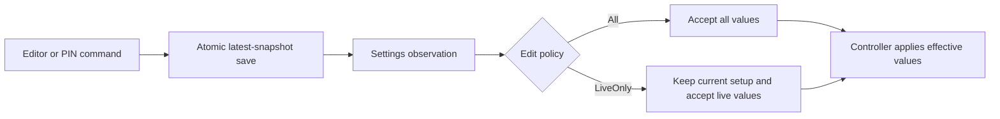

# Settings

`MjpegSettings` stores user choices; the controller decides which observed values can become effective. A successful save is not confirmation that capture or HTTP has applied it. This page owns the saved model, validation, compatibility and edit policy. [Coordination](../01-lifecycle/coordination.md) owns controller execution, [Network addresses](network-addresses.md) owns discovery, and [HTTP delivery](../03-delivery/http-delivery.md) owns runtime viewing credentials.

## Contents

- [Saved model and defaults](#saved-model-and-defaults)
- [Validation and image interpretation](#validation-and-image-interpretation)
- [PIN generation and edits](#pin-generation-and-edits)
- [Edit policy and effective settings](#edit-policy-and-effective-settings)
- [Storage, serialization and recovery](#storage-serialization-and-recovery)
- [Legacy import](#legacy-import)
- [Implementation and verification](#implementation-and-verification)

## Saved model and defaults

One `Data` snapshot contains five groups: `image`, `network`, `access`, `web` and `behavior`. The current native UI exposes address filters; the complete editor for these groups is not implemented. A saved field does not imply an implemented runtime effect.

### Image

| Field | Values | Default |
| --- | --- | --- |
| `sourceRegion` | `Full`, `LeftHalf`, `RightHalf` | `Full` |
| `cropEnabled` | Boolean | `false` |
| `cropInsets` | Nonnegative left/top/right/bottom pixels | All zero |
| `outputSelection` | `Scale`, `TargetSize` | `Scale` |
| `scalePercent` | Finite positive scale percentage | `50.0` |
| `targetSize` | Width, height and `AspectFit`/`Stretch`; nullable while unselected | `null`; target-size content mode defaults to `AspectFit` |
| `rotation` | Clockwise 0°, 90°, 180°, 270° | `Degrees0` |
| `mirror` | `None`, `Horizontal`, `Vertical` | `None` |
| `colorMode` | `Color`, `Grayscale` | `Color` |
| `jpegQuality` | Integer 0–100 | `80` |
| `frameRate` | `Auto`, `MaxFps(1..120)`, `SamplingInterval(1 second..1 hour)` | `Auto` |
| `jpegBackendPolicy` | `Auto`, `FrameworkOnly` | `Auto` |

Crop and target-size values remain saved when disabled or unselected. The system capture-consent result selects screen/app capture; `sourceRegion` selects within that granted capture area. Frame-rate limits govern fresh capture production, while [HTTP repeats](../03-delivery/jpeg-delivery.md#writing-jpeg-and-mjpeg) reuse already encoded bytes.

### Network

| Field | Values | Default |
| --- | --- | --- |
| `filter.families` | Nonempty set of `Ipv4`, `Ipv6` | `Ipv4` |
| `filter.interfaceTypes` | Nonempty set of `Wifi`, `Ethernet`, `Mobile`, `Vpn`, `Other` | `Wifi`, `Ethernet` |
| `filter.categories` | Nonempty set of `Private`, `NonPrivate`, `Loopback`, `LinkLocal` | `Private` |
| `httpPort` | Integer 1024–65535 | `8080` |

Selecting every option saves the full set. Address support, category meanings and filter matching are defined in [Network addresses](network-addresses.md#classification-and-filtering). Selection proves neither successful bind nor viewer reachability.

### Access

| Field | Values | Default |
| --- | --- | --- |
| `pinEnabled` | Boolean | `false` |
| `pinPolicy` | `Permanent`, `NewOnModuleStart` | `NewOnModuleStart` |
| `pin` | `SecretValue` containing six ASCII digits, or null | `null` |
| `hidePinOnCaptureStart` | Saved display preference | `true`; PIN display handling is not connected |
| `limitWrongPins` | Boolean | `true` |
| `blockMinutes` | Integer, at least 1 | `1` |

Leading zeros are valid. `SecretValue.toString()` returns `<redacted>`; serialization preserves its actual value. Reveal `value` only for an explicit user action. The saved PIN differs from the unsaved URL token and viewing cookie described in [HTTP access](../03-delivery/http-delivery.md#access-generations-and-pin-blocks).

### Shared web appearance

| Field | Values | Default |
| --- | --- | --- |
| `background` | `#` plus six hexadecimal RGB digits | `#101418` |
| `title` | Text, including an explicitly empty string | Trimmed manufacturer + model without repeated manufacturer; fallback `Android device` |
| `titleEnabled` | Boolean | `true` |
| `titleLayout` | Position, presentation, auto-hide | Top, Overlay, `true` |
| `controlsLayout` | Position, presentation, auto-hide | Bottom, Overlay, `true` |
| `retainImageOnMediaFailure` | Boolean | `true` |

Each `BlockLayout` independently selects `Top`/`Bottom`, `Overlay`/`Bar` and `autoHide`. Bars reserve page space; overlays cover the image. Browser-local fit mode, alternate media method, menu and information choices are not saved in this model. [Web client](../03-delivery/web-client.md#presentation-and-browser-local-choices) owns their current behavior.

### Stream behavior

| Field | Values | Default / current effect |
| --- | --- | --- |
| `keepScreenAwake` | Boolean | `false`; runtime handling is not connected |
| `stopOnScreenOff` | Boolean | `false`; runtime handling is not connected |
| `stopAfterNetworkLossSeconds` | Integer 10–1800, with no Never value | `60`; implemented |
| `postStopImage` | `None`, `Placeholder`, `LastAvailableFrame` | `Placeholder`; implemented |
| `notifySlowViewers` | Boolean | `true`; notification handling is not connected |

The implemented timeout watches an empty selected-address list, independently of bind failure. [Coordination](../01-lifecycle/coordination.md#network-loss-deadline) defines episode/recovery timing; [JPEG selection](../03-delivery/jpeg-delivery.md#capture-source-and-image-selection) defines post-Stop behavior. Dormant preferences have no runtime effect. Slow statistics continue independently of notification settings, and Android can terminate MediaProjection regardless of saved behavior choices.

## Validation and image interpretation

Model construction validates values before persistence. `ImageSettings` requires a finite `scalePercent` whose division by 100 remains positive, JPEG quality in 0–100, and a non-null target size when `TargetSize` is selected. Engine value types additionally require nonnegative crop insets, positive target dimensions and the frame-rate ranges above.

Value validity does not establish runtime geometry or resource feasibility. Region selection precedes crop; crop precedes rotation; mirror follows rotation; output size describes the transformed image. A half-region needs source width at least two pixels, and crop must leave a nonempty region. The engine can reject a saved request against actual capture geometry. Scaling above 100% is allowed; 100% preserves transformed size. `Auto` follows available source frames and processing capacity. A frame-rate cap or interval never promises that rate of successful production or network delivery.

Network construction requires all three saved filter groups to be nonempty and the saved port in 1024–65535. The lower-level HTTP contract accepts ports 1–65535; that broader range does not expand the saved settings UI policy. Access validates six ASCII digits when a PIN exists and a positive block duration. Web appearance validates RGB background; behavior validates its timeout range.

## PIN generation and edits

Creating or reading `MjpegSettings` does not generate a PIN. `updateData` enables protection with a missing PIN by generating and saving one in the same transaction. Generation uses `SecureRandom` over 0–999999 and pads to six digits.

At actual protected module activation, `NewOnModuleStart` regenerates once before the settings observation stream opens HTTP access. Capture Start/Stop and background return retain that PIN. An open activation also completes initial preparation: enabling protection later generates a PIN only if absent, without repeating startup regeneration. Disabling protection retains the saved PIN.

`Permanent` keeps its PIN until a typed edit or random regeneration. The controller admits random regeneration for either policy, and typed `Set` only for `Permanent` with valid digits. Both require setup edits to be allowed. Save jobs are ordered; each transaction rechecks the latest stored PIN policy rather than overwriting from an old observed snapshot. [Coordination](../01-lifecycle/coordination.md) owns command admission and save-job execution; [HTTP delivery](../03-delivery/http-delivery.md#access-generations-and-pin-blocks) owns credential rotation and wrong-PIN blocks.

## Edit policy and effective settings

`EditPolicy` is runtime-only. `All` applies when the controller is idle after initial settings acceptance or successful capture cleanup, even if no HTTP server is listening. `LiveOnly` covers consent, startup, capture, suspension, stopping and cleanup, including failed cleanup.

| Change | Allowed under `LiveOnly`? |
| --- | --- |
| Image processing and frame rate | Yes |
| `jpegBackendPolicy` | No |
| Address filter | Yes |
| HTTP port | No |
| Entire access group | No |
| Web appearance and behavior | Yes; dormant preferences remain dormant |

`allows(current, proposed)` compares the actual delta, permitting unchanged restricted fields within a live transaction. `effective(current, proposed)` accepts live fields while retaining the current backend, port and entire access group. The UI policy and controller application check are separate: a late observation cannot replace busy setup values. [Coordination](../01-lifecycle/coordination.md#effective-settings-and-saves) applies the latest observed setup after successful cleanup.

The flow separates persistence from application. Live image values survive startup, backend choice is fixed for the capture session, and a post-Stop image edit applies immediately while stopped using only the image still available.

## Storage, serialization and recovery

One `mjpeg.preferences_pb` Preferences DataStore file holds a JSON string under the shared store's `DATA` key. Related edits are atomic across the five groups. URL tokens, viewing cookies, discovered addresses, effective state, edit policy and statistics are runtime-only; the PIN is saved in the access group. A temporary [legacy import](#legacy-import) runs before the first read or update.

The module collects the settings flow to apply configuration; the filter editor also reads it for display. There is no separate permanent settings collector keeping an inactive module running.

The serializer ignores unknown fields and normally omits properties equal to defaults. The `web` group is required; `title` is always encoded so a stored device title survives later launches rather than being recalculated. An explicitly empty title stays empty. The retention property's saved name remains `retainImageOnReconnect` for compatibility, while its model and wire name are `retainImageOnMediaFailure`.

Custom serializers preserve crop as four integers, target size as width/height/content mode, the filter as three sets, and frame rate as `Auto`, `MaxFps` or `SamplingInterval` with an ISO duration string. Engine value validation runs during reconstruction.

`updateData` transforms the latest stored model, not a potentially stale `data` observation. A missing or invalid payload supplies defaults as transaction input; a resulting encoded value can replace invalid data even when it equals defaults. The MJPEG wrapper performs the admitted write in `NonCancellable` on its dispatcher. Transform, encoding and storage failures propagate; cancellation of the original caller does not abandon an admitted write. Observation may arrive after saving returns.

The common store caches the last successfully decoded raw payload/model. Recoverable I/O or serialization failure receives one repair attempt. Successful repair resumes reading the latest file; failed repair emits defaults until a normally completed update or a new collection. Corruption handling can replace the preferences file with an empty value. Unrelated failures and cancellation propagate. Observing defaults after recovery is not proof that a replacement write succeeded.

## Legacy import

Before access, a present `MJPEG_settings.preferences_pb` triggers one migration attempt into `mjpeg.preferences_pb`. These literal file names survive a Gradle module rename. The public Preferences serializer reads the source directly; there is no second source DataStore or dependency on the old module. Any raw-present destination `DATA` wins as a whole, including wrong-typed or malformed data that normal recovery subsequently handles.

Only actual present, correctly typed source values participate. Convert to the new domain, validate, and discard values equal to the new defaults. Missing values use a captured new-default snapshot, never the old settings model or its fallback defaults. If the final snapshot equals the defaults, no `DATA` is written. Otherwise the current serializer omits default properties and retains the required complete representation of nondefault compound values. Migration removes the synthetic device title but keeps required `web:{}` when empty. Normal later writes retain their usual title/default encoding; an unchanged update may leave the migration payload untouched.

Crop enabled state plus all four insets are one compound. Target dimensions, content mode and derived selection are another; both dimensions must be present and positive, and missing stretch uses new AspectFit. The entire address filter, including all family flags, interface/category masks and participating historical keys, is one compound. Any present invalid member rejects its whole compound. Missing members use new defaults; no valid subset of an invalid compound survives. Scale, rotation, port and other scalar settings, including the optional PIN, are independently validated. Migration never generates a PIN.

Image mappings preserve region, crop, scale, color, quality, rotation and mirror. Positive FPS 1–120 becomes MaxFps; zero is default Auto; negative seconds become SamplingInterval within 1 second–1 hour, with overflow-safe magnitude conversion. Target bounds swap for accepted 90°/270° rotation because old bounds preceded rotation. Access and behavior flags map to their corresponding saved preferences; six ASCII PIN digits retain leading zeros. RGB background drops the alpha byte, and retention keeps the saved alias `retainImageOnReconnect`.

Interface mask zero selects all five types; positive known bits select literal types, which can narrow old unknown/loopback admission. Address mask zero selects Private, NonPrivate and Loopback; the old PUBLIC bit becomes NonPrivate. LinkLocal remains excluded as in old discovery. Unknown mask bits reject the whole filter. Actual IP flags modify membership starting with new IPv4-only defaults; an empty result rejects the whole filter. Modern raw mask presence blocks historical fallback even when invalid. Otherwise `USE_WIFI_ONLY`, `ENABLE_LOCAL_HOST` and `LOCAL_HOST_ONLY` use their historical-format conversion; absent historical hostname companions mean false only within that conversion.

`HTML_SHOW_PRESS_START` approximates ordinary Stop as Placeholder/LastAvailableFrame; restart/error behavior is not equivalent. `NEW_PIN_ON_APP_START` maps to NewOnModuleStart/Permanent with the new activation semantics. `AUTO_CHANGE_PIN`, `STOP_ON_CONFIGURATION_CHANGE`, `HTML_ENABLE_BUTTONS` and `HTML_FIT_WINDOW` have no counterpart and are omitted. New title/layout/backend/block-duration/network-loss fields are not imported.

The exact source path is deleted nonrecursively in `migrate`'s `finally`, even for no-op, invalid/corrupt input, an existing destination or ordinary read/conversion failure. Corrupt protobuf gets a nonsecret diagnostic and no import; ordinary failures propagate. A deletion failure remains visible and is suppressed onto a primary migration failure when both occur. `cleanUp` does nothing; no completion marker is saved. Deletion occurs **before DataStore commits**, so a destination write failure or interruption after deletion permanently loses the legacy values and cannot retry import. Termination before deletion, filesystem deletion failure or restoring/recreating the source can permit another attempt. Enable this at the old-module replacement cutover; during coexistence the first attempt consumes the initial snapshot and later legacy use may recreate its file.

## Implementation and verification

- [MjpegSettings](../../src/main/kotlin/io/screenstream/mjpeg/settings/MjpegSettings.kt) owns storage and edit policy; [settings models](../../src/main/kotlin/io/screenstream/mjpeg/settings/MjpegSettingsModels.kt) own defaults, serializers and validation.
- [MjpegSettingsMigrations](../../src/main/kotlin/io/screenstream/mjpeg/settings/MjpegSettingsMigrations.kt) owns temporary legacy conversion and source deletion.
- [JsonPreferencesStore](../../../common/src/main/java/info/dvkr/screenstream/common/settings/JsonPreferencesStore.kt) owns common transaction and recovery behavior.
- [Controller](../../src/main/kotlin/io/screenstream/mjpeg/MjpegStreamingModuleController.kt) owns startup PIN preparation and effective application; [engine parameters](../../../screen-capture-engine/src/main/kotlin/io/screenstream/capture/ScreenCaptureParameters.kt) own image value types.
- [Testing](../04-testing/testing.md) describes verification scope and evidence requirements.

Navigation: [Internal guide](../README.md) · [Usage](../../docs/usage.md) · [Architecture](../../docs/architecture.md).
