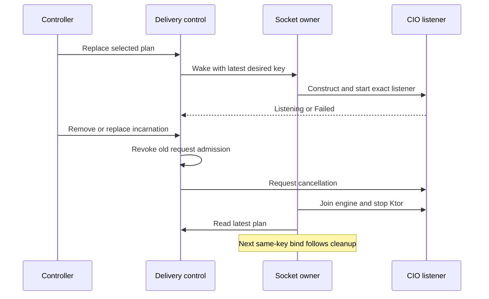

# HTTP delivery

One `HttpDelivery` serves a module's selected addresses. Listeners share credentials, routes and the selected JPEG; capture and encoding are not repeated per listener or viewer. The controller supplies settings, permission-filtered addresses and capture status; HTTP owns no Android capture resources. Physical request jobs own response completion, while endpoint history rows provide sampled viewer/accounting state. [Module lifecycle](../01-lifecycle/module-lifecycle.md) owns capture cleanup, [JPEG delivery](jpeg-delivery.md) owns image storage/writing, and [Web client](web-client.md) owns exact routes and wire behavior.

## Contents

- [Owners and activation](#owners-and-activation)
- [Planned servers and scoped sockets](#planned-servers-and-scoped-sockets)
- [Access generations and PIN blocks](#access-generations-and-pin-blocks)
- [Request admission and cutoff](#request-admission-and-cutoff)
- [Client history and statistics](#client-history-and-statistics)
- [Terminal cleanup](#terminal-cleanup)
- [CIO writer patch and limits](#cio-writer-patch-and-limits)
- [Implementation and verification](#implementation-and-verification)

## Owners and activation

| Owner | Lifetime and responsibility |
| --- | --- |
| `KtorHttpDelivery` | One HTTP lifetime; control monitor, runtime job, plan, admission, configuration, web state, sampler and shared cleanup |
| `HttpAccess` | One delivery; credential generation and immediate-peer PIN blocks under the control monitor |
| `HttpRequests` | One delivery; physical requests, endpoint history and retired payload totals; no independent lock/scope/timer |
| `PlannedServer` | One selected server incarnation; UUID, address metadata, port, socket key, attempts and exact listener |
| `SocketOwner` | One used or retiring scoped socket; runtime child serializing bind/cleanup and reading the latest plan |
| `HttpListener` | One physical bind attempt; one CIO engine and IP/port connector |
| `JpegStore` | One delivery; image selection and storage under its own monitor |
| `JpegResponse` / Reader | One admitted media call; acquired leases and write progress |
| `WebRoutes` | One delivery; lazy HTML cache and HTTP/WebSocket adapter |

The control monitor coordinates access, plan changes, request registration, cutoff and sampling. Its allowed nested order is control monitor → store monitor. Store code never calls runtime under its monitor. JPEG copies, transport writes, cancellation and joins occur outside both monitors.

`start` activates once, transfers exclusive ownership of logo bytes, applies configuration and starts owners/sampling. It can succeed with no selected address or no bound listener: success means admission is open. Pre-activation plans remain `Pending` without socket work. Repeated activation or terminal shutdown rejects start. The controller reads the logo on IO and must not mutate the transferred bytes.

`registerCapture` records an attempt/source before engine construction. Capture status changes are identity-fenced and select content through [JPEG delivery](jpeg-delivery.md#capture-source-and-image-selection). They do not replace the HTTP lifetime.

## Planned servers and scoped sockets

Three identities serve different purposes:

| Identity | What preserves or replaces it |
| --- | --- |
| Discovery address ID | Owned by [Network addresses](../02-configuration/network-addresses.md#address-identity-and-ordering) |
| Planned server UUID | Metadata updates and physical retries preserve it; removal/reselection or port change replace it |
| Exact `HttpListener` object | New for every physical bind attempt |

The plan requires unique discovery IDs and unique socket keys. A key contains IP bytes, IPv6 scope ID/interface and port; metadata changes must not change the scoped IP behind an existing address ID. `configureServers` replaces the ready plan without waiting for bind or cleanup. Unchanged incarnations and responses survive. Delivery starts admitted socket owners independently of caller cancellation before performing cutoff actions that could fail. Terminal stop ignores later plans.

Each socket owner uses a wake signal that retains only the latest notification. After physical cleanup it rereads the desired incarnation. If plans change A → B → C while A retires, the owner proceeds to C without keeping a worker waiting for B. Different keys can bind independently; an ordinary failure of one listener does not stop others. The same key cannot create its successor engine before its predecessor cleanup finishes.

`Pending` includes waiting for the socket or opening the listener. `Listening` follows successful start. `Failed(reason, attempts)` reports availability and the last failure; it does not itself assert physical file-descriptor cleanup.

The budget is three attempts, including the initial attempt and successful binds. Success does not reset it; a later listener termination can spend the remaining budget. Automatic retries wait 250 ms after a completed attempt. `retryServer(UUID)` resets only the current `Failed` incarnation to `Pending` and zero attempts; stale or repeated commands do nothing. Manual retry does not bypass outstanding cleanup or clear an already established retry deadline. A different incarnation discards the predecessor's retry correlation.

Listener failures map `BindException` to `AddressInUse`, `SecurityException` to `PermissionDenied`, `SocketException` to `AddressUnavailable`, other `IOException` to `IoFailure`, and other caught exceptions to `Unknown`. Normal unexpected listener termination becomes `IoFailure`. Before mapping a caught exception the persistent owner checks its own cancellation, distinguishing canceled delivery from a canceled physical engine.

## Access generations and PIN blocks

[Settings](../02-configuration/settings.md#pin-generation-and-edits) owns saved PIN preparation and editing. `HttpAccess` owns applied settings and unsaved credentials. Enabling protection or changing an enabled PIN creates a 192-bit URL-safe Base64 token and a 256-bit hexadecimal cookie; open access uses null credentials. Both new credentials are generated before either is committed. Generation changes fence admitted WebSockets.

Unchanged enabled PIN, PIN policy, hide preference and limiter edits preserve credentials. Repeated valid PIN login and valid URL-token exchange return the current cookie without rotating it, so other tabs retain access. Equal-length credentials use `MessageDigest.isEqual`; this does not make ordinary HTTP encrypted. [Web client](web-client.md#request-authority-origin-and-credentials) defines token exchange and cookie attributes.

Rotation under one control monitor closes old media readers' next-frame admission, applies credentials and clears endpoint rows. An initial lease not yet handed to its writer is released; an acquired payload may finish. Its final bytes remain in global totals without recreating the detached client row. Old WebSocket call jobs are canceled outside the monitor and generation checks fence state sending.

With wrong-PIN limiting enabled, the fifth wrong entry blocks verification for the immediate peer IP across all listeners. Missing or malformed PINs count as wrong when the parser supplies null. A block rejects even a correct PIN until expiry; requests during it do not extend its deadline. Success outside a block or expiry clears its attempts. A duration edit affects only later blocks. Rotation preserves current attempts/blocks; opening access or disabling the limiter clears them. Existing viewing credentials continue authorizing during a PIN block.

Peer identity is the direct connection address, not forwarded headers, a browser tab or a person. Block deadlines use elapsed realtime and saturate rather than overflow when adding duration. There is no persistent PIN-attempt history across delivery lifetimes.

## Request admission and cutoff

Media admission under the control monitor checks credentials first, then exact current listener and active call job, pins an initial image before headers, and registers the physical response. A denial remains access denial even when image availability would also fail. No image or unavailable runtime rejects admission rather than creating a reader waiting for its first image. [Web routes](web-client.md#routes-and-response-headers) owns the resulting HTTP statuses.

The exact call job's completion retires a response; return from the route or `respond` is insufficient. Retirement transfers that response's progress to retired totals once, checking endpoint identity so a late response cannot update a replacement row.

WebSocket admission accepts open access or a valid cookie, requires the exact active listener and call job, and records the current generation. It creates no media row. The transport checks listener/generation again before state sends; incoming termination ends its waiting collector. URL tokens authorize media or exchange through `/`, but do not directly authorize `/ws`.

Listener removal cuts off admission immediately, closes its readers and cancels its media/WebSocket jobs. Ordinary capture Stop or source replacement changes selected content while existing media readers survive. Credential rotation closes reader admission without forcibly canceling an acquired media payload. Terminal HTTP stop closes admission and separately requests physical cancellation.

## Client history and statistics

A client row represents `(server UUID, immediate remote IP, remote port)`. It is neither a tab nor a unique viewer. Media admission creates it before the first payload. Overlapping or sequential requests at that endpoint share completed payload bytes; its format records the most recent admission. HTML, PIN and WebSocket activity neither create nor prolong rows.

After the last current-listener response finishes, its row remains `Active` for two seconds, then `Disconnected` for five more. These absolute deadlines smooth JPEG polling; delayed sampling does not extend them. New media admission before expiry continues that row. A new port/UUID or admission after removal gets a new monotonic row ID.

When delivery cuts off a row, it skips Active grace and retains an earlier disconnect deadline. Completion from an old listener cannot restart grace, including after physical replacement with the same server UUID. Disconnected history retains numbers/strings, never requests, reader handles or JPEG arrays.

Server state and fatal failure publish immediately while preserving the previous statistics sample. Full statistics publish once a second, on credential rotation and after cleanup. `sampledAtElapsedRealtimeMillis` belongs to that full sample; unrelated publication does not refresh it. Terminal stop immediately clears visible servers/clients, then final cleanup preserves totals.

Each sample combines progress from still-active responses with retired totals; payload counters do not wait for response completion. Completed counts include each fully written JPEG payload, including repeats, and exclude framing and partial payload writes. [JPEG writing](jpeg-delivery.md#writing-jpeg-and-mjpeg) advances them before multipart footer/flush. They prove output-path payload progress, not receipt, decoding or display. Exact call-job completion transfers final writer progress once, even if its row already disappeared.

`hasConsumer` derives from sampled Active rows, including idle grace; there is no separate global activity tail. A delayed sample may miss a short Active period. Endpoint `isSlow` is true when any current-listener MJPEG response is slow for the current capture source. [JPEG slow observations](jpeg-delivery.md#slow-reader-observations) owns the skipped-publication algorithm; adjacent store/progress samples are not one atomic frame observation.

## Terminal cleanup

`requestStop` irreversibly closes runtime admission, readers and store, removes the plan/history, and publishes closing state. Outside the monitor it requests listener, call-job and runtime cancellation. Delivery records cancellation failures while still attempting the remaining actions, and starts shared cleanup independently of waiters.

Each listener's engine job is a child of the runtime job. Its noncancellable retirement joins engine work and then calls Ktor stop with zero grace/timeout. A failure records cleanup and fatal causes, requests terminal stop and prevents that socket owner from proceeding to a successor with uncertain cleanup.

`stop()` awaits one shared deferred. Cleanup joins runtime owners, sampler, CIO engines and physical calls. The WebSocket adapter joins Ktor's detached default-session job before its call finishes. It clears remaining owner bookkeeping and takes the final statistics sample. Canceling a stop waiter does not abandon resources or establish success.

Operational `fatalCause` and `cleanupCause` are distinct: operational failure can coexist with successful resource cleanup, while failed cancellation/listener cleanup makes the shared stop fail. [Capture cleanup](../01-lifecycle/module-lifecycle.md) has its independent result. A join establishes managed coroutine completion; this documentation does not assert instantaneous closure of every OS socket/FD on a device.

## CIO writer patch and limits

The root build substitutes `io.ktor:ktor-network-jvm` with [ktor-network-patched](../../../ktor-network-patched/build.gradle.kts). The module pins Ktor 3.6.0 and the upstream binary SHA-256, compiles its replacement as a friend of that binary and merges the complete upstream jar while replacing the `CIOWriterKt` class family. Consumers require that merged jar, not a directory variant containing only the writer.

The [replacement writer](../../../ktor-network-patched/src/main/kotlin/io/ktor/network/sockets/CIOWriter.kt) leaves `channel.read` after a zero socket write before suspending on the WRITE selector. It preserves FIFO and image-selection policy and adds no write timeout. A Ktor version/checksum change requires separately maintaining the patch; the build checks are not compatibility evidence for a different version.

`HttpRequestLifecycle.cancelCallOnClose` helps cancel a call when CIO observes I/O disconnection, including during an image wait. There is no media watchdog or connection-count limit. A stalled connected reader can retain its lease, transport buffers and socket resources; `isSlow` reports skipped publications and does not cancel it. [JPEG memory limits](jpeg-delivery.md#pooling-and-memory-limits) explains why latest-frame storage is not a total memory bound.

## Implementation and verification

- [HttpDelivery](../../src/main/kotlin/io/screenstream/mjpeg/http/HttpDelivery.kt) defines the contract; [KtorHttpDelivery](../../src/main/kotlin/io/screenstream/mjpeg/http/KtorHttpDelivery.kt) and [HttpListener](../../src/main/kotlin/io/screenstream/mjpeg/http/HttpListener.kt) own runtime and transport lifetime.
- [HttpAccess](../../src/main/kotlin/io/screenstream/mjpeg/http/HttpAccess.kt) and [HttpRequests](../../src/main/kotlin/io/screenstream/mjpeg/http/HttpRequests.kt) implement credential and accounting rules.
- [Testing](../04-testing/testing.md) describes verification scope and evidence requirements.

Navigation: [Internal guide](../README.md) · [Usage](../../docs/usage.md) · [Architecture](../../docs/architecture.md).
