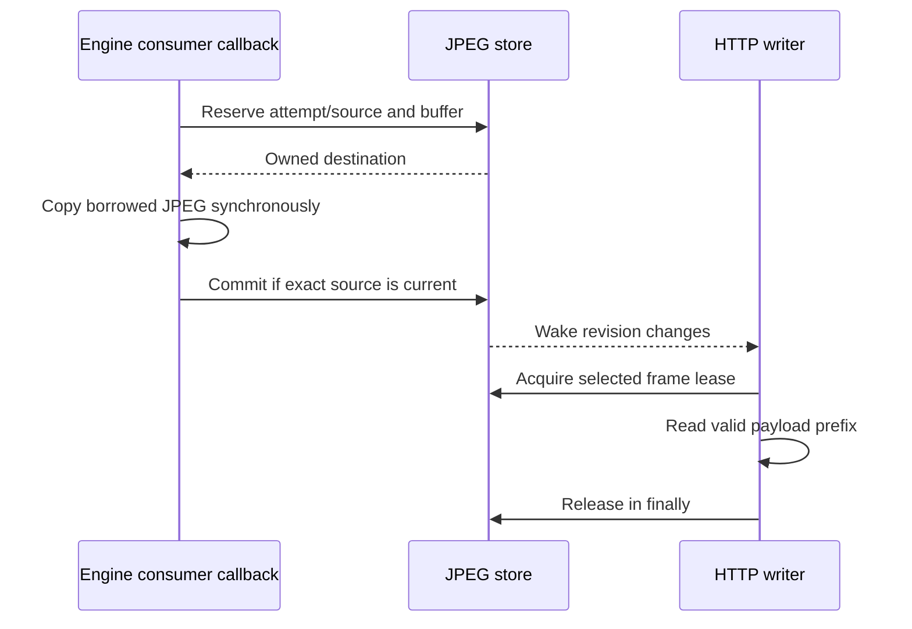

# JPEG delivery

One store accepts synchronous copies from the capture consumer and exposes leased immutable content to multiple physical HTTP writers. New readers pin an image before headers; existing MJPEG readers follow selection changes without a queue of old frames. [HTTP delivery](http-delivery.md) owns request admission, cancellation and accounting; the [HTTP viewing API](../../docs/http-viewing-api.md) owns media routes; [Web client](web-client.md) owns browser recovery.

## Contents

- [Copying and publication authority](#copying-and-publication-authority)
- [Capture source and image selection](#capture-source-and-image-selection)
- [Reader pinning and leases](#reader-pinning-and-leases)
- [Pooling and memory limits](#pooling-and-memory-limits)
- [Writing JPEG and MJPEG](#writing-jpeg-and-mjpeg)
- [Slow-reader observations](#slow-reader-observations)
- [Implementation and verification](#implementation-and-verification)

## Copying and publication authority

`JpegStore` owns one logo, one latest real frame, an optional spare buffer and `captureSourceToken`. Selection is derived rather than separately owned. The token identifies an allowed period of image production; each frame's `publicationVersion` identifies its publication, independently of that source. The store monitor follows the runtime control monitor in lock order and never calls runtime while locked. Reader wakeups and producer copies run outside the store monitor.

The engine adapter exposes each borrowed `EncodedFrame` as `MjpegBorrowedJpeg`. The capture attempt forwards its byte count and synchronous copier to HTTP, which can decline the offer or copy during the same callback. The borrowed frame and copier are usable only on the callback thread before it returns; neither may be retained for asynchronous writes. `offerJpeg(attempt, byteCount, copyTo)` reserves the current source and storage under the store monitor, invokes `copyTo` at most once outside both monitors, then commits only if the source identity still matches. The callback writes exactly `byteCount` bytes at offset zero and must not retain the array.

Closed/stale attempts and missing capture source reject before invoking the copy. Positive length is required for an admitted offer. Allocation/copy failure returns eligible storage before rethrowing. A successfully copied stale source does not publish or increment the publication version. Disposal prevents late copies from publishing or repopulating the spare pool.

`publicationVersion` advances on logo installation and accepted capture publications. `changeRevision` wakes waiting readers for status, policy, cutoff or publication changes. Neither value queues payloads. [Engine delivery](../../../screen-capture-engine/internal/03-output/delivery.md#borrowed-frame-lifetime) defines the upstream borrow boundary.

## Capture source and image selection

Capture attempt identity rejects work from older attempts; source identity rejects work from an earlier production period within the same attempt. `registerCapture` sets `Starting`, creates a fresh token and retains the latest real frame/readers. Until a current-source frame arrives, selection follows the fallback. Permission and startup preserve that token so a first JPEG need not wait for asynchronous Active observation. `Active` creates a source if suspension revoked it. Suspend/resume within the same attempt therefore rejects a delayed copy from the earlier source.

| Current status / change | Selection effect |
| --- | --- |
| Register a new attempt / `Starting` | Retain latest real frame, replace producer token and apply fallback until a current frame arrives |
| `Active` | Keep selection; ensure a current source exists |
| `Reconfiguring`, `WaitingForPermission` | No additional selection change |
| `Suspended`, `Failed` | Revoke source and apply fallback without erasing latest real frame |
| `Stopping`, `Stopped` | Revoke source and apply the same fallback |
| Terminal store disposal | Drop latest-real/logo/spare ownership and close admission; outstanding leases remain valid |

The [saved fallback](../02-configuration/settings.md#stream-behavior) applies whenever the latest real frame does not belong to the current non-null producer token: `None` selects nothing; `Placeholder` selects the cached logo; `LastAvailableFrame` selects the latest real frame, or logo if absent. A current-source real frame always wins. This one rule covers initial idle, consent, startup before the first frame, suspension, Stop and failure. Policy edits apply immediately to fallback selection without erasing the latest real frame. It remains available across capture attempts, policy edits, listener changes and credential rotation until replacement or delivery disposal. The controller keeps failure status until accepting a new capture attempt.

Availability is independent of capture phase: startup may show retained content, and a stopped stream may expose a logo or last image. Ordinary capture Stop/source changes keep the HTTP response alive. An existing MJPEG reader with no selected image waits for selection or cutoff; a new request without an image is rejected at [HTTP admission](http-delivery.md#request-admission-and-cutoff).

## Reader pinning and leases

`openReader` acquires the current selection under the store monitor before response headers. That initial lease pins the `/jpeg` content length even if selection changes later. The Reader holds it until either `acquireFrame` hands it to the writer or `close` revokes the unclaimed initial lease. Closure before writer handoff can produce a truncated response after a pinned content length was announced.

After initial handoff, each successful `acquireFrame` needs exactly one `releaseFrame`. A writer retains its acquired frame through the last byte read and releases it in `finally`, before multipart footer/flush. Reader close prevents subsequent acquisition but cannot invalidate a writer-local lease already handed out. Runtime separately cancels the call job to interrupt I/O.

Frame metadata is stable; `ByteArray` is a mutable type whose valid prefix `[0, byteCount)` must remain unmodified while readers can access it. Spare capacity beyond that prefix is never sent. Logo bytes are exclusively transferred to the store; pooled capture frames count leases, so replacement/disposal cannot reuse leased bytes prematurely.

The MJPEG writer observes `changeRevision` **before** acquiring. If acquisition returns null, it ends when the Reader is closed; otherwise it waits until the revision changes. This ordering avoids a lost wake between availability check and suspension. Waiting holds no frame lease, and wakeups run outside the store monitor so a resumed writer can safely enter runtime.

## Pooling and memory limits

A spare array is reusable when large enough for the offered JPEG and no more than twice its size. Otherwise the producer allocates an exact-size array. A replaced latest-real frame returns its array only after its last lease is released; a released retired frame can fill the one spare slot if the store is still open.

One latest-real owner and one spare are not a global two-array bound. Memory may include logo, latest-real/spare arrays, an in-flight copy, distinct retired arrays held by concurrent slow writers and library/transport buffers. The implementation assumes one serialized producer and permits multiple readers; it does not cap connections or total leased payloads.

There is no full-JPEG copy per response and no growing application frame queue. This is still not zero-copy transport: Ktor/CIO and multipart chunked encoding can buffer or copy payload. [HTTP transport limits](http-delivery.md#cio-writer-patch-and-limits) describe the patch and absent media watchdog/write timeout.

## Writing JPEG and MJPEG

`JpegResponse.respond` is used once per call. The writer owns its media format. `/jpeg` takes the one-shot branch: it uses `image/jpeg` and the pinned content length, sends the initial acquired payload once, flushes and returns. Only `/mjpeg` enters the selection/repeat loop; it uses `multipart/x-mixed-replace; boundary=screenstream-jpeg` without a top-level length.

The multipart stream starts with `--screenstream-jpeg\r\n`. Each part writes `Content-Type: image/jpeg`, `Content-Length: <byteCount>`, a blank line, the exact payload prefix and `\r\n--screenstream-jpeg\r\n`. It flushes after each part. Ending a response does not add a final closing boundary; cutoff/error can terminate at the current transport position.

A writer acquires the latest selected frame, so intermediate publications can be skipped. After successful payload/footer/flush, an unchanged publication repeats after one second. This reuses encoded bytes and does not catch up a backlog of missed repeats. New publications or selection changes wake the wait early. No-image waits suspend rather than busy-loop.

Counts advance once the payload write completes, before multipart footer/flush. A partial payload contributes nothing; a later footer/flush failure does not undo the completed payload count. Repeated logo or capture JPEGs count as payload writes. [HTTP statistics](http-delivery.md#client-history-and-statistics) owns transfer to final totals and the limits of interpreting those numbers.

`respond` closes the Reader in `finally`, including failure before the engine invokes the body writer. Every acquired frame is independently released in the body writer's `finally`. Reader/store closure and job cancellation have different purposes: admission closure protects the next acquisition, while cancellation handles an active transport wait.

## Slow-reader observations

Slow status measures skipped accepted capture publications, not bandwidth, latency or decode speed. Each MJPEG writer observes the acquired frame's immutable non-null capture source token and publication version without querying current store authority. A retained or since-revoked source can update its internal baseline; logo frames and `/jpeg` polling leave slow observations unchanged.

The first frame from an observed source sets a baseline and zero skipped count. A later different publication adds `max(currentVersion - priorVersion - 1, 0)` to the cumulative count, capped at five. Five accumulated skipped publications marks the response slow. A consecutive publication with gap zero resets the count and clears slow status. Repeating the same publication is neutral. A different observed source resets the baseline. An internal reset or clear for an obsolete source does not establish live recovery.

The response tracks its publication-version baseline and accumulated skips in private fields. `Progress` contains source identity, slow status and completed-payload counts, never a leased array. It is an immutable volatile snapshot written by the response. The store allocates fresh source tokens after revocation and never restores an old token. Public slow status is filtered for freshness only during [HTTP sampling](http-delivery.md#client-history-and-statistics): it is displayed only when the observed source matches the current non-null token and the response belongs to a current listener. The current token and listeners are captured under the delivery control monitor; adjacent store/progress observations can still differ, so this is not one atomic frame measurement. Slow status does not disconnect a client. The controller separately consumes sampled slow status for the live [slow-viewer warning policy](../01-lifecycle/coordination.md#slow-viewer-warnings); statistics remain independent of the notification preference.

## Implementation and verification

- [JpegStore](../../src/main/kotlin/io/screenstream/mjpeg/http/media/JpegStore.kt) owns copies, source fences, selection and Reader leases; [JpegResponse](../../src/main/kotlin/io/screenstream/mjpeg/http/media/JpegResponse.kt) owns framing, writing, repeats and progress.
- [MjpegCaptureSession](../../src/main/kotlin/io/screenstream/mjpeg/MjpegCaptureSession.kt) connects borrowed JPEG callbacks from the [engine adapter](../../src/main/kotlin/io/screenstream/mjpeg/MjpegCaptureEngineAdapter.kt) to HTTP; [HTTP delivery](http-delivery.md) owns physical call completion and terminal cancellation.
- [Testing](../04-testing/testing.md) describes verification scope and evidence requirements.

Navigation: [Internal guide](../README.md) · [Usage](../../docs/usage.md) · [Architecture](../../docs/architecture.md).
