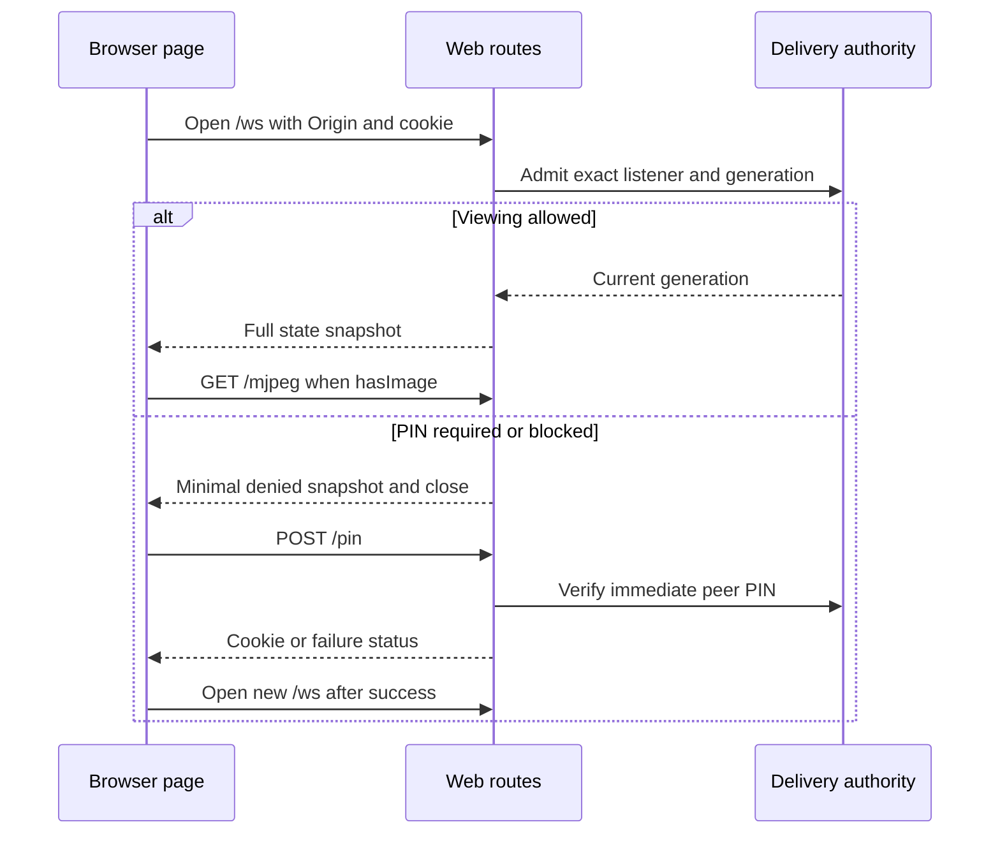

# Web client

One packaged HTML page provides viewing, PIN entry and recovery for independent browsers. It requests state and JPEGs from the Android device and does not control capture. [HTTP delivery](http-delivery.md) owns runtime authority and credentials; [JPEG delivery](jpeg-delivery.md) owns payload lifetimes and writer behavior. The route, authority, PIN parser and WebSocket sections define the server protocol. The browser sections describe recovery, presentation and resource lifetimes.

## Contents

- [Routes and response headers](#routes-and-response-headers)
- [Request authority, origin and credentials](#request-authority-origin-and-credentials)
- [PIN body parser](#pin-body-parser)
- [WebSocket snapshots and transport](#websocket-snapshots-and-transport)
- [Browser owners and recovery](#browser-owners-and-recovery)
- [Presentation and browser-local choices](#presentation-and-browser-local-choices)
- [Fullscreen and picture in picture](#fullscreen-and-picture-in-picture)
- [Source, build workflow and verification limits](#source-build-workflow-and-verification-limits)

## Routes and response headers

| Request | Current result |
| --- | --- |
| `GET /` | One HTML page; protected viewing is established separately through `/ws` |
| `GET /?accessToken=…` | Always `303` to `/`; valid protected token also sets the existing viewing cookie |
| `POST /pin` | Same-origin check, bounded form parsing, then `204` + cookie on success; `403` on wrong PIN; `429` + `Retry-After` while blocked |
| `GET /jpeg` | One JPEG, authorized by open access, token or cookie; `403` if denied; `503` + `Retry-After: 1` if unavailable |
| `GET /mjpeg` | Multipart stream with the same authorization/unavailability policy |
| `GET /ws` upgrade | Read-only full state snapshots, authorized by open access or cookie; token is not accepted directly |

The common interceptor adds `Cache-Control: no-store` and `X-Content-Type-Options: nosniff`. `Referrer-Policy` is `no-referrer` whenever the query contains an `accessToken` parameter, otherwise `same-origin`. It rejects untrusted authority or an inactive exact listener with `403` before normal route work. Unknown paths then follow Ktor routing behavior; there is no separate asset-route family because CSS/JavaScript are embedded in HTML.

Presence of the token parameter, including an invalid or empty value, triggers the root redirect. An invalid token grants no new access and does not erase a valid existing cookie. Media auth is independent of loading the page; logo and captured frames use the same endpoints. [JPEG delivery](jpeg-delivery.md#writing-jpeg-and-mjpeg) owns content types, lengths and multipart framing.

## Request authority, origin and credentials

The adapter trusts direct CIO HTTP authority. Exactly one `Host` header must parse as an HTTP numeric address or `localhost`, with the listening port. Numeric host bytes must match the listener IP after stripping its scope suffix for comparison; `localhost` is accepted only on a loopback listener. Arbitrary DNS aliases, forwarded host/scheme headers and reverse-proxy authority are not trusted.

Authority parsing rejects user information, fragment, path and query. The port defaults to 80 when omitted. Hosts are lowercased and IPv6 brackets removed. Literal parsing restricts IPv4 to four numeric octets in 0–255 and IPv6 to permitted numeric characters before `InetAddress` parsing; it does not resolve arbitrary hostnames. The route check compares numeric authority bytes, but origin equality subsequently compares parsed host text plus effective port. Do not assume all textual spellings of an equivalent IPv6 address are interchangeable for Origin.

PIN requests require `Origin` matching that trusted request origin; only when Origin is absent may `Referer` provide the origin with a path/query. WebSocket requires Origin without Referer fallback. Origin values must use `http`, have no user information/fragment and, when supplied as Origin, no path/query. Media credential admission does not require the PIN/WS origin check. This application check applies the browser origin model described in [RFC 6455](https://www.rfc-editor.org/rfc/rfc6455.html#section-10.2); an Origin header alone is not a viewing credential.

The cookie is `screenstream_access=<hex>; Path=/; HttpOnly; SameSite=Lax`, with no Domain, expiry or Max-Age. It is host-only and session-lived by browser policy; its authorization validity depends on current in-memory credentials. No Secure attribute is added because current listeners use ordinary HTTP. Browser enforcement of cookie attributes is platform behavior, and traffic is not encrypted.

A valid protected URL token exchanges for the current cookie and redirects away from the token-bearing address. The token and cookie independently authorize media; there is no page-session identifier. Correct PIN login shares the same cookie without disrupting other tabs. [HTTP access](http-delivery.md#access-generations-and-pin-blocks) owns generation changes, rotation cutoff and peer blocking. Neither PIN/token values nor internal capture diagnostics are part of the state JSON.

## PIN body parser

`POST /pin` requires `application/x-www-form-urlencoded` after removing content-type parameters. It reads at most 257 bytes, using the extra byte to detect a body over the 256-byte limit, within five seconds. Parsing requires exactly one `pin` field; other fields do not replace it. The access validator requires six ASCII digits.

Wrong content type, oversize body, malformed form encoding (including malformed percent escapes), or missing/duplicate PIN yields null and enters ordinary PIN verification. With protection enabled, this yields `403`, or `429` when the peer is blocked or reaches the wrong-PIN threshold. An already active block is checked before verification; even a correct PIN cannot bypass it. Body-read timeout, read failures, cancellation and unexpected parser failures propagate through the transport rather than receiving a dedicated status mapping here. An Origin rejection occurs before PIN parsing/verification.

Blocked responses round remaining milliseconds upward to seconds for `Retry-After`. Open access returns successful authorization without issuing a protected cookie. If the listener became unavailable before verification, the handler returns no result and the route responds `403`.

## WebSocket snapshots and transport

An accepted connection receives the current complete snapshot and later changed snapshots from `StateFlow`. Internal generation fences transport but is omitted from JSON. Equal state can be conflated; this is a latest-state protocol, not an event history. Unchanged image availability does not produce a snapshot per captured JPEG, and HTTP statistics are not streamed here.

| Authorized snapshot field | Wire values |
| --- | --- |
| `access` | `open` or `authorized` |
| `notice` | Required null, or `permission_required`, `stopped`, `paused`, `failed` |
| `hasImage` | Required Boolean, independent of whether selected image is logo or capture |
| `display.background` | Shared RGB text |
| `display.title`, `display.titleEnabled` | Shared text and Boolean |
| `display.titleLayout`, `display.controlsLayout` | `position: top/bottom`, `presentation: overlay/bar`, `autoHide: Boolean` |
| `display.retainImageOnMediaFailure` | Boolean |

Notices map `WaitingForPermission` → `permission_required`, `Stopped` → `stopped`, `Suspended` → `paused`, `Failed` → `failed`; `Active`, `Starting`, `Reconfiguring` and `Stopping` use null. Notice and image availability are independent, so a stopped notice can accompany a retained image. The browser maps fixed notice codes through its English dictionary. Capture notice differs from state-connection recovery status.

Denied admission sends only `{ "access": "pin_required" }`, or `{ "access": "blocked", "retryAfterMs": <remaining> }`, and closes normally. Denial does not require display, notice or image fields. A valid cookie still authorizes during a peer PIN block. Listener/access revocation can cancel transport without delivering a denial snapshot.

The current browser validator rejects malformed JSON, missing authorized fields, unknown notice values, invalid layouts and wrong types. Denied access codes are handled before authorized-field validation; the page normalizes block timing. Extra fields are not a version negotiation mechanism.

Ktor settings use 15-second ping and timeout, maximum inbound frame size 4096 bytes, incoming wrapper capacity 4 with close-on-overflow, and outgoing capacity 8 with suspension. Outgoing JSON snapshots have a separate 256 KiB limit. Wrapper bounds do not establish a limit on all Ktor/transport memory.

State send plus flush has a five-second budget; voluntary close plus default-session join has another five-second budget. Text/binary commands violate the read-only contract and close with policy violation. An incoming close/error ends a collector awaiting the next state. In `finally`, the adapter cancels the request/raw transport and detached default-session jobs, then joins the default-session job in `NonCancellable`; it does not join its own request job. [HTTP cleanup](http-delivery.md#terminal-cleanup) waits physical call completion.

## Browser owners and recovery

| Owner | Current browser resources |
| --- | --- |
| Connection | One WebSocket, first-state/retry timer and one PIN XHR |
| Media | One displayed `img`, at most one replacement candidate, attempt generation and timers |
| Presentation | Shared appearance, local sizing, layout, inactivity, fullscreen and PiP |
| Page | Applies snapshots; PIN panel/countdown, status text and page lifecycle |

State connection and media recover independently. Losing only WebSocket keeps an already working media image/connection. The first authorized state after a new socket forces a media replacement when `hasImage` is true, including when its fields equal the preceding snapshot. Ordinary `true → true` availability updates leave healthy or exhausted media attempts alone; `false → true` starts media.

Both retry series use delays 0, 1, 2, 4 and 8 seconds, then require manual action. WebSocket gets ten seconds for its first valid state; media gets ten seconds for its first usable image. Successful authorized state/promoted image resets its own budget. A browser without WebSocket support displays unsupported state.

A replacement candidate is hidden until nonzero natural dimensions become available. `load` and 100 ms probes inspect readiness. JPEG additionally requires `complete` and awaits `decode()` when supported; multipart MJPEG uses dimensions/load because decode may never settle for a continuing stream. Callbacks from old socket objects or media generations are ignored. Promotion removes the previous displayed image and begins 500 ms size observation. [HTML image processing](https://html.spec.whatwg.org/multipage/images.html#updating-the-image-data) defines the platform signals; those signals and a live WebSocket do not prove every frame was repainted.

MJPEG is the default. The viewer can manually switch JPEG ↔ MJPEG; the choice survives reconnect in page memory. JPEG polls 500 ms after a candidate is successfully promoted, so a slow load delays the next request rather than accumulating requests. It uses the same first-image timeout and finite recovery budget. Generated request-sequence query values distinguish attempts; they are not server session credentials.

`retainImageOnMediaFailure` controls retaining the displayed image during media error/replacement recovery. Authorization denial, `hasImage: false` and page pause always clear displayed/candidate images and PiP. A retained multipart decoder may already have damaged its displayed content; no visual preservation guarantee follows from retaining the element. A static JPEG can be normal, and the browser has no freshness watchdog proving new capture production.

PIN submission validates six digits locally, permits one XHR, uses a ten-second browser timeout and posts a URL-encoded field. `204` clears the PIN field and retries state connection; `403` shows wrong PIN; `429` uses Retry-After for the countdown, with a one-second fallback. Network errors prompt retry. Countdown expiry re-enables entry without claiming the server accepted anything.

Page `pagehide`/`freeze` pauses connection, aborts pending PIN XHR, releases media/PiP and clears timers; `pageshow`/`resume` reconnects. Returning from visibility hidden for more than 30 seconds replaces a stale state connection, whose first snapshot replaces media. A shorter return retries if connection is unhealthy, otherwise resumes missing media and exposes controls. Background/event-loop throttling can delay all these timers.

## Presentation and browser-local choices

[Settings](../02-configuration/settings.md#shared-web-appearance) owns shared appearance defaults. Viewer choices live only in page memory; new page load resets them. Each screen JPEG, retained frame and logo uses the same sizing logic:

| Local mode | Behavior |
| --- | --- |
| Fit, default | Preserve aspect ratio and fit the complete JPEG with background around it |
| Original size | Natural image size in CSS pixels with scrolling |
| Fit width | Proportional width and vertical scrolling when tall |
| Connection information, hidden by default | Viewing method, state connection, image delivery, dimensions, full title and stream notice |

Oversized images start at the scroll origin so all edges remain reachable. The title is text, not injected HTML; a long caption is ellipsized while full text remains available in title/information. The document title falls back to ScreenStream for an empty shared title.

Controls order is sizing, fullscreen, PiP, More; optional actions use feature detection. Caption and controls independently follow top/bottom, overlay/bar and auto-hide. At one edge the caption is outermost and controls nearer the image. Bars reserve space even when auto-hidden, avoiding resize on inactivity. Menu opens toward the center, with scrolling and available-height limits; status sits below occupied blocks. Safe-area CSS and `visualViewport` are used when available. Narrow layouts replace button labels with compact icons and retain focus styling.

One four-second inactivity timer hides only auto-hide blocks. Touch/mouse activity and keyboard interaction reveal them; active interaction, control/menu focus and an open menu prevent hiding at expiry. Arrow keys traverse enabled visible control elements; Escape/BrowserBack closes the menu. Equal appearance snapshots do not reset inactivity/layout. Changed display and the first snapshot of a new socket do; access, notice and availability still apply on every accepted snapshot.

## Fullscreen and picture in picture

Fullscreen uses available standard/prefixed native request/exit APIs and reports failure while ordinary viewing remains available. The [Fullscreen standard](https://fullscreen.spec.whatwg.org/) defines native asynchronous behavior; feature detection is not a compatibility result.

When detected APIs permit PiP, the page paints the current JPEG to canvas every 100 ms, uses `canvas.captureStream(10)`, attaches it to video and requests native PiP. Each attempt owns its canvas, context, stream/tracks, timers and resulting PiP window. Cleanup releases only that attempt's resources, detaches video and stops tracks; stale callbacks cannot release a successor.

Preparation, metadata, play and native enter share a ten-second application timer. `NotAllowedError` retains a ready stream and asks for another user press, with a 30-second ready timer; another such rejection renews it.

The browser serializes native enter/exit operations. A late successful enter from an already released attempt requests exit before another operation. Native promises cannot be canceled: an unresolved operation can block later operations even after application resources are released.

Exit, image clearing and page pause release the attempt. Timers depend on browser scheduling, and API presence does not prove user-activation, secure-context, policy or device support. The current [W3C PiP working draft](https://www.w3.org/TR/picture-in-picture/) describes those platform APIs; current code's native behavior and resource costs remain unverified on target browsers.

## Source, build workflow and verification limits

Authored files are [connection.js](../../tools/web-client/src/connection.js), [media.js](../../tools/web-client/src/media.js), [presentation.js](../../tools/web-client/src/presentation.js), [page.js](../../tools/web-client/src/page.js), [strings.js](../../tools/web-client/src/strings.js), [style.css](../../tools/web-client/src/style.css) and [HTML template](../../tools/web-client/src/index.html). [WebRoutes](../../src/main/kotlin/io/screenstream/mjpeg/http/web/WebRoutes.kt) and [WebState](../../src/main/kotlin/io/screenstream/mjpeg/http/web/WebState.kt) own transport/wire generation.

Follow the [web-client build guide](../../tools/web-client/README.md) for pinned runtime versions, commands, browser syntax targets and generated assets. Its syntax/drift checks do not verify browser APIs or MJPEG/fullscreen/PiP compatibility.

iPhone/iPad Safari, Android Chrome, desktop and TV viewing remain intended environments without a verified compatibility matrix. The browser offers manual JPEG/MJPEG switching and retains ordinary viewing when fullscreen/PiP fails. [HTTP limits](http-delivery.md#cio-writer-patch-and-limits) remain independent of browser state. [Testing](../04-testing/testing.md) describes verification scope and evidence requirements.

Navigation: [Internal guide](../README.md) · [Usage](../../docs/usage.md) · [Architecture](../../docs/architecture.md).
