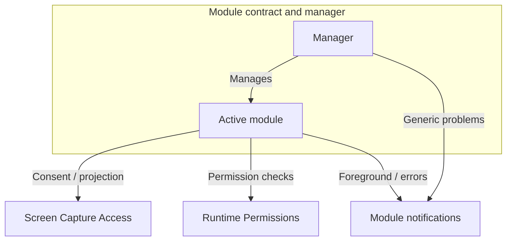

# Core

Core lets a host app open streaming modules, coordinate screen-capture consent and runtime permissions, and present streaming notifications. The guides below describe how the parts work together; KDoc on each declaration defines its exact contract.

| Guide | Covers | Main types |
| --- | --- | --- |
| [Streaming Module Contract and Manager](docs/module-contract-and-manager.md) | Module definitions, instances, commands, shutdown and health | `StreamingModule`, `StreamingModuleService`, `StreamingModuleManager` |
| [Screen Capture Access](docs/screen-capture.md) | Screen-sharing consent and `MediaProjection` acquisition | `ScreenCaptureAccess`, `ScreenCaptureConsentHost`, `ConsentRequestObserver` |
| [Runtime Permissions](docs/runtime-permissions.md) | Permission checks and Activity-root request UI | `RuntimePermission`, `RuntimePermissions`, `LocalRuntimePermissions` |
| [Streaming Module Notifications](docs/notifications.md) | Foreground notifications, error notifications and notification actions | `StreamingModuleNotifications`, `StreamingModuleActionReceiver` |

## Key concepts

- A **module instance** is one opening of a registered module. `StreamingModuleManager`, a process-wide singleton, admits at most one instance to new work at a time.
- Each instance runs in the module's `StreamingModuleService` subclass. The Service hosts the foreground notification and creates the instance's `StreamingModule.Controller`, which owns the instance's work, UI, resources and cleanup.
- A **capture attempt** is one accepted Start within an instance. Opening a module and starting capture are separate steps.

## Host app integration

The host app:

- includes `StreamingKoinModule`, which provides the manager, `ScreenCaptureAccess` and the streaming settings store, and supplies the Android `Context`, every `StreamingModule` definition, one `StreamingModuleNotifications` provider and one `ConsentRequestObserver`
- mounts `ScreenCaptureConsentHost()` once at the Activity root and provides its `RuntimePermissions` host there through `LocalRuntimePermissions`
- renders the selected module with `StreamingModuleManager.InstanceContent` and removes its tasks when the manager publishes `Exiting`
- can replace Core's log writer with `configureLogWriter` during application startup; the default writer forwards to XLog, which the app must initialize

Core's manifest declares the non-exported `StreamingModuleActionReceiver`. Each module declares its own Service with its foreground types and permissions.

## How the components connect

A typical session:

1. The app selects a module, and the manager opens an instance.
2. Start reaches the Controller. The module checks its permissions and obtains screen-capture access.
3. The module prepares its media work and streams.
4. A normal Stop ends the capture attempt. Exit or replacement closes the instance and starts its cleanup.

Core maintainers can start from [Core internals](internal/README.md), which maps each contract to its source and describes how Core is verified.
