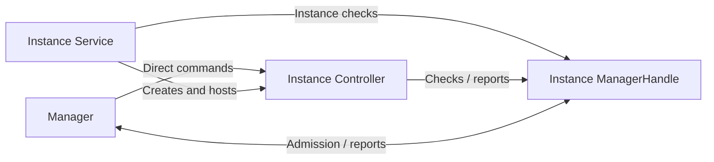
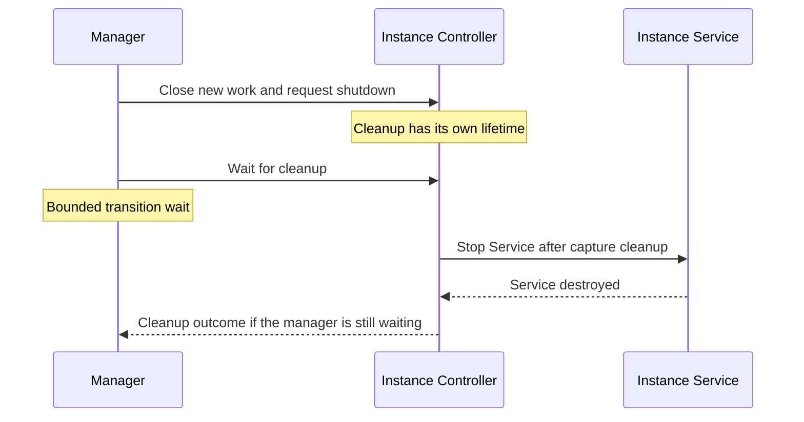

# Streaming Module Contract and Manager

[Core](../README.md)

`StreamingModule` describes a streaming module. `StreamingModuleManager`, an application-process singleton, selects registered modules, opens and replaces their instances, routes commands and publishes state.

A **module instance** is one opening of a registered module. The manager admits at most one instance to new work at a time. Capture Start and a normal Stop happen inside an instance; restarting or reopening a module creates a new instance.

## Participants and relationships

- **Manager.** Owns selection, opening, replacement, command routing, health observation and shutdown requests.
- **Module definition.** The `StreamingModule` descriptor that the app registers. It names the module, its priority, its `StreamingModuleService` subclass and that Service's foreground notification slot. One definition serves every opening.
- **Instance Service.** The module's `StreamingModuleService` subclass. For an admitted start it enters foreground, then calls the module's Controller factory. It hosts the instance's foreground notification.
- **Controller.** The module's `StreamingModule.Controller` for one instance. It executes commands and owns streaming, module UI, resources and cleanup. The manager installs and starts it, sends commands directly to it and requests its shutdown.
- **ManagerHandle.** The instance's connection to the manager, shared by its Service and Controller. The manager creates it before the Service start is delivered. It carries the instance identity and foreground slot, answers admission checks and accepts status and failure reports.

## How they collaborate

1. **Opening.** The app selects a module. The manager resolves the choice, creates the instance identity and handle, and starts the Service with ordinary `Context.startService`.
2. **Waiting foreground.** For an admitted start, the Service enters **waiting foreground** (`specialUse`, with an Exit action), then calls the Controller factory. If the instance is still admitted, the manager installs and starts the Controller. The first accepted status completes startup and publishes `Running`, or `Unresponsive` if its heartbeat is already stale.
3. **Capture.** An accepted Start begins a **capture attempt**. The module checks [runtime permissions](runtime-permissions.md) and obtains [screen-sharing consent](screen-capture.md). After consent and before acquiring the `MediaProjection`, the same Service switches to `mediaProjection` foreground, adding `microphone` when the module requires it. The module then prepares its media work and starts capture.
4. **Stop or closure.** A normal Stop cleans up the attempt and returns the Service to waiting foreground for another Start. Replacement, restart, Exit and terminal failure close the instance to new work and request Controller shutdown.

A start delivered after Exit, or after startup admission expired, neither promotes the Service nor creates a Controller. The unowned Service stops unless a newer start for it is pending. Because the manager uses `startService` rather than `startForegroundService`, a rejected delivery leaves no pending obligation to call `startForeground`.

## Identities and lifetimes

| Identity | Meaning |
| --- | --- |
| `StreamingModule.Id` | The registered module, stable across openings. |
| `StreamingModule.InstanceId` | One opening of that module. Restart and reopening create a new one. |
| `StreamingModule.CaptureAttemptId` | One accepted Start within an instance. |

The Controller and handle belong to one instance until its cleanup ends. After admission closes, the handle still carries that instance's identity, and its reports are ignored, so callbacks from an old instance never affect its replacement.

The manager routes Start, but the Controller decides readiness and owns capture admission. A Service admits one attempt at a time to capture foreground; the module decides how it serializes the rest of an attempt.

### Closing a module instance

Closing stops new work and asks the Controller to clean up. Shutdown can be requested before `startModule` runs or while the control loop is stalled.

The Controller finishes capture cleanup, then stops its original Service with `stopAndAwaitDestruction` and waits for its destruction. If the Service is destroyed for another reason, it notifies the same Controller, which closes admission and keeps cleanup ownership. An Android foreground-service timeout or a failed foreground call makes the Service report instance failure and request Controller shutdown.

Replacement and Exit wait a bounded time for the previous instance's cleanup. The manager records one shutdown deadline per instance, and later waits reuse it. Repeated requests therefore don't extend the wait, and restarting an instance that failed earlier may find its deadline already past. When the wait ends, the manager moves on: old cleanup can continue alongside a replacement, and older resources may still be releasing. Cleanup completion follows the guarantees of the module's resource owners.

A replacement that uses a different Service component can open while the old Service is still alive. One that reuses the same component needs the old Service destroyed first: a start delivered to a Service that still hosts a Controller fails the new instance, and the old Controller keeps its Service.

## Manager commands

Commands are requests. The manager drops unknown, stale and ill-timed requests, and returning confirms nothing; observe `state` for outcomes.

### Selection and restart

`selectModule(id)` opens a registered module. Without an ID, the first selection uses the saved choice if that module is still registered, otherwise the highest-priority module; later requests without an ID use the choice made in this process. A changed explicit choice is saved asynchronously.

Selecting the current module keeps its instance, even a failed one. `restartModule` replaces that exact instance with a new opening of the same module. While another transition is in progress, including the first settings load, selection and restart are dropped.

Android can reject the ordinary Service start or the later waiting-foreground promotion, for example when the app leaves the foreground during preparation. A request from UI doesn't guarantee permission at either later call, and leaving the foreground doesn't always cause rejection. Any startup failure, a missing first status, or a start delivered to a Service that still hosts the previous Controller publishes generic `Failed`. The manager doesn't retry: return to foreground UI and restart that exact failed instance.

### Capture Start, Stop, and recovery

The manager forwards these commands only while the target is the current admitted instance, in `Running` or `Unresponsive`, and no transition is active.

- **Start** is forwarded asynchronously. The Controller decides readiness and owns the attempt that follows.
- **Stop** targets one capture attempt and is forwarded synchronously on the main thread. The Controller, not the manager, matches the attempt, because reported status can lag behind the notification that offered Stop. A normal Stop leaves the instance open.
- **Recovery** asks the module to handle an operation error in place. The Controller validates the error token; a module without recovery ignores it.

### Exit

Exit closes new work, cancels a pending opening and returns while shutdown proceeds. Unlike selection, it is accepted during a transition. `exit()` applies regardless of the current instance; `exit(instanceId)` applies only while that instance is admitted, including during startup.

While Exit's bounded wait is pending, selection, restart and commands are dropped. `Exiting` stays published after the wait ends, until a later selection. The host app removes its tasks; task removal and media cleanup complete independently.

## Observable process and instance health

`StreamingModuleManager.state` publishes one snapshot of the manager lifecycle and the current instance's control health. Collectors see only the latest snapshot and can skip intermediate states.

| State | Meaning |
| --- | --- |
| `NoModule` | Nothing is open; awaiting selection. |
| `Switching` | An opening is in progress: the settings load, the previous instance's bounded wait, or the new instance's first status. |
| `Running` | The current Controller reports fresh progress. |
| `Unresponsive` | Progress is stale; the last accepted status is retained. |
| `Failed` | Terminal failure. Admission is closed and cleanup proceeds. Remains until another selection, a restart or Exit. |
| `Exiting` | Exit has closed admission. Remains after the bounded wait. |

Health shows whether Controller work is progressing, not whether capture or the network is ready; an idle Controller is healthy while it keeps reporting. `Running` and `Unresponsive` refer to the same instance, commands reach both, and a fresh report restores `Running`.

Each report carries a `StreamingModule.Status`: whether capture is streaming, whether a consumer is present, the current capture attempt and any operation error. Streaming and consumer presence change independently. An operation error leaves the instance usable; terminal failure is reported separately through `reportFailed`.

## Module UI and notifications

The Controller owns its module UI. `InstanceContent` renders it only while that instance is admitted and otherwise shows the app's fallback; rendering changes don't affect the Controller's work or cleanup.

[Streaming Module Notifications](notifications.md) describes how the Service, the manager and the Controller each present their notifications through the app's provider.
