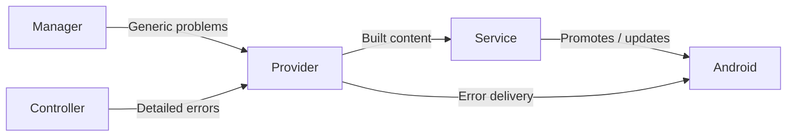

# Streaming Module Notifications

[Core](../README.md) · [Streaming Module Contract and Manager](module-contract-and-manager.md)

`StreamingModuleNotifications` is the app-supplied **notification provider**. It builds foreground content, delivers or clears error notifications, reports channel availability and supplies channel settings destinations. Each notification's owner decides when it is shown, updated or cleared.

## Participants and relationships

- **Notification provider.** One per process, supplied by the app. Error delivery is best effort.
- **Instance Service.** `StreamingModuleService` owns the instance's foreground notification, in the module's foreground slot.
- **Manager.** Owns the generic problem notification, in the `NOTIFICATION_ID_MODULE_ERROR` slot.
- **Controller.** Owns any detailed operation-error notification it presents, including an optional recovery action.
- **Android.** Controls visibility and the user's notification settings.

## Foreground presentation

Each module definition declares a foreground slot for its Service component. The manager rejects a catalog in which a slot isn't positive or equals the module error slot, one Service component has two slots, or two components share one; it passes the validated slot to the instance through its handle. The Service uses that one slot in every phase:

1. **Waiting.** An admitted Service enters `specialUse` foreground with Exit content before its Controller factory runs. A start that isn't admitted never promotes.
2. **Capture preparation.** After consent and before projection acquisition, `enterCaptureForeground` promotes the same Service to `mediaProjection` foreground, adding `microphone` when required. The content still offers Exit.
3. **Confirmed capture.** `updateCaptureNotification(attempt, true)` switches the content to Stop for that attempt. Content updates post under the same ID and keep the foreground types.
4. **Stopping capture.** The module can restore Exit content while cleanup continues. After the attempt's cleanup or rollback settles, `leaveCaptureForeground` restores waiting foreground while the instance is still admitted.
5. **Shutdown.** After capture cleanup, the Controller calls `stopAndAwaitDestruction`, which closes foreground updates and stops the Service. Android removes the foreground notification when the Service stops.

The provider builds foreground content even while delivery is blocked. On API 33+, when the notification permission changes, the Service re-posts its current foreground notification if the Streaming channel can deliver. A failed foreground call or an Android foreground-service timeout closes foreground updates, reports instance failure and requests Controller shutdown. [Screen Capture Access](screen-capture.md) describes the consent and projection steps around capture foreground.

## Error presentation

The manager and the Controller each own one error notification, and both can be visible at once.

The manager derives its notification from `state`. An operation error in the current status, or `Unresponsive` health, starts one warning episode for that instance with a single delivery attempt. Message changes, moving between error and unresponsive, and re-enabled delivery don't post it again. `Failed` replaces the warning with failure content, using the failure's message resource or generic text. Every other state, including responsive control without an error, a transition and Exit, cancels it. A provider failure is logged and isn't retried within the episode.

The Controller chooses which operation errors to present in detail (`ErrorContent.Text`), can attach a recovery action for its current error episode, and clears its notification when the error resolves or the instance shuts down. Recovery stays within the same instance ([Capture Start, Stop, and recovery](module-contract-and-manager.md#capture-start-stop-and-recovery)).

## Notification actions

`StreamingModuleActionReceiver` creates immutable PendingIntents for notification buttons and routes them to the manager. Core's manifest declares the receiver as non-exported. Each action's data URI encodes its exact target, which keeps PendingIntents for different targets distinct; malformed URIs are ignored.

| Button | Target | Effect |
| --- | --- | --- |
| Exit | The instance whose Service showed it | `exit(instanceId)`, which applies only while that instance is admitted |
| Stop | One confirmed capture attempt | `requestStreamStop(attempt, fromNotification = true)`; the Controller matches the attempt |
| Recovery | An instance and its error-episode token | `requestRecovery`; the Controller validates the token |

A button keeps its original target after replacement or a later capture attempt, so it can't act on a newer instance or attempt.

## Delivery and permissions

`areNotificationsEnabled(channel)` reports whether a channel can deliver now. Foreground-service eligibility and the visibility of foreground notifications follow separate Android rules. [Runtime Permissions](runtime-permissions.md) owns the notification permission check, which includes app-wide enablement, and the request UI. Module UI can open the provider's `channelSettingsIntent` when it isn't null.

The app's current provider creates the Streaming and Error channels, builds localized content whose tap opens the app, and posts error notifications only while the Error channel can deliver. Its availability check combines the notification permission on API 33+, app-wide enablement and, on API 26+, the channel's importance.
