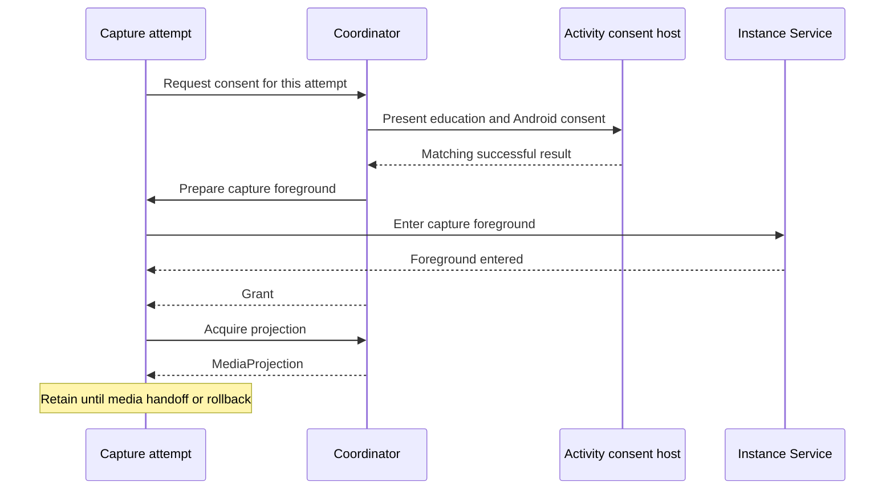

# Screen Capture Access

[Core](../README.md) · [Streaming Module Contract and Manager](module-contract-and-manager.md)

`ScreenCaptureAccess` is the process-wide coordinator for screen-sharing consent and `MediaProjection` acquisition. A **capture attempt**, identified by `StreamingModule.CaptureAttemptId`, is one accepted Start within a module instance. It requests consent, acquires a projection and hands it to the module's media owner. The [module guide](module-contract-and-manager.md) defines which instance may accept work.

## Participants and relationships

- **Coordinator.** `ScreenCaptureAccess` admits one consent request or projection acquisition at a time across the process, matches Activity results to the requesting attempt and issues one-use grants.
- **Activity consent host.** `ScreenCaptureConsentHost`, mounted once at the Activity root outside module screens. While resumed, it can present capture education and Android's consent dialog.
- **Capture attempt.** Owned by the module's Controller and bounded by its own coroutine `Job`. It prepares capture foreground on its instance's Service, holds the returned projection until handoff, and owns rollback.
- **Instance Service.** Enters capture foreground after consent and before projection acquisition ([foreground presentation](notifications.md#foreground-presentation)).
- **Media owner.** The module component that accepts the projection and performs capture. Acceptance transfers ownership; the media owner then handles the projection's operation, revocation and release.

## How they collaborate

This order follows Android's prerequisites for the `mediaProjection` foreground-service type: consent first, then the foreground service, then `getMediaProjection` ([foreground service types](https://developer.android.com/develop/background-work/services/fgs/service-types#media-projection)). The attempt's foreground-preparation callback runs synchronously on the main thread after a successful result, even while the Activity is paused. It must recheck the attempt, module admission and permissions, and a grant is returned only when it succeeds.

A request ends normally with `Granted` or with `NotGranted` and a reason: `Busy`, `HostUnavailable`, `EducationDeclined`, `Declined` or `ForegroundRejected`. Cancellation and technical failures are thrown instead; a launcher failure arrives as `ConsentLaunchException`.

## Host and request ownership

Fresh consent needs a resumed host. When several hosts are resumed, the most recently resumed one is selected; when it leaves, another resumed host becomes selectable.

- **Before submission**, the request belongs to the selected host. A change of selected host ends it as `HostUnavailable`, and dismissing education ends it as `EducationDeclined`.
- **At submission**, the request is marked submitted before Android's dialog launches, so a recreated host never launches it again.
- **After submission**, the request keeps its result association across pause, host changes and recreation. A matching result settles it even with no resumed host.

A submitted request can stay pending if its host is lost without a result. The host detects one such loss: when it uses its Activity's own result registry and the launcher that submitted the request is disposed while that Activity is finishing, the request ends as `HostUnavailable`. Only that launcher can settle its own request this way, and a result that arrived first is unaffected. Other losses go undetected, for example a recreated Activity that finishes before the host mounts, or a task removed while no host is mounted. If the result registry isn't the Activity's own, the host logs a warning and doesn't detect finishing. Core adds no timeout and never relaunches the dialog; cancelling the attempt, for example through Exit, ends a pending request.

Cancelling the attempt removes its request. Android's dialog may stay visible, and its late result is ignored. Cancellation can also win after foreground preparation succeeded but before the grant is delivered, so attempt cleanup must undo foreground preparation even without a grant.

Capture education is shown until the user accepts it once. Acceptance is saved independently of consent or capture success, and a failed save can show it again. Pending requests, grants and saved consent belong to the current process. Ordinary permissions use the separate [Runtime Permissions](runtime-permissions.md) host.

## Projection creation and handoff

`createProjection` consumes a grant on a worker thread and holds a creation guard until `finishProjectionCreation` is called for the same attempt, even when the platform call fails. While the guard is held, consent requests return `Busy` and other acquisitions throw. A grant works only with the coordinator that issued it and only while its attempt `Job` is active.

The returned projection belongs to the attempt until the module's media owner accepts it. If startup fails or is cancelled before handoff, the attempt stops the projection and then finishes creation. After handoff, the media owner governs the projection's lifetime and release under its own guarantees.

Below API 34, a caller can opt in to one retry of a `SecurityException` raised shortly after foreground preparation; `createProjection` defines the delay and window.

## Legacy reuse and cleanup

On SDK 24–33, the coordinator can keep one consent result in process memory for the next attempt. The module offers a grant through `saveConsentForReuse` only after successful startup, a normal requested stop and confirmed media cleanup. Failure, timeout, revocation or unconfirmed cleanup makes the attempt ineligible, and the coordinator trusts the module's judgment. Only a consumed grant of the most recently admitted attempt is saved.

The next request takes saved consent without a host and consumes it immediately, even if that attempt later fails; only a new save makes consent available again. Reuse still runs foreground preparation and needs its own projection acquisition. From SDK 34, Core always requests fresh consent; Android 14 requires consent for each capture session in apps that target API 34 or higher ([behavior change](https://developer.android.com/about/versions/14/behavior-changes-14#media-projection-consent)).

## Consent observations

The app's `ConsentRequestObserver` learns where each attempt's consent came from: saved consent was taken, or a request was submitted to Android's dialog, together with whether the user accepted capture education for it. Calls run synchronously on the main thread once the decision is committed; the coordinator logs and ignores observer exceptions. An observation doesn't imply approval, a grant or capture startup.
