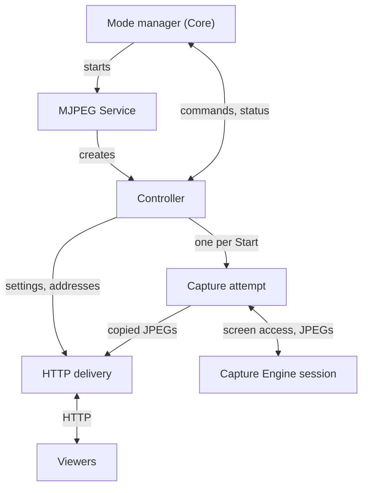
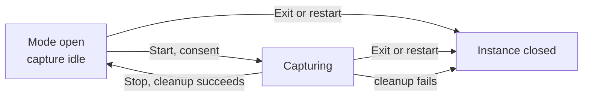

# MJPEG architecture

[Overview](../README.md) · [Usage](usage.md) · Architecture · [HTTP server](server.md)

MJPEG mode turns the streaming device into a small web server. While the mode is open, the app serves a viewer page and images over direct HTTP on the device's network addresses. **Start stream** begins screen capture. The screen, or an app window approved in Android's consent dialog, becomes a sequence of JPEG images, and every connected viewer receives the newest one.

This guide explains which component owns each kind of work, how long each one lives, and how the components cooperate when capture starts, stops or fails. [Usage](usage.md) describes sharing and each setting, and [HTTP server](server.md) defines the requests and responses that clients use.

## Contents

- [Components](#components)
- [Two lifetimes: the open mode and each capture](#two-lifetimes-the-open-mode-and-each-capture)
- [Hosting and coordination](#hosting-and-coordination)
  - [The Service](#the-service)
  - [The Controller](#the-controller)
- [Settings](#settings)
- [Addresses, listeners and readiness](#addresses-listeners-and-readiness)
- [Starting capture](#starting-capture)
- [Delivering images](#delivering-images)
  - [From Engine frame to shared image](#from-engine-frame-to-shared-image)
  - [What viewers receive](#what-viewers-receive)
  - [The viewer page and image clients](#the-viewer-page-and-image-clients)
- [Viewing access](#viewing-access)
- [Stopping, closing and recovery](#stopping-closing-and-recovery)
  - [Stop](#stop)
  - [Pauses and failures](#pauses-and-failures)
  - [Closing the mode](#closing-the-mode)
- [Status and statistics](#status-and-statistics)

## Components

MJPEG mode is built from three parts:

- [Core](../../core/README.md) opens the mode and hosts it in an Android Service. It also coordinates screen-sharing consent, runtime permissions and notifications.
- [Capture Engine](../../../screen-capture-engine/README.md) turns the screen content that Android allows the app to capture into complete JPEG images.
- MJPEG mode supplies everything needed to serve those images over HTTP from the device's own network addresses.

| Component | Responsibility | Lifetime |
| --- | --- | --- |
| Mode manager (Core) | Opens and closes the mode, routes Start, Stop and Exit, and watches health | The app process |
| MJPEG Service | The Android foreground Service that hosts one opening of the mode and creates its Controller | One opening of the mode |
| Controller | Coordinates settings, addresses, capture, HTTP delivery and the mode's screen, and reports to the manager | One opening of the mode |
| Capture attempt | Obtains screen-sharing consent, runs a Capture Engine session, and copies its JPEGs to HTTP delivery | One accepted Start, through its cleanup |
| Capture Engine session | Produces JPEGs from the shared screen or app using the current image settings | One capture attempt |
| HTTP delivery | Runs the HTTP listeners, which are server sockets (one per selected device address, all on the configured port). It also enforces viewing access, holds the shared current image, and serves the viewer page and its state | One opening of the mode |
| Address discovery | Watches the device's network interfaces and addresses | One opening of the mode |
| Settings | Saved image, connection, access, web page and automation preferences | Kept across openings |
| Viewers | The packaged browser page, or any client that reads MJPEG or JPEG over HTTP | Independent of the app |

The Controller coordinates the capture attempt and HTTP delivery but never carries image data. JPEGs go straight from the capture attempt to HTTP delivery.

## Two lifetimes: the open mode and each capture

Core calls one opening of a mode a **module instance**. Selecting MJPEG mode creates an instance, which lasts until Exit, **Restart mode**, the selection of a different mode, or a failure that closes it. HTTP delivery, address discovery and the viewing credentials belong to the instance. Viewers can therefore open the page as soon as a listener is ready, before any capture starts.

A **capture attempt** is one accepted Start inside the instance. It lasts from the consent request through capture until its cleanup completes. An instance runs one attempt at a time. A new Start is accepted only after the previous attempt has cleaned up successfully.

| Event | Module instance | Capture attempt | Viewers |
| --- | --- | --- | --- |
| Select MJPEG mode | Created. HTTP delivery and address discovery start. | None | Can open the page once a listener is listening, and see the inactive stream image |
| Start stream | Unchanged | Created: consent, then capture | Receive live images once the first JPEG arrives |
| Stop stream | Unchanged. Listeners and credentials stay. | Cleaned up | Stay connected and see the inactive stream image |
| Exit, Restart mode or another mode | Closed and cleaned up | Stopped and cleaned up | Disconnected. Old links and credentials stop working. |

## Hosting and coordination

### The Service

When MJPEG mode is selected, Core's mode manager starts the mode's Android foreground Service. The Service creates the Controller for that instance, and the manager then starts the Controller and sends it commands. All three share the instance's identity, so a late report or command from an old instance never reaches its replacement. [Streaming Module Contract and Manager](../../core/docs/module-contract-and-manager.md) describes these roles.

The Service keeps the mode running in the foreground for as long as the mode is open. It does this in two phases:

- **Waiting.** While no capture is running, the Service runs in a special-use foreground phase whose declared purpose is to keep the web server available. Its notification offers Exit.
- **Capture.** After consent, the same Service switches to the media-projection foreground phase that Android requires for screen capture. Once capture is confirmed, the notification offers Stop for that capture. After successful cleanup, the Service returns to waiting.

[Streaming Module Notifications](../../core/docs/notifications.md#foreground-presentation) defines this foreground presentation and how notification actions reach their targets.

### The Controller

The Controller is the single coordinator for the instance. It handles commands, saved settings, address changes and capture updates one at a time. As a result, each decision, such as whether to accept Start, sees one consistent picture of the mode. From that picture it publishes two things:

- **The mode's screen.** The screen shows the Start or Stop control, the stream addresses and their listener status, the PIN, and statistics. Actions on the screen go back to the Controller as requests, and the Controller decides whether they still apply.
- **Status reports to the manager.** Each report states whether capture is active, whether viewers are connected, which capture attempt is current, and any operation error. The Controller also sends a regular heartbeat, so the manager sees control progress even while capture is idle.

## Settings

Settings screens save directly to the mode's preference store. The Controller watches the saved values and decides when each one takes effect. Saving makes a value persistent; it becomes visible in the stream only when its owner applies it.

Settings fall into two groups:

- **Live settings** apply while you share. Image settings reach the running capture without restarting it. The Network filter changes the address selection, and with it the listeners. Web page and inactive-image settings change what every connected viewer sees straight away. Automation settings change what the Controller and the capture do next. **Hide PIN when starting a stream** controls whether the app screen masks the PIN when a capture starts.
- **Setup settings** are the JPEG encoder, the HTTP port and the access settings other than **Hide PIN when starting a stream**. They stay fixed from an accepted Start until that capture's cleanup succeeds, and the app disables their editors meanwhile. A Capture Engine session uses one encoder for its whole run, and a running capture keeps the port and the viewing credentials it started with. The Network filter stays live, so addresses can still appear or disappear during a capture. A setup value saved during a capture takes effect after cleanup succeeds.

When PIN protection is on and the PIN option is **New PIN on open**, the instance generates a fresh PIN while opening, before HTTP delivery applies the access settings. [Choosing settings](usage.md#choosing-settings) lists every setting with its choices and default.

## Addresses, listeners and readiness

Address discovery publishes the device's current network addresses. The Controller applies the **Network filter** to choose the stream addresses. Some addresses can be served only while Android's local-network permission is granted. The Controller checks that permission through Core's [Runtime Permissions](../../core/docs/runtime-permissions.md) and leaves such addresses out of the listener plan until the grant is present. The address row offers the permission request.

HTTP delivery opens one listener for each permitted address. Each listener is independently Pending, Listening or Failed. A failed listener can be retried from its address row, and it leaves the other listeners, and any running capture, unaffected. Address changes during capture add or remove listeners without interrupting capture.

Each address row offers actions to open, copy, share or show a QR code for the address:

- When the app has a **ready link** for the row, the actions use it. A ready link becomes available only after the row's listener is listening and the current access settings have been applied, and some addresses don't get one even then. With PIN protection on, the ready link carries the token, so it admits the viewer directly.
- Otherwise the actions use the **plain address**, and a protected stream asks the viewer for the PIN.

Start is available when all of these hold:

- the Controller has accepted the settings;
- no capture attempt is in progress;
- at least one listener on the current port is listening on a selected, permitted address.

The Controller checks these conditions again when it handles the request, so a tap can have no effect if conditions changed in between. A listening socket doesn't prove that a viewer can reach it; see [Make sure viewers can reach you](usage.md#make-sure-viewers-can-reach-you).

## Starting capture

A Start is a request. The Controller decides it when it handles the request: if the mode is still ready, it creates one capture attempt. The attempt takes capture through three handoffs, and each resource has one owner at a time:

- **Consent.** Core shows the app's explanation and Android's screen-sharing dialog. Before Core passes the approval to the attempt, the Service enters its capture phase, as Android requires. Meanwhile, viewers see that the device is waiting for permission.
- **Screen access.** The approval gives the attempt Android's handle to the shared screen or app. The attempt owns it until a Capture Engine session takes it over. If no session can be created, the attempt releases the handle itself.
- **Engine session.** The session starts with the latest image settings, including changes made while the dialog was open. When the session reports a successful start, capture is confirmed, which means the Engine has a usable configuration. The app and the notification then offer Stop. The first image can arrive shortly afterwards.

If the user declines, the attempt ends without an error and the mode stays ready. A capture startup failure ends the attempt with an error. If cleanup succeeds and the mode is still open, Start becomes available again. If Android refuses to let the Service enter its capture phase, the whole mode closes instead, because its foreground host has failed. On older Android versions, Core can reuse the approval from a normally stopped capture, so the dialog may not appear ([legacy reuse](../../core/docs/screen-capture.md#legacy-reuse-and-cleanup)). Core's [projection handoff](../../core/docs/screen-capture.md#projection-creation-and-handoff) and the Engine's [session contract](../../../screen-capture-engine/docs/usage.md#run-a-capture-session) define the shared rules.

## Delivering images

### From Engine frame to shared image

The Engine lends each JPEG for the duration of one callback. On the callback thread, the attempt copies the bytes into storage owned by HTTP delivery, then returns. The Engine skips delivery opportunities while a callback is busy rather than queueing them. HTTP delivery, in turn, keeps only the latest frame. Only a running capture can publish: once capture is paused, stopping or stopped, late copies are discarded. [Handle JPEG frames](../../../screen-capture-engine/docs/usage.md#handle-jpeg-frames) defines the borrowing rules.

HTTP delivery holds one selected image for all viewers. Each response keeps the image it is writing valid until that write completes, so replacing the image never disturbs a transfer in progress. MJPEG readers always advance to the newest image and skip any images they missed. When capture is quiet, the unchanged image is repeated periodically. The server keeps no backlog of old frames for a slow reader; each client handles its own buffering and display. Each viewer receives its own HTTP transfer, so outgoing data grows with the number of viewers.

### What viewers receive

| Situation | Image served |
| --- | --- |
| Capture is running and has produced a frame | The latest captured frame |
| No current frame: before the first Start, while consent is pending, before a new capture's first frame, and when capture is paused, stopped or failed | The **Inactive stream image**: the app logo (default) or **Last frame**, the most recent captured frame (the logo if there is none) |

The most recent captured frame survives Stop and later Starts until a newer frame replaces it or the mode closes. With **Last frame**, viewers can therefore keep seeing the final screen content after Stop.

### The viewer page and image clients

The packaged browser page loads from the root URL. It requests images as MJPEG (the default) or as repeated single JPEGs, and receives state over a read-only WebSocket. Each state snapshot is complete. It carries the access result, a capture notice (waiting for permission, paused, stopped or failed), the kind of image currently selected and the shared appearance.

State and images travel separately and can arrive in either order; the page combines them. Other clients can read the MJPEG or JPEG URLs directly. [HTTP server](server.md) defines the routes, media framing and state schema. [Watching in the browser](usage.md#watching-in-the-browser) describes the page's controls and automatic recovery.

## Viewing access

Viewing credentials belong to HTTP delivery for the whole instance, and all listeners share them. Access is open by default. With PIN protection enabled:

- the six-digit PIN is a saved setting;
- HTTP delivery generates a random **token**, which ready links and their QR codes carry, and a **viewing cookie**, which a browser receives after presenting a valid ready link or the PIN. Neither is saved;
- a viewer who opens the plain address enters the PIN.

Wrong-PIN limiting blocks further PIN checks from one peer IP address across all listeners. Viewers who are already authorized keep their access.

| Change | Effect on credentials |
| --- | --- |
| Start or Stop | Kept |
| Reopening the mode or Restart mode | New token and cookie. With protection on and **New PIN on open**, also a new PIN. |
| Turning protection on or off, or changing the PIN while protection is on | Replaced. Connected viewers are disconnected and reconnect under the new rules. |

Access changes are setup settings ([Settings](#settings)). Hiding the PIN on the mode's screen doesn't affect HTTP enforcement. [Decide who can watch](usage.md#decide-who-can-watch) explains the user-facing choices, and [HTTP server](server.md) defines token exchange, the cookie and PIN submission.

## Stopping, closing and recovery

### Stop

A Stop can come from **Stop stream** in the app, Stop in the notification, Android ending screen sharing (for example from its status-bar control), or an automation setting:

- **Stop when screen turns off** stops capture when the screen turns off.
- **Stop stream after address loss** stops capture when the Network filter has selected no address for the configured delay.

Each Stop targets one capture attempt, so a delayed Stop for an earlier attempt cannot end a newer one.

When Stop is accepted, the attempt stops publishing at once, and viewers switch to the inactive stream image with the stopped notice. Cleanup then stops the Engine session, which closes frame delivery and ends screen access, and waits until the attempt's frame handler has returned. It also settles the attempt's consent records with Core. When every step succeeds, the Service returns to its waiting phase. The Engine's own [stop contract](../../../screen-capture-engine/docs/usage.md#stop-a-capture-run) governs when its internal graphics and buffer resources are physically released.

Start becomes available again, and setup settings saved in the meantime take effect, only after this cleanup succeeds. If cleanup is slow, the app reports "Still stopping the stream…" and offers **Restart mode**. If cleanup fails, the whole mode closes ([Pauses and failures](#pauses-and-failures)).

### Pauses and failures

MJPEG mode distinguishes problems that a capture attempt can survive from problems that end the attempt or the whole instance.

| Situation | Capture attempt | Module instance | What users see |
| --- | --- | --- | --- |
| The Engine pauses output because the settings don't fit the capture area, the capture source is unavailable, or resources are insufficient | Continues, paused | Unchanged | The app shows the pause reason and keeps Stop available. Viewers see the paused notice and the inactive stream image. |
| Capture startup fails, the Engine fails, or a frame copy fails | Ends and cleans up | Stays open unless another failure or Exit closes it. Start returns after successful cleanup. | The app reports an error and offers **Restart mode**. A later successful Start clears it. |
| Capture cleanup fails | Ends | Reports failure and shuts down | The app shows a mode failure and offers **Restart mode** |
| HTTP delivery, address discovery or settings fail, Android refuses the Service's capture phase, or Android destroys the Service | Stopped | Reports failure and shuts down | Same as above |

A paused capture resumes when capture conditions change or a changed image setting reaches the Engine; the app does not retry on a timer. [Handle errors and recovery](../../../screen-capture-engine/docs/usage.md#handle-errors-and-recovery) defines the Engine's pause categories, and [Streaming Module Notifications](../../core/docs/notifications.md#error-presentation) describes how Core presents operation errors and failures.

### Closing the mode

Exit (from the app or the notification), **Restart mode** and selecting a different mode all ask the manager to close the instance. The instance stops accepting work, stops any capture attempt, shuts down HTTP delivery (ending every viewer connection and discarding the credentials) and closes address discovery. After capture cleanup, it stops the Service.

The manager waits only for a limited time, so a replacement instance can open while the old one is still releasing resources. **Restart mode** opens a replacement that waits for a new Start, with fresh credentials. [Closing a module instance](../../core/docs/module-contract-and-manager.md#closing-a-module-instance) describes the manager's side.

## Status and statistics

Core's manager tracks whether the instance's control work keeps making progress. Capture and network readiness are separate facts. When the instance is unresponsive or has failed, the app offers **Restart mode**. [Observable process and instance health](../../core/docs/module-contract-and-manager.md#observable-process-and-instance-health) defines these states.

The mode's statistics combine measurements from two owners:

| Figure | Source | Meaning |
| --- | --- | --- |
| Frame rate | Capture Engine statistics | How often capture produced a new JPEG |
| Outgoing traffic and per-client rate | HTTP delivery | Completed JPEG payload bytes written, including repeated images |
| Clients | HTTP delivery | One row per media connection endpoint (address and port), kept briefly after disconnection |
| Slow reader | HTTP delivery | An MJPEG response that keeps skipping newly captured frames |
| Engine statistics | Capture Engine statistics | Encoding times, image sizes and drop counts |

The one-minute history belongs to the instance: it survives Stop and Start and resets when the mode reopens. With **Warn about skipped frames** enabled, the app occasionally shows "Frames skipped" while a viewer is a slow reader. The figures show what the device produced and wrote, not what a viewer received or displayed. [Reading the statistics](usage.md#reading-the-statistics) explains how to use them.
