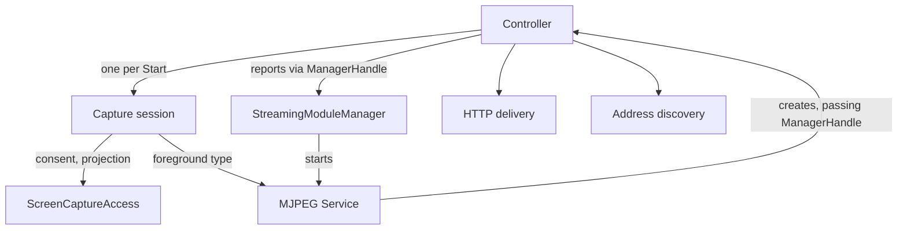

# Module integration

[Internals](../README.md) · [Architecture](../../docs/architecture.md) · [Capture lifecycle](02-module-lifecycle.md) · [Coordination](03-coordination.md)

This guide records MJPEG's side of Core's [Streaming Module Contract and Manager](../../../core/docs/module-contract-and-manager.md): the module descriptor, the Service and controller created for each opening of the mode, the Android declarations they rely on, and what the controller reports to the manager and cleans up when the mode closes. It continues [Hosting and coordination](../../docs/architecture.md#hosting-and-coordination) in the public architecture guide; Core's guarantees stay with Core.

## The pieces and their lifetimes

Core calls one opening of a mode a **module instance**, and MJPEG's work for one instance belongs to its **controller**. The [internals index](../README.md#components-and-responsibilities) lists each component, its lifetime and its source. Android starts the Service when the manager opens the mode. The Service's factory resolves the controller through Koin, and the controller creates one capture session for each accepted Start. The host app supplies Core's consent and permission hosts at the Activity root.

Arrows show who creates, calls or reports to whom. JPEG data never passes through the controller. [Capture lifecycle](02-module-lifecycle.md) describes the direct path from the capture session to HTTP delivery.

## Registration

The descriptor registers:

- the stable module ID `MJPEG`;
- priority 40;
- the mode's name, description and details resources;
- the Service class;
- foreground notification slot 400.

It is a process singleton and creates no controller, listener or capture resource. Selecting the mode creates a module instance under Core's [selection and restart](../../../core/docs/module-contract-and-manager.md#selection-and-restart) rules; capture waits for a separate Start.

## The original Service and controller

`MjpegStreamingModuleService` extends Core's `StreamingModuleService`. Core's base class owns the Android lifecycle, the foreground phases and the foreground bookkeeping for each capture attempt. MJPEG adds only the controller factory: `createController(managerHandle)` resolves the controller from Koin with that exact `StreamingModule.Controller.ManagerHandle` and the Service instance itself.

The controller keeps both for its whole lifetime and takes its instance ID from the handle. Every later effect of the instance targets these **original owners**: status and failure reports, foreground changes, capture-notification updates and the final Service stop. A delayed report or cleanup step from an old instance therefore cannot reach a replacement. Use the retained references; never look up the "current" Service or handle at the time of the effect.

Construction is inert. The controller creates its coroutine scope, screen-off observer and screen state, and reads the initial local-network grant. It does no other work until the manager calls `startModule()`. That call checks `managerHandle.isCurrent()`. If the handle is no longer current, the controller goes straight to shutdown. Otherwise the event loop starts and subscribes to settings, discovery and HTTP state. The loop also ends, and requests shutdown, whenever the handle stops being current.

The [MJPEG Koin module](../../src/main/kotlin/io/screenstream/mjpeg/MjpegKoinModule.kt) uses the repository's annotation-based configuration with component scanning. Its scopes are:

- **Controller.** A factory whose handle and Service are injected parameters.
- **HTTP delivery and address discovery.** Also factories, so each controller receives its own and never shares listeners or discovery with a previous instance.
- **Settings store.** A singleton.

The host app supplies Core's providers and Activity hosts, as the [Core overview](../../../core/README.md) describes. When changing DI, keep the exact injected parameters and these per-instance scopes.

## Android declarations

The [MJPEG manifest](../../src/main/AndroidManifest.xml) declares the Service as not exported, with foreground service types `specialUse|mediaProjection` and a special-use subtype that explains the local HTTP server. It requests permissions for three needs:

- **Networking:** `INTERNET` for the listeners, `ACCESS_NETWORK_STATE` for address discovery and `ACCESS_LOCAL_NETWORK` for Android's local-network permission.
- **Foreground hosting:** `FOREGROUND_SERVICE`, with `FOREGROUND_SERVICE_SPECIAL_USE` for the waiting phase and `FOREGROUND_SERVICE_MEDIA_PROJECTION` for capture.
- **Keep screen awake:** `WAKE_LOCK` for the optional screen wake lock.

MJPEG declares no broadcast receiver. Notification actions travel through Core's `StreamingModuleActionReceiver` ([notification actions](../../../core/docs/notifications.md#notification-actions)), and the screen-off receiver is registered at run time. Preserve these declarations when changing integration.

| MJPEG need | How it uses the shared boundary |
| --- | --- |
| Keep the HTTP server available while the mode is open | The Service stays in Core's waiting `specialUse` foreground before any capture, and returns to it after each successful capture cleanup. |
| Capture the screen | During consent, the attempt asks the original Service to enter capture foreground with `requiresMicrophoneType = false`. This gives the `mediaProjection` type without microphone. |
| Decide which listeners may open and whether Start is ready | The controller reads `RuntimePermission.LocalNetwork.isGranted(service)` and each address's permission requirement. See [local-network permission](03-coordination.md#lan-permission-ui-and-grant-checks). |
| Offer a permission request | The address row uses the app-provided `LocalRuntimePermissions`. The Activity host owns the explanation, the launcher and request completion. |
| Keep the screen awake when the user asks | The capture session holds an optional screen wake lock. Its failures are logged and never affect capture or cleanup results. |
| Stop on screen off when the user asks | The controller registers a receiver for `ACTION_SCREEN_OFF` only while an attempt needs it. |

Core's consent and permission hosts live at the Activity root, outside MJPEG's screen, so an admitted request keeps its host after navigation removes the screen that started it. Explanation UI and rationale history are host-app policies. Core's [Screen Capture Access](../../../core/docs/screen-capture.md) and [Runtime Permissions](../../../core/docs/runtime-permissions.md) define the reusable boundary.

## Capture handoff and readiness

Each accepted Start creates one **capture attempt**, identified by a `StreamingModule.CaptureAttemptId`. The controller retains the attempt before it can acquire any resource ([attempt admission](02-module-lifecycle.md#attempt-admission-and-ownership)). Two choices shape how MJPEG uses Core's capture boundary:

- **Consent.** The attempt passes Core its own Job and a foreground-preparation callback bound to the original Service. Core decides between saved consent and a fresh Android prompt ([legacy reuse](../../../core/docs/screen-capture.md#legacy-reuse-and-cleanup)).
- **Projection.** MJPEG acquires the projection with `retryAfterRecentForegroundStart = false`, so it never asks Core for that optional retry.

MJPEG owns the returned `MediaProjection` until Capture Engine session creation succeeds, and it settles Core's projection guard right after the handoff and again during cleanup. [Capture lifecycle](02-module-lifecycle.md) owns the full sequence and its failure rules.

Core's `Running` state describes control progress only. Before admitting Start, the MJPEG controller also requires:

- accepted settings;
- current discovery and permission evidence;
- a matching listening server.

[Start readiness](03-coordination.md#discovery-plan-and-start-readiness) defines the check.

## Reports to the manager

The controller reports through its original handle:

- **Heartbeat.** When the event loop runs normally, it calls `reportRunning(status, uptime)` about once a second, including while capture is idle. It also reports at once when the status changes. Only the running loop reports, so a stalled loop shows up as `Unresponsive` in Core's health ([instance health](../../../core/docs/module-contract-and-manager.md#observable-process-and-instance-health)).
- **Capture summary.** The summary has three fields, and each changes independently:
  - `isStreaming` is the processed confirmed-capture state of the attempt whose cleanup is pending.
  - `hasConsumer` comes from HTTP's sampled client rows. A row stays active for two seconds after its last media response.
  - `captureAttempt` names the retained attempt until its cleanup succeeds. An attempt whose cleanup failed stays reported.
- **Operation error.** A retained capture, cleanup or screen-off failure produces a generic `Status.Error` without a message. The technical cause is logged with a stage tag. A retained failure always takes precedence. Only when no failure is retained does a Stop whose cleanup has not finished after three seconds produce an error with the localized "Still stopping the stream…" text. [Native state projection](03-coordination.md#statistics-and-native-state-projection) defines when each error clears.
- **Terminal failure.** `reportFailed()` precedes shutdown in each of these cases:
  - capture cleanup fails;
  - HTTP publishes a fatal cause;
  - discovery stops or fails while the mode is open;
  - the settings subscription fails;
  - the controller itself fails;
  - `onServiceDestroyed()` runs.

  A handle that stops being current ends the instance without a failure report.

Core's manager owns freshness, the canonical manager state and bounded transition waits, and chooses the generic warning or failure from these reports; the host notification provider and the app screen present it ([error presentation](../../../core/docs/notifications.md#error-presentation)). MJPEG presents no detailed module errors and offers no in-place recovery: users recover with **Restart mode** or a new Start.

`onServiceDestroyed()` reports failure and then requests shutdown, without distinguishing expected from unexpected destruction. The manager decides what a report from an instance that is already closing means.

## Cleanup obligations

Shutdown has a single entry point, `requestModuleShutdown()`. The controller's cleanup outcome is the value returned by `awaitCleanup()`, and it covers:

- exact JPEG consumer completion and the media-stop result of the last capture attempt, with that attempt's Core and foreground settlements;
- HTTP delivery shutdown and address-discovery closure, both started independently of capture cleanup;
- screen-off receiver cleanup;
- every job in the controller's scope, including the capture coroutine and the open-time PIN save described in [Coordination](03-coordination.md#effective-settings-and-saves);
- stopping the original Service and awaiting its destruction.

The outcome stays pending until every obligation settles, even after Core's bounded wait has ended and a replacement instance is running. It does not include the engine's physical resource release, which follows the engine's [stop contract](../../../../screen-capture-engine/docs/usage.md#stop-a-capture-run). [Controller shutdown](02-module-lifecycle.md#controller-shutdown-and-complete-module-cleanup) defines the order.

The cleanup coroutine is created lazily and started by the shutdown request. Awaiting a lazily started coroutine also starts it ([`async`](https://kotlinlang.org/api/kotlinx.coroutines/kotlinx-coroutines-core/kotlinx.coroutines/async.html)). A caller that awaited cleanup before requesting shutdown would therefore begin cleanup while admission was still open. Core's manager requests shutdown before it waits, as its [closing sequence](../../../core/docs/module-contract-and-manager.md#closing-a-module-instance) shows. Keep that order in any new caller.

## Verification

[Integration scenarios](../03-testing/scenarios/09-integration.md) MJPEG-CFG-01 to MJPEG-CFG-04 record the required histories for metadata, DI, declarations and a qualified real lifetime. [Testing](../03-testing/01-testing.md) separates source inspection, executed checks and Android device qualification.
