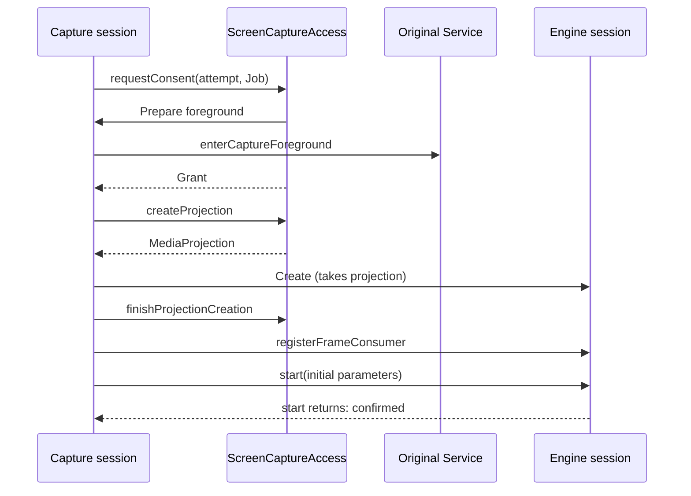
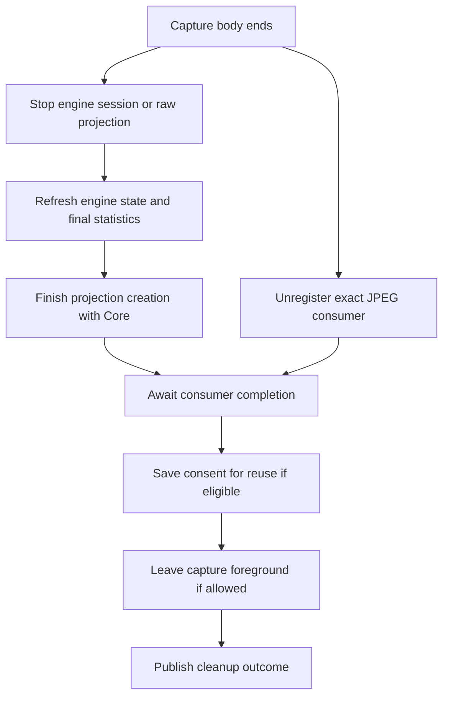

# Capture lifecycle

[Internals](../README.md) · [Module integration](01-module-integration.md) · [Coordination](03-coordination.md)

This guide follows one capture attempt through admission, consent and startup, JPEG publication, and Stop and cleanup, then the controller shutdown that retires the whole module instance. It continues [Starting capture](../../docs/architecture.md#starting-capture) and [Stopping, closing and recovery](../../docs/architecture.md#stopping-closing-and-recovery) in the public architecture guide. Core's [Screen Capture Access](../../../core/docs/screen-capture.md) owns the consent and projection rules, and the [Capture Engine usage guide](../../../../screen-capture-engine/docs/usage.md) owns the engine's session, frame and stop contracts. This page records MJPEG's obligations on top of them.

## Participants

| Participant | Responsibility in the attempt |
| --- | --- |
| Controller ([MjpegStreamingModuleController](../../src/main/kotlin/io/screenstream/mjpeg/MjpegStreamingModuleController.kt)) | Admits the attempt, retains it through cleanup, processes its state changes and routes Stop. [Coordination](03-coordination.md) describes those decisions. |
| Capture session ([MjpegCaptureSession](../../src/main/kotlin/io/screenstream/mjpeg/MjpegCaptureSession.kt)) | Owns one attempt: its state, its JPEG publication authority, every acquired resource and the cleanup outcome. |
| Engine adapter ([MjpegCaptureEngineAdapter](../../src/main/kotlin/io/screenstream/mjpeg/MjpegCaptureEngineAdapter.kt)) | Forwards the public engine session and exposes only what MJPEG uses: phase, problem and stop reason, statistics, frame registration and borrowed JPEG copying. Its factory interface also lets tests substitute the engine. |
| HTTP delivery ([HttpDelivery](../../src/main/kotlin/io/screenstream/mjpeg/http/HttpDelivery.kt)) | Applies the session's status and publication decisions and stores copied JPEGs. [JPEG delivery](../02-delivery/02-jpeg-delivery.md) owns storage and readers. |
| Core | `ScreenCaptureAccess` coordinates consent and projection acquisition. The original Service changes foreground type. |

Three terms recur on this page:

- A **capture attempt** is one accepted Start, identified by a `CaptureAttemptId`. It lasts until its cleanup outcome is known, and the controller keeps the latest attempt even after that.
- A **capture generation** is a period during which the attempt may publish JPEGs. It is an identity object that the session creates and HTTP compares. Revoking it (setting it to null) makes late JPEGs harmless. Pausing and resuming capture can replace it within one attempt. Generation identities are never reused, even across attempts.
- The **cleanup outcome** is the session's final Boolean. It is true when every required release step succeeded, and it is independent of whether capture itself failed.

## Attempt admission and ownership

The controller creates the session inert. Construction fixes the attempt's JPEG backend and seeds its desired image parameters from the accepted settings. Terminal shutdown takes the same admission gate as Start. Holding that gate, the controller:

1. constructs the session and its attempt record with a fresh initial generation;
2. registers that generation with HTTP, which sets the capture status to Starting and keeps its last real image;
3. retains the attempt as its current capture;
4. calls `start()`.

HTTP rejects the registration when it is not active or is already closing. In that case admission ends before anything launches. Shutdown reads the retained attempt under the same gate, so it always sees and stops any attempt that was admitted.

`start()` launches the attempt's capture coroutine in the controller's scope and returns at once. Its return confirms none of consent, engine startup or a first JPEG. When the coroutine body begins, it reports WaitingForPermission to HTTP, unless a Stop has already been accepted. A coroutine cancelled before its body begins has acquired nothing. It settles as a successful cleanup, with stop cause System unless a cause was already accepted. Once the body has begun, it owns its own cleanup, even if it is cancelled. The session also records a `Cleanup.capture` failure if its coroutine ever completes without a cleanup outcome for any other reason.

Each acquired item has exactly one owner at a time:

| Item | Owner and transfer |
| --- | --- |
| Consent grant | Core delivers it to the attempt's Job after foreground preparation. The attempt keeps it for possible reuse at cleanup. |
| Capture foreground | The original Service records the exact attempt when the foreground callback runs. The attempt owns demotion, even when cancellation prevents grant delivery. |
| Raw projection | The attempt holds it from the moment Core returns it, and stops it itself if engine creation throws. |
| Engine session | Successful creation transfers the projection to the engine. From then on, cleanup stops the engine session instead. |
| JPEG consumer registration | The attempt keeps the exact registration handle and awaits its unregister completion during cleanup. |

Core's [projection creation and handoff](../../../core/docs/screen-capture.md#projection-creation-and-handoff) model describes the shared rule. MJPEG calls `finishProjectionCreation(attempt)` right after the engine handoff. It calls it again during cleanup, after any rollback has settled, so Core's coordination ends whether startup succeeded or not. A projection that arrives after Stop or cancellation still belongs to the attempt until handoff or rollback.

## Startup

Each step has a stage tag that appears in logs when the step fails:

| Step | Detail | Stage tag |
| --- | --- | --- |
| Consent | Core decides between saved consent and a fresh Android prompt. A `NotGranted` result, such as a declined prompt, ends the attempt with stop cause User and no failure. A technical consent failure is a capture failure. | `Startup.consent` |
| Foreground | Core's preparation callback runs the Service's `enterCaptureForeground(attempt, requiresMicrophoneType = false)` synchronously on the main thread, before the grant is delivered. | `Startup.foreground` |
| Projection | `createProjection(grant, retryAfterRecentForegroundStart = false)`. | `Startup.projection` |
| Engine session | Created with a `ScreenCaptureConfig` that sets only the JPEG backend policy, so capture metrics follow the default display. | `Engine.creation` |
| Handoff settled | `finishProjectionCreation(attempt)`. | `Startup.projectionHandoff` |
| Consumer | The frame consumer is registered before start. | `Engine.registration` |
| Engine start | The observers launch, then `start(initialParameters)` runs. Its normal return is committed as startup confirmation. | `Engine.start` |

Stage tags are diagnostic labels, not API. The tag stays at `Engine.start` after startup, so an unexpected failure from a later parameter submission is also logged under it.

**Startup confirmation** means the engine's `start()` returned normally: a usable `Active` configuration was assigned and startup success was settled ([startup details](../../../../screen-capture-engine/docs/usage.md#startup-details)). Confirmation does not wait for a JPEG. The engine may deliver frames before the code after `start()` resumes, so the initial generation is installed at admission and such JPEGs are still published. On Android 14 (API 34) and later, the engine also waits for Android's first captured-content size before `Active`.

A Stop during startup makes the engine's `start()` end with cancellation. MJPEG treats that as a normal end, and records a capture failure only if the engine already reports `Failed` at that moment. A genuine Engine startup failure is a capture failure. If the attempt then cleans up successfully and the instance is still admitting ordinary work, the module stays open and Start becomes available again. A terminal failure of another owner, or a shutdown that has already begun, closes the instance even when capture cleanup succeeds. A platform failure while the original Service enters capture foreground is one such terminal failure. Core's Service closes foreground admission, reports module failure and requests the controller's shutdown. The attempt still cleans up, and the instance closes.

## Canonical capture state

One session snapshot holds:

- the latest engine facts;
- startup confirmation;
- the first Stop cause;
- the first capture failure and the first cleanup failure;
- the current generation;
- the nullable cleanup outcome.

Every transition is committed under the session's **state gate**, the lock that serializes its state commits. The effective status follows this precedence:

| Condition | Status |
| --- | --- |
| A capture or cleanup failure is retained, cleanup failed, or the engine is `Failed` | Failed |
| Cleanup finished successfully and no failure is retained | Stopped |
| A Stop cause is accepted and cleanup is pending | Stopping |
| No engine observation yet | WaitingForPermission |
| Engine `NotStarted` or `Starting` | Starting |
| Engine `Active`, `Reconfiguring` or `Suspended` | The matching status |
| Engine `Stopped`, cleanup pending | Stopping |

`isStreaming` means that startup was confirmed and no Stop cause has been accepted. A suspended capture that started successfully still counts as streaming. An `Active` observation that arrives before `start()` returns is an engine fact, not confirmation.

The first Stop cause is sticky:

| Cause | Sources |
| --- | --- |
| User | App or notification Stop (both arrive as exact-attempt commands), or a consent request that returned no grant |
| System | Screen-off Stop, the address-loss deadline, the engine reaching `Stopped` on its own (for example, when Android ends the projection), or an attempt body that ends without an earlier cause |
| Error | A capture failure, a cleanup failure, an engine `Failed` observation, or a screen-off receiver failure while that option is being enabled during an attempt |
| Shutdown | Module shutdown |

Engine terminal observations and failures accept their Stop cause in the same commit. Capture and cleanup failures are kept separately, so one never hides the other. Successful cleanup keeps any capture failure, so the session stays Failed while a controller that is still admitting ordinary work becomes eligible for another Start. Failed cleanup makes the whole module terminal: the controller reports failure and starts shutdown.

The session publishes its snapshot through a [`StateFlow`](https://kotlinlang.org/api/kotlinx.coroutines/kotlinx-coroutines-core/kotlinx.coroutines.flow/-state-flow/), which can skip intermediate values. Engine state emissions therefore act only as wakeups: the session rereads the engine's current state under the state gate that frame callbacks also use, so a delayed emission can never undo a newer observation. The controller likewise reads the session's current snapshot whenever it processes a change.

Locks nest in one order: **session state gate → HTTP control monitor → JPEG store monitor**.

- Status and generation commits call into HTTP while holding the state gate.
- HTTP never calls back into the session.
- The JPEG copy body runs while none of the three locks is held, so status commits and readers can proceed during a copy. Buffer reservation, copy commit, and reader acquisition and release each take the store monitor briefly and can wait behind a status commit.

Keep any new session entry outside the HTTP and store monitors.

## Desired parameters and publication generations

### Image parameters

The session keeps one **desired parameters** value. `updateImageSettings()` replaces it until a Stop is accepted, and is ignored after that. The initial engine parameters are the desired value read just before engine start, so edits made during consent and creation are included. After that, a collector combines the desired value with the session state and submits changes to the same engine session. It submits only when all of these hold:

- the status is Active, Reconfiguring or Suspended;
- no Stop has been accepted;
- the value differs from the last one submitted.

An `IllegalStateException` from `updateParameters()` means the engine closed admission during a race. It is logged and ignored, and the attempt continues. Any other exception ends the attempt as a capture failure. MJPEG never resubmits equal parameters, so it does not use the engine's [equal-parameter retry](../../../../screen-capture-engine/docs/usage.md#retry-suspended-capture). A paused capture resumes when engine conditions change or when a changed setting reaches the engine. The JPEG backend cannot change within an attempt.

Settings map directly to Engine parameters. Only the selected crop and output-size choices are sent. [Settings](04-settings.md#saved-model-and-defaults) owns the dormant values and their validation, and [MJPEG-CAP-05](../03-testing/scenarios/03-capture.md#mjpeg-cap-05) keeps the exact mapping.

### Observers

Once the engine session exists, three collectors run independently in the attempt's scope:

- **Terminal state.** Each engine state change triggers a fresh read under the state gate. `Stopped` or `Failed` accepts the Stop cause and cancels the attempt's scope. If observation itself fails, the failure is kept as `Engine.stateObservation` and the attempt ends.
- **Parameter submission.** Described above. It runs separately, so a slow submission can never delay terminal handling.
- **Statistics.** Each engine statistics value is published to the controller, together with a current FPS computed from produced-frame deltas between receipts. Observation errors are only logged.

### Publication generations

The session commits the effective status and the generation together, and sends that pair straight to HTTP. HTTP stores the pair atomically and never decides it.

| Status | Generation |
| --- | --- |
| Active | Keeps the current generation, or creates a new one if publication was revoked |
| WaitingForPermission, Starting, Reconfiguring | Unchanged, including null |
| Suspended, Stopping, Stopped, Failed | Revoked (null) |

These rules have visible consequences:

- **Active → Reconfiguring** keeps the current generation, so the last live frame stays live.
- **Suspended → Reconfiguring** stays revoked.
- **Recovery to Active** opens a new generation. HTTP serves the inactive image until the first fresh JPEG of that generation arrives.
- **Starting** keeps the initial generation open, so a JPEG delivered before `start()` returns is published.
- **A frame callback that sees a fresh `Active`** can open the recovered generation before the controller has processed the change.

### Frame callbacks

The engine lends each JPEG only for the duration of its callback, on the callback's thread ([handle JPEG frames](../../../../screen-capture-engine/docs/usage.md#handle-jpeg-frames)). Each callback:

1. reads the engine's current state under the state gate, commits any change and captures the current generation;
2. skips the frame if publication is revoked;
3. outside the gate, offers HTTP the generation, the byte count and a synchronous copier;
4. lets HTTP check the generation, run the copier into HTTP-owned storage, and check the generation again before publishing, so a copy that finishes after revocation is dropped;
5. finally, if any Stop cause has now been accepted, cancels the attempt's capture coroutine.

The copier must write exactly the advertised `byteCount`. A copy exception, a short copy, or any other exception in this sequence records the first capture failure at stage `Output.frame` with stop cause Error. Step 5 then ends the attempt. Never retain the copier or the frame, and never use either outside the callback thread. [JPEG delivery](../02-delivery/02-jpeg-delivery.md) owns storage, rejection and reader leases.

Callbacks follow the engine's [parameter contract](../../../../screen-capture-engine/docs/usage.md#change-capture-parameters), including its allowance for a frame produced under older settings. Suspension keeps the same engine session and the same foreground.

## Stop and capture cleanup

`requestStop(reason)` accepts the Stop cause if none is set yet. In the same commit, that revokes publication and releases the optional screen wake lock. The method then cancels the attempt's capture coroutine. It does not wait for an entered frame callback or for cleanup. Image setting updates are ignored from then on. `awaitCleanup()` waits for the cleanup outcome; cancelling that wait leaves cleanup running.

Once the body has begun, cleanup runs in [`NonCancellable`](https://kotlinlang.org/api/kotlinx.coroutines/kotlinx-coroutines-core/kotlinx.coroutines/-non-cancellable/). The normal order is:

The cleanup rules are:

- **Independence.** Consumer unregistration starts alongside media stop, and every applicable step is attempted even when an earlier one fails. The first recorded failure becomes the cleanup failure. An unexpected failure of the cleanup block itself is recorded as `Cleanup.capture`.
- **Steps that can fail.** Media stop, the Core settlement, consent saving and foreground demotion are real fallible boundaries. The engine's stop reports a required shutdown failure as `InternalFailure`. A raw projection stop is a direct platform call. Technical foreground failures throw. Their failures are recorded as `Cleanup.media`, `Cleanup.projectionCreation`, `Cleanup.consentReuse` and `Cleanup.foreground`.
- **Consumer completion is a wait.** The engine's `unregister()` closes delivery to that consumer and suspends until any entered callback returns. It is legal after the session has stopped or failed and has no ordinary failure result, so the `Cleanup.consumer` catch is only defensive. Cleanup awaits it non-cancellably; the real risk is a callback that never returns, which keeps cleanup pending ([MJPEG-CAP-10](../03-testing/scenarios/03-capture.md#mjpeg-cap-10)).
- **Final facts.** After the engine's stop returns, cleanup republishes the final statistics (without an FPS value) and rereads the engine state. The terminal-state collector may have cancelled the other collectors before their last emission.
- **Consent reuse.** Cleanup offers the grant to Core's [legacy reuse](../../../core/docs/screen-capture.md#legacy-reuse-and-cleanup) only when all of these hold:
  - startup was confirmed;
  - no capture or cleanup failure is retained;
  - the first Stop cause is User or Shutdown;
  - the engine reports `Stopped(Requested)`.

  Core decides whether the running Android version keeps the grant. Reuse is offered before foreground demotion, so a later demotion failure can fail cleanup after consent was already saved.
- **Foreground demotion.** `leaveCaptureForeground(attempt)` returns the Service to waiting foreground only when media stop returned normally and no cleanup failure is recorded. The rule applies before and after engine handoff, so a failed raw-projection stop also suppresses demotion.
- **Outcome.** The cleanup outcome is true when every step that applied succeeded and no cleanup failure is recorded. A capture failure can coexist with a true outcome.
- **Hangs.** No step has a timeout. A required operation that never returns, including a frame callback that never returns, keeps the outcome pending.

A successful engine stop confirms three things: new work and frame delivery are closed, final state and statistics are assigned, and the projection-stop call has returned. Physical graphics and buffer release follows the engine's own limits. Exact consumer unregistration adds a separate guarantee: no frame callback is still running. See the engine's [stop](../../../../screen-capture-engine/docs/usage.md#stop-a-capture-run) and [consumer removal](../../../../screen-capture-engine/docs/usage.md#replace-or-remove-the-consumer) contracts.

[Coordination](03-coordination.md#capture-availability-and-command-admission) describes how the controller applies each cleanup outcome.

## Controller shutdown and complete module cleanup

Closure retires the whole instance, unlike a capture Stop ([internals index](../README.md#requests-completion-and-release)). `requestModuleShutdown()` is the only terminal entry point. It runs directly, outside the event queue, so it works before the event loop starts and while the loop is blocked. In order, it:

1. closes the screen-off observer synchronously, on every call, including the call triggered by Service destruction;
2. marks shutdown, which closes event and Start admission (repeated calls stop here);
3. closes Core foreground admission on the original Service;
4. requests Shutdown Stop on the retained attempt, read under the admission gate;
5. closes HTTP admission and starts its cancellation;
6. cancels the controller's scope, closes the event queue and starts module cleanup.

Steps 3 to 6 each run even if an earlier step throws.

Module cleanup then starts three independent branches. A hanging capture cleanup therefore leaves HTTP and discovery free to retire:

1. **HTTP.** Stops listeners, admitted requests and the HTTP runtime.
2. **Discovery.** Closes address discovery and awaits its cleanup.
3. **Platform.** Records the screen-off observer's cleanup result and awaits the retained attempt's cleanup outcome (true when no attempt exists). It then calls the original Service's `stopAndAwaitDestruction()`, even when capture cleanup failed.

Cleanup also joins the controller's job. That job includes the event loop, the input subscriptions, the capture coroutine and an entered open-time PIN save. The outcome is true only when every branch succeeded. The platform branch awaits capture before stopping the Service, so a hung capture cleanup keeps the Service alive and the whole outcome pending. The controller keeps the latest attempt after its cleanup, whatever the outcome, so this branch always has an owner to await.

Core owns the manager's [bounded wait](../../../core/docs/module-contract-and-manager.md#closing-a-module-instance). MJPEG's outcome still requires every obligation after that wait has ended, and Service destruction settles its own part. [Module integration](01-module-integration.md#cleanup-obligations) lists everything the outcome covers.

## Verification

[Capture scenarios](../03-testing/scenarios/03-capture.md) MJPEG-CAP-01 to MJPEG-CAP-14 record the required histories for this page. [Controller scenarios](../03-testing/scenarios/02-controller.md) MJPEG-CTL-12 and MJPEG-CTL-13 cover shutdown races and complete module cleanup. [Testing](../03-testing/01-testing.md) separates source contracts, executed checks and device evidence.
