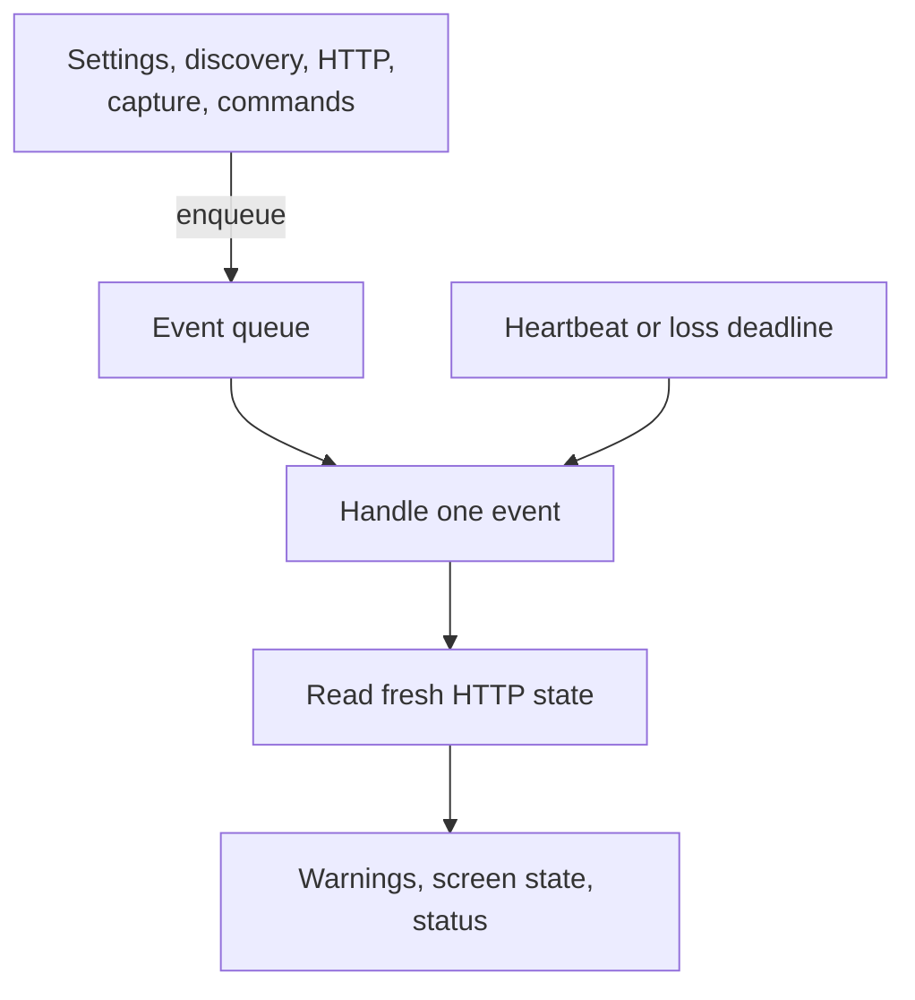

# Controller coordination

[Internals](../README.md) · [Module integration](01-module-integration.md) · [Capture lifecycle](02-module-lifecycle.md)

This guide explains how the MJPEG controller, [MjpegStreamingModuleController](../../src/main/kotlin/io/screenstream/mjpeg/MjpegStreamingModuleController.kt), keeps one module instance consistent while it is open. The controller decides:

- when Start and Stop apply;
- when saved settings take effect;
- which addresses get listeners;
- when automation stops capture;
- what the mode's screen and the manager see.

The guide continues the public [architecture guide](../../docs/architecture.md), in particular [Hosting and coordination](../../docs/architecture.md#hosting-and-coordination), [Settings](../../docs/architecture.md#settings), [Addresses, listeners and readiness](../../docs/architecture.md#addresses-listeners-and-readiness) and [Status and statistics](../../docs/architecture.md#status-and-statistics). [Usage](../../docs/usage.md) owns what users see and the setting defaults. The rules here are internal obligations that keep those public behaviors true.

## What the controller owns

The controller coordinates. It owns its decisions and the facts it needs to make them, and leaves resources with their owners:

| Owner | Owns |
| --- | --- |
| Controller event loop | Accepted and latest observed settings; the processed discovery state and address selection; the last processed snapshot of each attempt; the local-network grant it last read; network-loss episodes; the screen-off registration; slow-viewer warning state; statistics rates and history; the last reported status |
| Capture session | Capture state, publication generations, the screen wake lock and the cleanup outcome ([Capture lifecycle](02-module-lifecycle.md)) |
| HTTP delivery | Listeners, credentials, requests, image storage and client accounting ([HTTP delivery](../02-delivery/01-http-delivery.md)) |
| Address discovery | The interface inventory and address identity ([Network addresses](05-network-addresses.md)) |
| Settings store | Saved values and edit validation ([Settings](04-settings.md)) |

A fact is **processed** once the loop has handled the event that carried it. A **fresh** read asks the owner directly, at the moment of the decision. Several rules below depend on that difference. The controller's original Service and `ManagerHandle` stay fixed for its whole lifetime ([Module integration](01-module-integration.md#the-original-service-and-controller)).

## Serialized work and independent shutdown

All decisions run on one **event loop**. Inputs arrive as events in an unbounded queue:

- each saved settings value;
- each discovery state;
- HTTP changes to servers, consumer presence or fatal cause (statistics-only changes do not wake the loop);
- capture-session state changes and engine statistics updates;
- commands: Start, exact-attempt Stop, server Retry and screen-off broadcasts;
- failures of the settings, discovery or HTTP subscriptions.

Each pass through the loop is a **turn**. A turn runs these steps:

1. If a heartbeat is due, report status and reread the local-network grant.
2. Evaluate the network-loss deadline.
3. Wait for the next event, or for the heartbeat or loss deadline, whichever comes first. The heartbeat is scheduled about once a second on the uptime clock, which does not advance while the device is in deep sleep.
4. Handle the event, if one arrived.
5. Read HTTP's fresh state, update the slow-viewer warning, publish the screen state and report status if it changed.

Every turn rereads HTTP, so statistics refresh on the heartbeat turn as well as on event turns: normally about once a second, without events of their own. That cadence is best effort, not a guaranteed minimum. Scheduling delays, a blocked turn or device sleep can stretch the gap between turns.

JPEG data never enters this queue; it goes straight from the capture session to HTTP. The session also commits its publication decisions to HTTP directly, so queue delay never extends publication authority.

An exception thrown anywhere in a turn is a controller failure. The controller reports terminal failure and starts shutdown. The same happens when HTTP publishes a fatal cause, when discovery reports `Closed` or `Failed` while the mode is open, or when a subscription fails. Whenever the loop exits, for any reason, it requests shutdown. That includes the handle no longer being current.

Shutdown does not go through the queue. `requestModuleShutdown()` closes admission and starts [independent cleanup](02-module-lifecycle.md#controller-shutdown-and-complete-module-cleanup) directly, so it works before the loop starts and while a turn is blocked. After shutdown, new events are dropped and the screen keeps its last published state. Core's manager owns health and transition deadlines ([instance health](../../../core/docs/module-contract-and-manager.md#observable-process-and-instance-health)).

## Capture availability and command admission

The controller is **idle** when all of these hold:

- it has accepted settings;
- shutdown has not begun;
- either no attempt has existed yet, or the latest attempt's successful cleanup has been processed.

Idle permits setup edits. Start additionally needs a ready listener. From admission until its cleanup is processed, an attempt is **active**. Consent, startup, running, suspension and stopping all count as active. The retained attempt still owns its cleanup after it completes.

Commands are checked when the loop handles them, not when they are sent. A command that fails its check is dropped without an error.

1. **Start** requires idle and [Start readiness](#discovery-plan-and-start-readiness). It registers the screen-off receiver if needed. Then, holding the admission gate it shares with shutdown, it constructs the session, registers its initial generation with HTTP, retains the attempt and launches it ([attempt admission](02-module-lifecycle.md#attempt-admission-and-ownership)). If HTTP rejects the registration, nothing launches and the screen-off registration is removed.
2. **Stop** carries an attempt ID and applies only to the active attempt with that exact ID, so a delayed Stop cannot end a replacement attempt. App Stop and notification Stop both arrive this way, with cause User. A matching Stop:
   - records when stopping began;
   - clears any network-loss episode;
   - requests the Stop;
   - removes the screen-off registration;
   - reconciles at once.

   Stop is handled during consent, startup and cleanup, even while the screen shows Busy.
3. **Retry** passes a server UUID to HTTP. Only the current Failed server incarnation with that UUID can restart its bind attempts. Capture recovery is unrelated and belongs to the session.
4. **Capture changed** names an attempt. The controller reads that session's current snapshot rather than the event's payload.

Reconciling a capture change does the following:

- refreshes the wake-lock request and the capture notification;
- clears the previous error on the attempt's first confirmed startup (see [native state projection](#statistics-and-native-state-projection));
- records new capture or cleanup failures;
- stores the snapshot as processed.

A processed cleanup outcome then decides what follows:

- **Success** makes the controller idle and reapplies the latest observed settings, so deferred setup edits take effect.
- **Failure** reports terminal failure to the manager and requests shutdown at once.

The screen's main button follows the same facts:

| Situation | Button |
| --- | --- |
| Idle | Start, enabled only when Start would be admitted |
| Capture confirmed and no Stop accepted, including while Reconfiguring or Suspended | Stop |
| Before settings are accepted, and during consent, unconfirmed startup and stopping | Busy |

Confirmed startup, not the engine phase, decides between Busy and Stop. The engine can report Active and then Suspended while its `start()` is still pending ([Engine startup](../../../../screen-capture-engine/docs/usage.md#startup-details)). That attempt is still unconfirmed, so the button stays Busy until startup is confirmed. A Suspended attempt shows Stop only after confirmation.

Failed cleanup has no button of its own. The turn that processes it reports terminal failure and requests shutdown, and the loop then exits without publishing. The screen keeps its last published button, as for any [shutdown](#serialized-work-and-independent-shutdown).

The button and command return are advisory. [Architecture](../../docs/architecture.md#the-controller) describes how the Controller handles requests.

## Effective settings and saves

Settings screens write directly to the settings store, and the controller observes each saved value. The value the controller has applied is its **effective settings**.

**Opening the mode.** Before the first value is observed, the controller runs the once-per-instance **New PIN on open** save that [Settings](04-settings.md#pin-generation-and-edits) describes. A failure there is a settings failure and closes the instance. The save runs in the controller's scope, so once it has begun, module cleanup waits for it.

**While a capture attempt is active**, the edit policy is **live-only**. The controller keeps the previous JPEG backend, HTTP port and access settings, and accepts every other field. **Hide PIN when starting a stream** is the one access setting that still changes. A restricted value saved during the attempt stays deferred as the latest observed value, and is reapplied when successful cleanup is processed. Failed cleanup keeps the live-only policy until the instance closes. [Settings](04-settings.md) owns validation, the live-only projection and the screen's rejection of forbidden edits.

**Applying an accepted value:**

- **Image** changes update the active session's desired parameters.
- The **first** accepted value:
  1. starts discovery;
  2. applies the current address plan, which is usually still empty (HTTP keeps plans pending until it is activated);
  3. reads the app logo from assets on the IO dispatcher;
  4. activates HTTP with the access settings, web appearance, inactive-image choice and logo bytes.
- **Network** changes reselect addresses from the processed discovery state in the same turn and send HTTP the new plan.
- A later change to **access** (ignoring PIN visibility), **web appearance** or the **inactive stream image** updates HTTP's configuration.
- **Automation** changes update the session's wake-lock request and the screen-off registration. The network-loss delay and the slow-viewer option take effect at their next evaluation.
- **PIN visibility** changes only the screen.

HTTP rejecting a configuration is a module failure.

Saving and applying are independent. A save that has begun finishes even after capture starts or the screen leaves, because the store's update runs non-cancellably once called. Restricted values wait for cleanup. Engine convergence follows the engine. Credentials change only when HTTP applies them.

## Discovery plan and Start readiness

Discovery publishes an **inventory** of every supported address, with all interface alternatives for each scoped IP. The controller turns it into a **selection** by applying the effective Network filter, which picks at most one matching interface for each scoped IP. Selection happens on the loop whenever an `Observed` inventory, a filter change or a grant change is processed. While discovery is not `Observed`, for example while it is still loading, the last selection stays in place.

The **server plan** sent to HTTP is that selection without the addresses that need the local-network grant when the grant is missing. HTTP owns the plan and each **server incarnation**: the planned listener for one address and port, with its own UUID.

**Start readiness** is a single decision, made when Start is handled. The screen's Start button evaluates the same check every turn. It requires all of these:

- shutdown has not begun, and `managerHandle.isCurrent()` is true;
- the effective network settings exist;
- a fresh `Observed` inventory is read directly from the monitor, not only the processed one;
- an HTTP server is Listening on the effective port, and its address ID appears both in the fresh selection and in the controller's retained selection, eligible under the current grant in both.

The fresh row's classification counts. If the newest interface type for an address needs the grant, that address fails without the grant, even if an older row did not need it. Stale or non-matching rows fail the check.

Discovery IDs and server UUIDs are independent. Losing and regaining the grant, for example, removes a server and later creates a new incarnation with a new UUID for the same discovery row. [Network addresses](05-network-addresses.md) owns discovery evidence and identity. [HTTP delivery](../02-delivery/01-http-delivery.md) owns incarnations and binding.

## Network-loss deadline

**Stop stream after address loss** stops capture when the Network filter selects nothing for the configured delay. A **loss episode** belongs to the active attempt and the effective filter. It starts, on the elapsed-realtime clock, the first time the loop sees an empty selection from a processed `Observed` inventory while no Stop has been accepted. Attempts in consent, startup, running, reconfiguring and suspension all take part.

1. A nonempty selection, a discovery state that is not `Observed`, or an accepted Stop clears the episode.
2. Changing the delay keeps the episode's start. Changing the filter starts a new episode if the new selection is also empty.
3. The episode uses the raw selection. A selected address keeps the episode clear even when it lacks the local-network grant or its listener failed to bind.
4. At expiry, the controller rereads the monitor's current state and reapplies the filter. If that read shows a nonempty selection or no `Observed` inventory, the episode clears and the attempt continues, even when the recovery event is still queued.

Otherwise the controller sends an exact-attempt System Stop, and cleanup proceeds on its own. A later capture needs a new Start and gets its own episode. The running loop evaluates the deadline, so scheduling can delay it.

## Local-network permission

Core's [Runtime Permissions](../../../core/docs/runtime-permissions.md) defines `RuntimePermission.LocalNetwork`, including the conditions under which it is available. MJPEG decides which addresses need it:

- **Need it:** non-loopback addresses on Wi-Fi, Ethernet and Other interfaces.
- **Don't need it:** Mobile, VPN and loopback addresses.

These categories define MJPEG's admission only. They say nothing about routing, or whether a viewer can reach the address. A selected address can be a VPN, routed or non-private address, and listing it promises no reachability.

The controller rereads the grant through the original Service on each heartbeat. A change updates the server plan and Start readiness. Losing the grant keeps the saved filter and the discovered rows, and removes only the listeners for addresses that need the grant. It does not by itself stop an active capture: the address-loss deadline counts the selection before grant filtering, so a selected address still keeps the capture running. Regaining the grant can open those listeners again. It never starts a capture, so an idle controller still needs Start. The fresh grant is what authorizes listeners. The permission host's UI state and `tryRequest()` only describe what the screen offers.

An address row shows the permission button only when the controller excluded that row for a missing grant. Such a row has no server UUID. The button:

- hides itself when a fresh grant check during composition succeeds;
- uses the host's permission UI state only for its label and to disable itself while a request is in progress.

A row whose listener was admitted but whose bind Android denied keeps its server UUID, and offers Retry instead. Requests always start from that explicit button. The app's Activity-root host owns explanations and rationale history. It also keeps an admitted request after the originating screen leaves ([request lifetime](../../../core/docs/runtime-permissions.md#request-lifetime-and-outcomes)).

## Screen-off and keep-awake ownership

### Stop when screen turns off

With the option on, the controller subscribes to screen-off broadcasts for exactly one attempt, through consent, startup, running and suspension. The [screen-off observer](../../src/main/kotlin/io/screenstream/mjpeg/screenoff/AndroidScreenOffObserver.kt) checks whether the display is interactive both before and after registering its receiver, so a screen that turns off during registration is not missed. Each broadcast is queued as an event carrying the attempt ID and the registration ID. It acts only if both still match and the option is still on.

| Situation | Result |
| --- | --- |
| Screen already off when Start is handled | Start is rejected |
| Registration throws during Start | Start is rejected and a generic error is reported |
| Screen turns off during an attempt | System Stop for that attempt. Turning the screen back on does not restart capture. |
| Option enabled during an attempt | Registers for that attempt. If the screen is already off, System Stop. If registration fails, Error Stop and a generic error. |
| Stop accepted, option disabled, or cleanup processed | Registration removed |

A failure to unregister the receiver is reported as a generic error. The observer also records it, refuses later registrations and makes its final cleanup result false, which fails module cleanup. Shutdown closes the observer synchronously, including when shutdown starts from Service destruction.

### Keep screen awake

The capture session decides the wake-lock state under its state gate, against its current confirmed-capture state. The controller passes the preference on every capture change and every settings change.

- **When it's held:** only after confirmed startup and before Stop. This includes Reconfiguring and Suspended.
- **When it's released:** during consent, unconfirmed startup and HTTP-only operation.
- **The lock:** one non-reference-counted `SCREEN_DIM_WAKE_LOCK`, created on first use and acquired without a timeout and without wake-up flags.
- **On Stop:** accepting Stop releases the lock in the same commit, before media cleanup. A late request from the controller cannot take it again.
- **Failures:** acquire and release failures are only logged and never change capture or cleanup results.

The [Automation settings](../../docs/usage.md#automation) describe the best-effort effect for users. Android's [`PowerManager`](https://developer.android.com/reference/android/os/PowerManager) reference governs the lock itself. Whether the captured display stays on, and whether Android continues the projection, remain Android's decisions.

## Slow-viewer warnings

A warning is possible only while **Warn about skipped frames** is applied and the active session is confirmed and Active. The controller samples HTTP's slow-reader flag on its client rows; [JPEG delivery](../02-delivery/02-jpeg-delivery.md) defines when a reader counts as slow. The whole module shares one warning episode:

- **Entering eligibility** sets a watermark to the current elapsed-realtime time. Only HTTP samples taken strictly later count, so rows left over from an earlier period cannot trigger a warning.
- **A sample with no slow client** ends the episode.
- **A sample with a slow client** can attempt one Toast if the episode has not warned yet and the sample is at least 30 seconds after the previous warning attempt. An episode that starts during that cooldown can warn once the cooldown passes. Several slow clients share one episode, and continuous slowness warns only once.

The episode is marked as warned before the controller switches to the main thread. There, a final check of shutdown and of the session's current state can suppress the Toast. The cooldown starts when that main-thread step returns, whether the Toast was shown, suppressed or failed. Turning the option off, leaving Active, and shutdown all clear eligibility and the episode. The cooldown lasts for the whole module instance. Android controls Toast visibility and duration. The warning does not depend on notification permission.

## Statistics and native state projection

[Reading the statistics](../../docs/usage.md#reading-the-statistics) explains the figures to users. The controller derives them as follows:

- **Frame rate.** Each engine statistics value carries cumulative counters, including the produced-frame count. When the session receives a value, it computes the current FPS as the produced-frame delta divided by the elapsed-realtime time since it received the previous value in the same attempt, so an attempt's first value has no FPS. A decreasing count or a non-positive interval also gives none. Engine statistics values can arrive late, close together or not at all ([engine statistics](../../../../screen-capture-engine/docs/usage.md#statistics)). The current FPS is therefore an approximation over receipt intervals, and the last value persists, with no expiry, until the next one arrives. The controller shows FPS only while the session is Active. Cleanup republishes the final totals without an FPS.
- **Outgoing and per-client rates.** These are computed from completed JPEG payload bytes, repeats included, between two HTTP samples with different timestamps. There is no rate for a first sample, for a client missing from the previous sample, or when the interval is not positive or the count went down. Stop and Start keep HTTP's totals and the previous sample.
- **History.** History belongs to the controller:
  - Each one-second bucket holds at most one point, which is replaced when its FPS or outgoing rate changes.
  - Points older than 60 seconds drop out, and there are at most 60.
  - Buckets that no turn visited are missing rather than interpolated.
  - Stop and Start keep the history; a new module instance starts empty.

Each turn publishes the [screen state](../../src/main/kotlin/io/screenstream/mjpeg/ui/MjpegUiController.kt) from the facts the loop has processed.

An address row gets a **ready link** only when all of these hold:

- its listener is Listening;
- the row is permitted under the grant;
- settings have been applied;
- the address can be written portably in a URL. Deprecated IPv6 site-local addresses (`fec0::/10`) can't; IPv6 link-local addresses never reach a row.

With protection on, the link carries the `token` that HTTP has applied, read separately from HTTP's server list. Without a ready link, open, copy, share and QR use the plain address, and a protected stream asks for the PIN. Copied links are marked as sensitive for the clipboard. [Links the app shares](../../docs/server.md#links-the-app-shares) owns the link formats.

The controller reports operation errors through `Status.error`:

- **Retained failure.** A retained capture, cleanup or screen-off failure gives a generic error. The technical causes and stages are in the logs.
- **Slow Stop.** When no failure is retained, a pending Stop produces an error with the localized stop-delayed message after three seconds. A retained failure takes precedence, including one left from an earlier attempt, and the error then stays generic with no message. The check reads the session's current state, so a cleanup that has just succeeded suppresses the message.
- **Clearing.** The first confirmed startup of a later attempt clears the error, but only if it is still the error that existed when that attempt was admitted. A newer failure from the same turn survives.

Failed cleanup takes the terminal path described above. Manager state is one canonical snapshot of phase, identity and status, and the app owns the recovery UI.

## Verification

[Controller scenarios](../03-testing/scenarios/02-controller.md) MJPEG-CTL-01 to MJPEG-CTL-17 record the required histories for this page. [Settings](../03-testing/scenarios/01-settings.md) and [network](../03-testing/scenarios/04-network.md) scenarios cover the owners it delegates to. [Testing](../03-testing/01-testing.md) separates source contracts, executed checks and device evidence.
