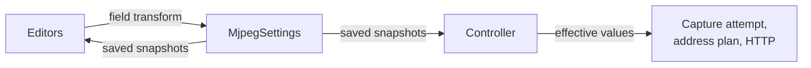

# Settings

[Internals](../README.md) · [Usage: Choosing settings](../../docs/usage.md#choosing-settings) · [Architecture: Settings](../../docs/architecture.md#settings) · [Coordination](03-coordination.md)

MJPEG settings are the user's lasting choices for image processing, connection, access, the web page and automation. [Choosing settings](../../docs/usage.md#choosing-settings) says what each setting means, its default and the range a user can enter. [Architecture](../../docs/architecture.md#settings) says which owner applies each group and why some groups wait until capture cleanup.

This guide follows a value from an editor to the running stream: the saved model and its validation, save ordering, how the Controller turns saved values into the values it uses, PIN preparation, and how the store handles unreadable data.

## Components and lifetimes

| Component | Responsibility | Lifetime |
| --- | --- | --- |
| [`MjpegSettings`](../../src/main/kotlin/io/screenstream/mjpeg/settings/MjpegSettings.kt) | Owns the store, the save transaction and the edit-policy rules | Process singleton |
| [Settings models](../../src/main/kotlin/io/screenstream/mjpeg/settings/MjpegSettingsModels.kt) | Define the five groups, their defaults, local validation and saved encoding | Immutable values |
| Shared [`JsonPreferencesStore`](../../../../common/src/main/java/info/dvkr/screenstream/common/settings/JsonPreferencesStore.kt) | Keeps the model as JSON in a Preferences DataStore and recovers from unreadable data | Owned by `MjpegSettings` |
| Settings editors (`ui/settings`) | Hold drafts and save changed fields | One settings screen; drafts survive UI recreation |
| `MjpegStreamingModuleController` | Decides which saved values take effect and hands them to their owners | One module instance |
| HTTP delivery | Creates viewing credentials from the applied access settings | One module instance |

Two readers observe the store. Editors collect saved snapshots directly, so they always show what is saved. The Controller collects the same snapshots and decides which values take effect now. The values it keeps are its **effective settings**. Saved and effective values can differ for a while, because a save takes time to be observed and capture freezes some setup values. Apart from preparing the PIN when an instance opens, the Controller never writes settings.

## Saved model and defaults

One immutable snapshot, `MjpegSettings.Data`, holds five groups: `image`, `network`, `access`, `web` and `behavior`. A group is the unit an editor changes, and every save replaces the whole snapshot atomically.

All five groups are saved, including the six-digit PIN. These values are never saved and live only at run time:

- discovered addresses and listener state
- the edit policy and the Controller's effective settings
- HTTP's token and viewing cookie
- statistics
- editor drafts and PIN reveal state

Each group's companion object defines its defaults. Model constructors and the "Default" lines in editors use these same constants. Saved JSON omits values equal to their defaults (see [Storage, serialization and recovery](#storage-serialization-and-recovery)). Changing a default constant therefore also changes the effective value for users whose saved snapshot held the old default.

The stream-name default comes from the device manufacturer and model, falling back to "Android device". The `web` group has no default inside `Data`, and its title is always encoded. As a result, the first save that writes the store also writes the device-derived name, and later launches keep that name instead of computing it again. An explicitly empty name stays empty.

Editors also have **seed values** for modes that have no saved value yet:

- 30 FPS for an FPS limit
- 1 second for an interval
- AspectFit for a target size
- half the screen's maximum window size, rounded up, for target dimensions

Seeds only fill a draft. Saved data changes only when the user closes the editor with a valid draft that differs from the value the editor opened with.

Some saved values are dormant. The crop insets stay saved while crop is off, and the unselected choice of scale or target size stays saved too, so the user can switch back without retyping. A capture attempt sends `CropInsetsPx.ZERO` when crop is off and sends only the selected output-size variant. The JPEG backend belongs to the Engine session's configuration and is read once, when the attempt is admitted. The other image values are Engine parameters that can change during a run, as [Change capture parameters](../../../../screen-capture-engine/docs/usage.md#change-capture-parameters) describes.

## Validation

Validation happens at three levels, each of which can catch different problems:

1. **Saved model.** Constructing a group rejects locally invalid values, from any source, including editors and decoding. It rejects:
   - a scale percentage that is nonfinite, or not above zero after division by 100 (so tiny positive values that underflow are rejected too)
   - JPEG quality outside 0–100
   - a target-size selection without a saved target
   - an empty filter group
   - an HTTP port outside 1024–65535
   - an address-loss delay outside 10–1800 seconds
   - a PIN block duration below one minute
   - a PIN that is not six ASCII digits
   - a background that is not `#RRGGBB`
2. **Engine values.** The Engine's value constructors also reject invalid crop insets, target dimensions and frame-rate values. Dormant values are constructed too, so they must stay valid even while unused.
3. **Capture geometry.** Whether a crop leaves visible content, or whether an output size can be produced, depends on the actual capture, so the Engine checks it only when it applies the values. The outcome depends on when the problem appears:
   - **At Engine startup.** Startup fails, the attempt ends with an error, and Start becomes available again after cleanup.
   - **During a run**, after a parameter change or a change in capture geometry. The Engine can suspend output instead. The attempt stays alive and paused, and Stop remains available. MJPEG schedules no retries of its own. A pause can end when capture conditions change or a changed image setting reaches the Engine, but a persistent problem can pause the same settings again.

   See [Image and geometry](../../../../screen-capture-engine/docs/usage.md#image-and-geometry) and [Handle errors and recovery](../../../../screen-capture-engine/docs/usage.md#handle-errors-and-recovery).

The size editor's estimate is based on the device's maximum window size and is only guidance. Sharing a single app or rotating the device can produce a different result.

Editors are deliberately stricter than the saved model in a few places:

| Value | Saved model accepts | Native editor accepts |
| --- | --- | --- |
| Scale | Any finite percentage that stays above zero after division by 100 | Up to 200% |
| Target dimensions | Any positive size (Engine rule) | 1–8192 px |
| Stream name | Any length | Up to 64 UTF-16 code units |
| PIN block duration | One minute or more | 1–60 minutes |
| HTTP port | 1024–65535 | 1024–65535 |

A saved value outside an editor's range is kept and shown until the user saves a valid change. HTTP delivery itself accepts any port from 1 to 65535. The narrower saved range is a product rule.

## PIN generation and edits

The saved PIN is the six-digit code that viewers type. HTTP delivery creates its token and cookie separately and never saves them; see [HTTP delivery](../02-delivery/01-http-delivery.md).

**Missing PIN.** Every save transaction ends with one rule: if protection is enabled and no PIN is saved, a PIN is generated in the same transaction. Generation uses `SecureRandom` and pads the result to six digits, so leading zeros are kept. Turning protection on can therefore never save an enabled state without a PIN. Turning protection off keeps the saved PIN.

**New PIN on open.** When a module instance starts observing settings, it first runs one save transaction, before any snapshot reaches the Controller. If protection is on and the policy is New PIN on open, that transaction replaces the PIN. The Controller's first effective settings, and so the first HTTP access configuration, already contain the new PIN. The previous PIN is never applied in this instance.

With protection off, this transaction changes nothing and writes nothing. Enabling protection later only fills a missing PIN. Start, Stop, leaving the screen and coming back never generate a new PIN. If the opening transaction fails, the settings observation fails and the module instance shuts down with a failure.

**Edits.** Both kinds of PIN edit are access changes, so they need the setup-edit policy described in the next section.

- **Generate new PIN** works with either PIN option.
- **A typed PIN** requires Permanent PIN. The editor checks for six ASCII digits. The save transform checks the option and format again against the latest saved access group, so if a change of PIN option races with the edit, the PIN stays unchanged.

**Storage and display.** `SecretValue` hides the PIN in `toString()`, which keeps it out of generated strings and logs. Serialization still writes the digits as plain text into the app's private storage.

The PIN under Stream addresses comes from the Controller's effective settings, while the PIN editor shows the saved PIN. The two differ briefly after a save. They differ for longer while a setup edit waits for capture cleanup, as the next section explains.

Each place that shows the PIN keeps its own reveal state. Under Stream addresses, the PIN is masked again whenever the shown PIN changes or the hide-on-capture condition changes. That condition is true while a capture attempt is in progress and **Hide PIN when starting a stream** is on.

The Controller turns the condition on when it admits the attempt, before consent is requested. Masking is still an ordinary UI repaint that is not synchronized with capture, so nothing guarantees the masked PIN is drawn before the Engine captures the screen. [Access](../../docs/usage.md#access) describes what users see.

## Edit policy and effective settings

The Controller publishes an **edit policy** along with the screen state:

- **All** means the module is open, the Controller has accepted settings, and either no capture attempt exists or the last one cleaned up successfully. All does not depend on listeners: it applies even when no address is listening.
- **LiveOnly** covers every other time:
  - before the first settings are accepted
  - from attempt admission, which comes before consent, until cleanup succeeds
  - after cleanup fails
  - after shutdown begins

  Failed cleanup also ends the module instance through the terminal failure path; see [Coordination](03-coordination.md).

Under LiveOnly, the Controller keeps some values from its previous effective settings whenever it observes a new snapshot:

| Field | Under LiveOnly |
| --- | --- |
| JPEG backend | Previous effective value |
| HTTP port | Previous effective value |
| Access group, except Hide PIN when starting a stream | Previous effective values |
| Everything else, including Hide PIN when starting a stream | Newly observed value |

`EditPolicy.allows()` uses the same mapping to validate an edit. A proposed snapshot is allowed when this mapping leaves it unchanged. A live edit therefore succeeds even when the saved snapshot carries unchanged setup fields along with it.

Two independent checks enforce the policy:

1. **The save transaction.** Each settings group applies its transform inside the transaction. It then calls `allows()` against the latest saved snapshot, using the policy the screen last received. A forbidden edit leaves the snapshot unchanged and shows no error, because the control should already have been disabled. This check only advises: the screen's policy can be one turn behind.
2. **The Controller.** It applies the LiveOnly mapping when it observes the save. This is the check that protects a running attempt.

The two checks can disagree. A setup edit admitted by the screen just before Start can be saved after the Controller has admitted the attempt. The attempt keeps its effective setup, and the saved value waits. When cleanup succeeds, the Controller applies the latest observed snapshot again, now under All. The waiting value then takes effect without another save.

A completed save never means the value is in use; [Effective settings and saves](03-coordination.md#effective-settings-and-saves) covers how each accepted group reaches its owner.

## Editors and save transactions

[Choosing settings](../../docs/usage.md#choosing-settings) walks through the controls. Internally, every editor follows the same pattern:

- **It starts a draft from the saved value when it opens.** Later saved snapshots do not replace the draft, so the user's newer local draft wins over a delayed observation. The PIN editor is the exception: it follows the saved PIN until the user types, so a generated PIN appears straight away.
- **Closing the editor saves only a valid draft that differs from the starting value.** An invalid draft is discarded and the saved value stays.
- **A save is a transform of the latest saved snapshot that touches only the edited fields.**
  - Crop insets are saved together as four values.
  - A target size saves width, height and content mode together.
  - Placement editors save only the properties the user changed.
  - A Network filter edit keeps whatever port is currently saved.
  - Switches, such as crop and PIN protection, flip the latest saved value.

`updateData` admits saves in the order they are called. Editors start saves undispatched, so each save reaches the store's fair mutex synchronously, before any dispatcher switch. The [Mutex contract](https://kotlinlang.org/api/kotlinx.coroutines/kotlinx-coroutines-core/kotlinx.coroutines.sync/-mutex/lock.html) resumes waiting callers in first-in, first-out order. Inside the mutex, the transform, missing-PIN generation, encoding and storage write run as one Preferences edit on the IO dispatcher.

The whole call runs in `NonCancellable`, including the wait for the mutex, so a save that has started continues after its screen leaves composition. The departed screen does not report the outcome. Failures from the transform or from storage propagate to the caller. Process death and storage failures keep their ordinary effects.

Save failures are logged and shown as a Snackbar on the current settings screen, with one message per group, separately from inline validation errors. Cancellation is not reported as a failure. The Snackbar host belongs to the screen, so a newly opened screen starts with no pending messages.

Editor drafts and editor visibility use Compose `retain`, so they survive supported UI recreation such as configuration changes. The screen also keeps the last saved snapshot so it can draw retained editors in its first frame, and removes the PIN from that copy. The PIN draft, its reveal state and the PIN editor's visibility use ordinary `remember`, so recreation discards them. Process death ends all retention, and only the saved values remain in DataStore.

## Storage, serialization and recovery

The store is the Preferences DataStore file `mjpeg.preferences_pb`, which holds one JSON string under the key `DATA`. The store file name is a fixed string, independent of the Gradle module name.

Encoded forms matter when the model changes:

- **Crop insets:** four integers.
- **Target size:** width and height, plus the content mode when it is not AspectFit.
- **Network filter:** three sets.
- **Frame rate:** tagged as `Auto`, `MaxFps` with `fps`, or `SamplingInterval` with an ISO-8601 duration string.
- **PIN:** the six digits as a string.
- **Background:** `#RRGGBB`.
- **Stream name:** always written, even when it equals the default.

MJPEG relies on the shared `JsonPreferencesStore` for encoding, reading, saving and repair:

1. **Encoding.** Unknown JSON keys are ignored on read, and properties equal to their declared defaults are omitted on write. A new field with a default can therefore be added without a migration. Because defaults are omitted, a saved snapshot does not pin values the user never changed (see [Saved model and defaults](#saved-model-and-defaults)).
2. **Reading.** A missing payload reads as the defaults. A payload counts as invalid if it is not a string, is malformed JSON, or decodes to a value a model constructor rejects. Each decoded model is cached against its raw JSON text, so an unchanged payload is not decoded again. The flow emits its first value only after the file has been read, and it does not repeat an equal value.
3. **Saving.** `updateData` runs the transform inside one Preferences edit. An invalid payload supplies the defaults as input and is replaced by the encoded result, even when that result equals the defaults. If the transform returns a value equal to the decoded one, nothing is written, so a save that changes nothing leaves the stored JSON exactly as it was. A save that returns normally is durable, and every collector then restarts its observation of the store.
4. **Repair.** A read or decode failure caused by I/O or serialization can trigger a repair: an edit that removes the payload if it still fails to decode. Reading then resumes, and a removed payload reads as the defaults, so the invalid JSON is gone.
   - **One repair until a successful read.** Only one repair is allowed before the next successful read. If the repair edit fails with I/O, or another failure arrives before that read, the flow emits the defaults and stops until a save returns normally or a new collection starts.
   - **Renewed after success.** After a successful read, a later failure in the same collection can be repaired again.
   - **No repair for corruption errors.** A `CorruptionException` that reaches the flow gets no repair and goes straight to the defaults.
   - **Unparseable Preferences file.** If DataStore cannot parse the Preferences file itself, it replaces the file with empty Preferences, which read as the defaults.
   - **Everything else.** Other failures and cancellation propagate.

Seeing defaults does not always mean storage holds defaults. After a failed repair, the invalid payload is still stored, and the next save replaces it. A failure that propagates ends the Controller's settings observation and shuts the module instance down with a failure.

## Implementation and verification

The [models](../../src/main/kotlin/io/screenstream/mjpeg/settings/MjpegSettingsModels.kt) own defaults, validation and encoding. [`MjpegSettings`](../../src/main/kotlin/io/screenstream/mjpeg/settings/MjpegSettings.kt) owns the transaction and the edit-policy mapping. The shared [JSON store](../../../../common/src/main/java/info/dvkr/screenstream/common/settings/JsonPreferencesStore.kt) owns repair behavior. [Settings scenarios](../03-testing/scenarios/01-settings.md) describe the required histories, and [Testing](../03-testing/01-testing.md) defines the evidence a settings change needs.
