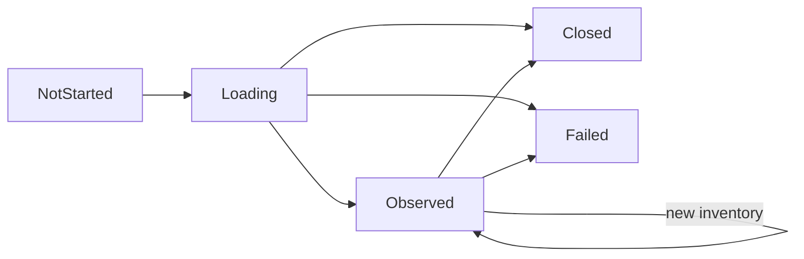
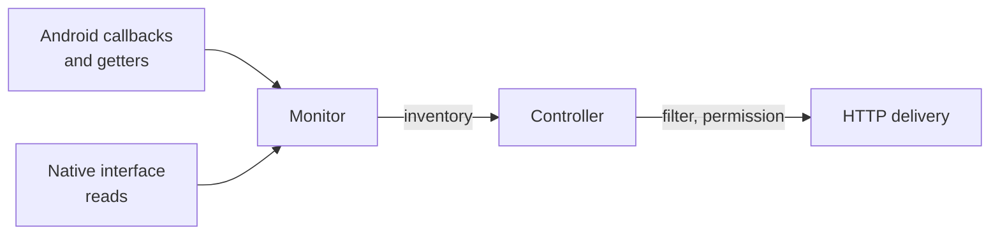
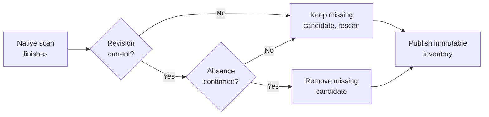

# Network addresses

[Internals](../README.md) · [Architecture: Addresses, listeners and readiness](../../docs/architecture.md#addresses-listeners-and-readiness) · [Usage: Connection](../../docs/usage.md#connection) · [Coordination](03-coordination.md)

Address discovery tells the Controller which IP addresses the device has right now, and on what kind of interface each one appears. [Architecture](../../docs/architecture.md#addresses-listeners-and-readiness) explains how the Controller filters those addresses, checks local-network permission and asks HTTP delivery for listeners. [Connection](../../docs/usage.md#connection) explains what the Network filter choices mean to users.

This guide explains how discovery gathers evidence when Android's reports are late or incomplete, why it keeps addresses it cannot confirm are gone, how addresses are classified, filtered and identified, and how discovery shuts down. An address in the inventory is a fact about this device only; nothing in discovery says whether another device can route to it.

## Components and lifetimes

| Component | Responsibility |
| --- | --- |
| [`NativeInterfaceAccess`](../../src/main/kotlin/io/screenstream/mjpeg/networkaddress/NativeInterfaceAccess.kt) | Wraps Java's `NetworkInterface`, keeping enumeration, name and getter failures visible so an unreadable interface stays distinct from one with no addresses |
| [`AndroidNetworkAddressSource`](../../src/main/kotlin/io/screenstream/mjpeg/networkaddress/AndroidNetworkAddressSource.kt) | Runs one native interface scan on IO against a supplied platform snapshot; owns no callbacks or lifetime |
| [`AndroidNetworkAddressMonitor`](../../src/main/kotlin/io/screenstream/mjpeg/networkaddress/AndroidNetworkAddressMonitor.kt) | Registers Android observers, runs scans one at a time, merges evidence, assigns address IDs, publishes inventories and retires its observers on close |
| [Address model](../../src/main/kotlin/io/screenstream/mjpeg/networkaddress/NetworkAddress.kt) | Immutable filter, scoped IP key, address and inventory types, classification and selection |
| `MjpegStreamingModuleController` | Selects addresses with its effective filter, applies the permission check and passes the plan to HTTP delivery |
| HTTP delivery | Owns planned servers, physical listeners and socket cleanup, separately from discovery identity |

Each module instance gets its own monitor. The Controller starts it when it accepts its first settings. `start()` returns immediately, can be called repeatedly from any thread, and is ignored once closing has begun. Discovery keeps running whether or not anyone collects its state. Every constructed monitor must be closed, even one that never started, and the module's cleanup waits for that close to finish.

The [monitor contract](../../src/main/kotlin/io/screenstream/mjpeg/networkaddress/NetworkAddressMonitor.kt) publishes these states:

`Observed` carries an inventory. An empty inventory, or an empty selection from one, is a valid observation: it means no known address matches, not that every network is down. While the module is open, the Controller treats `Failed` or `Closed` as a component failure and shuts the instance down.

## Two sources of evidence

Discovery combines two kinds of evidence. **Platform metadata** from Android's connectivity APIs tells it which interfaces belong to which networks and what transport they use. **Native reads** through `NetworkInterface` list the addresses each interface currently has. Neither source is complete on its own: callbacks can be late or missing, and native reads can fail for one interface or for the whole enumeration.

### Platform metadata

The network observer registers a `NetworkCallback` that requires `NOT_RESTRICTED` and nothing else. It requires neither `INTERNET` nor `VALIDATED`, so LAN-only and peer-to-peer networks count too. On API 30 and later the request clears the default capabilities. On older versions it removes `TRUSTED` and `NOT_VPN`, so VPN networks are included.

Android's [NetworkCallback reference](https://developer.android.com/reference/android/net/ConnectivityManager.NetworkCallback) advises against calling synchronous `ConnectivityManager` getters inside callbacks. The monitor therefore stores the capabilities and link properties delivered in each callback. Every change bumps a **platform revision** and posts to a conflated change channel. Several quick callbacks collapse into one wakeup, and that wakeup reads the latest snapshot.

Fallback reads use the older getters (`allNetworks`, `getNetworkCapabilities`, `getLinkProperties`), filtered to networks that are not restricted:

- **Below API 26**, fallback reads run on every scan alongside the callback. For each field, a callback value wins over a fallback value.
- **From API 26**, a registered callback is authoritative, and fallback reads run only while registration has not succeeded. When registration succeeds, the stored fallback data is cleared, because a network that disappeared before registration never produces `onLost`.
- **On every version**, a fallback read is discarded if the platform revision changed while it ran, so it cannot overwrite newer callback evidence. A partial fallback read is merged with the previous fallback data instead of replacing it.

On API 36 and later, a tethering observer adds the interface type of tethered interfaces.

Observer registration runs at the start of each scan, on the scan's IO thread, until it succeeds. A failed registration is logged, native scans keep working, and the next scan tries again.

A platform snapshot contains:

- the revision
- the interface addresses reported by callbacks
- a map from interface name to interface type
- a **ready** flag

Ready means the network callback is registered and every known network has both interface and transport metadata. Below API 26, the latest fallback read must also be complete. On API 36 and later, the first tethering report must have arrived.

### Native reads

A scan enumerates every native interface:

- **Successful read.** An interface that is down counts as successfully read with no addresses. A successful read is evidence that the interface has no other addresses.
- **Failed read.** Failing to read one interface's addresses puts that interface in the failed set, and the scan continues.
- **Failed enumeration.** If enumeration itself throws, it is incomplete. This includes a failure to read an interface's name, and it happens in practice: older Android versions can throw for some virtual interfaces. A `null` enumeration counts as complete and empty.

The scan then retries by name. After a complete enumeration it retries only the failed interfaces. After an incomplete one it retries every interface name the platform snapshot knows.

Callback addresses fill gaps only. They are added for an interface when the native read did not succeed and either enumeration was incomplete or that interface's read failed. A successful native read is always authoritative, even when callbacks report different addresses. Several networks can report addresses for the same interface.

A scan result is **complete** when enumeration was complete, no interface read failed and the platform snapshot was ready. Completeness affects only how soon the next scan runs.

## Evidence, freshness and retention

The monitor keeps the addresses it already knows until current evidence confirms they are gone. If one unreadable scan could remove addresses, a single glitch would tear down working listeners and replace address identities.

When a scan finishes, the monitor reads the platform revision again and compares it with the revision the scan started from:

A **candidate** is one IP address seen on one interface. When a scan finishes:

- Fresh candidates from the scan are always added, even when the scan is stale. Unspecified, multicast and IPv6 link-local addresses are dropped first.
- A previously known candidate that is missing from the scan is removed only when the scan is current and the interface's absence is confirmed. Absence is confirmed when the interface was read successfully, or when enumeration was complete and the interface is not in the failed set.
- Otherwise the old candidate is kept, and its interface type is updated from the latest platform snapshot when that snapshot has one.

The merged list puts fresh candidates before retained ones and keeps one candidate per interface and scoped IP. A scoped IPv6 candidate hides an unscoped copy of the same address on the same interface.

A platform change on its own, with no scan, reclassifies known candidates straight away and publishes the result. A candidate whose interface has no type in the new snapshot keeps its previous type until address reads catch up.

Each publication is a new immutable inventory, and selections from it are immutable too. `Loading` lasts until the first scan finishes. An inventory equal to the current one is not published again. Nothing is published once closing begins.

## Scheduling scans

At most one native scan runs at a time, on the IO dispatcher. The first scan starts immediately. After that:

| Event | Next scan |
| --- | --- |
| Platform revision changes | As soon as no scan is running; the retry sequence restarts if none was running |
| Scan finishes but its revision is stale | Immediately |
| Current scan is complete | After 30 seconds |
| Current scan is incomplete | After 250 ms, then 1 s, then 3 s, then every 30 s |

Changing the Network filter does not trigger a scan, because the Controller selects again from the inventory it already has. Discovery uses ordinary coroutine timers and holds no wake lock or alarm. While the device sleeps, Android's scheduling decides how quickly an address change is noticed.

## Classification and filtering

### Interface type

Interface types come from evidence in this order:

1. **Framework transport.** For one capability report: VPN, then Wi-Fi, then Ethernet, then cellular (Mobile); otherwise Other. When several networks report the same interface, VPN wins; otherwise the first type that is not Other is kept.
2. **Tethering report** (API 36 and later). This fills only interfaces that are still unknown or Other. Wi-Fi tethering maps to Wi-Fi, and any other tethering type maps to Other.
3. **Interface-name inference** for interfaces that are still unknown or Other, including those Android reported as Other:

| Name starts with | Type |
| --- | --- |
| `tun`, `tap`, `ppp` | VPN |
| `wlan`, `wifi`, `softap`, `ap_br_`, `p2p`, or the name is `ap` plus digits | Wi-Fi |
| `eth` | Ethernet |
| `rmnet`, `ccmni`, `pdp` | Mobile |
| anything else | Other |

This is why some hotspot and USB-tethering interfaces appear under Other, as [Connection](../../docs/usage.md#connection) warns users.

### Address category

| Category | Addresses |
| --- | --- |
| Loopback | `127.0.0.0/8`, `::1` |
| IPv4 link-local | `169.254.0.0/16` |
| Private | IPv4 `10.0.0.0/8`, `172.16.0.0/12`, `192.168.0.0/16`; IPv6 `fc00::/7` |
| Non-private | Every other supported unicast address, including CGNAT `100.64.0.0/10` and deprecated IPv6 site-local `fec0::/10` |

Unspecified, multicast and IPv6 link-local addresses never enter the inventory. Virtual interfaces are kept. Categories describe the address itself, not whether it is routable or reachable.

### Selection

The filter matches an address when it matches one selected value in every group: IP family, interface type and category. Groups combine with AND, and values within a group with OR. An empty group at this level selects nothing. Saved settings forbid empty groups, and the editor never lets the last choice in a group be cleared.

An inventory maps each scoped IP to its ordered alternatives, meaning the candidates for that IP on different interfaces. Selection filters the alternatives first and then takes the first match for each IP. Fresh alternatives come before retained ones, so a fresh match wins. If the fresh alternative is excluded by the filter, a matching retained alternative can still be selected.

### Local-network permission flag

Each address states whether the Controller must check local-network permission before planning a listener for it. The check applies to non-loopback addresses on Wi-Fi, Ethernet and Other interfaces. Mobile, VPN and loopback addresses skip it.

This follows Android's [local network definition](https://developer.android.com/privacy-and-security/local-network-definition): broadcast-capable interfaces such as Wi-Fi and Ethernet, excluding cellular and VPN. MJPEG treats Other as local, because hotspot and tethering interfaces often land there. Skipping the app's check only means MJPEG plans the listener. Android's enforcement still decides whether traffic is accepted; see [Permissions and platform limits](#permissions-and-platform-limits).

## Address identity and ordering

An **IP key** identifies a scoped IP. It contains the address bytes, the IPv6 scope ID and the name of the scoped interface. Two IPv6 addresses with the same bytes but different scopes are different keys.

Each IP key gets an **address ID**, a number that increases within one monitor. All alternatives for that IP share the ID. The ID stays the same across filter edits, interface metadata changes and port edits. Once every candidate for the IP has been confirmed absent, the IP key is forgotten, and if the address returns it gets a new ID. A new module instance has a new monitor, so its IDs start again.

Address equality covers the ID, the IP key, the interface name and the interface type. When only metadata changes, the inventory publishes a changed address that keeps its ID.

HTTP delivery builds on this identity without sharing its lifetime:

- A planned server is keyed by address ID and port. While both stay the same, HTTP keeps the planned server and its UUID and gives it the updated address. HTTP fails fast if an ID ever comes back with a different IP key.
- A port change, or an address that leaves the plan and returns, creates a new planned server. For example, losing and regaining the local-network grant replaces the HTTP server while discovery keeps the same address row and ID.
- Physical binds are serialized per IP key and port, so a replacement waits for the previous socket's cleanup.

[HTTP delivery](../02-delivery/01-http-delivery.md) owns planned servers and bind behavior.

Candidates and selections are ordered by:

1. interface name
2. address byte length
3. unsigned address bytes
4. IPv6 scope ID
5. scoped-interface name
6. interface type

Selection returns at most one address per IP key, which is what HTTP's one-socket-per-address rule relies on.

## How the Controller uses discovery

Discovery publishes inventories, and the Controller makes the decisions. The Controller selects from the latest inventory it has processed and keeps its last selection while discovery isn't `Observed`. It reads the monitor directly again before admitting Start and before an address-loss Stop. Permission, listener state and applied access then decide plans, readiness and links. [Discovery plan and Start readiness](03-coordination.md#discovery-plan-and-start-readiness), [Network-loss deadline](03-coordination.md#network-loss-deadline) and [Local-network permission](03-coordination.md#lan-permission-ui-and-grant-checks) own those rules.

## Closing discovery

Closing has two phases: fencing, then cleanup.

**Fencing** happens synchronously under the monitor's admission gate. It records any failure that caused the close, publishing `Failed` at once. It stops new starts, callback state changes and publication, and it takes the handles needed to unregister the observers. Registration and unregistration calls themselves run outside the gate. If the close comes before `start()`, observation is launched anyway so it can end cleanly.

**Cleanup** runs in a separate worker on IO, independently of whoever called `close()`:

1. Unregister every observer handle taken at the fence, collecting any errors.
2. Wait for observation to finish, including any native scan in progress. A registration that completes after the fence is rejected and unregistered inside that scan, so it is retired before the scan returns.
3. Settle the result. With no failure, publish `Closed` and complete normally. Otherwise publish `Failed` and complete with the failure. A discovery failure is the primary cause, and cleanup errors are attached to it as suppressed exceptions.

If observation fails on its own, it starts closing with that failure. Observers are then unregistered at the same time as the observation waits for any in-flight scan.

Everyone waiting in `close()` receives the same result, and cancelling one waiter cancels only that wait. Cancelling a scan does not interrupt a blocking native call. A hung `NetworkInterface` call therefore keeps the close, and with it the module's cleanup result, pending. Core's manager limits how long it waits for that result; see [Closing a module instance](../../../core/docs/module-contract-and-manager.md#closing-a-module-instance).

## Permissions and platform limits

The [manifest](../../src/main/AndroidManifest.xml) declares `INTERNET`, `ACCESS_LOCAL_NETWORK` and `ACCESS_NETWORK_STATE`. The Controller asks Core's `RuntimePermission.LocalNetwork` whether the local-network grant is currently present. [Runtime Permissions](../../../core/docs/runtime-permissions.md#permission-meanings) explains that a permission's availability depends on the device and app configuration. The non-loopback Wi-Fi, Ethernet and Other rule above is MJPEG's own admission policy, applied after selection.

Android's [local network permission guide](https://developer.android.com/privacy-and-security/local-network-permission) defines the platform's restriction, which covers accepting incoming TCP connections. Android applies it whether or not MJPEG checks first, so a listener that MJPEG plans can still fail to receive viewer traffic.

Discovery only observes interfaces and metadata that already exist. It does not create networks, and it cannot see routing, firewalls, client isolation or a peer's ability to connect. Missing callbacks (sometimes OEM-specific), interface-read bugs and incomplete tethering metadata remain runtime uncertainties. The retention and retry rules above are designed to absorb them.

## Implementation and verification

The [address model](../../src/main/kotlin/io/screenstream/mjpeg/networkaddress/NetworkAddress.kt) owns the immutable filter, scoped identity, classification and selection. The [monitor contract](../../src/main/kotlin/io/screenstream/mjpeg/networkaddress/NetworkAddressMonitor.kt) defines the start, state and close guarantees, and the components above implement evidence gathering and retirement.

[Network scenarios](../03-testing/scenarios/04-network.md) describe the required evidence histories, and [Testing](../03-testing/01-testing.md) the evidence levels.
