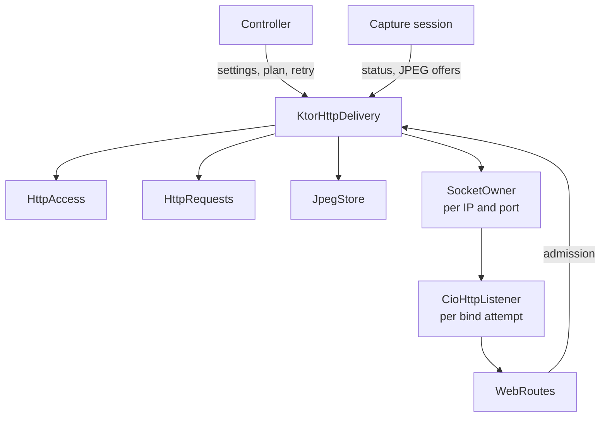
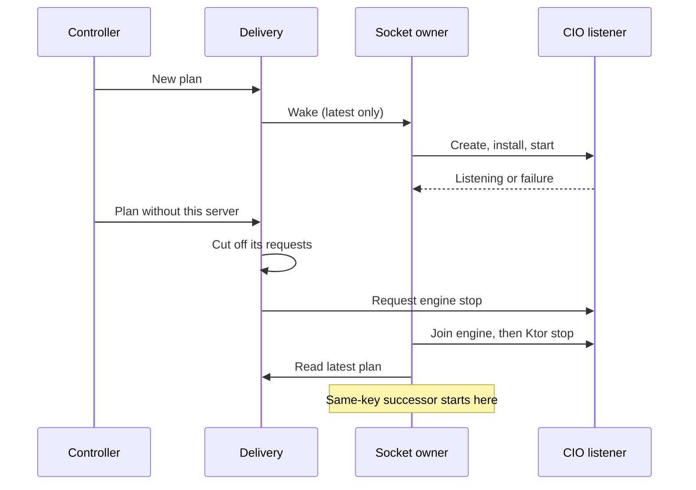

# HTTP delivery

[Internals](../README.md) · [JPEG delivery](02-jpeg-delivery.md) · [Web client](03-web-client.md)

HTTP delivery is the web server of one MJPEG module instance. It opens a listener on each selected device address and decides which requests may view the stream. It also keeps the request history behind the client list and statistics, and it releases everything when the instance closes. The public [HTTP server guide](../../docs/server.md) defines what clients send and receive. [Architecture](../../docs/architecture.md#addresses-listeners-and-readiness) shows where delivery sits in the module. This guide explains, for maintainers, which object owns each kind of work, how long it lives and the order in which owners act.

Two neighboring guides cover the rest of the HTTP side. [JPEG delivery](02-jpeg-delivery.md) owns the shared image store and the code that writes images into responses. [Web client](03-web-client.md) owns the Ktor route adapter and the packaged browser page. Capture resources belong to the [capture attempt](../01-module/02-module-lifecycle.md), not to HTTP delivery.

## Contents

- [Components and lifetimes](#components-and-lifetimes)
- [Activation and capture registration](#activation-and-capture-registration)
- [Planned servers and scoped sockets](#planned-servers-and-scoped-sockets)
- [Access generations and PIN blocks](#access-generations-and-pin-blocks)
- [Request admission and cutoff](#request-admission-and-cutoff)
- [Client history and statistics](#client-history-and-statistics)
- [Terminal cleanup](#terminal-cleanup)
- [CIO transport and limits](#cio-transport-and-limits)
- [Implementation and verification](#implementation-and-verification)

## Components and lifetimes

`KtorHttpDelivery` implements the `HttpDelivery` interface. The Controller creates one per module instance, activates it once, gives it address plans and settings, and asks it to stop when the instance closes. The current capture session calls it directly to publish capture status and JPEGs. Every other owner in the table lives inside the delivery.

| Owner | Lifetime | Responsibility |
| --- | --- | --- |
| `KtorHttpDelivery` | One module instance | Control monitor, address plan, socket owners, request admission, web state, statistics sampler and terminal cleanup |
| `HttpAccess` | One delivery | Applied access settings, the viewing credentials, their generation number and PIN-attempt records |
| `HttpRequests` | One delivery | Admitted media responses and state connections, client rows and the totals of retired responses |
| `JpegStore` | One delivery | The selected image and its storage, described in [JPEG delivery](02-jpeg-delivery.md) |
| `WebRoutes` | One delivery | The route adapter installed into each listener, with lazily loaded page assets ([Web client](03-web-client.md)) |
| `PlannedServer` | One server incarnation | Server UUID, address metadata, port, socket key, attempt budget, retry deadline and current listener |
| `SocketOwner` | While its IP and port are planned, plus cleanup | Serializes bind attempts and cleanup for one scoped IP address and port |
| `HttpListener` | One bind attempt | The lifecycle that delivery drives for that attempt: start listening, await termination, request stop, and stop with cleanup. The production implementation, `CioHttpListener`, runs one Ktor CIO engine with one connector. |
| `JpegResponse` | One admitted media call | Leases, writes and progress for that response |

`HttpAccess` and `HttpRequests` have no locks, coroutines or timers of their own. Every call into them happens under the delivery's control monitor.

### Locks and where work runs

Delivery has one lock, the **control monitor**. It guards access state, the plan, request registration, cutoff and statistics sampling. The JPEG store has its own monitor. Across the module, locks nest in this order: capture-session state gate, then control monitor, then store monitor. The capture session may enter delivery while holding its gate. Delivery may enter the store while holding the control monitor. The store never calls back out. Socket binding, transport writes, JPEG copies, job cancellation and joins all run outside both monitors, and JPEG writers never take the control monitor for each frame.

Background work runs in a runtime scope backed by one supervisor job on the IO dispatcher. That scope contains the socket owners and the sampler, and every listener engine is a child of its job. [Terminal cleanup](#terminal-cleanup) joins that job.

## Activation and capture registration

### Activation

`start` succeeds once. Under the control monitor it takes ownership of the logo array, applies the first access, inactive-image and page settings, marks delivery active and publishes the first web state. It also creates socket owners for any plan configured earlier. It then launches those owners and the once-a-second sampler. It returns true unless a shutdown began in the meantime. True means admission is open, even if no listener has bound yet. A second call, or a call after shutdown, returns false, and the Controller treats false as a failure. The Controller reads the logo asset on the IO dispatcher before calling `start`, never modifies the transferred array, and uses `updateConfiguration` for every later change.

`appliedToken` exposes the token of the credentials in effect, or null before activation and while access is open. Only the Controller changes access, so the token it reads while publishing address rows matches the access it last applied. [Coordination](../01-module/03-coordination.md#statistics-and-native-state-projection) owns the ready-link rules.

### Capture registration and status

Before a capture attempt starts, the Controller creates a fresh generation object and calls `registerCapture(attempt, generation)`. Delivery passes both to the store. The store records them, sets the status to Starting, and keeps the latest captured frame and any open readers. A false return means delivery is not active, and the Controller then doesn't start the attempt.

From then on, the capture session alone decides status and generation. It commits each pair under its state gate and pushes it through `updateCaptureStatus`. Delivery applies the pair atomically to the store and republishes web state. The store ignores updates from any attempt other than the registered one. [JPEG delivery](02-jpeg-delivery.md#capture-generation-and-image-selection) explains how the pair drives image selection. Because of that selection rule, readers and the HTTP lifetime survive ordinary Start, Stop, suspension and recovery.

JPEG offers bypass the control monitor. `offerJpeg` goes straight to the store. It enters the control monitor afterwards only when the selected image kind changed, for example from logo to live, to refresh web state. A running capture therefore doesn't contend with request admission once per frame.

### Fatal failures

An exception while applying a capture-status update, or an uncaught failure in a delivery worker such as a socket owner or the sampler, takes the fatal path. Delivery records the first cause as `fatalCause`, publishes it in `info` and requests terminal stop. The Controller checks `fatalCause` on every turn and handles it as a module failure: it reports the failure to Core and closes the instance.

Each listener engine installs its own exception handler that ignores uncaught coroutine failures, so a failure inside one engine doesn't reach this path. Bind failures and engine termination reach the socket owner instead. The fatal cause is kept separate from cleanup failures ([Terminal cleanup](#terminal-cleanup)) and from the capture attempt's own cleanup result.

## Planned servers and scoped sockets

A **plan** is the list of addresses that should have listeners, together with one shared port. The Controller owns address selection and the local-network permission filter and passes the result to `configureServers`. Delivery owns everything from there to a listening socket.

### Three identities

| Identity | Meaning | What keeps or replaces it |
| --- | --- | --- |
| Discovery address ID | One discovered address, owned by [Network addresses](../01-module/05-network-addresses.md) | Discovery |
| Server UUID | One planned incarnation of a server for that address and port | Metadata updates and physical retries keep it. Removal, reselection or a port change replace it. |
| `HttpListener` object | One physical bind attempt | A new object for every attempt |

A **socket key** combines the shared `IpAddressKey` (address bytes plus IPv6 scope ID and interface) with the port. Discovery and HTTP use the same scoped IP identity.

### Applying a plan

Delivery accepts ports 1–65535 and requires unique discovery IDs and unique socket keys. Saved settings restrict the port range further before a value gets here. An address ID that keeps its port must also keep its socket key, so a metadata update never moves a server to a different socket. Invalid plans throw to the caller, and the Controller treats that as a module failure.

Under the control monitor, the new plan replaces the old one in one step:

- An address ID planned again with the same port keeps its `PlannedServer`, with updated metadata. Its listener, responses and state connections continue untouched.
- Every other address gets a new incarnation with a new UUID, a fresh attempt budget and no retry deadline.
- Each incarnation that leaves the plan is cut off. Its client rows lose their Active grace, its media readers close, and its call jobs and listener are collected for cancellation.
- Every socket owner is woken, and owners are created for socket keys that don't have one.

After leaving the monitor, delivery first launches the new socket owners and then requests listener stops and job cancellations. Because the owners are launched first, an accepted plan is carried out even if a later cancellation throws or the caller is cancelled after acceptance. If a cutoff action throws, delivery records a cleanup failure, requests terminal stop and rethrows. `configureServers` never waits for a bind or for cleanup. Plans that arrive before activation are kept as Pending without socket work, and plans that arrive after terminal stop are ignored.

### Socket owners

A socket owner serves one socket key for as long as the plan contains it. Its loop runs in the runtime scope:

1. Read the incarnation currently planned for its key. If there is none, deregister and finish.
2. If that incarnation has spent its budget, or its retry deadline is still ahead, wait for a wake-up or for the deadline, then return to step 1.
3. Otherwise spend one attempt, publish Pending and run one [bind attempt](#bind-attempts) through to the end of its cleanup.
4. If the same incarnation is still planned and has budget left, set its retry deadline 250 ms ahead. Return to step 1.

The wake-up is a conflated signal that keeps only the latest notification. Suppose the plan changes A → B → C while A's listener is still being cleaned up. After cleanup the owner rereads the plan and goes straight to C, and no worker is left waiting for B. Different socket keys bind and fail independently. The same key can't create its next listener until the previous listener's cleanup has finished, so two engines inside the app never compete for one IP address and port.

### Bind attempts

A bind attempt creates a new `HttpListener` for the address's host string and the shared port, with the runtime job as its parent and an application setup that installs the delivery's routes. Delivery takes a listener factory as a constructor parameter, and its default constructs a `CioHttpListener`. The attempt installs that listener as the incarnation's current listener before starting it, so requests that reach the new socket pass the adapter's listener check straight away. It then starts the listener. For `CioHttpListener` that starts the CIO engine, which binds the socket. If the incarnation is still planned with that listener, the state becomes Listening. A late success for a removed or replaced incarnation isn't published. The attempt then waits for the listener to terminate. A termination that delivery didn't cause counts as `IoFailure`.

Every attempt ends the same way:

1. Under the monitor, if the listener is still the incarnation's current listener, it is detached and its requests are cut off. If the incarnation is still planned, any failure is published as `Failed(reason, attempts)`.
2. Outside the monitor, and immune to cancellation, the attempt cancels the cut-off call jobs and runs the listener's cleanup (see [Terminal cleanup](#terminal-cleanup)).
3. If that cleanup throws, delivery records a cleanup failure and requests terminal stop. The owner therefore never moves on to a successor while cleanup is uncertain.

### Listener states and retries

`ServerState` reports the availability of one incarnation:

- **Pending**: planned before activation, waiting for its socket owner, or opening its listener.
- **Listening**: the engine started, and the incarnation is still planned with that listener.
- **Failed(reason, attempts)**: the most recent attempt failed. `attempts` counts every attempt spent, successful ones included. This state doesn't say whether the failed socket has been physically closed.

Each incarnation has a budget of three attempts. A successful bind spends an attempt, and success doesn't refund it, so a listener whose engine later terminates spends from the same budget. While budget remains, Failed is followed automatically by another attempt 250 ms after the previous one ended, so the address row can show Failed briefly before Pending. Once the budget is spent, the state stays Failed.

`retryServer(uuid)` acts only on the current incarnation, and only while it is Failed. It resets the attempt count to zero, sets Pending and wakes the owner. Stale UUIDs, incarnations that aren't Failed and an inactive delivery are ignored. A manual retry doesn't bypass cleanup that is still running and doesn't clear a retry deadline that is already set. A replacement incarnation starts without a deadline.

| Outcome of a bind attempt | Reported failure |
| --- | --- |
| `SecurityException` | `PermissionDenied` |
| Any `SocketException`, including `BindException` | `AddressUnavailable` |
| Any other `IOException` | `IoFailure` |
| Any other exception | `Unknown` |
| The engine terminated by itself | `IoFailure` |

Before mapping an exception, the attempt checks whether its own coroutine was cancelled. Cancelling the owner during terminal stop propagates as cancellation. A cancelled engine under a still-active owner is mapped like any other failure. That result is published only if the incarnation is still planned, so a server that was just removed from the plan shows nothing.

## Access generations and PIN blocks

### Viewing credentials

[Settings](../01-module/04-settings.md) owns the saved PIN: how it is generated, when it changes and when it may be edited. `HttpAccess` owns the access settings that delivery has applied and at most one pair of **viewing credentials**:

- a **token**: 24 random bytes from `SecureRandom`, encoded as URL-safe Base64, which access links carry;
- a **cookie value**: 32 random bytes written as 64 hexadecimal characters, which browsers receive as `screenstream_access`.

When there are no credentials, access is open. Credentials are never saved. Each delivery, and therefore each opening of the mode, starts without them and generates a new pair when protection is applied, even if the saved PIN hasn't changed.

The pair is replaced as a whole, which this guide calls **rotation**, when protection is turned on, when it is turned off (the pair is removed), and when the PIN changes while protection is on. Each rotation increments `credentialGeneration`, which fences admitted state connections. Edits to the PIN option, the hide-PIN preference and attempt limiting leave the credentials and their generation unchanged. Protected access requires a saved PIN, and delivery rejects protected settings without one.

The credentials answer three kinds of request:

- **Viewing.** With open access everything is allowed. Otherwise a matching token or cookie is required.
- **Exchange.** A valid token returns the existing cookie value without rotating anything. Repeated valid exchanges and correct PINs return the same cookie, so other tabs keep their access.
- **PIN verification**, described under [Wrong-PIN limiting](#wrong-pin-limiting).

A supplied value of a different length fails at once, because credential lengths aren't secret. Values of equal length are compared with `MessageDigest.isEqual`. The transport is still plain HTTP, so this comparison doesn't protect secrets on the wire. The public [access contract](../../docs/server.md#access-and-credentials) owns token exchange and cookie attributes. [Web client](03-web-client.md#request-authority-origin-and-credentials) shows which credential each route reads.

### What rotation does to open requests

Rotation happens inside `updateConfiguration`, under the control monitor, in this order:

1. If the new settings require rotation, every admitted media reader is closed, so no response can acquire another image under the old credentials. An initial lease that hasn't reached its writer is released. A writer that already holds an image keeps a valid lease and may go on writing that image. A transport failure, a disconnect or cancellation can still interrupt it, so rotation doesn't guarantee the image arrives complete.
2. The settings are applied and the credentials rotate.
3. All client rows are cleared and a statistics sample is taken immediately, so the client list empties at once. Responses that are still running add their final bytes to the global totals when they retire, but they no longer have a row.
4. The jobs of all admitted state connections are collected.

Outside the monitor, those state-connection jobs are cancelled. A state connection checks the credential generation before each snapshot, so it can't send state under the new credentials even before cancellation lands. Rotation doesn't cancel media call jobs. An MJPEG response ends when its writer next tries to acquire an image and finds its reader closed, or earlier if its current write fails. A `/jpeg` response never makes a second acquisition. If its writer had already taken the pinned image, it writes that one payload, releases it, flushes and returns. That can finish normally or be cut short by a write failure, disconnect or cancellation. If rotation closed the reader before that handover, the response ends without its announced body.

### Wrong-PIN limiting

PIN verification compares the submitted value, which must be six ASCII digits, with the applied PIN. When the [route adapter](03-web-client.md#pin-body-parser) can't extract a PIN, the submission counts as wrong. With **Limit PIN attempts** on:

- Each wrong PIN from a peer increments that peer's count and sets the record to expire 15 minutes later. A partial count therefore lasts until 15 minutes pass without another wrong PIN.
- The fifth wrong PIN blocks the peer, and the record now expires after the configured block duration. The block covers every listener of the delivery.
- During a block, every verification returns Blocked with the remaining time, including one with the correct PIN. The PIN isn't compared, and the deadline doesn't move.
- A correct PIN outside a block removes the peer's record. When a block or a partial count expires, its record is removed and counting starts again from zero.
- A changed block duration applies only to blocks that start later. Rotation keeps existing records. Switching to open access or turning limiting off clears them all.
- Tokens and cookies that are already valid keep authorizing viewing during a block.

With limiting off, a wrong PIN creates no record.

The record table holds at most 1024 peers. Expired records are pruned during PIN verification and denied state-connection admission. Pruning never refreshes a deadline, and a live record is never evicted. When the table is full, a peer without a record must wait for the earliest record to expire before its PIN is compared, even if the PIN is correct. That wait creates no record and extends no deadline. A peer that already has an unblocked record can still verify, and a correct PIN frees its slot. A denied state connection reports the same wait, either the peer's block or the capacity wait, as `blocked`.

The peer is the IP address of the direct connection as CIO reports it. Forwarded headers are ignored. A peer isn't a browser tab or a person: devices that reach the server through one shared address share a record. Deadlines use elapsed realtime and saturate instead of overflowing when the duration is added. Records live only as long as the delivery.

## Request admission and cutoff

Requests pass two gates. The [route adapter](03-web-client.md#routes-and-response-headers) first rejects any request whose `Host` doesn't name this listener, and any request that reaches a listener that is no longer current. Route handlers then ask delivery for a decision under the control monitor, and that decision checks again that the listener is still current.

**Media (`/jpeg` and `/mjpeg`).** Admission checks, in order:

1. **Credentials**: open access, a valid token, or a cookie that the adapter accepted for this request. Failure returns `403`, even if no image could have been served either.
2. **Runtime**: delivery isn't closing, the listener still belongs to a planned server, and the call's job is still active. Failure returns `503` with `Retry-After: 1`.
3. **Image**: the store opens a reader that pins the selected image as its initial lease before any header is written. Failure returns `503`. While delivery is active the logo is always installed, so in practice this happens only during shutdown.

Delivery then creates the `JpegResponse` and registers it with its client row. It also installs a completion handler on the exact call job. That handler retires the response; returning from the route or from `respond` doesn't. Retirement closes the reader and transfers the response's final progress to the retired totals exactly once. If the row still belongs to that endpoint, retirement also adds the bytes to the row, so a late completion can't update a replacement row. The public [availability rules](../../docs/server.md#availability) describe the resulting statuses.

**State connections (`/ws`).** After the adapter's Origin check, admission requires a current listener, an active request job, and either open access or a valid cookie. The token is never accepted here. An admitted connection is registered with its listener, receives the current credential generation and creates no client row. A denied connection receives its peer's PIN wait, if there is one. The listener and job checks share that denial, so a connection that loses a race with listener removal is told `pin_required`, even on an open stream. The adapter checks the listener and generation again before every snapshot ([WebSocket transport](03-web-client.md#websocket-snapshots-and-transport)).

### Cutoff

| Event | Media responses | State connections | Client rows |
| --- | --- | --- | --- |
| Capture Start, Stop or a new capture generation | Continue. The selected image changes. | Continue. The next snapshot reports the change. | Unchanged |
| Credential rotation | Readers closed, so no further image is acquired. A writer may finish an image it already holds. Call jobs aren't cancelled. | Cancelled | All cleared |
| Server removed from the plan, or its engine ends | Readers closed and call jobs cancelled | Cancelled | Rows of that server skip Active grace |
| Terminal stop | Readers and store closed, call jobs cancelled | Cancelled | Cleared. Totals kept. |

Cutoff happens immediately under the monitor, and physical cancellation follows outside it. Closing a reader protects the next image acquisition, and cancelling a job interrupts a transport wait. The two are independent, and both are needed.

## Client history and statistics

### Client rows

A **client row** represents one endpoint: a server UUID, the immediate peer IP and the peer port. A row isn't a browser tab or a unique viewer. Media admission creates it before the first payload. HTML, PIN and state requests never create or extend rows. Overlapping or sequential media responses at one endpoint share the row and its byte count, and the row's format is that of the most recent admission. Row IDs come from a counter that only increases within the delivery. A new peer port, a new server UUID, or an admission after the row expired gets a new ID.

A row is Active while any response from that endpoint is open on a current listener. When the last one retires, the row stays Active for 2 more seconds of **grace**, then Disconnected for 5 more seconds, and then disappears. These deadlines are absolute, so a delayed sample doesn't extend them, and a new admission before expiry continues the same row. The grace smooths `/jpeg` polling, where every image is a separate request.

When delivery cuts a server off, that server's rows skip the grace and keep any earlier deadline already set. A late completion from an old listener can't start grace, even when the same server UUID already has a new physical listener. Rows hold only numbers and strings, never requests, readers or JPEG arrays.

### Publication

`info` is a state flow with two kinds of update:

- **Control updates.** Server state and the fatal cause are published immediately on change. They carry the previous statistics sample unchanged.
- **Full samples.** Clients, totals and `sampledAtElapsedRealtimeMillis` are taken once a second by the sampler, at each credential rotation and after terminal cleanup. The timestamp belongs to the full sample, and control updates don't refresh it.

Terminal stop publishes empty server and client lists at once. The final sample after cleanup keeps the totals.

Each sample adds the current progress of open responses to the retired totals, so counts grow while a long MJPEG response is still open. A JPEG counts as completed once its payload has been written to the response channel, before the multipart footer and flush ([Writing JPEG and MJPEG](02-jpeg-delivery.md#writing-jpeg-and-mjpeg)). Repeats count, but framing and partial payloads don't. The counts measure output on the device, not receipt, decoding or display by a client.

The Controller derives rates from successive samples with distinct timestamps. It also owns the frame-rate baseline, the one-minute history and the native presentation ([Coordination](../01-module/03-coordination.md)). [Reading the statistics](../../docs/usage.md#reading-the-statistics) explains what users see. The Controller's subscription to `info` reacts only to changes in servers, `hasConsumer` or the fatal cause, and it reads newer samples on its next turn.

### Consumer presence and slow readers

`hasConsumer` is true when any sampled row is Active, grace included. It feeds the module status that the Controller reports to Core. A short Active period between two samples can be missed.

A row's `isSlow` is true when any of its responses on a current listener reports slow for the current non-null capture generation. The sampler reads the store's current generation and the set of current listeners under the control monitor. Writers record their observations without consulting either. [Slow-reader observations](02-jpeg-delivery.md#slow-reader-observations) defines the measurement. Store state and writer progress are read at slightly different moments, so a sample isn't one atomic measurement of a frame. Slow status never closes a connection. The Controller's [slow-viewer warning](../01-module/03-coordination.md) consumes it independently of the statistics.

## Terminal cleanup

Shutdown has two entry points. `requestStop()` starts it and never waits. `stop()` starts it if necessary and then waits for the shared result.

### Requesting stop

`requestStop()` can be called repeatedly from any thread, and only the first call acts. Under the monitor, that call:

- marks delivery as closing, so later admissions, plans, retries, configuration and capture updates are refused or ignored;
- closes every media reader and disposes the JPEG store;
- clears the client rows and the plan;
- publishes `null` web state and empty server and client lists.

Outside the monitor, it requests stop of every listener engine, cancels every admitted call job and cancels the runtime job. If a cancellation throws, it is recorded as a cleanup failure and the remaining actions still run. Finally, the call starts the shared cleanup, whether or not anyone is waiting for it.

Every listener's engine job is a child of the runtime job, so runtime cancellation reaches every engine even if a direct stop request fails. A stop before or during engine startup cancels that same engine job, and the plan and exact-listener checks discard any late Listening result.

### Listener cleanup

Socket owners clean up their listener in a non-cancellable context through its `stopAndAwaitCleanup()`. `CioHttpListener` requests engine cancellation and joins the engine job. Then, in `finally`, it calls Ktor's public stop with zero grace period and zero timeout to dispose the application and its plugins. The socket owner keeps its socket key until both steps have finished. If either fails, delivery records a cleanup failure and requests terminal stop.

### Shared cleanup

The shared cleanup, which `stop()` awaits, joins the runtime job. That job completes only after the socket owners, the sampler, every listener engine and their calls have finished. State-connection handlers join Ktor's detached default-session job before their call completes ([Web client](03-web-client.md#websocket-snapshots-and-transport)), so that work is covered too. Cleanup then forgets any remaining socket owners and takes the final statistics sample. If a cleanup failure was recorded, `stop()` throws it. Cancelling a waiter doesn't cancel cleanup and doesn't signal success. The Controller runs `stop()` as one of its independent module-cleanup obligations ([Capture lifecycle](../01-module/02-module-lifecycle.md)).

Delivery keeps two causes apart:

- `fatalCause` is the first operational failure. It is published in `info`.
- `cleanupCause` is the first failure to cancel or release something. It is also recorded as a fatal cause, and it makes `stop()` fail.

An operational failure followed by successful cleanup lets `stop()` complete normally. The capture attempt's cleanup has its own independent result.

A completed join proves that managed coroutines have finished and that Ktor's stop has returned. It doesn't prove that the operating system has closed the socket or that the port can be bound again at once. Those questions need transport and platform evidence ([Testing](../03-testing/01-testing.md)).

## CIO transport and limits

- **Engines.** Each bind attempt gets its own CIO engine with one connector on the address's host string and the shared port, with `reuseAddress` off. A failing engine for one address doesn't affect the others.
- **Protocol and reach.** Listeners speak plain HTTP/1.1 on whatever addresses the Controller selected, which may include VPN, routed or non-private addresses. Listening proves only that a local socket exists. Whether another device can reach it depends on the network ([Make sure viewers can reach you](../../docs/usage.md#make-sure-viewers-can-reach-you)).
- **Disconnects.** Each application installs Ktor's `HttpRequestLifecycle` plugin with `cancelCallOnClose`. Ktor then cancels a call's coroutine when the engine detects that the client has disconnected, which ends media writers that are waiting for a new image or a repeat ([request lifecycle](https://ktor.io/docs/server-http-request-lifecycle.html)). A peer that vanishes without closing its connection is noticed only when the transport reports an error.
- **No other limits.** Delivery has no media watchdog, write timeout or connection limit. A stalled but connected reader keeps its lease, transport buffers and socket. `isSlow` reports skipped images but doesn't cancel anything. [Pooling and memory limits](02-jpeg-delivery.md#pooling-and-memory-limits) explains why the image store isn't a bound on total memory.

## Implementation and verification

- [HttpDelivery](../../src/main/kotlin/io/screenstream/mjpeg/http/HttpDelivery.kt) defines the contract the Controller and capture session use. [KtorHttpDelivery](../../src/main/kotlin/io/screenstream/mjpeg/http/KtorHttpDelivery.kt) owns the runtime, plan, admission and cleanup, and [HttpListener](../../src/main/kotlin/io/screenstream/mjpeg/http/HttpListener.kt) defines the lifecycle of one bind attempt. `CioHttpListener`, in the same file, implements it with one CIO engine.
- [HttpAccess](../../src/main/kotlin/io/screenstream/mjpeg/http/HttpAccess.kt) implements credentials and PIN limiting. [HttpRequests](../../src/main/kotlin/io/screenstream/mjpeg/http/HttpRequests.kt) implements request registration, cutoff, client rows and totals.
- The [HTTP runtime](../03-testing/scenarios/05-http-runtime.md), [access](../03-testing/scenarios/06-access.md) and [web protocol](../03-testing/scenarios/08-web-protocol.md) scenarios describe the histories this guide requires; [Testing](../03-testing/01-testing.md) covers environments and evidence.
