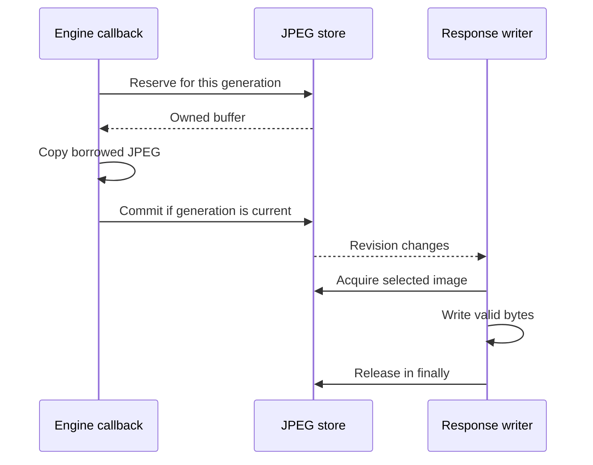

# JPEG delivery

[Internals](../README.md) · [HTTP delivery](01-http-delivery.md) · [Web client](03-web-client.md)

JPEG delivery turns the JPEGs that Capture Engine lends to the capture attempt into images that many HTTP responses can read at the same time. It decides which single image every viewer gets, keeps that image's bytes valid while responses write them, and writes the single-JPEG and MJPEG responses. [Architecture](../../docs/architecture.md#from-engine-frame-to-shared-image) describes the ownership boundary and [what viewers receive](../../docs/architecture.md#what-viewers-receive). The [HTTP server guide](../../docs/server.md#images) defines the wire format. The Engine's [frame contract](../../../../screen-capture-engine/docs/usage.md#handle-jpeg-frames) defines the borrowed frame that all of this starts from.

This guide is for maintainers who change copying, image selection, reader leases, response writing or slow-reader detection.

## Contents

- [Components and terms](#components-and-terms)
- [Copying and publication authority](#copying-and-publication-authority)
- [Capture generation and image selection](#capture-generation-and-image-selection)
- [Reader pinning and leases](#reader-pinning-and-leases)
- [Pooling and memory limits](#pooling-and-memory-limits)
- [Writing JPEG and MJPEG](#writing-jpeg-and-mjpeg)
- [Slow-reader observations](#slow-reader-observations)
- [Implementation and verification](#implementation-and-verification)

## Components and terms

| Component | Lifetime | Responsibility |
| --- | --- | --- |
| Capture session (`MjpegCaptureSession`) | One capture attempt | Decides the capture status and the capture generation. Copies each borrowed JPEG into the store from the Engine callback. [Capture lifecycle](../01-module/02-module-lifecycle.md) owns it. |
| `JpegStore` | One HTTP delivery | Holds the logo, the latest captured frame, one spare buffer, the applied status and generation, and the inactive-image policy. Selects the image and counts leases. |
| `JpegStore.Reader` | One admitted media response | Holds the initial lease and the right to acquire later images |
| `JpegResponse` | One admitted media response | Writes JPEG or MJPEG, holds each acquired lease while writing, and reports progress and slow status |
| HTTP delivery | One module instance | Admits and cancels responses and retires their accounting ([HTTP delivery](01-http-delivery.md)) |

These terms are used throughout:

- **Capture generation**: an identity object, a fresh `Any()`, for one period in which the current capture attempt may publish images. A generation is never reused, within one attempt or across attempts. Null means publication is revoked.
- **Real frame**: a JPEG copied from capture and tagged with the generation that published it. The **logo** is the app logo, installed once at activation, with no generation.
- **Publication version**: a counter within one delivery. It increases when the logo is installed and with each accepted capture publication.
- **Change revision**: a store-wide counter that wakes waiting writers. It changes on status, generation and policy updates, accepted publications, reader closure and disposal. It carries no payload and queues nothing.
- **Selected image**: the image that a new acquisition receives at that moment. The **image kind** describes it as `live`, `retained`, `logo` or `none`.
- **Lease**: a claim on an image's bytes. While any lease exists, those bytes are not reused.

### Locks and threads

The store has one monitor, innermost in the [module lock order](01-http-delivery.md#locks-and-where-work-runs). The store never calls HTTP or the session while holding its monitor. Two boundaries keep long or reentrant work away from that monitor:

- **Byte copy.** The producer's copy body runs while none of the three locks is held. The reservation before it and the commit after it each take the store monitor briefly.
- **Writer wake-ups.** The store increments its change revision after leaving its own monitor, because a resumed writer may enter HTTP code. The caller can still hold an outer lock at that point: registration, status, configuration and disposal updates arrive under the HTTP control monitor, and status commits also hold the session's state gate.

The store assumes one serialized producer, which the Engine provides because callbacks for one registration don't overlap. It allows any number of readers.

## Copying and publication authority

The Engine lends each JPEG as an `EncodedFrame` that is valid only on the callback thread until the callback returns. The capture session's callback moves its bytes into the store in six steps:

1. **Authority.** Under its state gate, the session reads fresh Engine state and the committed capture generation. If the generation is null, it drops the frame.
2. **Offer.** Outside the gate, it calls `offerJpeg(generation, byteCount, copyTo)` on HTTP delivery, which passes the offer straight to the store without the control monitor.
3. **Reserve.** Under the store monitor, the offer is rejected if the store is closed or the generation isn't exactly the current one. Otherwise the store takes the spare buffer, if there is one.
4. **Copy.** Outside every monitor, the store requires a positive `byteCount`. It reuses the spare buffer when its size is at least `byteCount` and at most twice that, and otherwise allocates an exact-size array. It invokes `copyTo` once. The copier writes exactly `byteCount` bytes from offset zero and must not keep the array. The session checks the count that the Engine's `copyTo` returns.
5. **Commit.** Under the store monitor, if the same generation is still current, the copy becomes the latest real frame with the next publication version. Otherwise the buffer goes back to the spare slot, and the version doesn't change.
6. **Wake.** The store wakes waiting writers. If the selected image kind changed, for example from logo to live, delivery republishes web state. Ordinary new frames don't change web state.

A delayed callback keeps the generation it read in step 1 for the whole offer, so a copy that finishes after Stop or a suspension is discarded at commit. Because generation identity alone rejects offers from old attempts and earlier periods, offers carry no attempt ID.

If allocation or the copy throws, the store returns the reserved or newly allocated buffer to the spare slot and rethrows. It does the same when an admitted offer has a non-positive `byteCount`. The session records the exception as a capture failure at stage `Output.frame`, and the attempt ends. Disposal of the store prevents a late copy from publishing or from refilling the spare slot.

Neither the borrowed frame nor the copier may be retained or used for asynchronous writing. Responses read only the store's own copy.

## Capture generation and image selection

The capture session decides the generation, and the store applies it and enforces it. Status and generation updates carry the attempt ID, and the store ignores updates from any attempt other than the registered one.

### Registration

Before an attempt starts, the Controller creates its initial generation and registers it through HTTP delivery. The store records the attempt and the generation and sets the status to Starting. It keeps the latest real frame and doesn't disturb readers. That frame belongs to an older generation, so selection follows the inactive-image policy until a frame of the new generation arrives.

The initial generation stays in force through consent and Engine startup. Publication therefore doesn't depend on the order in which the attempt sees `start()` return and the first callback. A return from `start()` confirms a usable configuration, not a JPEG ([Engine session contract](../../../../screen-capture-engine/docs/usage.md#run-a-capture-session)).

### Status and generation

[Capture lifecycle](../01-module/02-module-lifecycle.md) owns these decisions. This table summarizes what they mean for selection:

| Session status | Generation the session sends | Effect on selection |
| --- | --- | --- |
| WaitingForPermission, Starting, Reconfiguring | Unchanged, including null | None |
| Active | The current generation, or a new one if publication was revoked | The image becomes `live` once a frame of that generation is published |
| Suspended, Stopping, Stopped, Failed | Null | The inactive image is selected. The latest real frame is kept. |

The session reads fresh Engine state inside each frame callback, so it can open a recovered generation before the Controller's queue sees the change. An accepted Stop or failure is permanent within the session, so a late Engine Active can't reopen publication. State flows can skip transitions, so the generation fence covers the revocations that the session actually observes. If a brief suspension is skipped, the current generation simply continues.

### The selection rule

- If the latest real frame belongs to the current non-null generation, it is selected (`live`).
- Otherwise the saved **Inactive stream image** decides. App logo (`Placeholder`) selects the logo. Last frame (`LastAvailableFrame`) selects the latest real frame (`retained`), or the logo if no real frame exists.

Selection doesn't depend on the status itself. The same rule covers the time before the first Start, consent, startup before the first frame, suspension, Stop and failure. A policy edit changes the selection immediately and keeps the latest real frame. That frame survives later attempts, listener changes and credential rotation. Only a newer publication or disposal of the store replaces it.

A failed attempt that cleaned up successfully leaves the status at Failed, and so the `failed` notice, until the next registration. A capture-cleanup failure closes the module ([Capture lifecycle](../01-module/02-module-lifecycle.md)).

The logo is installed before delivery admits any request, so an active delivery always has a selected image. The kind `none` occurs only before activation or after disposal. Web state is null at those times, so `none` and the matching no-image `503` are defensive outcomes of the protocol.

Ordinary Stop and generation changes keep media responses alive. An MJPEG response simply moves on to whatever is selected next. An existing MJPEG reader with no selected image waits for a change or for its own closure. A new request without an image is rejected at [HTTP admission](01-http-delivery.md#request-admission-and-cutoff).

### Disposal

When HTTP delivery stops, it disposes the store. Disposal closes the store and drops the logo, the latest real frame and the spare buffer. It also clears the attempt and generation, and it wakes writers, which then end. Leases already handed out stay valid until their writers release them.

## Reader pinning and leases

HTTP admission calls `openReader` before writing any header. Under the store monitor, the reader acquires the current selection as its **initial lease**. That lease fixes the `/jpeg` `Content-Length` even if the selection changes before the body is written. The reader keeps the lease until one of two things happens:

- the writer's first `acquireFrame` hands the lease over;
- `close` releases it while it is still unclaimed.

If the reader closes before the handover, a `/jpeg` response ends without its announced body, so the client receives fewer bytes than the `Content-Length` promised.

After the handover, every successful `acquireFrame` needs exactly one `releaseFrame`. The writer keeps an acquired image through the last byte it reads and releases it in `finally`, before the multipart footer and flush. Closing the reader stops future acquisitions but can't invalidate a lease the writer already holds. Interrupting active I/O is the job of HTTP delivery, which cancels the call job.

Image metadata never changes, but `ByteArray` is mutable. The valid prefix `[0, byteCount)` must stay unmodified while any reader can access it. Spare capacity beyond that prefix is never sent. The logo array is transferred to the store at activation. Captured frames count their leases, so neither replacement nor disposal can reuse bytes that are still leased.

An MJPEG writer reads the change revision **before** it tries to acquire. If acquisition returns nothing, the writer ends when the reader is closed. Otherwise it waits until the revision differs from the value it read. Reading the revision first closes the gap between the availability check and the wait, so a publication or closure in that gap can't be missed. A waiting writer holds no lease.

## Pooling and memory limits

The store keeps one spare buffer. An offered JPEG reuses it when the buffer is large enough and no more than twice the JPEG's size. Otherwise the producer allocates an exact-size array. When a newer frame replaces the latest real frame, the old array returns to the spare slot only after its last lease is released, and only if the slot is empty and the store is still open.

One latest frame and one spare buffer are not a bound on total memory. At any moment memory can also hold the logo, an in-flight copy, older arrays still leased by slow writers, and library or transport buffers. The store doesn't limit connections or the number of leased payloads.

Responses share the store's bytes and always move on to the newest selection, so the store keeps no backlog. Ktor, CIO and chunked multipart encoding can still buffer or copy payload data on the way out. [CIO transport and limits](01-http-delivery.md#cio-transport-and-limits) describes how a stalled reader holds resources and which cutoffs exist.

## Writing JPEG and MJPEG

The public [image contract](../../docs/server.md#images) defines the framing. One `JpegResponse` serves each admitted media call.

### Single JPEG

The response announces `Content-Length` from the initial lease. The body takes over that lease, writes the payload, releases the lease and flushes. If the reader was closed before the handover, nothing is written, and the response ends short of its announced length.

### MJPEG

The response declares the multipart type with boundary `screenstream-jpeg` and no length. It writes the first boundary line once and then repeats this loop:

1. Check for cancellation, read the change revision, then acquire the selected image.
2. If nothing was acquired, return when the reader is closed (by cutoff, rotation, disposal or retirement). Otherwise wait, without a timeout, until the revision changes. Cancellation interrupts the wait.
3. If the image has the publication version that was written last and less than a second has passed since that write finished, release it. Wait for a revision change for at most the remaining time, then go back to step 1.
4. Otherwise record the [slow-reader observation](#slow-reader-observations) and write the part headers and payload. Release the lease in `finally`. Write CR LF plus the next boundary line, and flush. Remember the version, and allow the next repeat one second later.

Every completed part is followed immediately by the next boundary line, and the closing boundary is never written. A stream that ends between parts therefore ends right after a boundary line, while a cut stream ends partway through a part. Repeats send the same publication again, whether it is a live frame, a retained frame or the logo, about once a second while nothing new is selected. A selection change wakes the wait without building a backlog.

The change revision is store-wide, so every waiting writer wakes for every relevant change, including another response's reader closing. A writer that finds nothing new goes straight back to waiting. These wake-ups are cheap but untargeted.

### Progress and cleanup

Counts advance as soon as a payload has been written to the response channel, before the footer and flush. A partial payload adds nothing. A later failure of the footer or flush doesn't undo a payload already counted. Repeated images count as separate payload writes. [Client history and statistics](01-http-delivery.md#client-history-and-statistics) owns the transfer of these counts into totals and their interpretation.

`respond` closes the reader in `finally`. This includes the case where the engine fails before invoking the body writer, which would otherwise leave the initial lease unclaimed. Each acquired image is released separately, in the body writer's own `finally`.

## Slow-reader observations

Slow status counts **skipped capture publications** in one MJPEG response. It doesn't measure bandwidth, latency or decoding speed. Each MJPEG writer looks only at the image it acquired: that image's capture generation and publication version. It never asks the store which generation is current. Logo images are neutral, and `/jpeg` responses make no observations.

The observation is made when a part is about to be written, before its headers, so a part whose payload later fails still counts as observed:

- The first real frame from a generation the response hasn't seen sets a baseline and resets the skipped count to zero.
- A later, different publication from the same generation adds `max(current version − previous version − 1, 0)` to the count, capped at five.
- A consecutive publication, where that difference is zero, resets the count to zero and clears slow status.
- A repeat of the same publication changes nothing.
- When the count reaches five, the response is slow.

A frame retained from an earlier generation can still reset the baseline, because the writer doesn't know that its generation was revoked. A reset or recovery observed against an obsolete generation therefore doesn't mean the reader has caught up with live capture.

The response keeps its baseline version and count in private fields. Its published `Progress` is an immutable snapshot in a volatile field, written only by the response's writer. It holds the observed generation, the slow flag and the completed-payload counters, never a leased array.

[HTTP sampling](01-http-delivery.md#consumer-presence-and-slow-readers) decides when a row shows as slow and how the Controller's warning consumes it.

## Implementation and verification

- [JpegStore](../../src/main/kotlin/io/screenstream/mjpeg/http/media/JpegStore.kt) owns copies, generation fences, selection, readers and leases. [JpegResponse](../../src/main/kotlin/io/screenstream/mjpeg/http/media/JpegResponse.kt) owns framing, writing, repeats, progress and slow observations.
- [MjpegCaptureSession](../../src/main/kotlin/io/screenstream/mjpeg/MjpegCaptureSession.kt) connects borrowed JPEGs from the [Engine adapter](../../src/main/kotlin/io/screenstream/mjpeg/MjpegCaptureEngineAdapter.kt) to HTTP delivery. [HTTP delivery](01-http-delivery.md) owns physical call completion and cancellation.
- The [media scenarios](../03-testing/scenarios/07-media.md) describe the histories this guide requires; [Testing](../03-testing/01-testing.md) covers environments and evidence.
