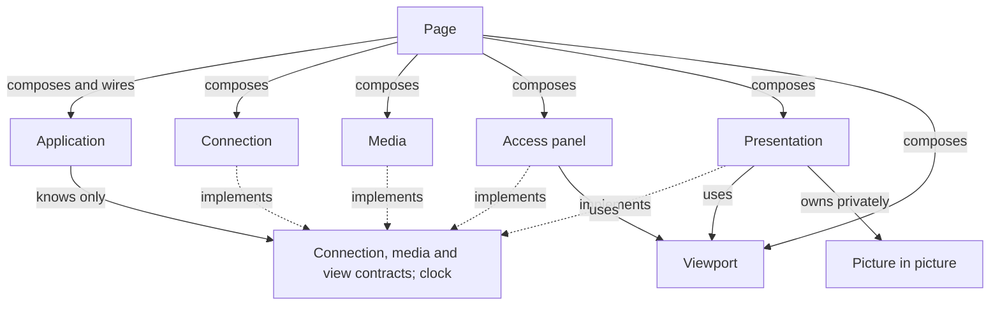

# Web client

[Internals](../README.md) · [HTTP delivery](01-http-delivery.md) · [Web client tools](../../tools/web-client/README.md)

The web client has two halves. On Android, the **route adapter** (`WebRoutes` and `WebState`) installs HTTP delivery's routes into each listener and carries viewer state over WebSocket. In the browser, the **packaged page** reads that state, asks for a PIN when needed, shows the images and recovers from interruptions. The public [HTTP server guide](../../docs/server.md) owns the protocol both halves speak, and [Watching in the browser](../../docs/usage.md#watching-in-the-browser) owns the controls that viewers see.

This guide explains, for maintainers, the adapter's ordering and parsing rules and the page's owners, timers and recovery rules. [HTTP delivery](01-http-delivery.md) makes every admission decision; the adapter only gathers the request facts that delivery needs and applies the result.

## Contents

- [Routes and response headers](#routes-and-response-headers)
- [Request authority, origin and credentials](#request-authority-origin-and-credentials)
- [PIN body parser](#pin-body-parser)
- [WebSocket snapshots and transport](#websocket-snapshots-and-transport)
- [Browser owners and recovery](#browser-owners-and-recovery)
- [Presentation and browser-local choices](#presentation-and-browser-local-choices)
- [Fullscreen and picture in picture](#fullscreen-and-picture-in-picture)
- [Source, build workflow and verification limits](#source-build-workflow-and-verification-limits)

## Routes and response headers

There is one `WebRoutes` per HTTP delivery. Each new listener's Ktor application receives:

- `DefaultHeaders`, which adds `Server: ScreenStream` and `Date`;
- the WebSocket plugin, configured as described in [WebSocket snapshots and transport](#websocket-snapshots-and-transport);
- a pipeline interceptor that runs before routing;
- the routes;
- a send-pipeline hook that adds `Allow` to `405` responses based on the path.

The interceptor handles every request in this order:

1. It appends `Cache-Control: no-store`, `X-Content-Type-Options: nosniff` and `Referrer-Policy`, which is `no-referrer` when the query contains `token` and `same-origin` otherwise. Rejections carry these headers too.
2. It checks the `Host` syntax. There must be exactly one ASCII `Host` without userinfo, path or query, and any port must be digits. Failure returns `400`.
3. It checks authority and listener. The `Host` must name this listener (see [below](#request-authority-origin-and-credentials)), and delivery must still consider the listener current. Failure returns `403`.

Routing then handles `/`, `/favicon.ico`, `POST /pin`, `GET` and `OPTIONS` on `/jpeg` and `/mjpeg`, and `/ws`. Unknown paths return `404`, and known paths called with another method return `405`. The [public route table](../../docs/server.md#routes) lists the responses.

The viewer HTML and favicon are read lazily from the APK assets, once per delivery, and shared by all listeners. The HTML is generated from the [web-client sources](../../tools/web-client/README.md) and contains its CSS, script and logo. No settings or credentials are injected into it, because appearance and image state arrive through authorized snapshots. Compression applies only to `GET /` responses that carry HTML with status `200`. The media routes add their CORS headers before asking delivery for admission, so `403` and `503` responses carry them too. `OPTIONS` always returns the same `204`.

## Request authority, origin and credentials

### Host and listener

The adapter derives a **trusted origin** from `Host`:

- The host must be a numeric IPv4 or IPv6 literal, or `localhost`, and the port must equal the listener's port. A `Host` without a port is treated as port 80. HTTP delivery itself accepts any port from 1 to 65535, but saved settings allow only 1024–65535, so for the app's listeners a `Host` without a port never matches.
- The literal's address bytes must equal the listener's address bytes. The listener's IPv6 scope suffix is ignored for this comparison.
- `localhost` is accepted only when the listener's address is a loopback address.

A syntactically valid `Host` that isn't a matching numeric address therefore gets `403`, not `400`. Examples are a DNS name or an IPvFuture literal. `Forwarded` and `X-Forwarded-*` headers are never consulted. The [public authority rules](../../docs/server.md#host-and-origin-checks) define the accepted client forms.

### Origin matching

`Origin` and `Referer` values are parsed into a lower-case host text, without brackets, and an effective port. They are compared with the trusted origin as text. Matching `Host` against the listener is byte-based, but matching `Origin` against `Host` is text-based. Two spellings of the same IPv6 address can therefore pass the `Host` check and still fail the `Origin` check. `Origin: null`, other schemes, userinfo and fragments never match. Keep this distinction if you change the parsing.

### Which credential each route reads

| Route | Origin evidence required | Credential read |
| --- | --- | --- |
| `GET /?token=…` | None | The token. A valid token sets the cookie, and every token request is redirected to `/` with `303`. |
| `POST /pin` | `Origin`, or a same-origin `Referer` when `Origin` is absent | The PIN in the body |
| `/ws` | `Origin`. `Referer` isn't accepted. | The cookie only, never the token |
| `/jpeg`, `/mjpeg` | None | The `token` query parameter, or the cookie unless the request looks cross-origin |

A media request looks cross-origin when any of these holds:

- `Origin` is present but isn't exactly one value equal to the trusted origin;
- `Sec-Fetch-Site` is present but isn't exactly one of `same-origin` or `none`;
- `Referer` is present but isn't exactly one same-origin value.

In that case the cookie is ignored, but the token still works.

The packaged page never reads its own URL query; its only use of `location` is to build the `/ws` address. An access link's token is consumed by the server, which sets the `HttpOnly` cookie and redirects to `/`. The token leaves the address bar, and the page script never sees the token or the cookie. Everything the page does afterwards (`/ws`, media and `/pin`) is a same-origin request that relies on the cookie.

### Peer identity

PIN records and client rows use CIO's immediate peer address, `remoteAddress`. Forwarded headers grant no authority and don't replace that address. [Access generations and PIN blocks](01-http-delivery.md#access-generations-and-pin-blocks) owns credential rotation and block lifetime across listeners and tabs.

## PIN body parser

The Origin check runs before the body is read. The parser then works as follows:

- If the content type, without parameters, isn't `application/x-www-form-urlencoded`, the result is no PIN.
- It reads at most 257 bytes, one more than the 256-byte limit so that it can detect an oversized body, within a five-second timeout. A body over 256 bytes yields no PIN, and the rest of the body isn't read.
- It decodes the bytes as UTF-8 and parses them as a query string. Invalid UTF-8 becomes replacement characters, which can't form a valid PIN. Invalid percent-encoding yields no PIN.
- The result is the single `pin` field. A missing or repeated `pin` yields no PIN.

"No PIN" is passed to delivery, which counts it as a wrong PIN on a protected stream. Read failures, the timeout and cancellation propagate out of the handler without an adapter-specific status, before verification, and they don't count as attempts. Delivery replies `Authorized`, `Wrong` or `Blocked`, or nothing if the listener stopped being current. The adapter maps those replies to `204` (with the cookie, if there is one), `403`, or `429` with `Retry-After` in whole seconds rounded up. A missing reply also becomes `403`. The [public PIN contract](../../docs/server.md#pin-verification) specifies the accepted input.

## WebSocket snapshots and transport

### State object

[WebState](../../src/main/kotlin/io/screenstream/mjpeg/http/web/WebState.kt) is an immutable value that delivery rebuilds under its control monitor after every relevant change. It is null before activation and from the start of shutdown. It contains:

- the credential generation, an internal fence that is never serialized;
- whether access is open;
- the capture notice derived from the session status;
- the selected image kind;
- the page settings.

Equal values don't produce a new emission, so ordinary new frames of the same image kind don't wake state connections. The [public schema](../../docs/server.md#state-connection) owns the serialized fields and notice values. The page and server ship together, and the page rejects values it doesn't know (see [Connection](#connection-and-explicit-pin-submission)). A change to the schema's values must therefore update both in the same change.

### Connection flow

1. **Origin.** If the request lacks a matching `Origin`, the adapter closes the connection with code `1008` and reason `Origin rejected`.
2. **Admission.** Delivery decides admission. On denial, the adapter sends one JSON message, `pin_required` or `blocked` with `retryAfterMs`, then closes with `1000` and reason `Access required`.
3. **Read-only guard.** An admitted connection starts a reader that waits for one incoming frame. Any application data closes the connection with `1008` and reason `Read-only connection`. That includes data that was already queued when admission completed. Ktor handles ping, pong and close frames itself, so they never reach the guard. When the incoming side ends or fails, the reader cancels the connection scope, which also stops a writer that is waiting for the next state.
4. **State loop.** The writer reads the current state. If the state is null or carries another credential generation, the connection ends by cancellation. Otherwise the writer encodes the state, asks delivery once more whether the listener is current and the generation matches, and sends. It then waits for a different state, or for two seconds, whichever comes first. The two-second repeat is the liveness signal that the page relies on.

Revocation, listener removal and shutdown end the connection by cancellation rather than through the voluntary close handshake. A reconnecting client learns the new requirement from its first message.

### Limits and settlement

| Limit | Value |
| --- | --- |
| Ping period and timeout | 15 seconds each |
| Largest incoming frame | 4096 bytes |
| Incoming queue | 4 frames, with Ktor's `CLOSE` overflow policy |
| Outgoing queue | 8 frames, with Ktor's `SUSPEND` overflow policy: overflow suspends the sender |
| Encoded snapshot | 256 KiB of UTF-8. A snapshot at exactly the limit is sent. A larger one closes with `1011` and reason `Page settings exceed snapshot limit`. |
| Send plus flush | 5 seconds |
| Voluntary close plus joining the session | 5 seconds |

These limits apply to particular queues and frames, not to all transport memory. The incoming setting bounds the queue of data frames that the handler reads. Under `CLOSE`, Ktor closes that queue once it reaches capacity, and frames already buffered stay readable ([`ChannelOverflow`](https://github.com/ktorio/ktor/blob/3.6.1/ktor-shared/ktor-websockets/common/src/io/ktor/websocket/WebSocketChannelsConfig.kt), [default session](https://github.com/ktorio/ktor/blob/3.6.1/ktor-shared/ktor-websockets/common/src/io/ktor/websocket/DefaultWebSocketSession.kt)). Overflow therefore doesn't guarantee that the physical connection closes before admission finishes or before the read-only guard reads a buffered frame. The app's contract is the one in the [connection flow](#connection-flow): after admission, application data closes with `1008`. Physical closure, call settlement and the close budget are separate facts, covered below.

The handler captures Ktor's detached default-session job before entering the close timeout, because the timeout introduces its own coroutine context.

When the handler exits for any reason, it cancels the raw request job and the default-session job, then joins the default-session job in a non-cancellable context. It must not join its own request job, because that would deadlock. Joining the default-session job lets [HTTP terminal cleanup](01-http-delivery.md#terminal-cleanup) rely on call completion. Ktor's [WebSocket documentation](https://ktor.io/docs/server-websockets.html) covers the ping, timeout and frame-size options. Whether the socket is actually released still needs transport and platform evidence.

## Browser owners and recovery

The page has one state owner, the application, and several resource owners. The application holds every fact that more than one owner depends on and makes the cross-component decisions. Resource owners hold browser objects and timers, check their own identities before acting, and report facts back. State and images travel separately, so a usable image stays visible while a replacement connection or image is prepared.

| Owner | Resources and decisions |
| --- | --- |
| [Application](../../tools/web-client/src/application.js) | Page lifecycle and revalidation, the latest server message, transport state, the PIN panel with its block deadline and countdown timer, media phase and frame size, the media method, the transient notice, and the selectors that derive media requests and the view |
| [Connection](../../tools/web-client/src/connection.js) | WebSocket, snapshot validation, connection and liveness timers, reconnection, admission probes and the single PIN request |
| [Media](../../tools/web-client/src/media.js) | The displayed image and its lifetime, at most one replacement candidate, the attempt number and retry timers |
| [Access panel](../../tools/web-client/src/access.js) | PIN draft, field feedback, focus and panel layout |
| [Presentation](../../tools/web-client/src/presentation.js) | Shared appearance, local sizing, the status, method, menu and info DOM, fullscreen, and a private picture-in-picture owner |
| [Viewport](../../tools/web-client/src/viewport.js) | The usable safe rectangle and viewport events |
| [Picture in picture](../../tools/web-client/src/picture-in-picture.js) | Canvas, video, tracks, attempt timers and serialized native operations |
| [Page](../../tools/web-client/src/page.js) | Constructing and wiring the owners, forwarding page lifecycle events, and starting them |

The diagram shows what each source knows, not the direction of calls or callbacks. The contracts are conceptual interfaces, not a separate file. Only the application changes shared state, and it sees only the injected contracts and the value facts they report. Connection and media accept commands and report through injected callbacks, without knowing the application, the UI or each other. The access panel and presentation work on the DOM and the viewport and report user intents the same way. Only presentation owns picture in picture.

### Application state and transactions

- **Separate facts.** Transport state says whether the state socket is connecting, reconnecting, connected or unsupported. The latest server message says whether the server admitted or denied the page. Each connection start sets `pin.checking`, and the next server answer or block expiry clears it. While it's set, the connection status follows transport rather than a stale denial. The block deadline is local, derived from `retryAfterMs`.
- **Revalidation.** The page starts out revalidating, and a denial or a pause sets revalidation again. Only an authorized snapshot accepted while the page isn't paused clears it. Neither a PIN `204` nor an expired countdown, which reopens PIN entry, makes media eligible.
- **Selectors.** Pure functions of the state, plus the current time for the countdown and notice expiry, return the media request (eligibility, image kind and method) and the view model: the primary message, connection and image labels, capture notice, frame size, method availability and the PIN panel. They don't touch the DOM or timers.
- **Transactions.** Every owner callback, user intent, lifecycle event and application timer is dispatched as an action. Actions raised while another runs, including synchronous reports from media or connection, are queued into the same transaction. Once the queue drains, a primary message clears the transient notice, and the view model is rendered to the access panel and presentation. Rendering doesn't change application facts, although presentation keeps its own local UI state and timers. User input returns later as a new action.
- **Start.** The page starts the UI owners and viewport, then the application renders its initial state before it opens the first connection.

### Connection and explicit PIN submission

The connection opens `/ws` on the page's own host. Every message passes a strict validator. A denial message must say `pin_required` or `blocked`. An authorized snapshot must contain every field with a known value, and a `hasImage` that agrees with `imageKind`. Unknown extra fields are tolerated. A message that fails validation is treated as a broken connection.

- **Timing.** A new socket has ten seconds to deliver an accepted snapshot. Each accepted snapshot restarts a five-second liveness timer. If the timer runs out while the page is visible, the connection reconnects. While the page is hidden, an expired timer is left for the [visibility-return check](#page-suspension-and-visibility-return).
- **Reconnection.** Delays run 0, 1, 2 and 4 seconds, then 5 seconds repeatedly. Socket handlers and timers check that they still belong to the current socket before acting. Disposal clears handlers and timers and closes the socket. Losing state leaves the displayed image in place.
- **Forced media restart.** The first authorized snapshot after the connection state was not `connected` restarts media, even if the snapshot is identical to the previous one. This is how a reconnection or **Retry connection** retries a failed image.

**Denied admission** uses short-lived sockets. After a denial, the connection schedules another probe after five seconds, or at the reported block expiry if that is sooner, with a minimum delay of 100 ms. A hidden page that is denied doesn't open probes. Its next check happens when it becomes visible. The block countdown is only feedback, and the next server answer decides access.

**PIN submission** is forwarded only while the PIN panel is open, not blocked and not already sending. The connection first checks for six ASCII digits locally. It then disposes the probe socket, so an older admission reply can't overtake the explicit login. It allows one XHR at a time, with a ten-second timeout:

- `204` closes the access panel and reconnects state.
- `403` reports a wrong PIN.
- `429` shows a block for the integer `Retry-After` seconds, or one second if the header is missing or invalid.
- Any other status, an error or the timeout reports a network failure, and the panel offers a retry.

When the request finishes and access is still denied, probing resumes. Pausing the page aborts the pending request, and late callbacks check the request's identity before acting.

### Media replacement and polling

Media is eligible only when the page isn't paused or revalidating and the latest snapshot is authorized with kind `live` or `retained`. Media owns the displayed image and removes it; presentation only borrows it for layout and picture in picture.

- **Kept.** Ordinary reconnection, including **Retry connection** and a reconnect on visibility return, doesn't set revalidation or revoke the displayed image. Media's own failure rules still apply.
- **Kept.** A `retained` selection, for example after Stop with **Last frame**, stays eligible, including while Android's permission prompt is pending, so its frame isn't revoked.
- **Revoked.** Denial, a `logo` or `none` selection, and page pause revoke the borrowed frame, which stops picture in picture, and release the displayed image and the candidate. A new frame reported while media is ineligible is ignored.

With **App logo** as the inactive image, Stop therefore closes the page's MJPEG request, and the next eligible snapshot opens a new one. The page doesn't use the server's ability to keep a response open across Stop. For `logo` the page shows its built-in logo without a request.

Each media attempt has an attempt number and a hidden candidate `` whose URL is `/mjpeg` or `/jpeg` with a throwaway `requestSequence` query. Load, decode, error and timeout callbacks must match both the attempt number and the candidate before they act:

- **Promotion.** A candidate is promoted only with positive intrinsic dimensions. A JPEG candidate must also be complete and decoded. Promotion swaps the candidate into place and removes the old image.
- **First-image deadline.** Ten seconds bound the wait for the first usable image of an attempt. They don't bound the freshness of an MJPEG stream that is already showing.
- **Failure.** A failed replacement keeps the previous usable image. An error or loss of dimensions on the displayed image clears it. If a replacement is already loading or scheduled, that replacement keeps its own deadline.
- **Retries.** After a failure, replacements are scheduled after 0, 1, 2, 4 and 8 seconds. After that the page offers **Retry connection** and the other method. A successful promotion resets this budget.
- **Snapshots and restarts.** The first snapshot on a new connection, and any snapshot that newly makes media eligible, restart media automatically. Other eligible snapshots leave healthy, retrying and exhausted attempts alone, so repeated snapshots neither spend nor reset the budget.

MJPEG is the default method. JPEG polling is single-flight. After a `live` promotion the next request starts at once, and after a `retained` promotion it waits 500 ms. A switch from `retained` to `live` during that wait starts the next request immediately. Intrinsic dimensions are checked every 500 ms to report size changes and detect lost image data. The method choice lives in page memory, survives reconnection and resets on reload.

Image-element events show that usable image data exists. They don't reveal HTTP status, the exact transport cause, delivery of each MJPEG part or repaint progress. The page keeps the displayed element itself rather than a separate pixel copy of the last MJPEG frame. See [HTML image processing](https://html.spec.whatwg.org/multipage/images.html#updating-the-image-data).

### Page suspension and visibility return

`pagehide` and `freeze` pause the page. Pausing:

- marks the page paused and revalidating, so late connection reports are ignored and media stays ineligible;
- closes the socket and stops connection timers;
- aborts any pending PIN request;
- revokes the frame and releases media and picture in picture;
- clears transient notices;
- stops the block countdown timer.

`pageshow` and `resume` restart a paused page with a fresh connection, and media returns only after that connection's first authorized snapshot. The access panel keeps its PIN draft and field error, and the application keeps the block deadline, across a pause.

When the page becomes hidden, it only records the time and leaves its work running. When it becomes visible again:

- a paused page resumes;
- after more than 30 seconds hidden, the state socket is replaced;
- otherwise, if the socket isn't open or its last accepted snapshot is five or more seconds old, the page reconnects;
- otherwise a healthy connection resumes missing media.

Browser timer scheduling and background throttling can delay every deadline here. [HTML timers](https://html.spec.whatwg.org/multipage/timers-and-user-prompts.html#timers) give no exact timing guarantee, so recovery times are approximate.

## Presentation and browser-local choices

Shared appearance comes from authorized snapshots. Sizing mode, media method and the **More** menu are local to each page. The background must be a `#RRGGBB` value, and anything else falls back to the default. Bar text switches between dark and light, whichever contrasts better with the background. The stream name is written as text, never as HTML. The tab title is the stream name, or the app name when the name is empty. An unchanged appearance snapshot doesn't restart the auto-hide timer. [Web page](../../docs/usage.md#web-page) describes these settings from the user's side.

The page shows one primary message at a time, in this order of priority:

1. access (the PIN panel itself);
2. an unsupported browser;
3. connection progress;
4. media failure or retry;
5. the capture notice;
6. waiting for the first image.

A primary message clears any transient notice, such as a fullscreen or picture-in-picture error. Otherwise a transient notice disappears after ten seconds. State and images can describe different moments.

Bars reserve their measured space, and overlays cover the image. Only overlays set to auto-hide disappear, after four seconds without interaction. They stay visible while a pointer is pressed or over a control, while the menu is open, or while keyboard focus is in the controls or menu.

The viewport owner intersects the layout size, the visual viewport when the page isn't zoomed (or the window size where `visualViewport` is missing), and the CSS safe-area insets, keeping a small margin at the top and bottom. Floating keyboards and older browsers can report geometry that doesn't reveal occlusion. A page inside an iframe can't see what covers the outer browser. The build and preview fixtures don't check layout, keyboard focus, screen-reader behavior or reduced motion.

## Fullscreen and picture in picture

### Fullscreen

Fullscreen uses the standard API or WebKit's prefixed one on the page shell, and the control is hidden unless both a request and an exit method exist. Each press creates an attempt identity. A promise rejection or thrown exception reports failure only for the current attempt. For WebKit methods that return nothing, a standard or WebKit `fullscreenerror` event does the same. A newer press replaces the attempt, and page pause clears it, so stale failures don't show. Standard and WebKit `fullscreenchange` events update the control from the browser's actual state. A failure leaves normal viewing available. The [Fullscreen standard](https://fullscreen.spec.whatwg.org/) defines the native behavior. Feature detection only chooses which API to try.

### Picture in picture

Presentation creates the picture-in-picture owner privately and passes it only the borrowed frame. The control appears only when canvas `captureStream`, video `requestPictureInPicture`, `srcObject` and `document.pictureInPictureEnabled` are all present, and it's enabled only while a frame is shown and no native call is pending. A press creates an attempt that:

- paints the displayed image onto its own canvas every 100 ms;
- gives `captureStream(10)` to a hidden video element;
- after metadata loads, calls `play()` and then requests picture in picture.

A ten-second preparation deadline covers metadata, `play()` and the native request. If the browser answers `NotAllowedError`, the prepared attempt stays ready for 30 seconds. Another press then calls `requestPictureInPicture()` synchronously in its click handler, without preparing again. Any other failure releases the attempt and shows a notice. Every callback checks that its attempt is still current and, where relevant, that its stream or window matches.

Releasing an attempt clears its timers, detaches its stream from the video, stops the tracks, and drops the canvas, context, stream and window references. Pending browser promises keep the attempt object alive, so its media references are released right away. Native enter and exit calls are serialized, because browser promises can't be cancelled. An unresolved native call can therefore delay the next attempt even after the app's resources have been released. A late successful entry from a released attempt is exited before anything else proceeds. Revoking the frame, access denial and page pause release the current attempt and exit an active window. A `leavepictureinpicture` event releases only the active attempt whose window matches.

The presence of the API doesn't prove secure-context, permissions-policy, device or user-activation support. The [Picture-in-Picture specification](https://www.w3.org/TR/picture-in-picture/) defines those conditions.

## Source, build workflow and verification limits

The owner links above point to the authored JavaScript. Shared strings, locales, CSS and the HTML template sit next to them in `src`. [build.cjs](../../tools/web-client/build.cjs) places the locale catalogs and the scripts, in its listed order, inside one strict-mode function, so all files share one scope without modules or transpiling. `strings.js` comes first, and `page.js` comes last to wire and start the page. The final escaped script must parse as ES2015. The [web-client tools guide](../../tools/web-client/README.md) covers the commands, the generated asset, the desktop preview and the browser compatibility target.

The preview builds the same viewer and serves it with a virtual device and its own HTTP and WebSocket server. The tools guide's [commands](../../tools/web-client/README.md#commands) section owns what the Node preview fixtures and [owner tests](../../tools/web-client/test) execute and what still needs browser checks. Neither suite reproduces Android capture history, Ktor or CIO behavior. The route adapter's required behavior is catalogued in the [web protocol scenarios](../03-testing/scenarios/08-web-protocol.md). [Testing](../03-testing/01-testing.md) separates requirements, test sources, fresh execution and platform evidence.
