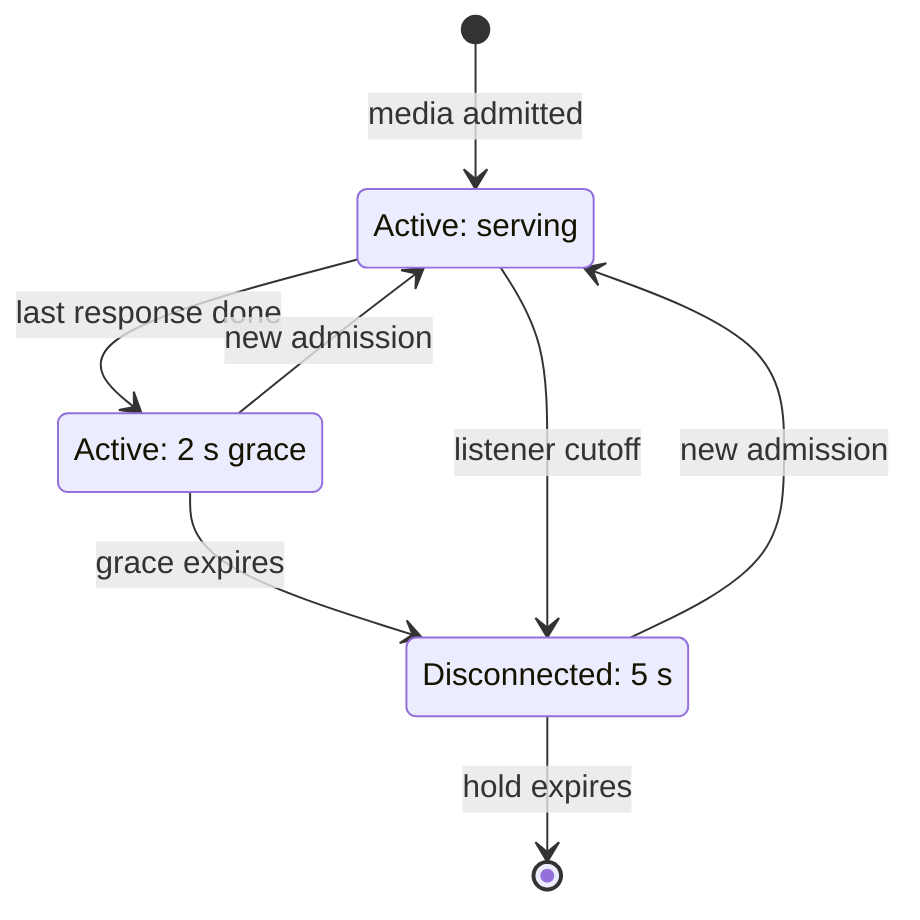

# HTTP runtime scenarios: listeners, request history and totals

[Scenario index](../02-verification-contracts.md) · [Testing MJPEG](../01-testing.md)

This page describes the histories a test needs in order to show how one HTTP delivery runs. It covers the delivery's activation, the address plan it serves, the physical listeners it binds and retires, its terminal stop, and the client rows and totals it reports.

Public behavior is owned elsewhere. The [HTTP server guide](../../../docs/server.md#what-clients-receive) says what clients see when an address stops being served or the mode closes. [Architecture](../../../docs/architecture.md#addresses-listeners-and-readiness) explains how addresses become listeners. [Usage](../../../docs/usage.md#reading-the-statistics) explains how users read the statistics. [HTTP delivery](../../02-delivery/01-http-delivery.md) owns the runtime rules this page tests.

Neighboring pages own related histories:

- [Controller scenarios](02-controller.md) cover which addresses become a plan, when delivery is activated, and rates and history.
- [Access scenarios](06-access.md) cover credentials and PIN blocks.
- [Media scenarios](07-media.md) cover image bytes and payload counting inside one response.
- [Web protocol scenarios](08-web-protocol.md) cover routes and status codes.

These are requirements, not a record of passing tests. [Testing MJPEG](../01-testing.md) explains the test-source coverage and the evidence rules.

## The pieces under test

| Piece | Lifetime | Responsibility |
| --- | --- | --- |
| `KtorHttpDelivery` | One open mode | Control monitor, address plan, admission, configuration, statistics sampling and the shared terminal cleanup |
| Planned server | One server incarnation | UUID, address metadata, port, bind attempts and retry deadline, and the exact current listener |
| Socket owner | One scoped IP and port, while used or retiring | Runs bind attempts and listener cleanup for its socket one at a time, then rereads the latest plan |
| `HttpListener` | One bind attempt | The lifecycle delivery drives for one host and port: start listening, await termination, request stop, and stop with cleanup. The production `CioHttpListener` runs one CIO engine ([HTTP delivery](../../02-delivery/01-http-delivery.md#components-and-lifetimes)) |
| `HttpRequests` | One HTTP delivery | Admitted media and WebSocket requests, client rows and retired totals |

Several terms recur below.

- The **plan** is the list of addresses and the shared port that the controller asks delivery to serve.
- An **incarnation** is one planned server, identified by a UUID that the app also uses for **Retry**. Metadata edits and bind retries keep the UUID. Removing and re-adding an address, or changing the port, creates a new incarnation.
- A **scoped socket** is an IP address (with its IPv6 scope) plus a port. At most one engine exists for a scoped socket at a time.
- **Retirement** is the physical end of a listener: its cleanup has finished, which for `CioHttpListener` means its engine job has been joined and Ktor has been stopped. Cancellation only requests that end.
- A **client row** represents one immediate peer endpoint: server UUID, remote IP and remote port. It is not a person or a browser tab.
- A **sample** is the once-a-second statistics publication. Server state and failures publish between samples.

A client row moves through these states:

Credential rotation and terminal stop remove rows immediately. A request already in flight still adds its final bytes to the global totals.

### Evidence layers

[Testing MJPEG](../01-testing.md#choosing-an-environment) defines levels L0 to L2 and their limits.

`HttpRequests` is plain Kotlin with explicit time and suits L0. `KtorHttpDelivery` reads Android's elapsed-realtime clock and runs its sampler and socket owners on a real IO dispatcher, so its histories need L1 with that clock controlled. Coroutine virtual time doesn't move it. Independent-bind histories need host IPv4 and IPv6 loopback addresses.

Registry histories establish the accounting rules. Real writers and real call completion establish nonzero output and physical settlement. A joined job establishes coroutine completion. Socket release needs an externally observed closure or a successful rebind.

## Activation and the address plan

### One delivery activation

**History.** Before any capture, configure plans with zero and with several addresses, still before activation. Activate, then activate again. In a separate history, request Stop before activation and then try to activate.

**Expected.**

- Before activation, every planned server is published as Pending and no socket work starts.
- The first accepted activation returns true and opens admission, even with an empty or unbound plan. It starts binding without any registered capture, and the HTTP lifetime is independent of capture.
- A repeated activation returns false and installs no second logo.
- After Stop, activation returns false and delivery stays closed; the logo wasn't transferred.
- An accepted activation transfers the logo bytes to the store. A Stop that races an accepted activation can make `start` return false after the store has already taken the bytes, so callers never reuse the array after calling `start`.

### Plan validation

**History.** Supply ports 1 and 65535, and reject 0 and 65536. Separately supply duplicate address IDs, two addresses that share a scoped socket, and a changed scoped IP under a retained address ID. Run each case before activation, after activation and after terminal stop.

**Expected.**

- Ports 1 and 65535 are accepted.
- An invalid plan throws to the caller. It keeps the planned membership, the incarnation UUIDs, the listeners and the published server list.
- After terminal stop, every later plan, valid or not, is ignored without an error.
- The range `1..65535` at this boundary is deliberately wider than the saved setting's `1024..65535`, which [Settings](../../01-module/04-settings.md) owns.

The changed-scoped-IP check runs while retained entries are being matched. When it fails, metadata edits for retained entries listed earlier in the same plan have already been applied, so don't assert that those entries' metadata is untouched.

### Server incarnation continuity

**History.** Reorder addresses, edit metadata under the same address ID and scoped IP, change the port, remove an address and re-add it in a later plan, and serve the same numeric IPv6 address under different scopes.

**Expected.** An unchanged address ID and port keep the same UUID, listener and responses. A port change, a removal followed by re-adding, or a different scoped socket creates a new incarnation with a new UUID. A Retry for a replaced UUID does nothing, even when its successor has the same numeric address and port.

## Binding, retry and listener retirement

### Independent bind failures

**History.** Occupy one host address and port while a second planned address serves recognizable media. Separately, inject faithful inputs at the listener boundary: `BindException`, `SecurityException`, another `SocketException`, another `IOException`, another caught exception, and a normal but unexpected end of listening.

**Expected.**

- The failed bind marks only its own incarnation Failed. The other listener keeps serving.
- The mappings are independent:
  - `BindException` → AddressInUse
  - `SecurityException` → PermissionDenied
  - another `SocketException` → AddressUnavailable
  - another `IOException` → IoFailure
  - any other caught exception → Unknown
  - an unexpected end of listening → IoFailure
- Before mapping an exception, the socket owner checks whether it was itself cancelled. A cancelled delivery publishes no failure, while a cancelled physical engine still maps normally.

**Boundary.** CIO on the host JVM can wrap an occupied-port error differently from Android. Qualify host mapping separately from Android mapping.

### Retry budget and deadlines

**History.** Exhaust an incarnation's three bind attempts: the initial attempt plus automatic retries 250 ms apart. Free the port, then request Retry for the current Failed UUID, for a stale UUID, and for a current UUID that is Pending or Listening. Separately, hold a listener's cleanup and request Retry during it, and request Retry during the 250 ms delay after a first failure.

**Expected.**

- Only Retry for the current Failed incarnation resets it to Pending with no spent attempts. The other requests do nothing.
- Every attempt spends budget, including a bind that succeeded and later ended.
- Retry never starts a bind before the previous listener's cleanup has finished. It doesn't clear a retry deadline that is already set: the next attempt still waits for it.
- A replacement incarnation starts without its predecessor's deadline.

### Same-socket replacement

**History.** Hold the cleanup of a listener. Remove its address and add it back, which creates a new incarnation on the same scoped socket. Then change the plan again.

**Expected.** No successor engine binds that socket until the predecessor's cleanup has finished. After that, the socket owner binds whatever the latest accepted plan requests and skips intermediate plans. A published Pending or Failed state, the plan change itself and a cancelled waiter don't establish that the descriptor has been released.

### Late physical results

**History.** Hold a listener's bind, its start or its termination. Meanwhile remove its address, change the port or stop delivery. Then release the hold.

**Expected.** The obsolete result can't publish Listening, authorize requests, overwrite its successor's state or start Active grace for client rows. The obsolete listener's own engine is still stopped and joined.

### Retirement receipt

**History.** With CIO, stop a listener that was constructed but never started, a listening one, and a listening one with a live connection.

**Expected.** Retirement means two things: the cleanup completed (engine job joined, Ktor stopped), and an external check shows the port closed or available to bind again. Cancellation alone is not retirement. A held cleanup that a replacement is waiting for, and a failure while constructing a listener, each need their own history.

## Terminal stop

### Terminal cutoff and shared cleanup

**History.** With MJPEG and JPEG responses, WebSockets, a writer holding an acquired image and listening servers all active, request Stop repeatedly and await `stop()` from two waiters. Cancel one waiter.

**Expected.**

- The first request immediately closes admission and every reader's future acquisitions. Later requests add nothing.
- Listeners and media and WebSocket call jobs are cancelled. Acquired bytes stay valid until their writer releases them.
- The shared cleanup still finishes, and the remaining waiter observes it.
- Published servers and clients are cleared at once. Completed totals remain, including late completions.
- No later plan, activation or Retry reopens delivery.

### Fatal cause versus cleanup outcome

**History.** Inject a worker failure, a listener cleanup failure, and both, while another cleanup obligation is held.

**Expected.**

- The fatal cause reports the first operational failure. A cleanup failure is recorded separately. It also becomes the fatal cause if none was recorded before.
- With only a fatal cause, `stop()` completes normally once the physical cleanup has finished.
- A cleanup failure makes `stop()` fail. It also starts terminal stop, and its socket owner never binds a successor on that socket.
- The remaining obligations are still attempted independently.

## Client rows and totals

### Consumer presence

**History.** Vary the capture state independently of current media requests and of their grace period.

**Expected.** `hasConsumer` is true while any sampled row is Active: a current listener is serving it, or it is within two seconds of its last response. It doesn't follow capture phase or whether a browser displays an image. A WebSocket alone creates no row and no consumer. A short Active period between samples can be missed.

### Grace, retention and reconnect

**History.** Complete the final current response of a row at time T. Sample just before and exactly at T + 2 s and at T + 7 s. Reconnect from the same endpoint before, exactly at and after T + 7 s, with and without a sample in between.

**Expected.**

- The row is Active until T + 2 s and Disconnected from T + 2 s.
- At T + 7 s it has expired.
- A reconnect before expiry keeps the row's ID and bytes. A reconnect at or after expiry gets a fresh ID, even if no sample removed the old row.
- The deadlines are absolute, so a delayed sample doesn't extend them, and WebSockets don't prolong them.

### Endpoint identity

**History.** Admit JPEG and MJPEG responses for the same server UUID, remote IP and remote port, both overlapping (at registry level) and in sequence. Vary the remote port and the incarnation independently, and add `Forwarded` and `X-Forwarded-For` headers.

**Expected.** One endpoint shares one row and its bytes, and the row's format shows the most recent admission. A different remote port or incarnation gives a separate row. Forwarded headers don't change the peer identity.

### Progress retirement exactly once

**History.** Let real writers complete payloads while their requests are still active, then retire the requests in overlapping and late orders.

**Expected.** Global totals equal the retired progress plus the progress of still-active responses. They include every completed JPEG exactly once, repeats included, both before and after retirement. Partial payloads and framing contribute nothing. Row bytes follow the same rule. Registry fixtures with zero progress can't establish this result.

### Cutoff and obsolete history

**History.** Remove a listener from the plan while it serves media. Let its responses complete after the replacement, including a rebind under the same UUID after an unexpected end of listening.

**Expected.** The cutoff makes that server's rows Disconnected without Active grace and keeps any earlier disconnect deadline. A late completion can't restart grace, extend retention, activate a successor's row or recreate a row that was already removed. Its completed bytes still count in the global totals.

### Rotation, shutdown and fresh lifetime

**History.** Rotate credentials, or stop delivery, while requests are pending and others have completed. Then create a fresh delivery with the same settings.

**Expected.** Rotation and shutdown clear the rows. Late physical completions add to the old delivery's totals only. The fresh delivery starts with no rows, zero counters and no captured image; after activation it holds only the logo. Saved settings follow their own policy. The test doesn't require newly generated credentials to differ from the old random values.

### Numeric history is not resource ownership

**History.** Keep a row after its requests have physically finished.

**Expected.** The row holds only numbers and strings. Retaining it never delays reader closure, lease release or request completion. Observe those events directly: garbage collection or private map sizes don't prove cleanup.

## Slow status and publication timing

### Current-source slow correlation

**History.** Use real output to make an MJPEG response slow on the current generation. Then replace its listener, stop and restart capture to change the generation, recover with consecutive publications, and retire the response.

**Expected.** A row is slow only while a current listener's response reports slow status for the current non-null generation. Logo frames, retained frames, an obsolete generation or an obsolete listener can't mark the row or its successor. The sample reads the current generation and listeners together, but each writer's progress is a separate observation, so they can reflect adjacent moments rather than one atomic frame.

### Control publication versus samples

**History.** Publish server state changes and a fatal failure between sample times. Then sample, rotate credentials and shut down.

**Expected.**

- Server state and failures publish immediately and keep the previous sample's clients, totals and `sampledAtElapsedRealtimeMillis`.
- Full samples happen once a second, on credential rotation and after cleanup, and each sets a new sample time.
- Shutdown clears servers and clients at once and keeps totals. The final sample follows cleanup.

Rate and history checks belong to the [controller statistics scenarios](02-controller.md#mjpeg-ctl-15).
