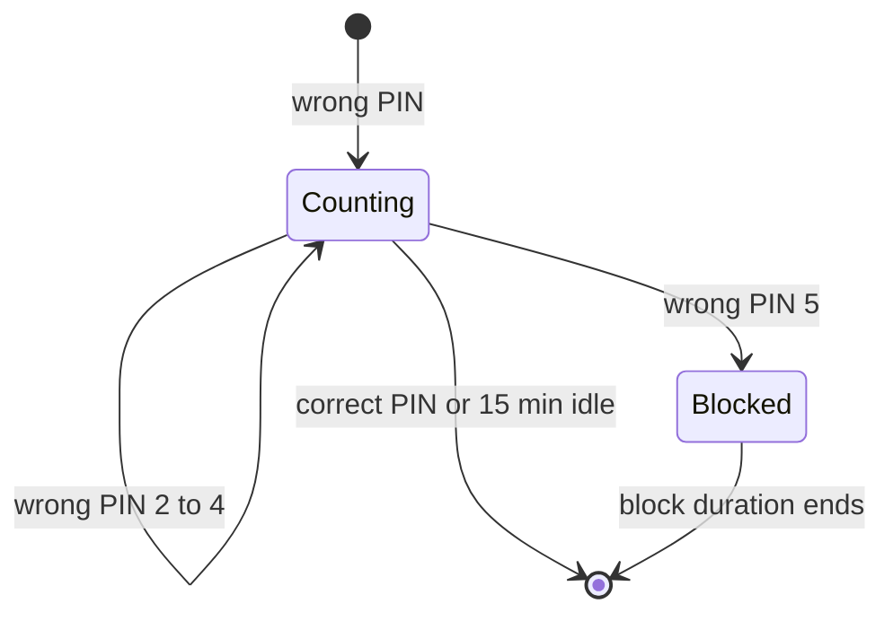

# Viewing access and PIN attempt scenarios

[Scenario index](../02-verification-contracts.md) · [Testing](../01-testing.md)

This page lists the test histories that protect MJPEG's viewing access. They cover which requests a protected stream admits, when the viewing credentials change, and how wrong PIN entries are limited. Use it when you change credential handling, rotation or PIN limiting and need to know which outcomes the change must preserve.

The scenarios build on these owners:

| Behavior | Owner |
| --- | --- |
| Credential kinds, token exchange, cookie attributes, PIN statuses, `Retry-After`, WebSocket denial messages | [HTTP server: Access and credentials](../../../docs/server.md#access-and-credentials) and [PIN verification](../../../docs/server.md#pin-verification) |
| Protection, PIN options and **Limit PIN attempts** as users see them | [Usage: Access](../../../docs/usage.md#access) |
| Credential rotation, request cutoff, attempt records and their capacity | [HTTP delivery](../../02-delivery/01-http-delivery.md) |
| Saved PIN preparation and PIN edits | [Settings](../../01-module/04-settings.md) |

Some request checks run before any access decision: Host, Origin and Referer validation, PIN body parsing and cross-origin cookie eligibility. Those belong to the [web protocol scenarios](08-web-protocol.md). The scenarios on this page link to them where the two meet.

## Components and terms

Three production pieces take part:

- [`HttpAccess`](../../../src/main/kotlin/io/screenstream/mjpeg/http/HttpAccess.kt) holds the applied access settings, the current viewing credentials and one attempt record per peer. It never reads a clock. Every call gets the time from its caller and must run under delivery's control monitor.
- [`KtorHttpDelivery`](../../../src/main/kotlin/io/screenstream/mjpeg/http/KtorHttpDelivery.kt) calls `HttpAccess` with `SystemClock.elapsedRealtime()`. It also rejects calls from listeners that are no longer current, and closes media readers and WebSocket calls when credentials change.
- [`WebRoutes`](../../../src/main/kotlin/io/screenstream/mjpeg/http/web/WebRoutes.kt) turns access results into HTTP and WebSocket responses. It supplies the peer address of the direct connection.

The scenarios use these terms:

- **Viewing credentials:** the random token and cookie that delivery creates together while protection is on. Open access has none.
- **Rotation:** replacing or removing that pair. Each rotation increments the **credential generation**, which shuts out WebSocket connections that were admitted under the old pair.
- **Immediate peer:** the remote IP address of the direct TCP connection, as the transport reports it. Forwarded headers never change it.
- **Attempt record:** the wrong-PIN count and expiry deadline kept for one immediate peer. A record with one to four wrong entries is *counting*, and it expires 15 minutes after its latest wrong entry. The fifth wrong entry makes it *blocked* until the applied block duration ends.

Turning protection off, or turning off **Limit PIN attempts**, discards every record at once.

## Test layers and evidence

[Testing](../01-testing.md) defines the layers, the test-source coverage and the evidence rules. For access they work as follows:

- **L0** exercises `HttpAccess` directly with explicit times. Use it for counting, blocks, expiry, capacity and rotation decisions.
- **L1** runs delivery and routes in the Ktor test engine or over CIO loopback. Use it to observe statuses, `Retry-After`, WebSocket denial messages, reader closure and accounting. Delivery reads `SystemClock.elapsedRealtime()`, so the test must control that clock. Coroutine virtual time does not move it.
- **Assertions** check whether a request is accepted or refused. Don't compare random credential values, their hash codes or their inequality: a new value can match an old one by chance.

## Credentials and rotation

### Open and protected viewing

**Setup.** Apply open access. In a separate history, turn on protection with a saved valid PIN.

**Steps.**

1. Request `/jpeg` and `/mjpeg` with each of these credentials: the current token, the current cookie, a wrong value of the same length, a value of another length, and none at all.
2. Send a request with a matching `Origin` and no credential.
3. Submit each of these PINs: the correct one, a wrong six-digit one, five digits, seven digits, letters, non-ASCII digits such as `١٢٣٤٥٦`, an empty value and a missing field.
4. Try to apply protected settings that carry no PIN.

**Expected.**

- Open access authorizes every media request. Every PIN submission that passes the origin check succeeds without a cookie.
- Protected access authorizes media only with the current token or the current cookie. A matching `Origin` adds no authority.
- Only six ASCII digits equal to the applied PIN authorize. Every other value is a wrong PIN. With limiting on, it counts as described in [mjpeg-acc-04](#mjpeg-acc-04).
- `HttpAccess` refuses protected settings without a PIN rather than opening access. The settings transaction must supply the PIN ([mjpeg-set-06](01-settings.md#mjpeg-set-06)).

**Related.** [mjpeg-web-15](08-web-protocol.md#mjpeg-web-15) covers cookie eligibility on cross-origin media requests. [mjpeg-web-09](08-web-protocol.md#mjpeg-web-09) covers the refusal of the token on `/ws`.

### Repeated token exchange

**Setup.** Turn on protection so that current credentials exist. In a separate history, use open access.

**Steps.** Exchange the current token several times, as separate tabs would. Exchange a wrong token, an empty one and a missing one. Repeat a valid exchange from a peer that is currently blocked from PIN entry.

**Expected.**

- Every valid exchange returns the current cookie. Exchange never rotates credentials or changes the credential generation, so cookies held by other tabs keep working.
- An invalid exchange returns no cookie and leaves any existing valid cookie usable.
- Open access returns no cookie.
- Exchange neither reads nor changes attempt records, so a PIN block doesn't stop a valid token.

**Related.** [mjpeg-web-04](08-web-protocol.md#mjpeg-web-04) covers the `303` redirect and the cookie attributes on `GET /?token=`.

### Rotation versus policy-only edits

**Setup.** Turn on protection with an applied PIN. Confirm that the current token and cookie authorize media.

**Steps.** Starting from that state each time, apply one change:

- the same PIN, built as a new, independent value
- the other PIN option
- a change to **Hide PIN when starting a stream**
- limiting turned on or off
- a different block duration
- a different PIN
- protection off, then protection on again

In a separate history, change the saved PIN while protection is off.

**Expected.**

- Credentials rotate exactly when protection is switched on or off, or when the PIN changes while protection stays on. `updateSettings` reports each rotation, and the generation advances once per rotation.
- After an equal PIN or a policy-only edit, the old token and cookie still authorize, and the generation stays the same.
- After a rotation to a new protected pair (a different PIN, or protection turned on again), the old token and cookie are refused, and the new pair is accepted.
- After protection is turned off, access is open: every media request is admitted without any credential. Old token and cookie values are simply no longer needed. Test this open admission separately from refusal under a protected successor.
- Changing the PIN while access is open causes no rotation. When protection is turned on later, credentials are created together with the PIN applied at that moment.

**Evidence boundary.** Prove a rotation by old and new authorization, not by comparing random values.

### Rotation during acquired output

**Setup.** Turn on protection and make sure an image is selected. Hold four requests admitted under the current credentials:

- a writer partway through an image payload it has already acquired
- an MJPEG reader that is waiting for the next image
- a media call whose initial image hasn't reached its writer yet
- an authorized WebSocket

**Steps.** Rotate the credentials by changing the PIN. In a second history, rotate them by turning protection off. Then release the held work and send new requests.

**Expected.**

- The payload that was already acquired may finish.
- No old reader acquires another image. The waiting reader ends, and the initial image that never reached its writer is released.
- The old WebSocket sends no snapshot of the new generation, and its call is cancelled.
- Rotation clears client rows at once. Bytes that old writers complete afterwards still count in the global totals, but they don't recreate a client row.
- New requests are admitted immediately: with the new credentials, or with none after protection is turned off.
- Rotation to open access closes the old readers too, and their clients have to reconnect.

**Related.** [mjpeg-web-11](08-web-protocol.md#mjpeg-web-11) covers how the generation fences snapshots. Closing a reader doesn't interrupt transport I/O. The [HTTP runtime scenarios](05-http-runtime.md) cover how physical calls settle.

## Wrong-PIN limiting

Every history in this section uses protection with **Limit PIN attempts** on, unless a step changes it.

### Immediate-peer attempt budget

**Setup.** Use two or more listeners, a block duration *D*, and two peers, A and B.

**Steps.**

1. From A, submit wrong PINs through different listeners and from different remote ports.
2. Also from A, submit forms that reach verification without a usable `pin` value: a different content type, a missing field, a repeated field, and a body over 256 bytes.
3. From B, submit one wrong PIN.

**Expected.**

- A's first four entries are wrong and return `403`. The fifth blocks A on every listener for the remaining time *D* and returns `429`.
- B's record is independent of A's.
- Forms without a usable value count as wrong.

The budget is keyed by the immediate peer address. Forwarded headers never split or merge a budget ([mjpeg-web-14](08-web-protocol.md#mjpeg-web-14)). Different addresses of one device, such as its IPv4 and IPv6 addresses, count as different peers.

Some requests never reach verification and spend nothing:

- Host, Origin or Referer rejections ([mjpeg-web-03](08-web-protocol.md#mjpeg-web-03))
- requests on a listener that is no longer current ([mjpeg-web-07](08-web-protocol.md#mjpeg-web-07))
- body read failures and timeouts ([mjpeg-web-06](08-web-protocol.md#mjpeg-web-06))

### Blocked requests do not renew a block

**Setup.** Block peer A at time *t0*, so its deadline is *t0 + D*. A also holds an MJPEG stream that it opened with a valid cookie.

**Steps.** Advance time in steps. At each step, do the following from A:

- submit the correct PIN and a wrong PIN
- open `/ws` without a cookie
- open new media requests, one with the cookie and one with the token

**Expected.**

- Each PIN submission is blocked, with remaining time *deadline − now* that shrinks as time advances.
- Neither the correct PIN nor a wrong one authorizes, extends the deadline or adds to the count.
- The WebSocket without a cookie receives `blocked` with the same remaining time.
- The open stream continues, and new requests with valid credentials are admitted.

### Success and exact expiry

**Setup and steps.** Run these histories separately. Use explicit times, not sleeps.

1. From A, submit one to four wrong PINs, then the correct PIN.
2. Block A. Then submit from A one millisecond before the deadline and again exactly at it, each time once with the correct PIN and once with a wrong one.
3. Block A again. Then submit from A only after the deadline has passed, for example one second later. Submit the correct PIN in one run. In another run, submit wrong PINs until A is blocked again.

**Expected.**

- In the first history, the correct PIN authorizes and removes A's record. The next wrong PIN counts as the first one again.
- In the second history, A is still blocked one millisecond before the deadline, with 1 ms remaining, which HTTP reports as `Retry-After: 1`. At the deadline, the record has expired. The correct PIN authorizes, and a wrong PIN starts a new count at one.
- In the third history, the expired block has no effect after the deadline either. The correct PIN authorizes. A wrong PIN counts as the first of a fresh budget, so A needs five wrong entries before it is blocked again. The new block gets a new deadline from the applied duration.

### Limiter policy changes

**Setup.** Peer A has a counting record, and peer B is blocked.

**Steps.** Starting from that same state each time, run one of these changes:

- change the PIN while protection stays on
- change the block duration
- turn limiting off, submit wrong PINs, then turn limiting on again
- turn protection off, then on again

**Expected.**

- A PIN change rotates credentials but keeps every record. A's count continues, and B keeps its original deadline.
- A new block duration leaves B's deadline unchanged and applies from the next block onwards.
- Turning limiting off discards all records. While limiting is off, a wrong PIN creates no record, no block and no capacity wait. Turning limiting on again starts from an empty table.
- Turning protection off discards all records, and turning it on again starts from an empty table.

### Defensive deadline overflow

**Setup.** Supply a current time close to the largest value the time type can hold.

**Steps.** Submit a fifth wrong PIN so that a block starts. Separately, submit a single wrong PIN, whose record uses the 15-minute idle lifetime.

**Expected.** Deadline arithmetic stops at the maximum value instead of wrapping around. The reported remaining time stays nonnegative, and expiry follows that capped deadline.

**Evidence boundary.** This is an arithmetic check, not a prediction about real device clocks.

### Idle expiry and full peer capacity

**Setup and steps.**

1. Give A a counting record and let time pass. Check just before and exactly at 15 minutes after A's latest wrong entry. Also check that another wrong entry before then moves the idle deadline.
2. Fill the table with 1,024 peers that hold live records, some counting and some blocked. From a new peer N, submit the correct PIN and a wrong PIN, and open `/ws` without a cookie. Submit the correct PIN from a known counting peer, and any PIN from a known blocked peer.
3. Let one record expire, then repeat N's request.

**Expected.**

- A counting record expires 15 minutes after its latest wrong entry. A wrong entry after that counts from one again.
- While all 1,024 records are live, N must wait until the earliest record expires before its PIN is compared, even when the PIN is correct. HTTP answers `429` with that wait, and the WebSocket answers `blocked` with it. The wait creates no record for N and changes no existing deadline.
- A known counting peer's PIN is still compared. A correct PIN authorizes and removes its record, which frees a slot.
- A known blocked peer receives its own remaining time.
- Verification and denied WebSocket admission both discard expired records without refreshing the others. Once a record has expired, N's PIN is compared.
- Requests with valid credentials keep working throughout.

**Evidence boundary.** The 1,024 limit bounds this table only. It doesn't limit connections or transport memory overall.
