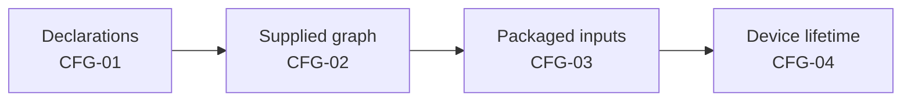

# Integration inspections and packaged-app smoke

[Scenario index](../02-verification-contracts.md) · [Testing](../01-testing.md)

These scenarios check that MJPEG is installed into the app correctly. Each step widens the scope: MJPEG's own declarations, then a dependency graph that a test supplies, then the packaged app's inputs, and finally a real lifetime on a device.

Three guides own the contracts being checked:

- [Architecture](../../../docs/architecture.md#hosting-and-coordination) describes the parts being connected.
- [Module integration](../../01-module/01-module-integration.md) describes MJPEG's obligations at those seams.
- [Core](../../../../core/README.md) defines the shared host contracts.

Core's manager, its Service base class, the consent and permission hosts, and the Capture Engine have their own verification. These scenarios check only that MJPEG meets them correctly.

Each step adds evidence that the earlier ones can't provide. Reading a declaration says nothing about the merged APK, and a test graph says nothing about how the real app resolves its dependencies.

## MJPEG-CFG-01: Inert metadata and declared Service

**History.** Inspect `MjpegStreamingModule`, its string resources and the module manifest. Then list the descriptor the way the app's module catalog does.

**Expected.**

- The descriptor identifies the selectable mode:
  - ID `MJPEG` and priority 40
  - name, description and details resources
  - `MjpegStreamingModuleService` as its Service class
  - foreground notification slot 400
- The descriptor is a process-wide singleton bound as `StreamingModule`. Listing or reading it creates no controller, HTTP delivery, discovery or capture work.
- The manifest declares the Service as not exported. It has the foreground types `specialUse|mediaProjection` and a special-use subtype that describes the local HTTP server.
- The manifest requests these permissions: `INTERNET`, `ACCESS_LOCAL_NETWORK`, `ACCESS_NETWORK_STATE`, `WAKE_LOCK`, `FOREGROUND_SERVICE`, `FOREGROUND_SERVICE_SPECIAL_USE` and `FOREGROUND_SERVICE_MEDIA_PROJECTION`.

**Evidence boundary.** Source declarations don't establish the merged manifest or the packaged APK. [CFG-03](#mjpeg-cfg-03) checks those.

## MJPEG-CFG-02: DI and exact ManagerHandle installation

**History.** Inspect the Koin annotations. Then, in a graph the test supplies:

1. Let the real Service create the real controller with its `ManagerHandle`.
2. Resolve a second controller for another instance.
3. Route commands, reports and cleanup through both.

**Expected.**

- **Bindings.**
  - `MjpegKoinModule` is a component-scanned configuration.
  - The descriptor is a singleton.
  - The controller is a factory whose `ManagerHandle` and Service are injected parameters.
  - `MjpegSettings` is a singleton.
  - `HttpDelivery` and `NetworkAddressMonitor` are created per resolution.
- **Per-instance owners.** Each module instance therefore gets its own HTTP delivery and discovery, and all instances share one saved-settings store.
- **Exact handle and Service.** The Service passes its exact handle and itself, and the controller's `instanceId` equals the handle's.
- **Inert construction.** Construction stays inert until `startModule()` ([CTL-01](02-controller.md#mjpeg-ctl-01)).
- **Retained targets.** Commands, status reports, failure reports and cleanup all target that original handle and Service, including after the handle stops being current.

**Evidence boundary.** A replacement graph supplied by a test can't show that the real application graph resolves. That needs the packaged app ([CFG-03](#mjpeg-cfg-03), [CFG-04](#mjpeg-cfg-04)). Core owns the [module and controller collaboration](../../../../core/docs/module-contract-and-manager.md#how-they-collaborate).

## MJPEG-CFG-03: Manifest, dependency and host boundaries

**History.** Inspect the current build declarations: the [module build](../../../build.gradle.kts), the [root build](../../../../../build.gradle.kts), the [app build](../../../../../app/build.gradle.kts), the [settings build](../../../../../settings.gradle.kts) and the [version catalog](../../../../../gradle/libs.versions.toml). Those files own the current SDK, toolchain and dependency values, and this page doesn't repeat them. Then separately inspect the packaged app: its merged manifest, its resolved dependencies and the hosts it supplies. Record what you find as inspection evidence. An inspection runs nothing.

**Expected.**

- **SDK and toolchain declarations.**
  - The root build defines the shared minimum SDK, compile SDK, target SDK and build-tools values.
  - The MJPEG library takes its minimum SDK, compile SDK and build tools from those values, and declares no target SDK of its own.
  - Android enforces the packaged app's target SDK, which the app build sets. Read it from the merged manifest of the build being qualified, not from the library.
  - The module build sets one JVM toolchain for production code and a separate Java launcher for unit tests. The test launcher says nothing about the shipped bytecode or the device runtime.
  - Record the values in force for the build being qualified.
- **Transport dependencies.**
  - The module build declares the Ktor server CIO, compression, default-headers and WebSocket artifacts for production, and the Ktor test host for tests only. Their versions are references into the shared version catalog.
  - A catalog entry is a declaration, not a resolved version: dependency resolution can select another version. The test host must not reach the packaged app's runtime classpath.
  - Dependencies resolve from Google and Maven Central, and the settings build rejects repositories declared by individual projects.
  - The inspected scripts and catalog contain no dependency substitution, no included Ktor build and no patched transport sources.
  - Confirm the Ktor artifacts and versions that the packaged app's runtime classpath actually resolves, for example with Gradle's dependency report. Record any substitution or patch you find, or record that there is none.
- **Other project dependencies.** For the build inspection, also record that the module depends on the repository's common, Core and Capture Engine projects.
- **Merged manifest.** The packaged manifest still declares the Service as not exported, with the same foreground types and permissions. Nothing in the app removes them.
- **App-supplied hosts.** The app provides the Activity-root hosts that MJPEG relies on:
  - `LocalRuntimePermissions`, for the address row's permission action ([Runtime Permissions](../../../../core/docs/runtime-permissions.md))
  - the screen-capture consent host, for Start ([Screen Capture Access](../../../../core/docs/screen-capture.md))
  - the notification provider, for foreground content ([Streaming Module Notifications](../../../../core/docs/notifications.md))
- **Fresh grant.** MJPEG still checks the current local-network grant itself before it plans listeners or accepts Start. A permission UI hint from the host is not a grant.

**Evidence boundary.** Declarations and a resolved dependency list show what was built, not how it behaves. This inspection doesn't test the app's capture explanation, rationale history or permission launchers. Core and the app own those.

## MJPEG-CFG-04: Qualified real lifetime

**History.** Use a recorded build on a device, with a viewer on a second device:

1. Select MJPEG mode and open the page from the viewer before pressing Start.
2. With protection on, also open a ready access link.
3. Start, grant consent and show recognizable content.
4. Stop, then Start again.
5. Exit the mode and reopen it with the same saved preferences.

Repeat the reopening with protection on (once with each PIN option) and with protection off.

On API 37 with a build that targets API 37, also revoke and grant the local-network permission while the viewer is connected from the other device.

**Expected.**

- **Before Start.**
  - The page loads and shows the inactive image.
  - On a protected stream, the plain address asks for the PIN.
  - A ready access link exchanges its `token` for the viewing cookie and redirects to `/`, so the address bar no longer shows the token.
  - An address row offers a ready link only once its listener is listening with the current access applied. Until then, its actions use the plain address.
- **Start.**
  - Android asks for consent, unless Core reuses an earlier consent on an older Android version. Record which happened.
  - Stop becomes available once capture is confirmed. The first live JPEG can arrive a moment after that confirmation.
- **Stop.**
  - The page stays open with the stopped notice and the inactive image. Listeners, credentials and the PIN are unchanged.
  - Start works again.
- **Reopening with protection on.**
  - The previous instance's access link and viewing cookie no longer authorize. The new instance's ready link does.
  - With **New PIN on open**, opening prepares a PIN under that policy: the PIN shown is a valid six-digit value, and viewers can authorize with it. Don't require it to differ from the previous PIN.
  - With **Permanent PIN**, the saved PIN still authorizes.
- **Reopening with protection off.**
  - The plain address can be identical to before, and it keeps working. Open access admits requests whatever leftover token or cookie they carry.
  - Viewers get no PIN prompt, and the app shows no PIN row. The saved PIN stays in settings.
- **Fresh instance state.** The reopened instance inherits no captured image (Last frame shows the logo), no PIN blocks, no counters and no client history.
- **Local network.** Revoking the permission removes listeners on Wi-Fi, Ethernet and Other addresses, and granting it brings them back. A local bind, or a browser on the streaming phone, can't show this.
- **Reachability.** A listed address isn't a promise of reachability. Record the network used, such as Wi-Fi, a hotspot or a VPN, and whether the viewer device actually reached the stream.

**Record:**

- device, Android version, build and QPR
- the app's target SDK
- grant states for local network and notifications
- whether the whole screen or one app was shared
- the foreground and projection prerequisites from Core's [capture contract](../../../../core/docs/screen-capture.md)
- the network type

**Evidence boundary.** Browser rendering across browsers, the full range of image transforms, Engine backends and ABIs, and Core internals need their own checks.
